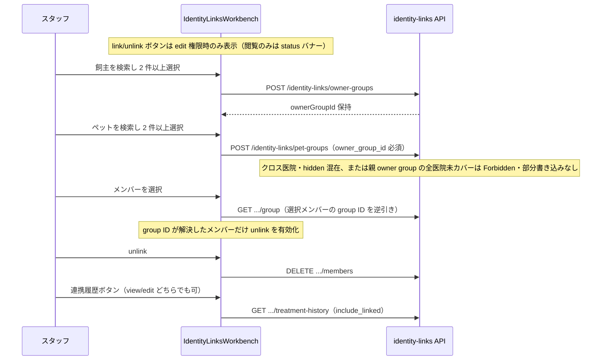

# 同一飼主・ペット連携 仕様書 (Identity Links)

| 管理項目 | 記載 |
|:---|:---|
| 文書ID・種別 | page.identity-links.workbench／D19 業務・画面仕様 |
| 決定状態 | 2026-10-17追加決定は末尾と進捗入口を参照。従来：既存記載を継承。明示済み合意と現行実装説明を分け、2026-10-15整理節の提案・未決は未承認 |
| 実装状態 | 既存記載を継承（今回の再監査なし）。既知gapを保持 |
| 実機検証状態 | 今回未実施。テスト名・過去証拠の掲載は再実行を意味しない |
| 文書確認日 | 2026-10-17追加差分（従来確認2026-10-15）。本文・参照・FR/AC整理。独立レビュー前 |

## 概要

- **画面の目的**: 所属医院内の飼主・ペットを手動で identity group にリンク／unlink し、連携先ペットの最小治療履歴を参照する（Phase 1 workbench）。
- **URLパターン**: `/identity-links`（`operations-routes.tsx` に lazy 登録。サイドバー常設ナビは持たない）。
- **アクセス権限**:
  - `identity-links:view` — ページ表示。未所持時は `IdentityLinksPage` が `/` へ `Navigate`（`ResourceIdentityLinks` + `usePermission`）。
  - `identity-links:edit` — リンク／unlink 操作の表示。閲覧のみのときは status バナー「閲覧のみ（link/unlink 権限なし）」。
- **スコープ**: 所属医院内の手動リンクのみ。権限のない医院 ID はサーバ側で拒否（UI 説明文と一致）。

---

## 1. 画面構成

### 1.1 シェル

- `PageLayout` タイトル「同一飼主・ペット連携」。
- `resource={ResourceIdentityLinks}`。
- 内部実装は `IdentityLinksWorkbench`（同一ファイル内）。

### 1.2 飼主リンク

- 検索入力（placeholder「氏名・カナ・電話」）。`useDebouncedValue` 300ms 後に `searchOwnersForLink`。
- ヒット一覧をトグル選択（clinic_id + owner_id）。
- `canEdit` 時: 「飼主をリンク」（選択 2 件以上）、メンバーごとの unlink。メンバー選択時に `findOwnerIdentityGroupByMember` で逆引きし、そのメンバーの group ID が解決した場合だけ unlink を有効化する。

### 1.3 ペットリンク

- 親の飼主 identity group（`ownerGroupId`）が必要である旨を表示。
- 検索入力（placeholder「ペット名・番号」）→ `searchPetsForLink`（300ms debounce）。
- `canEdit` 時: 「ペットをリンク」（ownerGroupId ありかつ選択 2 件以上）、メンバーごとの unlink。メンバー選択時に `findPetIdentityGroupByMember` で逆引きし、そのメンバーの group ID が解決した場合だけ unlink を有効化する。
- 選択ペットごとに「連携履歴」ボタン → `getLinkedTreatmentHistory`（view/edit どちらでも可）。結果は plain text /「（履歴なし）」。

### 1.4 空・エラー・pending

- 検索クエリ空: ヒット一覧をクリア（専用 empty コピーなし）。
- 失敗: `role="alert"` のインラインエラー。
- 閲覧のみ: `role="status"` バナー。
- ミューテーション／履歴取得中は `useTransition` の pending でボタン disable。

---

## 2. 主要フロー・制約

1. 飼主を 2 件以上選択 → 飼主グループ作成 → `ownerGroupId` 保持。既存メンバーを選択した場合はメンバー逆引き GET で group ID を解決する。
2. その group を親にしてペットを 2 件以上選択 → ペットグループ作成。既存ペットの選択時も同様にメンバー逆引き GET を行う。
3. group ID はメンバーごとに保持する。そのメンバーの逆引きが成功した場合だけ unlink を有効化し、別メンバーの session group ID を使って unlink を有効化しない。
4. クロス医院の無断リンクはサーバ拒否。fail-closed の権限デフォルト（新規医院テンプレートに identity-links を付けない）。
5. **親飼主 group の全医院セット必須（mutation）**: ペット group 作成（`CreatePetGroup`）では、actor が親 owner group の **anchor（`CreatedClinicID`）＋全 active owner member の clinic** および全 pet clinic に所属していること。1 医院でも欠けると Forbidden・ゼロ書き込み。any-member フォールバックは禁止（`assertActorCoversOwnerGroupClinics`）。既存 pet group の Add/Unlink は `assertCanManagePetGroup`（pet group anchor + owner-group anchor + 全 pet member clinics）。閲覧（GET/search/history）は actor clinic でフィルタ可。

---

## 3. 臨床安全・アクセシビリティ

- 本画面は臨床記録の直接編集ではなく identity 運用。誤リンク防止のため **edit 必須** で create/unlink を隠す。
- 検索・履歴の失敗を空成功にしない（alert 表示）。
- セクションは `aria-label`（飼主リンク／ペットリンク）。status / alert ロールを使用。

---

## 4. 技術仕様

### 構成

| 要素 | 役割 |
|:---|:---|
| `IdentityLinksPage` | view ゲート + workbench 委譲 |
| `IdentityLinksWorkbench` | 検索・選択・link/unlink・履歴 |
| `usePermission` / `ResourceIdentityLinks` | view / edit |
| `useDebouncedValue` | 検索 300ms |
| `identity-links-api.ts` | HTTP クライアント |

### API連携（本画面が呼ぶもの）

| メソッド | エンドポイント | 用途 | 必須アクション |
|:---|:---|:---|:---|
| GET | `/api/v1/identity-links/owners/search` | 飼主検索 (`q`, `limit`) | `view` |
| GET | `/api/v1/identity-links/pets/search` | ペット検索 | `view` |
| GET | `/api/v1/identity-links/owners/:clinic_id/:owner_id/group` | 選択した飼主メンバーの group 逆引き | `view` |
| GET | `/api/v1/identity-links/pets/:clinic_id/:pet_id/group` | 選択したペットメンバーの group 逆引き | `view` |
| POST | `/api/v1/identity-links/owner-groups` | 飼主グループ作成 | `edit` |
| DELETE | `/api/v1/identity-links/owner-groups/:groupId/members` | 飼主メンバー unlink | `edit` |
| POST | `/api/v1/identity-links/pet-groups` | ペットグループ作成（`owner_group_id` 必須） | `edit` |
| DELETE | `/api/v1/identity-links/pet-groups/:groupId/members` | ペットメンバー unlink | `edit` |
| GET | `/api/v1/identity-links/pets/:clinicId/:petId/treatment-history` | 連携治療履歴（`include_linked`, page, limit） | `view` |

### BE 追加ルート（Phase 1 UI 未使用・OpenAPI 契約済み）

| メソッド | エンドポイント | 用途 | 必須アクション |
|:---|:---|:---|:---|
| GET | `/api/v1/identity-links/owner-groups/:id` | group 取得（可視メンバーのみ） | `view` |
| POST | `/api/v1/identity-links/owner-groups/:id/members` | 飼主メンバー追加 | `edit` |
| GET | `/api/v1/identity-links/pet-groups/:id` | pet group 取得 | `view` |
| POST | `/api/v1/identity-links/pet-groups/:id/members` | ペットメンバー追加 | `edit` |

OpenAPI 正本: `backend/docs/api.yaml`（`/identity-links/*`）。ルート drift gate は `backend/internal/apicontract/openapi_route_drift_test.go` が identitylink package を walk。

### 関連

- ルート: `frontend/src/app/routes/operations-routes.tsx`
- Feature: `frontend/src/features/identity-links/`
- 製品 leaf 数の正本は `route-inventory.test.tsx`。本ファイルは **画面仕様インデックス上の 1 葉**であり、product leaf 数と「番号付き md ファイル数」は一致しない。

---

## 5. Phase 1 Acceptance Criteria（証拠）

| AC | 要件 | 証拠 |
|:---|:---|:---|
| AC-1 | 手動 link/unlink（飼主・ペット） | BE: `CreateOwnerGroup` / `UnlinkOwnerMember` / `CreatePetGroup` / `UnlinkPetMember` + FE workbench ボタン。OpenAPI: POST/DELETE owner-groups・pet-groups members |
| AC-2 | clinic-scoped linked treatment history | `ListLinkedTreatmentHistory` + `include_linked` 相関 `(clinic_id,pet_id)` のみ。FE: `getLinkedTreatmentHistory`。Test: `TestListLinkedTreatmentHistory_*` |
| AC-3 | mixed / hidden / cross-clinic IDs は **全体 reject・部分書き込みなし** | `assertOwnerRefsInActorScope` / `assertPetRefsInActorScope` + lock length check。Tests: `TestCreateOwnerGroup_RejectsMixedCrossClinic_NoPartialWrite`, `TestCreatePetGroup_RejectsMixedCrossClinic_NoPartialWrite`, `TestAddOwnerMembers_RejectsMixedCrossClinic_NoPartialWrite`, `TestAddPetMembers_RejectsMixedCrossClinic_NoPartialWrite`, `TestCreateOwnerGroup_RejectsHiddenOwner_NoPartialWrite` |
| AC-3b | 親 owner group の **全医院**（anchor + active members）を actor がカバーしない CreatePetGroup は Forbidden・ゼロ書き込み | `assertActorCoversOwnerGroupClinics`。Tests: `TestCreatePetGroup_RejectsMissingParentOwnerAnchorClinic_NoPartialWrite`, `TestCreatePetGroup_RejectsMissingParentOwnerMemberClinic_NoPartialWrite`, `TestCreatePetGroup_AllowsWhenActorCoversAllParentOwnerAndPetClinics` |
| AC-4 | audit は business write と同一 tx・fail-closed | `writeAudit` 失敗で callback error。PHI（name/phone）を audit payload に含めない（IDs のみ）。Tests: `TestCreateOwnerGroup_AuditFailureRollsBack`, `TestCreateOwnerGroup_NilAuditFailClosed`, `TestCreateOwnerGroup_SuccessWritesAuditWithoutPHI` |
| AC-5 | 権限 fail-closed（view/edit） | routes: GET=view, link/unlink=edit。FE: view なし → `/` Navigate、edit なし → 閲覧バナー。Tests: `handler_permission_test.go`, `IdentityLinksPage.test.tsx` |
| AC-6 | OpenAPI と RegisterRoutes の route 一致 | identity-links 全 13 ルートを `api.yaml` に記載。reverse-lookup 2 本を known-missing allowlist から除去済み |

**Out of scope (Phase 2 / DEC-46)**: 自動link・merge。候補提示は2026-10-17にD04登録時の同一確認用途として採用済みで、一律Phase2除外を置換する。手動groupの既存操作と自院利用は区別する。

---

## D19の手動連携・監査境界整理（2026-10-15）

### 対象・用語・責務

identity groupは複数の既存飼主／ペット記録を手動で関連付ける関係であり、元レコードのmerge・患者ID付替え・削除ではない。氏名類似による自動統合は採用しない。D04の氏名／動物種＋ペット名候補表示とスタッフ確認は採用済みで、手動group再設計を意味しない。LINEアカウント紐付けはD20、基本台帳登録はD04、各臨床記録writeは各ownerが所有する。

本節は本文とPhase 1 ACの既存記載を業務条件に対応付ける。所属医院内の既存scopeを保持する。本文にあるanchorと全member clinic集合のサーバ検証はscope防御の技術契約であり、本整理が医院間利用や閲覧範囲を新たに許可するものではない。実際のstaff所属／grant・実装適合は未確認。

### 操作・状態・不変条件

| 要件ID | 操作・契約 | 根拠と決定状態 |
|:---|:---|:---|
| FR-identity-manual-relation | 既存重複の手動関係操作では2件以上の飼主を選択してgroupを作る。共通患者の自院利用の前提として2件目の重複登録を要求しない。ペットgroupは親owner groupを必要とする。元台帳/診療記録の統合を兼ねない | 本文§1〜2・Phase 2除外の既存継承 |
| FR-identity-member-group-resolution | unlinkは対象メンバー自身のgroup逆引き成功後にのみ有効にする。他メンバーのsession group IDを流用しない | 本文§1.2/1.3、§2 |
| FR-identity-authorized-scope | view/editを分離し、hidden/許可外clinic混在は全体拒否、部分書込をしない。親groupの必要clinic集合を満たさないmutationを拒否する | 本文§2、既存AC-3/3b/5 |
| FR-identity-audit-atomicity | business writeと監査は同一transactionで、監査失敗/依存欠落時fail-closed。監査payloadはIDのみでname/phoneを載せない | 既存AC-4 |
| FR-identity-history-read | 連携履歴はview権限とclinic/pet相関で読み取り、検索/履歴失敗を履歴なしへ置き換えない | 本文§1.3/3、既存AC-2 |

### 受入条件

既存AC-1〜6（AC-3b含む）の証拠リンクは保持する。以下は独立した業務受入の追跡で、既存テストを本日実行した意味ではない。

| 条件ID | Given（前提） | When（操作） | Then（期待結果） | 独立確認・成功条件・確認手順／証跡 |
|:---|:---|:---|:---|:---|
| AC-identity-view-only | viewありeditなし | ページを開く | 閲覧バナーと読取を提供しlink/unlinkを許可しない | 本文§1/既存AC-5 |
| AC-identity-no-view | viewがない | 直接URLを開く | ページ表示を許可しない | 本文概要/既存AC-5 |
| AC-identity-selection | 選択が2件未満、または親owner groupなし | group作成を試みる | 対応する作成条件を満たすまで実行不可 | 本文§1.2/1.3 |
| AC-identity-member-lookup | Aのgroup解決済み、Bは未解決 | Bをunlinkしようとする | AのIDを流用してBのunlinkを有効化しない | 本文§2.3 |
| AC-identity-scope-mixed | 可視/hiddenまたは許可外clinic IDが混在する | mutationする | 全体reject、部分書込みなし | 既存AC-3の試験参照を保持 |
| AC-identity-parent-scope | 親owner groupの必要clinic集合を満たさない | pet groupを作成する | Forbidden、ゼロ書込み | 既存AC-3bの試験参照を保持 |
| AC-identity-audit-failure | 監査依存欠落/監査書込失敗 | link/unlinkを保存する | business writeも保存しない | 既存AC-4。runtime再実行なし |
| AC-identity-no-phi-audit | link操作を記録する | 監査payloadを生成する | IDを記録しname/phoneを含めない | 既存AC-4の証拠参照 |
| AC-identity-history-failed | 履歴取得が失敗する | 結果を表示する | alertとし履歴なしの成功へ変換しない | 本文§1.4/3 |
| AC-identity-no-merge | 手動linkが成功する | 元台帳/臨床記録を扱う | 関係操作だけを根拠に元記録のmerge/削除/患者付替えを行わない | Phase 2除外と各owner境界を照合 |

### 再送・同時編集・未決の扱い

2026-10-15に `backend/internal/identitylink/service_owner.go`、`service_pet.go`、`request.go` を静的照合した現行契約。UIのpending無効化だけで一度処理を保証せず、以下の同一関係収束と結果再取得を区別する。

| 操作 | 現行結果・競合境界 |
|:---|:---|
| owner/pet group作成 | 正規化後2メンバー以上。既存active member集合と完全一致するgroupは、全認可後に同じgroupを返す。部分重複した別groupを自動mergeしない |
| member追加 | 1件以上。同じgroupに既所属なら重複追加せず、別group所属は競合。変更があった場合だけ変更監査を記録する |
| owner unlink | 対象active memberがなければNotFound。親owner groupにactive pet groupがある間はConflictで、先にpet連携を解除する。pet groupを無断で切断しない |
| pet unlink | 親owner groupを先にlockし、次にpet groupをlock。事前読取後に親が変わった場合はConflict。対象不在はNotFound |
| unlink後 | 残り1人/1頭ならgroupを残す。0メンバーになったgroupだけ論理削除する。元owner/pet台帳を削除しない |
| atomicity | 対象refsをlockし、scope/親group全医院認可と必要監査を同一transactionで検査。失敗は関係writeもrollback |
| 通信結果不明 | 同じ対象のgroup逆引き/メンバーを再取得し現状態を確認する。unlink再送のNotFoundだけで初回失敗と断定しない。HTTP期待版や一般的なoperation receiptは現行requestにない |

| 条件ID | Given（前提） | When（操作） | Then（期待結果） | 確認根拠 |
|:---|:---|:---|:---|:---|
| AC-identity-identical-create | 同じactive member集合のgroupがある | 同集合で作成 | 認可後に同じgroupへ収束し新groupを増やさない | service_owner/service_pet |
| AC-identity-overlap | 選択memberが別groupに一部所属 | 作成/追加 | 自動mergeせず競合、部分追加なし | 同serviceの所属検査 |
| AC-identity-add-existing | memberが既に対象group所属 | 再追加 | 重複memberを増やさない | 同serviceの既所属skip |
| AC-identity-parent-unlink | owner groupにactive pet groupあり | owner unlink | Conflict、親だけ切れてpet関係が孤立しない | service_owner |
| AC-identity-last-members | unlink前に2人または1人 | unlink | 残り1ならgroup維持、0ならgroupのみ論理削除 | 両serviceのremaining count |
| AC-identity-pet-parent-race | pet groupの親が事前取得後に変更 | pet mutation | 親先行lockと親一致検査でConflict、部分writeなし | service_pet |
| AC-identity-unlink-retry | 初回unlinkの応答が不明 | 状態照会/同対象再送 | 既に解除済みのNotFoundを重複削除/元台帳削除へ置換しない | 現行NotFoundと関係境界 |

臨床履歴の保存期間・削除はC05/各ownerへ委ねる。これは既存scopeの技術照合であり、医院間利用範囲の新規承認ではない。

### 正本・関連

本画面の既存Phase 1 AC、API表、[文書状態規約](../authoring-guide.md#status)を参照する。台帳D04とLINE本人紐付けD20の利用範囲は別々に確認し、D19の操作権限から他ownerのwrite権限を導出しない。

## 2026-10-17確定仕様との接続

[決定根拠・適用範囲](../domains/SPECIFICATION_PROGRESS.md#confirmed-business-decisions-20261017)：ユーザーの2026-10-16〜17 JSTの直接決定、文書更新承認は10月17日03:20 JST。以下は目標仕様・未実行の受入条件であり、実装・実機合格を示さない。

[業務正本・受入条件](../domains/owners-pets/lifecycle.md#common-owner-pet-20261017)。氏名または動物種＋ペット名の候補をスタッフ確認し、同一飼主は警告して新規停止、別人は可、新ペットは既存飼主へ追加する。他院既存患者の自院利用と共通最新基本情報を採用し、院別診療・金銭記録と認可は維持する。旧他院行／ID一律拒否を自院利用へ機械適用しない。共有ID・既存重複移行・link/unlink方式は未選定で、重複作成を自院利用条件にしない。
