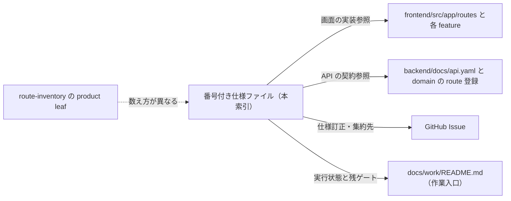

# 画面詳細仕様書 インデックス (Screen Specifications Index)

> **目的**: 画面仕様書と画面ナビゲーションのインデックスを提供する。
> **読者**: 新規参加エンジニア・PdM。
> **タイミング**: 画面インデックス参照・全体像把握時。
> **編集時のルール**: [CLAUDE.md](CLAUDE.md) を参照。

本ディレクトリ直下の番号付き仕様（`[0-9]*.md`）は **41 ファイル**（フロー文書 `99-medical-record-flow` を含むため「41 画面」ではない）。製品ルートの product leaf 数（`route-inventory.test.tsx` が pin する **88**）とは数え方が異なり、88 leaf と番号付き仕様は many-to-one の文書グルーピングである。**route path → primary 仕様の一意な対応表は [ui-design-compliance.md §2](../ui-design-compliance.md) が正本**であり、本索引は文書単位の閲覧入口。redirect 専用 route は route code であって新しい画面ではない。

LIFF の別エントリーポイントアプリは leaf 集計の対象外: LIFF 健康・連携アプリ `frontend/liff/src/App.tsx` は画面 38 の仕様に、公開予約・状態機械 `frontend/line-reserve/src/App.tsx` は画面 37 の仕様に含まれる（別アプリであって main app の leaf route ではなく、画面数として「88 に 2 を加算」という数え方もしない）。

> 追記（2026-10-11 補完）: 番号付き仕様のない設定画面 2 つ — `/settings/bug-reports`（2026-09-26 コミット `48ec94c7`）と `/settings/chat-history`（2026-10-02 コミット `e9574b28a`）— の画面契約を [settings/README.md §バグ報告一覧](./settings/README.md#バグ報告一覧)・[§チャット履歴](./settings/README.md#チャット履歴) へ補完した（所有記録は上記コミットハッシュのまま。新しい番号付き仕様ファイルは作らず、本索引の 41 ファイル数は変わらない）。

画面の実装参照は `frontend/src/app/routes/` と各 feature、API の契約参照は `backend/docs/api.yaml` と各 domain の route 登録。GitHub Issue は本文に加えて後続の仕様訂正・集約先を確認する。Closed だけでは臨床承認・UAT・本番稼働の証明にならない。実行状態と残ゲートは [作業入口](../../work/README.md) を参照する。

---

## 🩺 臨床・診療コア (Clinical Core)

| No | 画面名 | 仕様書 | 概要 |
|:---|:---|:---|:---|
| 00 | **ペット選択** | [00-pet-selection.md](./00-pet-selection.md) | 新規データ作成時の共通検索・特定フロー。 |
| 01 | **当日の受付** | [reception-board.md](../domains/reception/pages/reception-board.md) | カンバン形式による院内稼働状況の管理。 |
| 02 | **予約管理** | [reservation-management.md](../domains/reservations/pages/reservation-management.md) | 月/週カレンダーによる予約枠とシフトの可視化。 |
| 05 | **カルテ一覧** | [medical-record-list.md](../domains/medical-records/pages/medical-record-list.md) | 全カルテの時系列検索。 |
| 06 | **カルテ詳細・入力** | [medical-record-form.md](../domains/medical-records/pages/medical-record-form.md) | SOAPS 形式の診療録作成（9 タブ構成）。 |
| 12 | **検査一覧** | [12-examinations-list.md](./12-examinations-list.md) | 検査オーダー状況と結果の進捗管理。 |
| 13 | **検査登録・結果** | [13-examinations-form.md](./13-examinations-form.md) | 数値検査の入力と基準値判定。未紐付け受信は1クリックで後付け。 |
| — | **検査受信** | `/lab-device`（`LabDeviceBoard`）／契約 [ADR-007](../../architecture/adr/007-lab-device-receive-and-commit.md)・ローカル受信 agent [ADR-008](../../architecture/adr/008-local-lab-device-agent.md) | 医院に設定された検査機器の単一掲示板。機器カードで受信状況をリアルタイム表示。本日診療中カルテをカード選択。日別の受信一覧。未紐付け・［取り消す］。医院セットアップで機器接続を1回許可。詳細契約は ADR、運用は ops/deploy。 |
| 14 | **予防接種一覧** | [14-vaccinations-list.md](./14-vaccinations-list.md) | 接種実績と次回予定の時系列リスト。 |
| 15 | **予防接種登録** | [15-vaccinations-form.md](./15-vaccinations-form.md) | ワクチン履歴記録と次回予定自動計算。 |
| 16 | **トリミング一覧** | [16-trimming-list.md](./16-trimming-list.md) | 施術予約と完了ステータスの管理。 |
| 17 | **トリミング登録** | [17-trimming-form.md](./17-trimming-form.md) | 施術内容の記録。画像は選択時にアップロードされ、object key で永続化（EMR-300）。 |
| 25 | **定期健診一覧** | [25-checkups-list.md](./25-checkups-list.md) | 健診履歴の参照と当日カルテ自動生成。 |
| 39 | **飼主カルテレポート** | [39-owner-report.md](./39-owner-report.md) | 同居ペットを選択し、1頭分の診療前確認・来院・履歴を別ウィンドウで俯瞰。 |

### 検査受信

索引行の契約は ADR-007。サイドバーの説明に使う文は次のとおり。

- **画面の目的**: 医院に設定された検査機器の受信を同一画面で見て、本日診療中のカルテへ紐付ける。

---

## 🛏️ 入院・ホテル管理 (Inpatient Care)

| No | 画面名 | 仕様書 | 概要 |
|:---|:---|:---|:---|
| 07 | **入院管理一覧** | [07-hospitalization-list.md](./07-hospitalization-list.md) | ボードビューによるケージ稼働状況の監視. |
| 08 | **入院詳細・記録** | [08-hospitalization-detail.md](./08-hospitalization-detail.md) | デイリーケア計画と時系列バイタル記録。 |
| 09 | **入院登録・編集** | [09-hospitalization-form.md](./09-hospitalization-form.md) | 入院基本情報と登録時治療プラン（料金明細スナップショット）の定義。 |

---

## 💰 会計・経営管理 (Finance & Admin)

| No | 画面名 | 仕様書 | 概要 |
|:---|:---|:---|:---|
| 03 | **飼主・ペット一覧** | [03-owners-list.md](./03-owners-list.md) | 顧客データベースの検索と参照。 |
| 04 | **飼主・ペット登録** | [04-owners-form.md](./04-owners-form.md) | 顧客情報の編集と Lステップ個別送信。 |
| 10 | **会計一覧** | [accounting-list.md](../domains/accounting/pages/accounting-list.md) | 請求履歴の検索とステータス監視。 |
| 11 | **会計精算** | [accounting-settlement.md](../domains/accounting/pages/accounting-settlement.md) | 保険窓口精算、決済、インボイス発行。 |
| 22 | **見積書一覧** | [22-estimate-list.md](./22-estimate-list.md) | 発行済み見積の有効期限と承認管理。 |
| 23 | **見積書作成** | [23-estimate-form.md](./23-estimate-form.md) | 概算費用の算出と飼主向け説明文編集。 |
| 26 | **見積書詳細** | [26-estimate-detail.md](./26-estimate-detail.md) | 見積内容の最終確認とステータス制御。 |
| 29 | **レジ締め・履歴** | [29-closing-aggregation.md](./29-closing-aggregation.md) | 日次売上の確定と現金の実査・履歴。 |
| 30 | **未納者一覧** | [unpaid-list.md](../domains/accounting/pages/unpaid-list.md) | 売掛金の把握と督促業務支援。 |
| 32 | **月次集計レポート** | [32-accounting-reports.md](./32-accounting-reports.md) | 経営分析用データの抽出と CSV 出力。 |
| 36 | **顧客集計ダッシュボード** | [36-aggregation-dashboard.md](./36-aggregation-dashboard.md) | 売上・来院頻度による顧客分析。 |

---

## 📦 設定・外部連携・監視 (Infrastructure & CRM)

| No | 画面名 | 仕様書 | 概要 |
|:---|:---|:---|:---|
| 18 | **在庫管理一覧** | [18-inventory-list.md](./18-inventory-list.md) | 品目別の在庫監視と発注点管理。 |
| 27 | **在庫登録・編集** | [27-inventory-form.md](./27-inventory-form.md) | 薬品・備品の基本情報管理。 |
| 24 | **シフト管理** | [24-shift-calendar.md](./24-shift-calendar.md) | スタッフ勤務と LINE 予約の連動. |
| 28 | **LINE 予約設定** | [28-line-reservation.md](./28-line-reservation.md) | 予約システム稼働ルールと文言編集・予約枠カレンダー. |
| 37 | **LINE 予約（飼主側）** | [37-line-reserve-owner-flow.md](./37-line-reserve-owner-flow.md) | 飼主が LINE から予約を作成・確認・キャンセルする 13 ステップのフロー。 |
| 38 | **LIFF 診察券・健康情報** | [38-liff-pet-health.md](./38-liff-pet-health.md) | 飼主向け LINE ミニアプリ。健康手帳（ワクチン記録）表示と LINE アカウント紐付け。 |
| 31 | **Lステップ連携設定** | [31-lstep-integration.md](./31-lstep-integration.md) | CPM 判定、配信自動化、各種プレフィックス設定。 |
| - | ├ **Lステップタグ管理** | [31-lstep-integration.md](./31-lstep-integration.md) | 連携タグのマスタ管理・コードマッピング。 |
| - | ├ **健診タグ一括同期** | [31-lstep-integration.md](./31-lstep-integration.md) | 健診対象者の抽出と一括タグ連携（プレビュー付）。 |
| - | └ **Lステップ顧客分析** | [31-lstep-integration.md](./31-lstep-integration.md) | CPM 分析と友だち属性推移ダッシュボード。 |
| 34 | **Lステップ配信監視** | [34-lstep-delivery-monitor.md](./34-lstep-delivery-monitor.md) | 自動配信トリガーの実行ログと失敗検知。 |
| 35 | **取扱説明書** | [35-internal-manual.md](./35-internal-manual.md) | システム内マニュアルの閲覧と編集。 |
| 40 | **同一飼主・ペット連携** | [40-identity-links.md](./40-identity-links.md) | 所属医院内の飼主・ペット手動 identity link と最小連携履歴。 |
| 21 | **ログイン** | [21-login.md](./21-login.md) | 認証プロセスとパスワード再設定。 |
| 19 | **医院マスタ設定** | [19-clinic-settings.md](./19-clinic-settings.md) | 医院基本情報と税務設定。 |
| — | **バグ報告一覧** | [settings/README.md §バグ報告一覧](./settings/README.md#バグ報告一覧) | 全医院共有のバグ報告ボード（サポート画面。`/settings/bug-reports`）。 |
| — | **チャット履歴** | [settings/README.md §チャット履歴](./settings/README.md#チャット履歴) | 全医院共有の LLM チャット ROOM ボード（サポート画面。`/settings/chat-history`）。 |

---

## 🛠️ 技術・共通基盤

- **[共通ダイアログ](./common-dialogs.md)**: 全画面で共有される検索、入力部品。
- **[カルテ保存フロー](../domains/medical-records/lifecycle.md)**: カルテの複雑なライフサイクル。
- **[マスタ設定ポータル](./20-master-settings.md)**: 各種定義データ管理の入り口。
- **[マスタ設定画面群 (settings/)](./settings/README.md)**: 個別マスタ設定画面の詳細仕様インデックス。

---

**静的照合**: 2026-09-06、基準コード `7c6592f9f`。本索引と配下仕様をコード・GitHub Issue の本文／コメントへ照合した日付付き記録であり、稼働環境・実機・UAT の再実行は含まない。実行状態の SoT は Plane workspace `baritechllc` / project `EMR`（hub `EMR-1`。`BRT-4` は履歴別名）、作業入口は [docs/work/README.md](../../work/README.md) を参照する。

## ドメイン別の本文配置

予約・受付・カルテ・会計の本文は [spec/ の入口](../README.md)から各 domains/ へ辿れます。本索引は全画面の閲覧入口として保持し、移設した番号の旧ファイルには移動案内だけを置きます。従来の番号付き41件は本文と移動案内を合わせた文書索引であり、88製品ルートの件数とは別です。カルテ保存契約は画面ではなく [lifecycle.md](../domains/medical-records/lifecycle.md) §2 が正本です。

## このフォルダの役割と使い方

既存画面仕様と、移設済み画面への互換案内の入口。

番号付き画面仕様、共通ダイアログ、settingsを保持する。移設済みの予約・受付・カルテ・会計本文をここへ戻して二重管理せず、横断フロー・保存契約も対応する正本へ参照する。

子フォルダ：[settings/](settings/README.md)

主要文書：主要文書は本書の既存索引・上記の読む順を参照します。

読む順：[全体仕様](../README.md) → 本索引または[88ルート対応](../ui-design-compliance.md) → 該当正本。[settings](settings/README.md)は共通マスタ・設定の入口。

正本・状態：[決定状態と検証状態の規約](../authoring-guide.md#status)に従い、各節・FRの承認根拠と実装／実機状態を別に読む。READMEへの掲載・フォルダ配置は承認や実装済みを表さず、対象外の既存仕様を新たに確定しない。既存の別名入口・索引の責務は維持し、本書は案内を補う。
