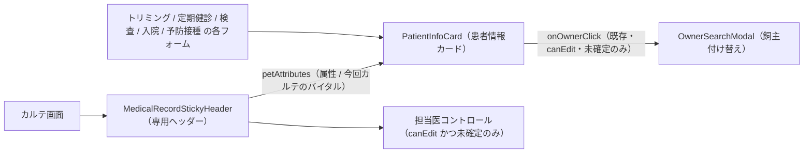

# 共通ダイアログ・共有コンポーネント 仕様書 (Shared UI Components)

## 概要
本システムは、全画面での UX の一貫性と、医療ミスを防ぐための「安全機能」を担保するため、高度に共通化されたコンポーネントライブラリを使用しています。

---

## 1. 臨床安全・ナビゲーション

### 1.1 患者情報カード (`PatientInfoCard`)
トリミング・定期健診・検査・入院・予防接種の各フォーム画面上部に常駐し、カルテ画面では `MedicalRecordStickyHeader` に内蔵される「単一の真実」（`features/trimming`, `features/checkups`, `features/examinations`, `features/hospitalization`, `features/vaccinations`, `features/medical-records`）。
- **臨床アラート**: 死亡 (`deceased`) ステータスを【死亡】バッジで強調。
以下のカルテ内蔵・クリック条件は現行mainの実装対応。旧finalizedによるUI制限を、[終了後通常編集・目的別訂正の業務目標](../domains/medical-records/lifecycle.md#medical-record-agreement-autosave-20261015)の代わりに採用しない。

- **属性表示**: 名前、年齢、性別、最新体重、担当医、保険、次回来院予定。`petDetails` は `formatPatientPetDetails` が組み立てる。`species` があるときは先頭に実データを出す。欠損の年齢・性別・去勢避妊だけ「不明」。カルテでは登録体重が未登録または空のとき `-` を表示する。独立登録（予防接種・定期健診・入院新規）も同じ関数を使う。
- **カルテ側の例外**: カルテ画面は `MedicalRecordStickyHeader` が `PatientInfoCard` を内蔵し、年齢・性別・避妊去勢・品種と今回カルテのバイタル（T / HR / RR / 測定体重）を `petAttributes`（ReactNode）スロットで差し込みます。担当医・来院種別などカルテ側の操作はカード外の専用コントロールに置くため、カードの該当フィールドは `hideStaff` / `hideReservationType` で隠します。他フォームは従来どおり `formatPatientPetDetails` の契約を使います。
- **クイックアクション**: `onOwnerClick` / `onStaffClick` 等のクリックコールバックを任意で受け取る。`onOwnerClick` を渡すのはカルテ画面（`MedicalRecordStickyHeader`）のみで、既存カルテかつ `medical-records` の `canEdit` かつ未確定のときだけ関数を渡し、呼び出し元の `OwnerSearchModal`（飼主付け替え）を開きます。新規・閲覧専用・確定済みでは渡さず、飼主名はボタンになりません（詳細リンクは残ります）。担当者変更はトリミングフォームの担当スタッフ選択と、入院登録・編集フォームの担当医選択で使用する（入院は `canSubmit` 時のみ）。カルテの担当医クリックは本カードの `onStaffClick` ではなく、`MedicalRecordStickyHeader` 側の専用コントロール（`canEdit` かつ未確定のときのみ）です。
- **関連仕様**: カルテ画面での内蔵方法・バイタルチップ・担当医導線の正本は `domains/medical-records/pages/medical-record-form.md` のスティッキー患者ヘッダー節です。
- **通常カルテのバイタル表示**: [D03の最新値・測定時刻／履歴](../domains/medical-records/pages/medical-record-form.md#requirement-fr-medical-records-vital-measured-time-history)に従い、同カルテの値と元の測定時刻を対応付け、同日を含む以前の測定は履歴で参照する。カルテの旧時刻なしチップは未追従差分。専用記録フォームへの新入力機能・飼主公開・薬量基準をこの参照から追加しない。

### 1.2 離脱防止ガード (`NavigationBlocker`)
React Router 7 の `useBlocker` を活用し、入力データの損失を物理的に防ぎます。
- **トリガー**: フォーム変更（`isDirty`）がある状態でのページ離脱。
- **挙動**: SPA内遷移はカスタム`ConfirmDialog`（`NavigationBlocker`自身）で確認。タブを閉じる/リロード等のブラウザレベル離脱はネイティブの `beforeunload` ダイアログで確認（こちらは併用する `useUnsavedChanges` フックが担当し、`NavigationBlocker` 単体の機能ではない）。

---

## 2. 検索・選択モーダル (Modals)

### 2.1 診療項目検索 (`TreatmentSearchDialog`)
数千項目のマスタから目的の処置を瞬時に特定します。
- **フィルタ**: 診察、検査、処置、予防、入院、薬剤のカテゴリチップ切り替え。
- **検索**: インクリメンタルなキーワード検索。

### 2.2 飼主検索・付け替え (`OwnerSearchModal`)
既存カルテの飼主を誤って登録した場合や、譲渡時の変更に使用します。
- **安全確認**: `OwnerSearchModal` 自身は選択のたびに汎用の「飼主変更の確認」ダイアログ（「飼主を「A」→「B」に変更します。よろしいですか？」）を無条件で表示する（値引率・会員区分の差異は判定しない）。会員区分・値引率が異なる場合の金額変動警告（BUG-373）は呼び出し元（`OwnerForm.tsx` の `handlePetChangeOwner`）側の別ロジックであり、`OwnerSearchModal` の機能ではない。

### 2.3 担当医選択 (`StaffSelectionModal`)
稼働中（在職）スタッフを職種別にグルーピングし、名前検索で臨床担当者を割り当てます。
- **注**: 実装は `features/medical-records/components/StaffSelectionModal.tsx` にあり、現状カルテ画面（`MedicalRecordForm`）専用。他画面から共有利用されているコンポーネントではない。

---

## 3. 入力・フィルタリング補助

### 3.1 属性入力 (`PropertyInput`)
Notion の操作感を踏襲したボーダーレス入力。
- **特徴**: 通常時はテキスト、フォーカスで入力枠が出現。画面を煩雑にせず、かつ高速な編集を可能にします。

### 3.2 高機能フィルタ (`PropertyFilter`)
- **動的条件**: ユーザーがその場で「かつ/または」条件を組み合わせてデータを抽出。
- **遅延描画**: `useDeferredValue` は `PropertyFilter` 自身ではなく利用側の一覧画面が検索キーワードへ適用し、大規模データのフィルタ中もタイピングの遅延が発生しません（遅延中の視覚フィードバックは共有 `FilteringIndicator` が担当）。

---

## 4. 技術仕様 (Common Standards)

- **アクセシビリティ**: 全てのモーダルは WAI-ARIA 準拠。`ESC` キーでの終了、フォーカストラップを完備。
- **パフォーマンス**: 頻繁に再描画される親画面の影響を避けるため、主要なモーダル・カード系部品（`PatientInfoCard`, `OwnerSearchModal`, `TreatmentSearchDialog`, `StaffSelectionModal`, `PropertyFilter` 等）は `memo()` 化されています。ただし本ページで扱う `PropertyInput` と `NavigationBlocker` は非 `memo()`。

---
