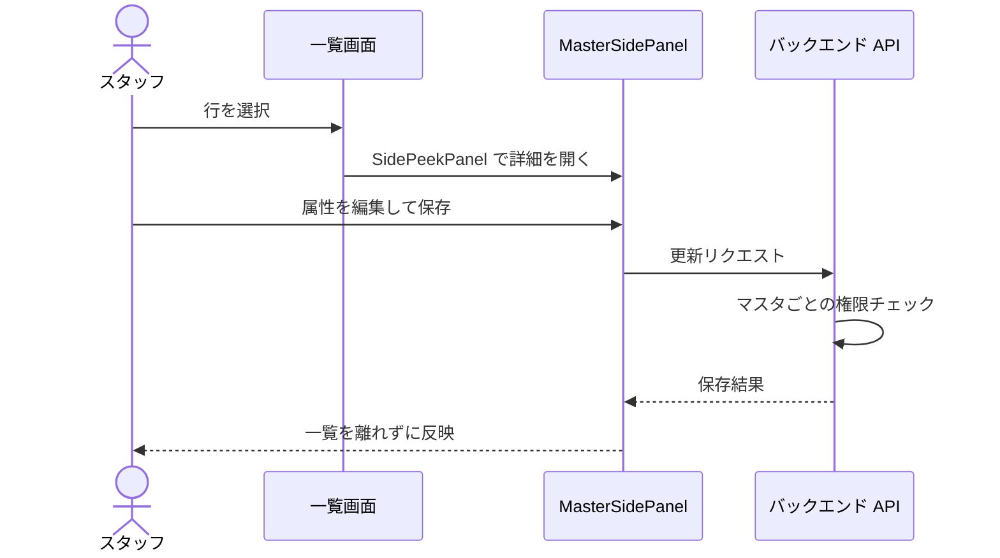

# 設定画面 仕様書インデックス (Settings Index)

本ディレクトリには、Animal Ekarte の各マスタデータの詳細定義・管理画面の操作仕様に加え、設定配下のサポート画面（バグ報告・チャット履歴）の画面契約を格納します。`/settings/*` 全 path と primary 仕様の対応表は [../../ui-design-compliance.md §2](../../ui-design-compliance.md) が正本。

---

## 🏗️ 基礎・共通マスタ

| マスタ名 | 仕様書 | 概要 |
|:---|:---|:---|
| **医院情報** | [../19-clinic-settings.md](../19-clinic-settings.md) | 院名、住所、登録番号、消費税率（通常/軽減）。 |
| **動物種別** | [master-animal-species.md](./master-animal-species.md) | 犬、猫、エキゾチック等の大分類。 |
| **職種** | [master-occupation.md](./master-occupation.md) | スタッフの役割（獣医、看護師等）の定義。 |
| **スタッフ** | [master-staff.md](./master-staff.md) | 氏名、職種、所属院、LINE 予約用プロフィール。 |
| **権限グループ** | [master-permission-group.md](./master-permission-group.md) | ロールごとの詳細なアクセス権限（CRUD）マトリックス。 |

---

## 🩺 医療・臨床マスタ

| マスタ名 | 仕様書 | 概要 |
|:---|:---|:---|
| **診療項目** | [master-treatment.md](./master-treatment.md) | 診察、処置、手術等の名称と標準価格。 |
| **主訴種別** | [master-chief-complaint.md](./master-chief-complaint.md) | 診察理由の大分類（消化器、皮膚等）。 |
| **薬剤** | [master-medicine.md](./master-medicine.md) | 薬品名、剤形、単価の定義（在庫紐付けは API のみで設定画面に UI 未実装）。 |
| **診断・病名** | [master-diagnosis.md](./master-diagnosis.md) | 疾患カテゴリと正式病名の体系的定義。 |
| **検査項目** | [master-examinations.md](./master-examinations.md) | 検査プランの名称・価格の定義（診療項目マスタと同一UIを共有。課税区分は保存されない）。 |
| **検査機器マスタ** | [マスタ設定のカルテ関連](../20-master-settings.md) / [ADR-007 §7 マスタ](../../../architecture/adr/007-lab-device-receive-and-commit.md) | `/settings/lab-device-item-masters`。機器項目と検査フィールドの対応を管理する。日常の受信操作は [検査受信ボード](../README.md)を参照。 |
| **問診/定型文**| [master-interview.md](./master-interview.md) | カルテ入力を効率化する各種テンプレート。 |
| **ケージ** | [master-cage.md](./master-cage.md) | 入院室の番号、サイズ、収容タイプ。 |
| **入院プラン** | [master-hospitalization-plan.md](./master-hospitalization-plan.md) | 入院・宿泊の単価・対象体格・料金単位の定義。 |

---

## ✂️ 専門サービスマスタ

| マスタ名 | 仕様書 | 概要 |
|:---|:---|:---|
| **トリミングコース種別** | [master-trimming-course-type.md](./master-trimming-course-type.md) | シャンプー・カット等、コースカテゴリの分類を管理。 |
| **トリミング** | [master-trimming.md](./master-trimming.md) | コース・オプションの定義（価格は対象サイズ区分のみ、犬種別ではない）。 |
| **予約区分** | [master-reservation-type.md](./master-reservation-type.md) | 診察、手術等の予約枠と LINE 公開設定。 |
| **シフトパターン**| [master-shift-template.md](./master-shift-template.md) | よく使う勤務時間と休憩時間のテンプレート。 |

---

## 💰 会計・外部連携マスタ

| マスタ名 | 仕様書 | 概要 |
|:---|:---|:---|
| **締め時間** | [closing-time-settings.md](./closing-time-settings.md) | AM/PM 境界、日界、休診日の管理。 |
| **支払方法** | [payment-methods.md](./payment-methods.md) | 現金、カード、QR 等の決済手段。 |
| **保険** | [master-insurance.md](./master-insurance.md) | ペット保険名称・補償率の管理（マスタ補償率の会計への自動設定は未実装。会計画面で選択した割合による控除計算は実装済み）。 |
| **割引キャンペーン** | [master-campaigns.md](./master-campaigns.md) | 会計割引ルールの期間・対象カテゴリ/商品設定。 |
| **販売商品** | [master-merchandise.md](./master-merchandise.md) | 療法食、ケア用品等の販売品。 |
| **LINE ページ** | [28-line-reservation.md §2](../28-line-reservation.md) | 飼主向け予約画面の案内文言カスタマイズ（LINE 予約設定仕様書へ統合）。 |

---

## サポート画面（2026-10-11 補完・番号付き仕様書は増やさない）

`/settings/bug-reports` と `/settings/chat-history` の画面契約の正本は本節（schema 複製ではない）。実装参照は FE/BE source（`frontend/src/features/support/`・`backend/internal/support/` の handler.go / service.go）、wire 契約の正本は [`backend/docs/api.yaml`](../../../../backend/docs/api.yaml) — fact 範囲が別である。runtime/UAT の観測主張は行わない。

### バグ報告一覧

- **URL / 実装**: `/settings/bug-reports`（`BugReportsPage`）。RBAC の resource ゲートなし — 認証済みスタッフ全員が閲覧できる意図的な製品判断。
- **一覧（共有 READ）**: `GET /api/v1/support/bug-reports` の全医院共有一覧。列は日時・医院・報告者・タイトル・発生 route・status・Plane。タイトルはネイティブの詳細ボタンで、モーダルに詳細と任意スクリーンショット（alt/プレースホルダー付き）を表示する。Loading / Error / Empty を明示する。
- **mutation は報告医院のみ**: status `PATCH /api/v1/support/bug-reports/:id/status`・Plane 起票 `POST .../plane-ticket`・`DELETE .../:id` は、現在医院が報告医院と一致する行にだけ表示（`isOwnClinic`）。backend が報告医院を強制し、他医院への操作は 404。削除は明示確認付きで、実行中は対象の mutation 実行ボタンを disable にする（modal 全体の無効化ではなく、詳細の Close などは有効のまま）。最終権限は backend。
- **新規作成は別経路**: 作成はグローバル support-widget の POST 経路であり、本一覧ページのフォームではない。UI トグルは open/resolved のみ。
- **外部連携の失敗表示**: Plane 未設定は 501、作成失敗は 502 をそのまま返す（retry 成功を約束しない）。
- **臨床境界**: 共有表示は臨床 write 権限の回避ではなく、通常の医院制限 READ に対する意図的例外。スクリーンショットは診療情報・資格情報を含み得るため、docs に実例・秘密値を記録しない。

### チャット履歴

- **URL / 実装**: `/settings/chat-history`（`ChatHistoryPage`）。RBAC resource ゲートなし — 認証済みスタッフ全員が閲覧できる閲覧専用画面。
- **一覧（共有 ROOM ボード）**: `GET /api/v1/support/chat/rooms` の全医院・全スタッフ共有 ROOM ボード。md 以上で2ペイン（ROOM 選択リスト＋ターン表示）。選択 ID が無い・存在しない場合は先頭 ROOM にフォールバック。リストは医院・スタッフ・時刻・ターン数を表示し、選択中は `aria-current` とラベル付き nav / conversation 領域を持つ。Loading / Error / Empty を明示する。
- **ROOM グルーピング**: 同一 clinic×staff の会話を 30 分超の空白で区切った表示単位（永続化された chat session id モデルではない）。最新 ROOM 順。
- **別経路との区別**: 個人の `GET`/`DELETE /api/v1/support/chat/history`（認証コンテキストの clinic×staff スコープ）は widget 側の経路。`GET /chat/exchanges` は質問+回答ペアの共有 endpoint で本画面のソースではない。本画面に POST/DELETE/reset はなく、質問送信の `POST /chat` は rate limit 付きの別 widget 経路。
- **表示境界**: 表示は text/整形済みのみで臨床 write 操作はない。

---

## 技術的な共通事項

- **Notion スタイル編集**: 各マスタは `MasterSidePanel`（`SidePeekPanel` ベース）と `PropertyRow`/`PropertyInput` を使用した、リストを離れない直感的な編集体験を提供します。
- **認可ガード**: 個別のマスタに対し、`ResourceMasterMedical` や `ResourceMasterStaff` 等の独立した権限チェックがバックエンドで実行されます。
- **名称一意のエラー表示**: `(clinic_id, name)` UNIQUE のマスタで重複保存したとき、トーストは種別ラベルだけでなく入力した実名を含む（診療項目 5 タブの正本は [master-treatment.md §2.3](./master-treatment.md)）。

全マスタ画面に共通する編集導線と認可の流れ:

---

## このフォルダの役割と使い方

共通マスタ・設定と既存サポート画面契約の入口。

現行のマスタ・設定画面仕様を保持する。利用領域の業務フローや語彙、別のAPI／DB型定義を重複掲載しない。

子フォルダ：現在、子フォルダはありません。

主要文書：主要文書は本書の既存索引・上記の読む順を参照します。

読む順：本索引 → 該当マスタ → 関連[業務領域](../../domains/README.md)・[共通入口](../../shared/README.md)。ルート対応は[対応表](../../ui-design-compliance.md)。

正本・状態：[決定状態と検証状態の規約](../../authoring-guide.md#status)に従い、各節・FRの承認根拠と実装／実機状態を別に読む。READMEへの掲載・フォルダ配置は承認や実装済みを表さず、対象外の既存仕様を新たに確定しない。既存の別名入口・索引の責務は維持し、本書は案内を補う。
