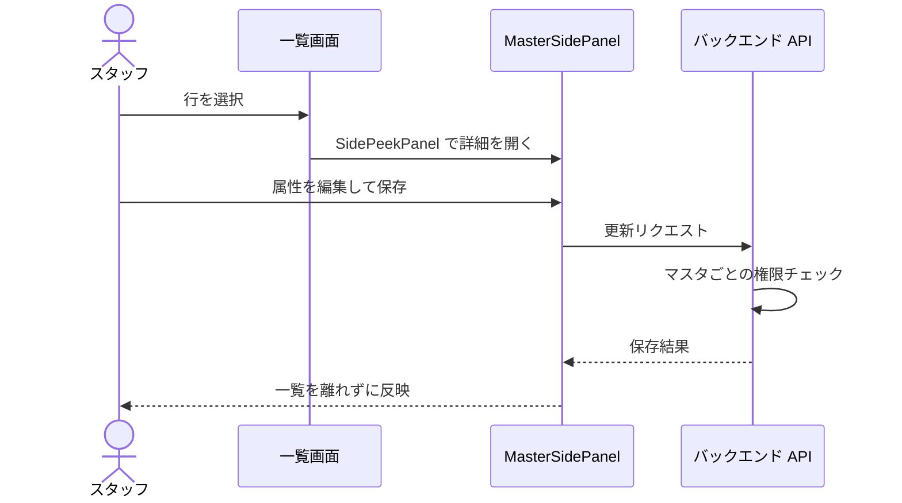

# 設定画面 仕様書インデックス (Settings Index)

本ディレクトリには、Animal Ekarte の各マスタデータの詳細定義・管理画面の操作仕様に加え、設定配下のサポート画面（バグ報告・チャット履歴）の画面契約を格納します。`/settings/*` 全 path と primary 仕様の対応表は [../../ui-design-compliance.md §2](../../ui-design-compliance.md) が正本。

---

## 🏗️ 基礎・共通マスタ

| マスタ名 | 仕様書 | 概要 |
|:---|:---|:---|
| **医院情報** | [../19-clinic-settings.md](../19-clinic-settings.md) | 院名、住所、登録番号、消費税率（通常/軽減）。 |
| **動物種別** | [master-animal-species.md](./master-animal-species.md) | 犬、猫、エキゾチック等の大分類。 |
| **職種** | [master-occupation.md](./master-occupation.md) | スタッフの役割（獣医、看護師等）の定義。 |
| **スタッフ** | [master-staff.md](./master-staff.md) | 氏名、職種、所属院、LINE 予約用プロフィール。 |
| **権限グループ** | [master-permission-group.md](./master-permission-group.md) | ロールごとの詳細なアクセス権限（CRUD）マトリックス。 |

---

## 🩺 医療・臨床マスタ

| マスタ名 | 仕様書 | 概要 |
|:---|:---|:---|
| **診療項目** | [master-treatment.md](./master-treatment.md) | 診察、処置、手術等の名称と標準価格。 |
| **主訴種別** | [master-chief-complaint.md](./master-chief-complaint.md) | 診察理由の大分類（消化器、皮膚等）。 |
| **薬剤** | [master-medicine.md](./master-medicine.md) | 薬品名、剤形、単価の定義（在庫紐付けは API のみで設定画面に UI 未実装）。 |
| **診断・病名** | [master-diagnosis.md](./master-diagnosis.md) | 疾患カテゴリと正式病名の体系的定義。 |
| **検査項目** | [master-examinations.md](./master-examinations.md) | 検査プランの名称・価格の定義（診療項目マスタと同一UIを共有。課税区分は保存されない）。 |
| **検査機器マスタ** | [マスタ設定のカルテ関連](../20-master-settings.md) / [ADR-007 §7 マスタ](../../../architecture/adr/007-lab-device-receive-and-commit.md) | `/settings/lab-device-item-masters`。機器項目と検査フィールドの対応を管理する。日常の受信操作は [検査受信ボード](../README.md)を参照。 |
| **問診/定型文**| [master-interview.md](./master-interview.md) | カルテ入力を効率化する各種テンプレート。 |
| **ケージ** | [master-cage.md](./master-cage.md) | 入院室の番号、サイズ、収容タイプ。 |
| **入院プラン** | [master-hospitalization-plan.md](./master-hospitalization-plan.md) | 入院・宿泊の単価・対象体格・料金単位の定義。 |

---

## ✂️ 専門サービスマスタ

| マスタ名 | 仕様書 | 概要 |
|:---|:---|:---|
| **トリミングコース種別** | [master-trimming-course-type.md](./master-trimming-course-type.md) | シャンプー・カット等、コースカテゴリの分類を管理。 |
| **トリミング** | [master-trimming.md](./master-trimming.md) | コース・オプションの定義（マスタ価格の区分は対象サイズのみ（個別施術の料金手修正・行値引きはD06で扱い、マスタ価格は変えない）、犬種別ではない）。 |
| **予約区分** | [master-reservation-type.md](./master-reservation-type.md) | 診察、手術等の予約枠と LINE 公開設定。 |
| **シフトパターン**| [master-shift-template.md](./master-shift-template.md) | よく使う勤務時間と休憩時間のテンプレート。 |

---

## 💰 会計・外部連携マスタ

| マスタ名 | 仕様書 | 概要 |
|:---|:---|:---|
| **締め時間** | [closing-time-settings.md](./closing-time-settings.md) | AM/PM 境界、日界、休診日の管理。 |
| **支払方法** | [payment-methods.md](./payment-methods.md) | 現金、カード、QR 等の決済手段。 |
| **保険** | [master-insurance.md](./master-insurance.md) | ペット保険名称・補償率の管理（マスタ補償率の会計への自動設定は未実装。会計画面で選択した割合による控除計算は実装済み）。 |
| **割引キャンペーン** | [master-campaigns.md](./master-campaigns.md) | 会計割引ルールの期間・対象カテゴリ/商品設定。 |
| **販売商品** | [master-merchandise.md](./master-merchandise.md) | 療法食、ケア用品等の販売品。 |
| **LINE ページ** | [28-line-reservation.md §2](../28-line-reservation.md) | 飼主向け予約画面の案内文言カスタマイズ（LINE 予約設定仕様書へ統合）。 |

---

## サポート画面（2026-10-11 補完・番号付き仕様書は増やさない）

`/settings/bug-reports` と `/settings/chat-history` の画面契約の正本は本節（schema 複製ではない）。実装参照は FE/BE source（`frontend/src/features/support/`・`backend/internal/support/` の handler.go / service.go）、wire 契約の正本は [`backend/docs/api.yaml`](../../../../backend/docs/api.yaml) — fact 範囲が別である。runtime/UAT の観測主張は行わない。

### バグ報告一覧

- **URL / 実装**: `/settings/bug-reports`（`BugReportsPage`）。RBAC の resource ゲートなし — 認証済みスタッフ全員が閲覧できる意図的な製品判断。
- **一覧（共有 READ）**: `GET /api/v1/support/bug-reports` の全医院共有一覧。列は日時・医院・報告者・タイトル・発生 route・status・Plane。タイトルはネイティブの詳細ボタンで、モーダルに詳細と任意スクリーンショット（alt/プレースホルダー付き）を表示する。Loading / Error / Empty を明示する。
- **mutation は報告医院のみ**: status `PATCH /api/v1/support/bug-reports/:id/status`・Plane 起票 `POST .../plane-ticket`・`DELETE .../:id` は、現在医院が報告医院と一致する行にだけ表示（`isOwnClinic`）。backend が報告医院を強制し、他医院への操作は 404。削除は明示確認付きで、実行中は対象の mutation 実行ボタンを disable にする（modal 全体の無効化ではなく、詳細の Close などは有効のまま）。最終権限は backend。
- **新規作成は別経路**: 作成はグローバル support-widget の POST 経路であり、本一覧ページのフォームではない。UI トグルは open/resolved のみ。
- **外部連携の失敗表示**: Plane 未設定は 501、作成失敗は 502 をそのまま返す（retry 成功を約束しない）。
- **臨床境界**: 共有表示は臨床 write 権限の回避ではなく、通常の医院制限 READ に対する意図的例外。スクリーンショットは診療情報・資格情報を含み得るため、docs に実例・秘密値を記録しない。

### チャット履歴

- **URL / 実装**: `/settings/chat-history`（`ChatHistoryPage`）。RBAC resource ゲートなし — 認証済みスタッフ全員が閲覧できる閲覧専用画面。
- **一覧（共有 ROOM ボード）**: `GET /api/v1/support/chat/rooms` の全医院・全スタッフ共有 ROOM ボード。md 以上で2ペイン（ROOM 選択リスト＋ターン表示）。選択 ID が無い・存在しない場合は先頭 ROOM にフォールバック。リストは医院・スタッフ・時刻・ターン数を表示し、選択中は `aria-current` とラベル付き nav / conversation 領域を持つ。Loading / Error / Empty を明示する。
- **ROOM グルーピング**: 同一 clinic×staff の会話を 30 分超の空白で区切った表示単位（永続化された chat session id モデルではない）。最新 ROOM 順。
- **別経路との区別**: 個人の `GET`/`DELETE /api/v1/support/chat/history`（認証コンテキストの clinic×staff スコープ）は widget 側の経路。`GET /chat/exchanges` は質問+回答ペアの共有 endpoint で本画面のソースではない。本画面に POST/DELETE/reset はなく、質問送信の `POST /chat` は rate limit 付きの別 widget 経路。
- **表示境界**: 表示は text/整形済みのみで臨床 write 操作はない。

---

## 技術的な共通事項

- **Notion スタイル編集**: 各マスタは `MasterSidePanel`（`SidePeekPanel` ベース）と `PropertyRow`/`PropertyInput` を使用した、リストを離れない直感的な編集体験を提供します。
- **認可ガード**: 個別のマスタに対し、`ResourceMasterMedical` や `ResourceMasterStaff` 等の独立した権限チェックがバックエンドで実行されます。
- **名称一意のエラー表示**: `(clinic_id, name)` UNIQUE のマスタで重複保存したとき、トーストは種別ラベルだけでなく入力した実名を含む（診療項目 5 タブの正本は [master-treatment.md §2.3](./master-treatment.md)）。

全マスタ画面に共通する編集導線と認可の流れ:

---

## このフォルダの役割と使い方

共通マスタ・設定と既存サポート画面契約の入口。

現行のマスタ・設定画面仕様を保持する。利用領域の業務フローや語彙、別のAPI／DB型定義を重複掲載しない。

子フォルダ：現在、子フォルダはありません。

主要文書：主要文書は本書の既存索引・上記の読む順を参照します。

読む順：本索引 → 該当マスタ → 関連[業務領域](../../domains/README.md)・[共通入口](../../shared/README.md)。ルート対応は[対応表](../../ui-design-compliance.md)。

正本・状態：[決定状態と検証状態の規約](../../authoring-guide.md#status)に従い、各節・FRの承認根拠と実装／実機状態を別に読む。READMEへの掲載・フォルダ配置は承認や実装済みを表さず、対象外の既存仕様を新たに確定しない。既存の別名入口・索引の責務は維持し、本書は案内を補う。

## 2026-10-15 不具合報告の送信契約

[サポート業務正本](../../domains/support/README.md)へ従う。送信前にDiscord・Planeへ渡す内容と送信先を表示して確認する。送信後は院内報告を残し、外部通知・起票失敗でも消さない。外部で作成済みか不明なら確認後に再送する。共有READ・報告医院mutation・本人historyの境界は変更しない。

決定根拠：ユーザー Sentinel_7a67fd30e47c819192cd36d416f0a2bf の「ok」（確認文 Sentinel_9c0eb79acfd481919738187e9769f8cd、対象確認 Sentinel_8d0032ca45b881919b3d2ceb5339f792）。製品仕様の承認であり、今回実際に通知・起票する許可ではない。現行serviceはDiscordを保存前・Planeを保存後にbest-effort実行するため、保存失敗時の外部残存・孤立issue・送信前確認は[技術差分](../../../design/domains/support/technical-spec.md)として検証する。

報告保存・配送・削除は[選定契約](../../../design/domains/support/technical-spec.md#support-selected-delivery-contract)へ従う。院内保存commit前に外部送信しない。外部成功後にclaim／結果記録を保存できなければ元operation・外部結果を照合し、照合不能中は再送を保留する。通常削除は[共通C05](../../shared/retention-audit.md)に従い論理削除／非表示とし、保存済み添付blob・元参照・必要履歴／監査を保持する。現行storage先行削除は目標との差分で、物理削除の新許可ではない。

## 21マスタ文書の主責務と受入の所在

次の21件は本ディレクトリの個別仕様文書の数。医院設定・LINEページは別画面、機器項目対応はD07／ADRの別契約で、この21本文へ重複加算しない。複数routeや複数consumerがあっても主責務は一つ。旧実装欄を目標仕様の承認へ読み替えず、保存済み記録への影響・認可／競合は各正本を参照する。

| 本文 | 主責務 | 業務・受入正本 | 照合する境界 |
|:---|:---|:---|:---|
| [動物種](master-animal-species.md) | D04 | [正本](../../domains/owners-pets/lifecycle.md) | 基本台帳と既存患者参照を保護 |
| [ケージ](master-cage.md) | D05 | [正本](../../domains/hospitalization/lifecycle.md) | 割当・占有と宿泊頭数は別 |
| [入院プラン](master-hospitalization-plan.md) | D05 | [正本](../../domains/hospitalization/lifecycle.md) | 標準条件と個別確認料金を分離 |
| [トリミング](master-trimming.md) | D06 | [正本](../../domains/trimming/lifecycle.md) | コース／選択肢と当時価格・履歴 |
| [コース種別](master-trimming-course-type.md) | D06 | [正本](../../domains/trimming/lifecycle.md) | 分類変更と既存明細参照を分離 |
| [検査](master-examinations.md) | D07 | [正本](../../domains/examinations/lifecycle.md) | 検査計画と機器項目対応は別 |
| [支払方法](payment-methods.md) | D10 | [正本](../../domains/accounting/lifecycle.md) | 安定ID・実授受の方法と配分 |
| [保険](master-insurance.md) | D10 | [正本](../../domains/accounting/lifecycle.md) | 窓口確認・一患者一契約とmaster |
| [割引](master-campaigns.md) | D10 | [正本](../../domains/accounting/lifecycle.md) | 計算根拠／snapshotと現在設定 |
| [販売商品](master-merchandise.md) | D10 | [正本](../../domains/accounting/lifecycle.md) | 全体割引除外とD13実物在庫は別 |
| [締め時間](closing-time-settings.md) | D12 | [正本](../../domains/cash-register/business-rules.md) | 営業日と原締めsnapshotを保護 |
| [職員](master-staff.md) | D14 | [正本](../../domains/staff-workforce/README.md) | 所属・対応能力・未来未終了予約保護 |
| [職種](master-occupation.md) | D14 | [正本](../../domains/staff-workforce/README.md) | 分類とgrant・個人能力は別 |
| [シフトtemplate](master-shift-template.md) | D14 | [正本](../../domains/staff-workforce/README.md) | 展開先と予約影響・過去へ自動波及なし |
| [予約区分](master-reservation-type.md) | D01 | [正本](../../domains/reservations/README.md) | 分類・公開／指名・ホテル任意／臨床入院担当を分離 |
| [診療項目](master-treatment.md) | D03 | [正本](../../domains/medical-records/lifecycle.md) | 臨床入力・実施とD10価格／税snapshot |
| [診断](master-diagnosis.md) | D03 | [正本](../../domains/medical-records/lifecycle.md) | 参照履歴と新規選択の境界 |
| [薬剤](master-medicine.md) | D03 | [正本](../../domains/medical-records/lifecycle.md) | 投与単位・小数量とD10価格／D13在庫は別 |
| [問診・定型文](master-interview.md) | D03 | [正本](../../domains/medical-records/lifecycle.md) | templateと保存済み臨床記載を分離 |
| [主訴](master-chief-complaint.md) | D03 | [正本](../../domains/medical-records/lifecycle.md) | 参照分類と確定済み記録の保持 |
| [権限group](master-permission-group.md) | C04 | [正本](../../shared/access-control.md) | 現在認可・scope例外・staff割当の境界 |

新規選択可否・参照中の無効化／削除・旧名称／価格保持・明示再適用・現在権限／版は同じ扱いとは限らない。master全体に一律のcascade削除や過去snapshot再計算を追加しない。

## 2026-10-15会議合意の接続：shifts-5

シフトtemplateと[期間複製・CSV取込](../24-shift-calendar.md#shift-copy-csv-agreement-20261015)の接続は[マスタ境界](master-shift-template.md#shift-template-bulk-boundary)へ。テンプレートCRUDと勤務の入力／反映は別操作で、登録済み勤務への自動遡及や勤務権限の拡張を行わない。新操作のFR／ACはシフト画面とD14技術契約に置き、本索引では第二定義を作らない。

## 2026-10-15コースカテゴリの入口

コース種別はコースのカテゴリであり、予約区分マスタに近い一覧・編集UIへ整理する。予約区分の業務分類・枠設定とは別。正本は[コース種別](master-trimming-course-type.md)と[D06](../../domains/trimming/lifecycle.md#trimming-meeting-pricing-category)。
