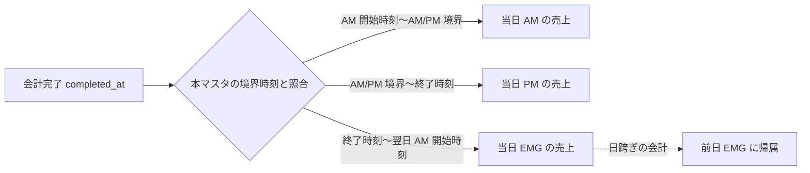

# 締め時間設定 仕様書 (Closing Time Settings)

| 管理項目 | 記載 |
|:---|:---|
| 文書ID・種別 | page.settings.closing-time／画面仕様 |
| 決定状態 | 既存記載を継承（決定根拠未確認の部分を含む）。C1の目標は依頼者2026-10-15承認（Sentinel_7a67fd30e47c819192cd36d416f0a2bf）。既存詳細全体の再承認ではない。 |
| 実装状態 | 現行差を分離。今回実装変更・網羅監査なし |
| 実機検証状態 | 未実施。受入条件は検査定義 |
| 文書確認日 | 2026-10-17（No.49入力精度の追加決定。実機検証日ではない） |
## 業務正本と現在の説明範囲

[業務契約・FR／受入条件・例外・未決](../../domains/cash-register/business-rules.md)。締め営業日を設定する画面。月次の日次明細はJST暦日であり、本設定による月次日界変更を実装済みとしない。LINE予約休診とは別設定。

## 概要
- **画面の目的**: レジ締めの営業日／区分に使用する境界時刻、休診日、および特別な集計期間の管理。
- **URLパターン**: `/settings/closing-time`
- **アクセス権限**: 締め時間設定管理権限が必要（`ResourceClosingSettings`）

---

## 画面構成

### 1. 標準境界時刻の定義
日常的な営業における「一日の区切り」を設定します。集計レンジは AM / PM / EMG（緊急）の 3 区分です（#215）。
- **AM 開始時刻**: AM レンジの開始時刻（`closing_am_start`、固定 09:00）。**編集不可**（PATCH API・画面のいずれにも入力フィールドがなく、DB default から変更する経路が存在しない。レンジプレビューの算出にのみ使用）。
- **AM/PM 境界**: 午前診療と午後診療を分かつ時刻（デフォルト 14:00）。
- **終了時刻 (Weekday/Sunday)**: PM レンジの終端（デフォルト平日 18:30 / 日曜 17:30）。これを過ぎた会計は「翌日の売上」ではなく、**当日の EMG（緊急）レンジ** `[終了時刻, 翌日の AM 開始時刻)` に計上されます（深夜 0:00〜AM 開始の会計は前日 EMG 帰属）。
- **レンジプレビュー**: 設定値から算出した AM/PM/EMG の実レンジが秒単位（HH:MM:SS）で画面上に表示されます（#151）。EMG は `終了時刻:00`〜`翌 AM 開始時刻−1秒` の越日レンジとして「翌」接頭辞付きで表示されます。

### 2. 定例休診日の管理
曜日ごとの休診フラグ（`closed_weekdays`）を設定します。`StandardClosingTimeSection` 内のチェックボックス群として実装されており、独立したセクションではありません。

### 3. 特別期間 (Special Periods)
年末年始、短縮営業などの例外的な集計境界時刻を日付範囲で登録します（`SpecialPeriodSection`）。

登録済みの各特別期間には、保存された `am_pm_boundary`・`pm_end` と標準設定の `closing_am_start`（特別期間は標準設定の AM 開始時刻を継承し、独自の am_start を持たない）から導出した AM/PM/EMG 時間帯レンジが秒単位（HH:MM:SS）で表示されます。導出規則は標準締め時間のレンジプレビューと同一です（AM: `am_start`〜`boundary−1秒`、PM: `boundary`〜`pm_end−1秒`、EMG: `pm_end`〜`翌 am_start−1秒` の越日レンジ）。登録フォームでは `am_pm_boundary`・`pm_end` の入力に追従して同じ導出レンジが「時間帯プレビュー」として即時表示されます。

### 4. 個別休診日 (Holidays)
特定の1日を休診日として登録します（日付＋理由メモ、`HolidaySection`）。定例休診日（曜日単位）や特別期間（境界時刻の上書き）とは独立した、日付単位の登録です。`POST` は INSERT のみで同一日を UPSERT しない。既存日の再追加は 409（`uk_clinic_holidays_clinic_date`）。理由変更は削除してから再追加する。

---

## 主要な機能

### 1. 売上計上の自動判定
システムは、会計が完了（`completed_at`）した時刻と、本マスタの設定値を照合し、「何日の、AM/PM/EMG いずれの売上か」を自動的に決定します（AM/PM/EMG は連続・非重複で 24 時間を被覆）。これにより、深夜に及ぶ緊急診療等でも正確な日次集計が可能です。

### 2. 予約枠計算とは非連動
本画面の休診設定（定例休診日 `closed_weekdays`・特別期間・日付単位の休診日）はいずれも `clinic_settings` / `closing_special_periods` / `clinic_holidays` テーブルに保存され、**売上集計専用**です。LINE 予約の空き枠計算エンジン（[28-line-reservation.md](../28-line-reservation.md)）は完全に別モデルの `line_reservation_settings.closed_weekdays`（LINE 予約設定画面で個別設定）を参照しており、本画面の設定とは連動しません。曜日休診をLINE予約にも反映したい場合は、LINE 予約設定側でも別途設定する必要があります。

---

## 技術仕様

### 使用コンポーネント
- **`StandardClosingTimeSection`**: 境界時刻の編集（ネイティブ `<input type="time">`、分単位）とレンジプレビュー、および定例休診日（曜日チェックボックス）。
- **`SpecialPeriodSection`**: 登録済み特別期間（境界時刻の日付範囲上書き）の管理。
- **`HolidaySection`**: 個別休診日（日付単位）の管理。

### API連携
| メソッド | エンドポイント | 用途 | 必須権限 | 必須アクション |
|:---|:---|:---|:---|:---|
| GET | `/api/v1/closing-settings` | 現在の時刻・休診設定の取得 | `closing-settings` | `view` |
| PATCH | `/api/v1/closing-settings` | 境界時刻の更新 | `closing-settings` | `edit` |
| GET | `/api/v1/closing-settings/special-periods` | 登録済み例外期間の一覧取得 | `closing-settings` | `view` |
| POST | `/api/v1/closing-settings/special-periods` | 新規例外期間の登録 | `closing-settings` | `create` |
| PATCH | `/api/v1/closing-settings/special-periods/:id` | 例外期間の更新（BE実装済みだが編集UIは未実装のため未呼出。変更は削除+再登録で運用） | `closing-settings` | `edit` |
| DELETE | `/api/v1/closing-settings/special-periods/:id` | 例外期間の削除 | `closing-settings` | `delete` |
| GET | `/api/v1/closing-settings/holidays` | 休診日一覧の取得 | `closing-settings` | `view` |
| POST | `/api/v1/closing-settings/holidays` | 休診日の登録 | `closing-settings` | `create` |
| DELETE | `/api/v1/closing-settings/holidays/:date` | 休診日の削除 | `closing-settings` | `delete` |

## 全院投入手順（#252 / BRT-43）

PO 裁定（2026-07-15、#252 本文）: 全院を城東同値で投入。**本セッションでは本番投入しない。** 値は Issue 本文の転記であり、新規発明ではない。

| フィールド | #252 裁定値 | 画面 |
|---|---|---|
| `closing_am_start` | 09:00 | **編集不可**。確認のみ |
| `closing_am_pm_boundary` | 12:00 | `/settings/closing-time` |
| `closing_weekday_end` | 18:30 | 同上 |
| `closing_sunday_end` | 18:30 | 同上（資料 2 に曜日区別なし） |
| `closed_weekdays` | 変更しない | #252 対象外 |

**実行境界:** #252裁定値はhistorical decision inputであり、固定clinic/seedの現在値を前提にしない。S09は承認済みdisposable clinicへ合成設定を投入して検証する。共有STG/本番へのPATCHはnamed target・USER承認・dated receiptがある場合だけ行う。

投入順（USER）: 対象 env 確定 → 各院で境界・終了を裁定値へ → プレビューで AM/PM/EMG 目視 → `closing_am_start`≠09:00 のみ事前承認後 DB → 過去締め非再計算（#215）→ 非機密 receipt。結果は **未記入**。

---

## 秒精度と標準／特別期間のプレビュー

Backlog No.30・49の既存レンジ規則に従い、標準／特別期間ともAM・PM・EMGの時間帯をHH:MM:SSでプレビューする。原No.49の「秒単位で保持」と上記の分単位入力という実装参照は区別し、任意の秒入力まで今回の確定仕様としない。入力精度は以下の2026-10-17本人回答Aで確定した。固定AM開始の編集不可、特別期間の標準AM開始継承を維持し、原締めsnapshotや過去集計を現設定で再計算しない。
| 条件ID | 前提／操作 | 期待結果 | 検証状態 |
|:---|:---|:---|:---|
| AC-closing-settings-period-preview | 標準設定と特別期間のAM/PM境界・終了時刻を変更する | AM/PM/EMGを秒で表示し、EMGの翌AM開始直前までの越日範囲を区別。入力中と保存後を確認する | No.30・49、既存レンジ導出規則。未実施 |

## 追加決定：分単位の入力と秒までのプレビュー

2026-10-17、質問 Sentinel_f9ae54abbcf48191990b9225486e993d のA「入力は『18:30』のように分単位。プレビューは秒まで表示」、再確認 Sentinel_bb2a699712748191b2466ca49c0d62bd に対し、本人 Sentinel_5263c946095881919d39b18aefa73105 が「A」と回答した。標準設定・特別期間の編集可能な境界／終了時刻はHH:MMの分単位で入力し、AM/PM/EMGの時間帯プレビューはHH:MM:SSで表示する。『18:30:15』のように任意の非00秒を職員が指定するUIは採用しない。固定AM開始の編集不可と、特別期間による標準AM開始の継承は維持する。

この回答は入力UIの精度を決めるものであり、既存の時刻保存精度・秒桁や既存値の移行を変更する許可ではない。分入力採用を理由に保存済み秒を切捨て・丸め・一括変換しない。既存値が分入力にそのまま表せない場合の具体的な表示／更新対応は設計照合に残し、未確認値を推測で書き換えない。

集計の既存境界は変更しない。終了時刻をEMGの開始とする半開区間、前区分終端を境界の1秒前として見せる既存プレビュー、越日の扱いは上記の標準／特別期間規則と[境界の受入条件](../../domains/cash-register/business-rules.md#requirement-fr-closing-period-boundary)を維持する。秒まで表示することを、秒入力が可能であることや新しい終了境界の採用と取り違えない。過去の締めsnapshot・保存済み集計は現設定で再計算しない。本文・以下の受入条件は目標仕様で、実装・実機合格を示さない。

### 分入力の追加受入条件

| 条件ID | 前提／操作 | 期待結果 | 検証状態 |
|:---|:---|:---|:---|
| AC-closing-settings-minute-input | 標準設定と特別期間で編集可能な境界／終了をそれぞれHH:MMで入力し、プレビュー・保存後の再表示を比較する | 職員の入力は分単位で、任意の非00秒を指定するUIを設けない。プレビューは秒まで表示し、既存AM/PM/EMG導出・固定AM開始／特別期間継承を保持する | No.49、本人A。未実施 |
| AC-closing-settings-input-storage-boundary-separation | 既存の時刻保存値・締めsnapshotと境界ぴったり／1秒前の判定を、分入力表示の追加前後で照合する | 入力UIの精度決定だけで保存精度・過去snapshotを変換せず、既存半開区間・秒終端表示・越日帰属を変更しない。分入力に表せない旧値の更新を推測処理しない | 既存AC-closing-boundaries／AC-closing-settings-period-previewと区別して確認。未実施 |
