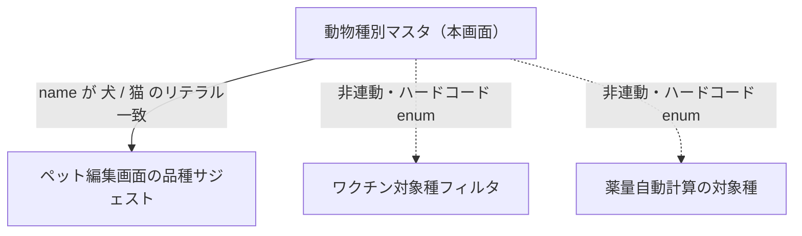

# 動物種類マスタ 仕様書 (Animal Species Management)

> 領域正本: [業務契約](../../domains/owners-pets/lifecycle.md)・[技術契約](../../../design/domains/owners-pets/technical-spec.md)。以下は既存画面／API観察を継承する。削除endpointの存在は無条件削除の許可ではなく、参照・必要履歴・現在認可を検査し、業務原本や分類不明を通常物理削除しない。無効化後も既存記録の参照を保持する。master変更は過去記録・追加済会計明細へ自動反映せず、会計の再適用はD10の明示確認契約へ従う。
2026-10-15の[共同確認](../../domains/owners-pets/lifecycle.md#agreement-owner-membership-dm-20261015)で、全医院共通と追加・名称変更・無効化のシステム管理者限定を確認済み。以下の並び替え・削除・監査・画面配置等は既存条件を継承し、今回の共同確認を削除権限の拡大や全既存挙動の一括承認に使わない。

## 概要
- **画面の目的**: システムで取り扱う動物種（犬、猫、うさぎ等）の定義。
- **URLパターン**: `/settings/animal-species`
- **アクセス権限**:
  - **一覧・参照**: `master-animal-species` の `view`（`ResourceMasterAnimalSpecies`）。
  - **作成・更新・削除・並び替え**: システム管理者のみ（`is_system_admin` / backend `requireSystemAdminForGlobalMaster`）。全医院共有マスタのため、clinic-scoped の resource create/edit/delete では mutation 不可。FE も `canMutate = isSystemAdmin`。

---

## 1. 画面構成

### 1.1 種別一覧テーブル
- **項目**: 種別名、有効/無効ステータス。
- **ドラッグ操作**: リスト左端のハンドルで表示順序を直感的に変更（`sort_order` を更新）。実行はシステム管理者のみ。

### 2. 詳細編集サイドパネル (`SidePeekPanel`)
- **種別名**: 臨床および統計で使用される正式名称。
- **ステータス**: 使用しなくなった動物種を「無効」に設定し、新規登録時の選択肢から除外。

---

## 主要な機能

### 1. システム全体への波及
- **品種サジェスト**: ペット編集画面で動物種名（マスタの `name`）が「犬」「猫」の場合のみ品種候補リストを提案します（ハードコードされたリテラル一致。それ以外の登録種は自由入力）。
- **医療プロトコル非連動**: ワクチンの対象種フィルタ（`Vaccine.Species`: dog/cat/both）と薬量自動計算の対象種（`MedicineDoseSpecies`: dog/cat）は、いずれも本マスタとは独立したハードコード enum です。本マスタに動物種を追加・編集しても、ワクチン接種周期や投薬量計算のロジックには反映されません。

波及する経路としない経路の整理:

### 2. 削除の安全性
すでにペット情報が紐付いている動物種を削除しようとした場合、データ不整合を防ぐため、エラー（409 Conflict）として物理削除がブロックされます。

### 3. 監査（fail-closed）
Create / Update / Delete / Reorder は業務 write と `audit_logs` を同一 transaction で commit する。監査失敗時は業務変更も rollback する（`TestAnimalSpeciesService_*_AuditFailureRollsBack`）。

---

## 技術仕様

### 使用コンポーネント
- **`AnimalSpeciesSettings`**: メインページ。
- **`dnd-kit`**: 並び替えエンジン。
- **`AnimalSpeciesSidePanel`**: `MasterSidePanel` によるボーダーレスな名称編集。

### API連携
| メソッド | エンドポイント | 用途 | 必須権限 | 必須アクション |
|:---|:---|:---|:---|:---|
| GET | `/api/v1/masters/animal-species` | 動物種一覧の取得（無効を含む全件） | `master-animal-species` | `view` |
| GET | `/api/v1/masters/animal-species/:id` | 特定の動物種情報の取得 | `master-animal-species` | `view` |
| POST | `/api/v1/masters/animal-species` | 新規動物種の登録 | システム管理者 (`is_system_admin`) | — |
| PATCH | `/api/v1/masters/animal-species/:id` | 属性の更新 | システム管理者 (`is_system_admin`) | — |
| DELETE | `/api/v1/masters/animal-species/:id` | 動物種の削除（紐付けなしの場合のみ） | システム管理者 (`is_system_admin`) | — |
| PATCH | `/api/v1/masters/animal-species/reorder` | 表示順序の一括保存 | システム管理者 (`is_system_admin`) | — |

---

## 10/19後続承認：同種操作・検索ボタン方式

本画面の既存キーワード欄は[適用台帳 M10](../../shared/interaction-scope.md)と[共通FR/8AC](../../shared/ui-contracts.md#interaction-consistency-20261019)へ従う。入力中/適用済みを分け、入力/待機/消去だけでは検索せず検索ボタンで適用。既存の明示リセット、独立filter、詳細復帰、認可・検索対象・取得上限/ページ内制限を保持し、全件検索や一律の保存方式へ変えない。取得中/0件/失敗と遅延応答を分け、検索で選択/保存/コピー/送信を確定しない。旧defer/debounceの記載は入力即適用の目標に用いず、適用後の描画最適化と区別する。[S14手順](../../../ops/testing/scenarios/S14-search-and-multi-word.md#cross-ui-search-20261019)を各対象IDで実施する受入条件とし、実装適合・実機は未確認。
