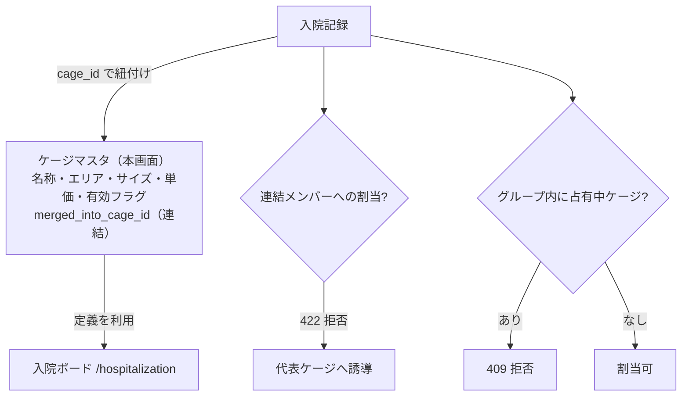

# ケージマスタ 仕様書 (Cage Management)

## 概要
- **画面の目的**: 院内のケージ、入院室、ペットホテルの宿泊スペースの定義。
- **URLパターン**: `/settings/cage`
- **アクセス権限**: 設備マスタ管理権限が必要（`ResourceMasterHospitalization`）

---

## 画面構成

### 1. ケージ一覧
- **表示**: ケージ名、エリア、サイズ、単価(税込)、有効/無効ステータス。
- **並び順**: 一覧内の表示順序をドラッグ&ドロップ（`dnd-kit`）で管理。ステータスは有効/無効のマスタフラグであり、入院ボードの空き/使用中といったリアルタイム稼働状況は表示しない。
- **連結状態バッジ**: 連結メンバー行には `連結中: <代表ケージ名>`、代表ケージ行には `連結中（代表）: <構成メンバー名…>` を表示する（`CageSortableTable`）。

### 2. 詳細編集サイドパネル (`SidePeekPanel`)
- **ケージ名**: 院内での識別名。
- **エリア（`cageType`）**: ICU / 犬舎(`dog`) / 猫舎(`cat`) / 汎用(`general`)。
- **サイズ（`cageSize`）**: 小型、中型、大型。
- **単価(税込)**: 入院・宿泊料金の基礎となる金額。
- **ステータス**: 有効/無効の切り替え（`StatusToggleButton`。特定の「一時利用停止」概念ではなく汎用の有効/無効フラグ）。
- **備考**: 自由記述。
- **連結状態**: 連結メンバーの場合は代表ケージ名を、代表ケージの場合は構成メンバー名一覧を `連結状態` 行に表示する（`CageSidePanel`）。連結中のケージは無効化・削除できない（backend が 409 で拒否するため、先に解除が必要）。

---

## 主要な機能

### 1. 入院ボードとの連動
ここで定義されたケージは、入院一覧画面（`/hospitalization`）のボードビューで利用される。

### 2. ケージ一時連結（EMR-306）
複数のケージを一時的に「1つの入院スペース」として運用する機能。大型動物や多頭入院で隣接ケージを合体させる用途を想定する。

**モデル**
- `cages.merged_into_cage_id`（nullable、自己参照）。NULL = 独立ケージまたは代表ケージ。構成メンバーは代表ケージ ID を指す。
- 単一階層のみ（グループの入れ子は不可）。代表ケージの単価が入院料金に使われる。
- 構成メンバー上限は 1 グループ 32 件。

**操作**
- **連結**: 一覧のチェックボックスで複数選択 →「選択したケージを連結」→ 確認ダイアログで代表ケージを選択して確定。選択できるのは未連結・有効・占有中でないケージのみ（連結済み・無効行のチェックボックスは disabled）。
- **解除**: 連結済み行（メンバー・代表双方）の解除ボタン → 確認ダイアログで確定。代表ケージ ID に対する unmerge API を呼ぶ。
- 入院ボード（`/hospitalization`）の連結モードからケージ同士のドラッグ&ドロップでも連結できる（入院側仕様書参照）。

**制約（backend で強制）**
- 連結できるのは同一 clinic・有効・未連結・占有中でないケージのみ。違反は 409。
- 連結メンバーケージへの入院割当は 422 で拒否（入院フォームのケージ選択肢からも除外）。
- 連結グループ内のいずれかのケージが占有中（admitted/reserved の入院あり）の場合、代表ケージへの新規割当は 409。
- 連結中のケージ（メンバー・代表双方）は無効化・削除できない（409）。
- 退院しても連結は自動解除されない。明示的な解除操作のみが連結を解く。
- 占有中のケージを含む解除は 409。

**割当ガード**
- `hospitalization_service.go` の Create/Update で `validateCageAssignmentGuard` がトランザクション内でグループ行をロックして検査する（昇順ロックでデッドロックを抑制）。
- 自身の入院を対象ケージへ移す更新（例: 連結前に構成ケージへ紐付いた入院を代表へ移動）は自己占有を集計から除外する。
- discharged 等の占有しないステータスの登録・更新は占有検査をスキップする（構成ケージへの構造的拒否は維持）。

マスタ定義と入院側データの関係:

---

## 技術仕様

### 使用コンポーネント
- **`CageSettings`**: メインページ。
- **`CageSortableTable`**: `dnd-kit` によるドラッグ並び替え一覧。
- **`CageSidePanel`**: 基本属性の編集。

### API連携
| メソッド | エンドポイント | 用途 | 必須権限 | 必須アクション |
|:---|:---|:---|:---|:---|
| GET | `/api/v1/masters/cages` | 定義済みケージの一覧取得 | `master-hospitalization` | `view` |
| GET | `/api/v1/masters/cages/:id` | 特定のケージ詳細情報の取得 | `master-hospitalization` | `view` |
| POST | `/api/v1/masters/cages` | 新規ケージの登録 | `master-hospitalization` | `create` |
| PATCH | `/api/v1/masters/cages/:id` | ケージ情報の更新 | `master-hospitalization` | `edit` |
| DELETE | `/api/v1/masters/cages/:id` | ケージの削除 | `master-hospitalization` | `delete` |
| PATCH | `/api/v1/masters/cages/reorder` | 表示レイアウトの保存 | `master-hospitalization` | `edit` |
| POST | `/api/v1/masters/cages/:id/merge` | ケージの一時連結（`:id` = 代表、`member_cage_ids` = 構成・最大32件） | `master-hospitalization` | `edit` |
| POST | `/api/v1/masters/cages/:id/unmerge` | 連結グループの解除（`:id` = 代表） | `master-hospitalization` | `edit` |

---

