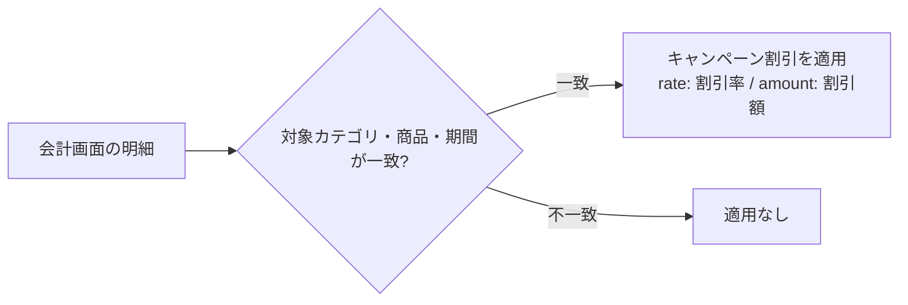

# 割引キャンペーンマスタ 仕様書 (Campaigns Settings)

| 管理項目 | 記載 |
|:---|:---|
| 文書ID・種別 | page.settings.master-campaigns／画面仕様 |
| 決定状態 | 既存本文は継承（決定根拠未確認）。第六群の合意と未決は下記正本へ |
| 実装状態 | 既存記載を継承。今回の目標機能／認可適合は未確認 |
| 実機検証状態 | 未実施 |
| 文書確認日 | 2026-10-15 |

### 会計第六群との対応

[第六群の業務正本](../../domains/accounting/lifecycle.md#accounting-agreement-sixth)と[マスタ変更権限](../../domains/accounting/lifecycle.md#requirement-fr-accounting-master-authorized-maintenance)へ従う。マスタ変更者は管理者と対象変更権限付きスタッフ。現行APIのaccountingと割引値操作のdiscountは別で、会計操作権限だけを新業務のマスタ編集許可にしない。全体割引からの品目除外は品目マスタで指定し、キャンペーンの対象選択や保険対象外と混同しない。 全スタッフに変更を開放せず、対象grant・医院scopeを検査する。今回、実権限・設定・API／DBは変更していない。詳細な[現行mapping](../../../design/domains/accounting/technical-spec.md#accounting-master-permission-map)は技術仕様へ。

## 概要
- **画面の目的**: 会計施策としてのキャンペーンを期間・割引条件付きで定義し、明細計算時に適用可能にする。
- **URLパターン**: `/settings/campaigns`
- **アクセス権限**: 会計権限（`ResourceAccounting`）

---

## 1. 画面構成

### 1.1 一覧
- **一覧項目**: キャンペーン名、期間、割引値、ステータス、編集アクション。
- **対象範囲検索**: キャンペーン名での文字列検索。
- **並び順**: 画面上のドラッグ並び替え UI は未実装（バックエンドの `reorder` API は存在するが未使用）。

### 1.2 編集パネル (`SidePeekPanel`)
- **名称**: キャンペーン名（必須）。
- **実施期間**: 開始日 (`startDate`) と終了日 (`endDate`)。終了日は開始日以降を必須チェック。
- **割引種別**:
  - `rate`: 割引率（%）
  - `amount`: 割引額（円）
- **対象カテゴリ**: フード、物販、処方、診察、検査、処置、手術、ワクチン、トリミング、ホテル、しつけ、その他 などの複数選択。
- **対象商品**: 商品名での検索後、複数選択。
- **有効フラグ**: `StatusToggleButton` で ON/OFF。

---

## 2. 運用ルール
- **日付チェック**: `終了日 < 開始日` の場合は保存不可。
- **名称バリデーション**: 空名は保存不可。
- **適用対象**: 会計画面の明細計算で、対象カテゴリ・商品・期間が一致する明細に割引を適用。

明細への適用判定:

---

## 3. 技術仕様

### 3.1 構成コンポーネント
- **`CampaignSettings`**: 一覧・フィルタ・保存の制御。
- **`CampaignSidePanel`**: 名称・期間・割引設定・対象条件の編集。

### API連携
| メソッド | エンドポイント | 用途 | 必須権限 | 必須アクション |
|:---|:---|:---|:---|:---|
| GET | `/api/v1/masters/campaigns` | キャンペーン一覧取得 | `accounting` | `view` |
| GET | `/api/v1/masters/campaigns/:id` | 特定のキャンペーン情報の取得 | `accounting` | `view` |
| POST | `/api/v1/masters/campaigns` | キャンペーン作成 | `accounting` | `create` |
| PATCH | `/api/v1/masters/campaigns/:id` | キャンペーン更新 | `accounting` | `edit` |
| DELETE | `/api/v1/masters/campaigns/:id` | キャンペーン削除 | `accounting` | `delete` |
| PATCH | `/api/v1/masters/campaigns/reorder` | キャンペーンの表示順一括保存（BE実装済みだが本画面からは未呼出） | `accounting` | `edit` |

