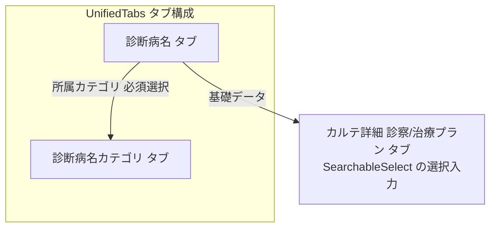

# 診断・傷病名マスタ 仕様書 (Diagnosis Management)

2026-10-14、入力4項目合意の[診療master権限編集・無効化と当時内容保持](../../domains/medical-records/pages/medical-record-form.md#requirement-fr-medical-records-master-history-snapshots)が業務正本。対象masterの操作grant・医院scopeを保持し、無効項目を新規選択せず、既存記録に保存した名称・対象が持つ単位／価格は当時内容を保持する。旧実装説明だけでsnapshot保持済みと判断しない。

## 概要
- **画面の目的**: 臨床現場で使用される標準的な診断名、および疾患カテゴリの体系的管理。
- **URLパターン**: `/settings/diagnosis`
- **アクセス権限**: 診療マスタ管理権限が必要（`ResourceMasterMedical`）

---

## 画面構成

### 1. タブ構成
- **診断分類/診断病名タブ**: 「診断病名カテゴリ」タブと「診断病名」タブを `UnifiedTabs` で切り替え（`?tab=diagnosis_type` / `?tab=diagnosis_name`）。
- **並び替え**: 各タブともドラッグ操作（`dnd-kit`）で表示順を変更可能。

### 2. 詳細編集サイドパネル (`SidePeekPanel`)
- **診断カテゴリ**: 名称、有効/無効ステータス、備考。
- **診断病名**: 名称、有効/無効ステータス、所属カテゴリ（必須選択）、備考。

タブ構造とカテゴリ必須の関係:

---

## 主要な機能

### 1. カルテ入力の高速化
ここで定義されたマスタは、カルテ詳細画面の「診察/治療プラン」タブにおいて、検索可能な選択入力（`SearchableSelect`）の基礎データとして使用されます。

2026-10-15の[第1・第2それぞれの複数診断](../../domains/medical-records/pages/medical-record-form.md#requirement-fr-medical-records-diagnoses-multiple-per-category)へ接続する。記録上の第1／第2区分と、本マスタの疾患カテゴリは別概念。各診断で名称・所属カテゴリの既存整合を維持し、カルテの複数化だけでmasterの分類構造・必須項目・権限や集計の数え方を変更しない。現単件入力の複数対応は実装未確認。

### 2. 統計分析への活用
疾患カテゴリごとに来院件数を集計することで、病院が得意とする診療分野や季節性の疾患トレンドの分析が可能になります。

---

## 技術仕様

### 使用コンポーネント
- **`DiagnosisSettings`**: メインページ（`UnifiedTabs` でカテゴリ/病名タブを切り替え）。
- **`DiagnosisSortableTable`**: `dnd-kit` によるドラッグ並び替え一覧。
- **`DiagnosisTypeSidePanel` / `DiagnosisNameSidePanel`**: 詳細編集パネル。

### API連携
| メソッド | エンドポイント | 用途 | 必須権限 | 必須アクション |
|:---|:---|:---|:---|:---|
| GET | `/api/v1/masters/diagnosis-types` | 診断カテゴリ一覧の取得 | `master-medical` | `view` |
| GET | `/api/v1/masters/diagnosis-types/:id` | 特定の診断カテゴリ情報の取得 | `master-medical` | `view` |
| POST | `/api/v1/masters/diagnosis-types` | 診断カテゴリの作成 | `master-medical` | `create` |
| PATCH | `/api/v1/masters/diagnosis-types/:id` | 診断カテゴリ情報の更新 | `master-medical` | `edit` |
| DELETE | `/api/v1/masters/diagnosis-types/:id` | 診断カテゴリの削除 | `master-medical` | `delete` |
| PATCH | `/api/v1/masters/diagnosis-types/reorder` | 診断カテゴリ表示順の一括保存 | `master-medical` | `edit` |
| GET | `/api/v1/masters/diagnosis-names` | 診断名一覧の取得 | `master-medical` | `view` |
| GET | `/api/v1/masters/diagnosis-names/all` | 全ての診断名一覧（未ページネーション）の取得 | `master-medical` | `view` |
| GET | `/api/v1/masters/diagnosis-names/:id` | 特定の診断名情報の取得 | `master-medical` | `view` |
| POST | `/api/v1/masters/diagnosis-names` | 診断名の作成 | `master-medical` | `create` |
| PATCH | `/api/v1/masters/diagnosis-names/:id` | 診断名情報の更新 | `master-medical` | `edit` |
| DELETE | `/api/v1/masters/diagnosis-names/:id` | 診断名の削除 | `master-medical` | `delete` |
| PATCH | `/api/v1/masters/diagnosis-names/reorder` | 診断名表示順の一括保存 | `master-medical` | `edit` |

---

## 10/19後続承認：同種操作・検索ボタン方式

本画面の既存キーワード欄は[適用台帳 M06](../../shared/interaction-scope.md)と[共通FR/8AC](../../shared/ui-contracts.md#interaction-consistency-20261019)へ従う。入力中/適用済みを分け、入力/待機/消去だけでは検索せず検索ボタンで適用。既存の明示リセット、独立filter、詳細復帰、認可・検索対象・取得上限/ページ内制限を保持し、全件検索や一律の保存方式へ変えない。取得中/0件/失敗と遅延応答を分け、検索で選択/保存/コピー/送信を確定しない。旧defer/debounceの記載は入力即適用の目標に用いず、適用後の描画最適化と区別する。[S14手順](../../../ops/testing/scenarios/S14-search-and-multi-word.md#cross-ui-search-20261019)を各対象IDで実施する受入条件とし、実装適合・実機は未確認。
