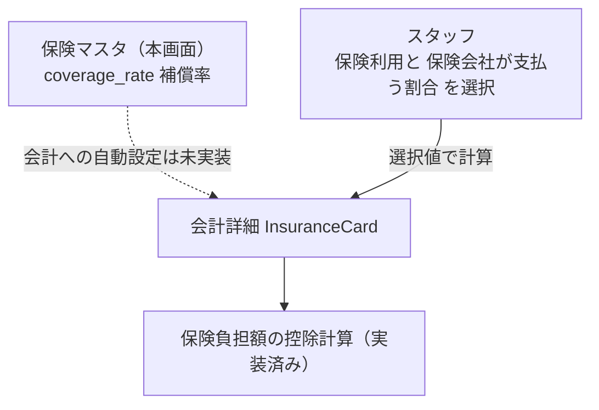

# 保険マスタ 仕様書 (Insurance Management)

| 管理項目 | 記載 |
|:---|:---|
| 文書ID・種別 | page.settings.master-insurance／画面仕様 |
| 決定状態 | 既存本文は継承（決定根拠未確認）。第六・第七群の合意と未決は下記正本へ |
| 実装状態 | 既存記載を継承。今回の目標機能／認可適合は未確認 |
| 実機検証状態 | 未実施 |
| 文書確認日 | 2026-10-15 |

### 会計第六・第七群との対応

[第六群の業務正本](../../domains/accounting/lifecycle.md#accounting-agreement-sixth)と[マスタ変更権限](../../domains/accounting/lifecycle.md#requirement-fr-accounting-master-authorized-maintenance)へ従う。複数の保険会社を扱い、アニコムは例。[第七群](../../domains/accounting/lifecycle.md#accounting-insurance-window-scope)では、スタッフが資格・残限度を外部画面等で確認し、結果と保険負担額を会計に記録する。保険利用は会計ごと・ペットごとに1契約、同じ診療費の複数契約併用は対象外。全取扱商品一覧・会社／商品別の自動給付算式はこの記録運用の前提ではなく、将来自動化時の別スコープ。保険会社への請求・入金照合・査定差額管理は今回の対象外。下記の補償率自動設定なしは現行記載で、将来の自動設定禁止を合意したものではない。 全スタッフに変更を開放せず、対象grant・医院scopeを検査する。今回、実権限・設定・API／DBは変更していない。詳細な[現行mapping](../../../design/domains/accounting/technical-spec.md#accounting-master-permission-map)は技術仕様へ。

### 会計の保存・参照保護契約

[D10のmaster責務と互換](../../../design/domains/accounting/technical-spec.md#accounting-master-coverage)・[画面取得／失敗／保存](../../../design/domains/accounting/technical-spec.md#accounting-screen-contract)へ従う。現在認可・clinic／対象版を検査し、無権限／競合は保存しない。取得失敗を空masterとせず未保存入力を保護。名称変更／無効化／削除で過去請求／資金・帳票参照を失わせず前後値を追跡。旧CRUD表は現行参照で、新業務未対応経路はadapterと実装受入まで利用開始しない。

## 概要
- **画面の目的**: ペット保険（アニコム、アイペット等）の定義、および保険が補償する側の割合（「補償率」）の設定管理。
- **URLパターン**: `/settings/insurance`
- **アクセス権限**: 保険マスタ管理権限が必要（`ResourceMasterInsurance`）

---

## 画面構成

### 1. 保険会社一覧
- **項目**: 名称（例：アニコム 50%）、補償率、連絡先、有効/無効（ステータス）。

### 2. 詳細編集サイドパネル (`SidePeekPanel`)
- **保険名称**: ペット編集画面で保険選択時に表示される名称。
- **補償率(%)**: `coverage_rate`（0〜100 の整数。`validateInsuranceForm`）。UIラベルは「補償率」であり、保険が補償する側の割合を表す（飼主の窓口負担割合ではない）。入力に HTML `max` は付けない。101 以上はインラインエラーを出し、HTML5 制約で保存ボタンを無音ブロックしない。
- **連絡先**: 保険会社の電話番号等（`contact_phone`）。
- **備考**: 自由記述。

---

## 主要な機能

### 1. 会計への補償率自動設定（未実装）
保険マスタの `coverage_rate` を会計の割合へ自動設定する連携はない。会計詳細の `InsuranceCard` では、スタッフが保険利用と「保険会社が支払う割合」を選び、その選択値で保険負担額を計算する（[accounting-settlement.md](../../domains/accounting/pages/accounting-settlement.md)）。保険控除計算自体は既存記載上実装済みであり、本マスタ連携の未実装と混同しない。これは現行の説明で、[第七群の確認結果・負担額記録](../../domains/accounting/lifecycle.md#accounting-insurance-window-scope)や会社／商品の公式条件への適合を検証済みという意味ではない。会計・請求の実装は `backend/internal/billing/`。

マスタ値と会計計算の連携状況:

---

## 技術仕様

### 使用コンポーネント
- **`InsuranceSettings`**: メインページ。
- **`InsuranceSidePanel`**: 補償率・連絡先の編集、`StatusToggleButton` による有効/無効切り替え。

### API連携
| メソッド | エンドポイント | 用途 | 必須権限 | 必須アクション |
|:---|:---|:---|:---|:---|
| GET | `/api/v1/masters/insurances` | 取扱い保険の一覧取得 | `master-insurance` | `view` |
| GET | `/api/v1/masters/insurances/:id` | 特定の保険会社情報の取得 | `master-insurance` | `view` |
| POST | `/api/v1/masters/insurances` | 新規保険会社の登録 | `master-insurance` | `create` |
| PATCH | `/api/v1/masters/insurances/:id` | 設定内容の更新 | `master-insurance` | `edit` |
| DELETE | `/api/v1/masters/insurances/:id` | 保険会社の削除 | `master-insurance` | `delete` |
| PATCH | `/api/v1/masters/insurances/reorder` | 表示順序の一括保存（BE実装済みだが本画面からは未呼出） | `master-insurance` | `edit` |

---

## 10/19後続承認：同種操作・検索ボタン方式

本画面の既存キーワード欄は[適用台帳 M14](../../shared/interaction-scope.md)と[共通FR/8AC](../../shared/ui-contracts.md#interaction-consistency-20261019)へ従う。入力中/適用済みを分け、入力/待機/消去だけでは検索せず検索ボタンで適用。既存の明示リセット、独立filter、詳細復帰、認可・検索対象・取得上限/ページ内制限を保持し、全件検索や一律の保存方式へ変えない。取得中/0件/失敗と遅延応答を分け、検索で選択/保存/コピー/送信を確定しない。旧defer/debounceの記載は入力即適用の目標に用いず、適用後の描画最適化と区別する。[S14手順](../../../ops/testing/scenarios/S14-search-and-multi-word.md#cross-ui-search-20261019)を各対象IDで実施する受入条件とし、実装適合・実機は未確認。
