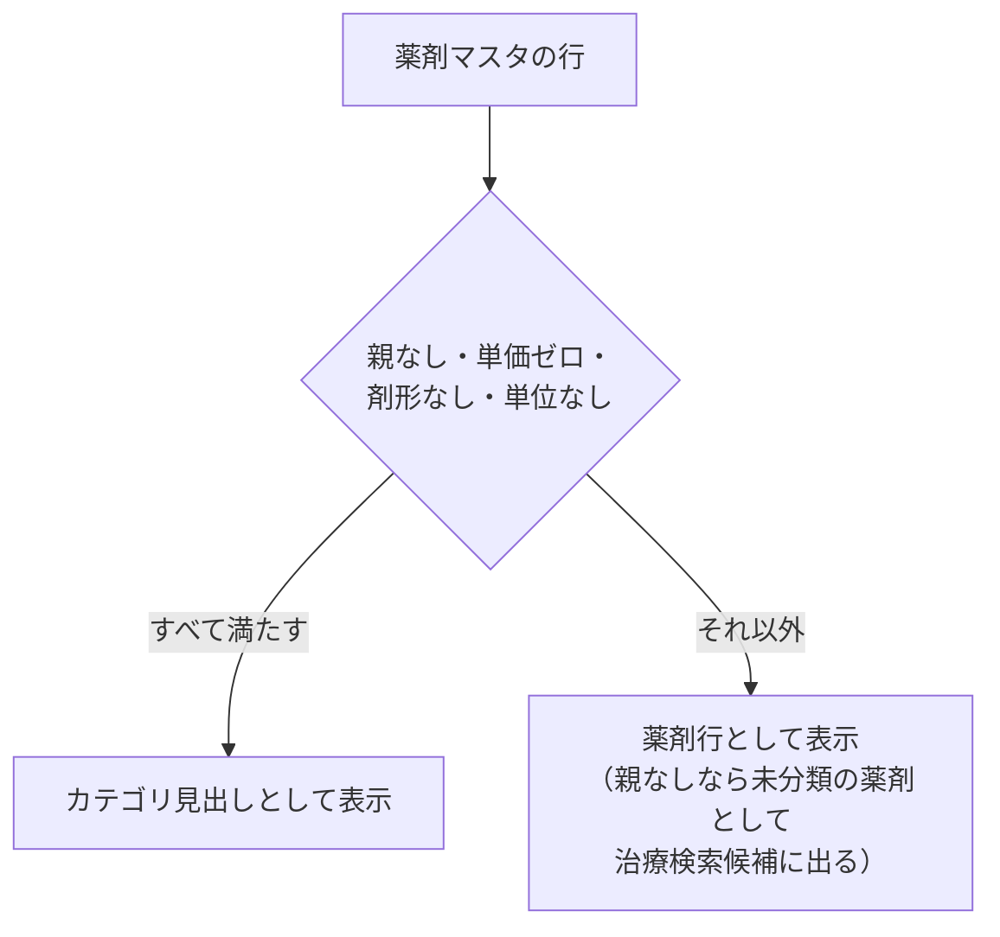

# 薬剤マスタ 仕様書 (Medicine Management)

| 管理項目 | 記載 |
|:---|:---|
| 文書ID・種別 | page.settings.master-medicine／画面仕様 |
| 決定状態 | 既存本文は継承（決定根拠未確認）。第六群の合意と未決は下記正本へ |
| 実装状態 | 既存記載を継承。今回の目標機能／認可適合は未確認 |
| 実機検証状態 | 未実施 |
| 文書確認日 | 2026-10-15 |

### 会計第六群との対応

[第六群の業務正本](../../domains/accounting/lifecycle.md#accounting-agreement-sixth)と[マスタ変更権限](../../domains/accounting/lifecycle.md#requirement-fr-accounting-master-authorized-maintenance)へ従う。全体割引から除外する品目を該当する品目マスタで指定できることが目標。薬剤の保険対象外とは別で、除外フィールド実装済みとしない。価格等のマスタ変更者は管理者と対象変更権限付きスタッフ。既存の診療master履歴保持の正本も維持する。 全スタッフに変更を開放せず、対象grant・医院scopeを検査する。今回、実権限・設定・API／DBは変更していない。詳細な[現行mapping](../../../design/domains/accounting/technical-spec.md#accounting-master-permission-map)は技術仕様へ。

2026-10-14、入力4項目合意の[診療master権限編集・無効化と当時内容保持](../../domains/medical-records/pages/medical-record-form.md#requirement-fr-medical-records-master-history-snapshots)が業務正本。対象masterの操作grant・医院scopeを保持し、無効項目を新規選択せず、既存記録に保存した名称・対象が持つ単位／価格は当時内容を保持する。旧実装説明だけでsnapshot保持済みと判断しない。

### 会計の保存・参照保護契約

[D10のmaster責務と互換](../../../design/domains/accounting/technical-spec.md#accounting-master-coverage)・[画面取得／失敗／保存](../../../design/domains/accounting/technical-spec.md#accounting-screen-contract)へ従う。現在認可・clinic／対象版を検査し、無権限／競合は保存しない。取得失敗を空masterとせず未保存入力を保護。名称変更／無効化／削除で過去請求／資金・帳票参照を失わせず前後値を追跡。旧CRUD表は現行参照で、新業務未対応経路はadapterと実装受入まで利用開始しない。

[第十群](../../domains/accounting/lifecycle.md#accounting-empty-rounding-master)で全体割引除外は初期値／設定欠落時とも対象外にしない。明示設定を保持し保険／税／明細割引と混同しない。追加済み会計行はmaster変更で自動更新せず明示再適用へ。単価×数量の行額は値引き前に行別1円四捨五入。臨床数量・投薬量や確定済み会計／旧帳票は直接変更しない。

## 概要
- **画面の目的**: 院内で使用・処方される医薬品の定義、単価設定、および在庫システムとの紐付け。
- **URLパターン**: `/settings/medicine`
- **アクセス権限**: 診療マスタ管理権限が必要（`ResourceMasterMedical`）

---

## 1. 画面構成

### 1.1 薬剤検索リスト
- **検索**: 薬品名による絞り込み。
- **ステータス**: 有効/無効のフィルタ切り替えに対応（フィルタはステータスのみ）。
- **親カテゴリ**: フィルタではなくグループ表示で扱い、カテゴリ単位の折りたたみ切り替えに対応。
- **カテゴリ判定**: 親なし・単価 0・剤形なし・単位なしの行だけをカテゴリ見出しとする（`isMedicineCategoryNode`）。親なしでも剤形または単位があれば未分類の薬剤として治療検索候補に出す。

### 1.2 詳細編集サイドパネル (`SidePeekPanel`)
- **基本情報**: 薬品名、親カテゴリ、剤形（錠剤、液剤、注射剤、外用剤、散剤）、単位。
- **処方設定**:
    - **単位**: 「1錠あたり」「1mlあたり」「1回あたり」「1gあたり」等の販売・投与単位の定義。
    - **単価(税込)**、**課税区分**（外税/内税/非課税）、**税率**（10%/8%）。
    - **保険対象外**: 対象/対象外の切り替え。
- **投与量自動計算（#201・実装済み）**:
    - `calculation_type = per_weight` の薬剤では、サイドパネルに `MedicineDoseParamsEditor` を表示し、動物種別（犬・猫）ごとの dose パラメータを編集できる（`MedicineSidePanelBody` 経由）。
    - 下限 > 上限はインラインエラーで拒否する。下限 = 上限は受理する。保存成功時はトーストを出す。HTML5 制約だけで無音ブロックしない。
- **在庫連携**:
    - バックエンドの `Medicine` モデルは在庫アイテム（`inventory_id`）を保持するが、本設定画面のサイドパネルに在庫アイテム紐付けUIは未実装（#201 とは別課題）。

---

## 2. 主要な機能

2026-10-14初回合意の[評価不能時の医師確認・理由付き手入力](../../domains/medical-records/lifecycle.md#requirement-fr-medical-records-unevaluable-dose-manual)が最新の業務正本。薬量数値・対象の承認者は医師で、新たな臨床責任者役割を作らない。下記#201の実装説明を値の承認済みや最新確認・ログの反映済みとしない。

### 2.1 処方入力の自動化
ここで設定された剤形と単位は、カルテ詳細の「治療」タブにおける処方明細の入力補助（数量選択や単位表示）として反映されます。体重・species からの数量自動プリフィルはカルテ側 `TreatmentRow`（`calculateDose` / `computeDoseGate`）が担う。上限超過時はインライン表示して送信せず、`ConfirmDialog` による解除経路は無い。上限内の下限割れ・推奨値からの著しい乖離には逸脱理由が必須（挙動詳細は [medical-record-form.md §2.3](../../domains/medical-records/pages/medical-record-form.md)）。対象薬や値の臨床承認は [#261](https://github.com/MinoruSoga/AnimalEkarte/issues/261) の別工程であり、マスタ入力 UI や #201 の Closed を承認証跡としない。

### 2.2 原価・在庫管理の統合（バックエンドのみ）
`PATCH /api/v1/masters/medicines/:id` は `inventory_id` を受け付け、薬品と在庫アイテムを紐付け可能だが、本設定画面のサイドパネルには対応する入力UIが存在しない（他画面または今後の実装課題）。

---

## 3. 技術仕様

### 3.1 構成コンポーネント
- **`MedicineSettings`**: メインページ。
- **`MedicineSidePanel`**: 薬価・剤形・単位・課税区分の直接編集。
- **`MedicineDoseParamsEditor`**: 動物種別 dose パラメータ（per_weight）の編集 UI（#201）。

### API連携
| メソッド | エンドポイント | 用途 | 必須権限 | 必須アクション |
|:---|:---|:---|:---|:---|
| GET | `/api/v1/masters/medicines` | 薬剤一覧の取得 | `master-medical` | `view` |
| GET | `/api/v1/masters/medicines/:id` | 特定の薬剤詳細の取得 | `master-medical` | `view` |
| POST | `/api/v1/masters/medicines` | 新規薬剤の登録 | `master-medical` | `create` |
| PATCH | `/api/v1/masters/medicines/:id` | 価格や在庫紐付け、剤形の更新 | `master-medical` | `edit` |
| DELETE | `/api/v1/masters/medicines/:id` | 薬剤の削除 | `master-medical` | `delete` |
| PATCH | `/api/v1/masters/medicines/reorder` | 表示順序の一括保存 | `master-medical` | `edit` |
| GET | `/api/v1/masters/medicines/:id/dose-params` | 薬剤の動物種別投与量計算パラメータ一覧取得 | `master-medical` | `view` |
| PUT | `/api/v1/masters/medicines/:id/dose-params/:species` | 動物種別投与量計算パラメータの登録・更新 | `master-medical` | `edit` |
| DELETE | `/api/v1/masters/medicines/:id/dose-params/:species` | 動物種別投与量計算パラメータの削除 | `master-medical` | `delete` |

---

