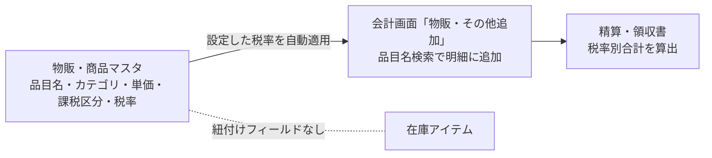

# 物販・商品マスタ 仕様書 (Merchandise Management)

| 管理項目 | 記載 |
|:---|:---|
| 文書ID・種別 | page.settings.master-merchandise／画面仕様 |
| 決定状態 | 既存本文は継承（決定根拠未確認）。第六群の合意と未決は下記正本へ |
| 実装状態 | 既存記載を継承。今回の目標機能／認可適合は未確認 |
| 実機検証状態 | 未実施 |
| 文書確認日 | 2026-10-15 |

### 会計第六群との対応

[第六群の業務正本](../../domains/accounting/lifecycle.md#accounting-agreement-sixth)と[マスタ変更権限](../../domains/accounting/lifecycle.md#requirement-fr-accounting-master-authorized-maintenance)へ従う。全体割引から除外する品目を本マスタに対応する品目設定で指定できることが目標。現行フィールド実装済みとせず、保険対象外・税区分と区別する。価格等のマスタ変更者は管理者と対象変更権限付きスタッフ。品目ごとの税務分類は別途確認が必要。 全スタッフに変更を開放せず、対象grant・医院scopeを検査する。今回、実権限・設定・API／DBは変更していない。詳細な[現行mapping](../../../design/domains/accounting/technical-spec.md#accounting-master-permission-map)は技術仕様へ。

## 概要
- **画面の目的**: 療法食、サプリメント、ヘアケア用品等の販売商品の定義および価格管理。
- **URLパターン**: `/settings/merchandise-items`
- **アクセス権限**: 会計マスタ管理権限が必要（`ResourceMasterMerchandise`）

---

## 1. 画面構成

### 1.1 商品一覧
- **分類**: フード(`food`)、物販(`goods`)、その他(`other`) の3カテゴリ（`MERCHANDISE_CATEGORY_OPTIONS`）。
- **項目**: 品目名、カテゴリ、単価(税込)、税率、有効/無効ステータス。JANコード・在庫数フィールドはモデルに存在しない。

### 1.2 詳細編集サイドパネル (`SidePeekPanel`)
- **品目名**: 正式な販売名称。
- **カテゴリ**: フード/物販/その他の3択。
- **単価・課税区分・税率**:
    - **単価**: `MoneyInput` による金額入力。
    - **課税区分**: 外税/内税/非課税。
    - **税率**: 現行UIは10%／8%を手動選択する記載。カテゴリに応じた自動判定はない。選択肢があることは、療法食など特定品目への税率適用が適切との判断ではない。
- **在庫連携**: `MerchandiseItem` モデルに在庫アイテムとの紐付けフィールドは存在しない（`backend/internal/model/merchandise_item.go`）。販売時の理論在庫自動減算機能は本マスタには実装されていない。

---

## 2. 主要な運営機能

### 2.1 レジでのクイック追加
会計画面の「物販・その他追加」において、品目名検索から素早く明細に追加できます。マスタで設定された税率が自動適用されるため、入力ミスを最小限に抑えます。

### 2.2 税率別の集計と確認範囲
会計時点の税区分・税率を保持し、税率別の集計・端数は[会計の計算契約](../../domains/accounting/lifecycle.md#accounting-calculation-order)に従う。旧本文の特定商品に8%を当てはめた例は、品目の税務分類や適格請求書全体の適合根拠として採用しない。異なる税率の計算例は正本の仮定例を参照し、実際の品目分類は医院の会計責任者等が確認する。今回の文書整理で現行帳票計算を検証済みとはしない。

---

## 3. 技術仕様

### 3.1 構成コンポーネント
- **`MerchandiseItemSettings`**: メインページ。
- **`MerchandiseSidePanel`**: カテゴリ・単価・課税区分の編集。

### API連携
| メソッド | エンドポイント | 用途 | 必須権限 | 必須アクション |
|:---|:---|:---|:---|:---|
| GET | `/api/v1/masters/merchandise-items` | 販売商品の一覧取得 | `master-merchandise` | `view` |
| GET | `/api/v1/masters/merchandise-items/:id` | 特定の商品詳細の取得 | `master-merchandise` | `view` |
| POST | `/api/v1/masters/merchandise-items` | 新商品の登録 | `master-merchandise` | `create` |
| PATCH | `/api/v1/masters/merchandise-items/:id` | 名称・カテゴリ・単価・課税区分の変更 | `master-merchandise` | `edit` |
| DELETE | `/api/v1/masters/merchandise-items/:id` | 商品の削除 | `master-merchandise` | `delete` |
| PATCH | `/api/v1/masters/merchandise-items/reorder` | 表示順の一括保存 | `master-merchandise` | `edit` |

---

