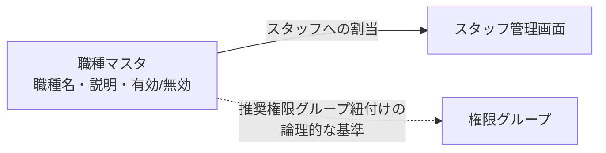

# 職種マスタ 仕様書 (Occupations Management)

## 概要
- **画面の目的**: 医院内で勤務するスタッフの職種（獣医師、看護師、トリマー、受付等）の定義。
- **URLパターン**: `/settings/occupations`
- **アクセス権限**: スタッフ管理者権限が必要（`ResourceMasterStaff`）

---

## 1. 画面構成

### 1.1 職種一覧
- **項目**: 職種名、説明、有効ステータス。
- **並び順**: モデルに `sort_order` フィールドは存在するが、画面上のドラッグ並び替え UI は未実装（一覧は `sort_order` 昇順・名称昇順で表示）。

### 1.2 詳細編集サイドパネル (`SidePeekPanel`)
- **職種名**: 例：「院長」「チーフトリマー」「AHT（動物看護師）」。
- **説明**: 職種の補足説明を自由記述で入力する任意項目。
- **有効/無効**: `StatusToggleButton` によるステータス切り替え。

---

## 2. 主要な機能

### 2.1 スタッフ登録との連動
スタッフ管理画面 (`/settings/staff`) において、ここで定義された職種を割り当てます。

### 2.2 権限プリセットとの親和性
職種と認可role／grantは別管理です。職種に基づく自動付与・自動変更は行わず、権限は既存の明示設定と操作grantへ従います。

---

## 3. 技術仕様

### 使用コンポーネント
- **`OccupationSettings`**: メインコンテナ。
- **`OccupationSidePanel`**: `MasterSidePanel` による職種名・説明の編集。
- **`PropertyInput`**: 説明欄のインライン編集。

### API連携
| メソッド | エンドポイント | 用途 | 必須権限 | 必須アクション |
|:---|:---|:---|:---|:---|
| GET | `/api/v1/masters/occupations` | 定義済み職種の一覧取得 | `master-staff` | `view` |
| GET | `/api/v1/masters/occupations/:id` | 特定の職種詳細の取得 | `master-staff` | `view` |
| POST | `/api/v1/masters/occupations` | 新規職種の追加 | `master-staff` | `create` |
| PATCH | `/api/v1/masters/occupations/:id` | 名称・説明・ステータスの更新 | `master-staff` | `edit` |
| DELETE | `/api/v1/masters/occupations/:id` | 職種の削除 | `master-staff` | `delete` |
| PATCH | `/api/v1/masters/occupations/reorder` | 表示順序の一括保存（BE実装済みだが本画面からは未呼出） | `master-staff` | `edit` |

---

## 職員属性・休業期間の追加接続

[社員リスト採用正本](../../domains/staff-workforce/README.md#staff-source-adoption-20261015)へ従う。職種・役職・雇用区分・認可roleは別概念で自動連動しない。休業は退職と異なる在籍期間属性で、対象期間の新規勤務／指名候補を除外する。既存指名予約は自動取消せず、復帰時も同一人物・所属・履歴を保持する。予約指名は任意のままで、担当医の意味や未定受付を変更しない。
