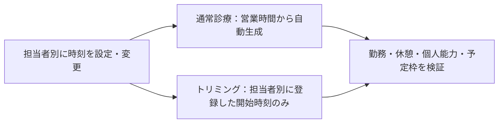

# 予約区分マスタ 仕様書 (Reservation Types)

予約で別分類の区分を選ぶ変更は[18:26の受付前後の変更境界](../../domains/reservations/pages/reservation-management.md#requirement-fr-reservations-cross-business-type-change)が正本。区分マスタ自体の分類変更禁止と混同しない。

> 確定仕様の適用範囲：今回の予約ドメイン合意と本書の接続境界。承認日は各FR要件表・根拠節（2026-10-13〜2026-10-14 17:35）、追加合意は各補足節を参照。[確定FR索引](../../domains/reservations/README.md#approved-reservation-scope)に掲載した箇所のみを確定情報として扱う。対象外の継承本文・未承認案・現行実装説明は一括確定しない。実装・実機状態は別管理。

17:35合意の[ホテル受付上限](../../line/reservation-spec.md#requirement-fr-line-reservations-hotel-concurrent-stay-limit)は、医院別の同時宿泊頭数を宿泊期間全体で判定し、未設定・超過時はLINE確定せず医院相談へ案内する。ケージは宿泊管理側で割り当て、担当医師は任意とし、医師指名／医師シフトで代用しない。技術方式は設計、実装・実機受入は未確認。

17:23 JSTの[LINE予約6点合意](../../line/reservation-spec.md#line-agreement-1723)へ従う。公開された診療・トリミング・ホテルは予約対象、入院は医院相談。ホテルには医師指名・医師シフト・通常予約の同日制約を適用しない。受付制限・入力保持・受付前取消・必要設定不足の扱いと受入条件はLINE正本を参照する。ホテル受入基準は17:35合意の医院別同時宿泊頭数・全宿泊期間判定で、実装・実機受入は未確認。

17:17 JSTの院内予約8点一括合意は[予約入口の決定一覧](../../domains/reservations/README.md#internal-reservation-batch-1717)を参照する。誤取消／誤終了訂正、未終了予約保護、診療前の日付・カルテ整合、マスタ利用・名称履歴、休診日予約／日跨ぎ勤務、患者照合、ホテル担当時点／入院記録失敗の各正本と受入条件へ従う。LINE受付条件は17:23合意（ホテル受入基準は17:35合意、計算・保存方式は設計）、実装・実機受入は未確認。

| 管理項目 | 記載 |
|:---|:---|
| 文書ID・種別 | page.master-reservation-types／既存画面・共通マスタ仕様 |
| 決定状態 | 今回の予約ドメイン合意は2026-10-14 17:35まで反映し、正本間の記述レビュー完了。対象外は既存決定状態を継承。実装・移行・実機検証とは別。完了範囲は予約入口の最終レビュー参照 |
| 実装状態 | main ec4f7146aの必要箇所を静的照合。新合意へ未追従／未確認の残差を下記に記載。コード変更なし |
| 実機検証状態 | 未実施。文書検査と実機受入を分ける |
| 文書確認日 | 2026-10-14（合意・参照・語彙の確認。実機受入日ではない） |

用語・概念関係は[予約オントロジーの語彙正本](../../ontology/reservations.md#reservation-ontology)へ統一する。予約区分、予約区分グループ（表示用）、予約区分の業務分類を区別し、担当者の総称と画面の指名医師／担当トリマー、職種と個人の対応可能予約区分を同義にしない。画面ラベル・引用・コード識別子は継承し、用語整理から未決業務を確定しない。

## 概要
- **画面の目的**: 予約区分の標準所要時間・有効状態・任意のグループと、その色・名称の管理。院内／LINE共通のマスタ。LINE条件は[現在の正本](../../line/reservation-spec.md#line-scheduled-slot-basis)へ従い、実装／検証は別。
- **URLパターン**: `/settings/reservation-type`
- **アクセス権限**: 予約管理権限が必要（`ResourceMasterReservationType`）

---

## 1. 画面構成

### 1.1 予約区分一覧
- **区分グループ**: [所属と色の継承](#requirement-fr-reservation-types-group-inheritance)を採用。区分の所属は0または1グループ、グループの入れ子はなし。業務分類は各区分に別途設定し、[13:14の担当者・記録接続](#requirement-fr-reservation-types-business-routing)へ使う。予約区分自体の親子分類は未決。既存モデルのgeneral／trimmingだけで新合意の分類・対応を実装済みと扱わない。
- **表示項目**: 名称、備考、ステータス（有効/無効）。グループ見出し行にグループ色のドットを表示。行はドラッグ&ドロップで並び替え可能。

### 1.2 詳細編集サイドパネル (`SidePeekPanel`)
- **基本属性**: 名称、ステータス（有効/無効）、グループ、備考。略称・標準所要時間は下記「LINE予約設定」セクション内にある（所要時間は `<input type="number">` min=5 / max=480 分。15 分刻みへの制約はない）。
- **カレンダー色**: 色は[グループ側のみ](#requirement-fr-reservation-types-group-inheritance)で設定し、区分が継承する。未所属は共通標準色。現実装の固定グレーやseed色値を新しい標準色の確定値にしない。
以下のLINE公開・曜日・枠などの詳細は既存実装／既存仕様の参照。2026-10-13の院内予約見直しでLIFFの規制を解除せず、LINE条件は[現在の正本](../../line/reservation-spec.md#line-scheduled-slot-basis)へ従い、残す項目や配置の具体化は設計へ分ける。

- **LINE 予約連携**:
    - **予約ページに表示**: 有効かつオンの区分を飼主向け LIFF アプリの選択肢に出す。「内部サービス」がオン、または無効の区分は公開しない。無効化済み区分の新規予約もサーバ側で拒否する（#238）。
    - **所要時間**: [院内／LINE共通・保存済予約不変](#requirement-fr-reservation-types-shared-duration)が合意仕様。LINE予約設定内に置かれている現画面の配置と、業務上の共通責務は分ける。
- **予約可能枠**: [追加合意1](../../line/reservation-spec.md#requirement-fr-line-reservations-business-start-times)では、通常診療は営業時間から生成、トリミングは医院が担当者別に登録した開始時刻だけを候補とし、時刻を変更できる。以下の追加・削除リストは現行UI参照で、担当者別編集の実装適合は未確認。予約可能な開始時刻（毎週／特定日）をリスト形式で追加・削除。「カレンダーで編集」リンクから [LINE予約枠カレンダーページ](../28-line-reservation.md)（`/line-reservation/slots?typeId=:id`）へ遷移し、週カレンダーで日別に編集できる。子予約区分を持つ親区分では非表示（「子予約区分ごとに予約枠を設定してください」の案内のみ表示）。
- **予約不可時間**: 予約を受け付けない時間帯（毎週／特定日）を時間範囲で登録。予約可能枠と同様、子予約区分を持つ親区分では非表示。
- **紐付け職種による予約可否**: [2026-10-13 20:43の廃止合意](#requirement-fr-reservation-types-occupation-gate-retirement)に従う。現画面の「紐付け職種（出勤なし → 予約不可）」は実装残差で、新仕様の入力項目ではない。職種自体のスタッフ分類は残す。

> **現行差分：旧加算挙動**。`mergeAvailableTimeSlots`で登録時刻を営業時間由来の枠へ加算する旧方式は、追加合意1のトリミング登録時刻限定に追従していない。通常診療の営業時間からの自動生成、変更可能な担当者別開始時刻、勤務・能力の再検証を区別する。設定変更で既存予約を黙って移動・取消・担当変更しない。目標仕様は[LINE予約設定](../28-line-reservation.md#line-staff-start-times-settings)へ従う。

以下のseed表と色コードは旧実装の参照情報で、合意した10presetのRGB値を示すものではない。DB・seedは今回変更しない。

### 1.3 標準予約区分（seed 投入）

全医院に共通で用意する標準区分。八王子テスト報告（EMR-193）で「新規予約作成でトリミングしか選べない」ことが判明したため追加された。

| 名称 | category | 標準所要時間 | sort_order | 既定のLINE公開 | 色 |
|---|---|---|---|---|---|
| 診察 | `general` | 15 分 | 1 | 非公開 | `#3B82F6` |
| お手入れ | `general` | 15 分 | 2 | 非公開 | `#10B981` |
| ワクチン | `general` | 15 分 | 3 | 非公開 | `#8B5CF6` |
| 健診 | `general` | 15 分 | 4 | 非公開 | `#F97316` |
| ホテル | `general` | 15 分 | 5 | 非公開 | `#06B6D4` |

- 既存のトリミング区分（`sort_order=9`、`category=trimming`）より前に並ぶ。
- **投入経路**: `backend/migrations/seeds/live_insert_standard_reservation_types.sql` を承認済み runbook から `psql` で手動適用する。`cmd/migrate` の自動適用対象ではなく、CSV bundle（`002_master`）の immutable 制約により CSV 直接編集も行わない。
- **冪等性**: `(clinic_id, name)` の未削除行が既にある医院では INSERT をスキップし、手動作成済みの同名区分を上書きしない。
- **`reservation_visible=false`（非公開）が既定**: 院内予約フォームは `is_active` のみで絞るため院内では即選択可能だが、LIFF の飼主向け選択肢には出ない。LINE 予約へ公開する場合は本画面で区分ごとに有効化する。
- **ホテル（EMR-321、2026-10-08 ユーザー決定）**: 15 分はチェックイン時の来院枠で、預かり日数ではない。予約詳細の「入院・ホテル登録」へ進める。既存同名行は属性を維持し、無効行があると投入全体が rollback される。削除済み行も事前確認し、[手動投入・ケージ確認手順](../../../ops/deploy/runbooks/EMR-321_HOTEL_RESERVATION.md)に従う。手動 SQL のみでは fresh DB 用 CSV は更新されない。

次の図は追加合意1の目標契約を表す。上記seedや旧加算実装の動作図ではない。

---

## 主要な機能

### 1. カレンダー・スケジューリング
ここで設定された標準所要時間は、[最新8点](../../domains/reservations/pages/reservation-management.md#booking-course-option-duration-20261017)のコース未選択時の基礎時間として院内／LINEで共通に用いる。コース選択時はコース時間を基礎にし、選択追加オプション時間を加算する。

### 2. カラーコーディング
区分グループ単位の色分け（例：診察系グループは赤、トリミング系グループは緑）により、カレンダーを俯瞰した際の院内の忙しさやリソース配置を一目で把握可能にします（色は区分グループに設定するもので、予約区分単体には設定できません）。

---

## 2026-10-13の途中合意・業務要件

決定者はユーザー、合意日は2026-10-13。根拠は予約マスタ・担当適格性・シフト連携の対話合意を親タスクから引き継いだ記録。予約ドメインには関連マスタ・シフト・LINEも含み、途中合意で未完了。LINE6点は17:23合意、ホテル受入基準は17:35合意、計算・保存方式は設計として保持。実装・実機受入の完了を意味しない。

| 要件ID | 定義の所在 | 決定根拠 |
|:---|:---|:---|
| FR-reservation-types-business-routing | [業務分類と担当者・記録接続](#requirement-fr-reservation-types-business-routing) | 合意済み。2026-10-14 13:14 JST、ユーザー「ok」。17:17までに確定したホテル・入院接続を満たす画面／保存方式と専用管理内部は未決。既存予約がある区分の分類変更は14:14合意で不可 |
| FR-reservation-types-business-classification-lock | [既存予約がある区分の分類変更禁止](#requirement-fr-reservation-types-business-classification-lock) | 合意済み。2026-10-14 14:14 JST、ユーザー「ok」。未来・過去を含む。未使用変更・未設定補完は15:58合意。補完担当は旧マスタ確認補完FRで確定。権限識別子・確認資料・方式は設計 |
| FR-reservation-types-business-classification-initialization | [業務分類の変更・未設定補完](#requirement-fr-reservation-types-business-classification-initialization) | 合意済み。2026-10-14 15:58 JST、ユーザー「ok」。補完担当は旧マスタ確認補完FRで確定。権限識別子・具体的方法は設計 |
| FR-reservation-types-hotel-inpatient-entry | [ホテル担当と入院の両入口](#requirement-fr-reservation-types-hotel-inpatient-entry) | 合意済み。2026-10-14 16:07 JST、ユーザー回答。開始操作は16:33、担当医決定・記録時期は16:44合意。失敗時の開始未確定・理由表示・再試行は17:17合意。UI・保存方式は設計 |
| FR-reservation-types-inpatient-start-confirm | [来院後の入院開始確定と同じ入院の二重登録防止](#requirement-fr-reservation-types-inpatient-start-confirm) | 合意済み。2026-10-14 16:33 JST、ユーザー「ok」。担当医・記録時期は16:44合意。失敗時の開始未確定・理由表示・再試行は17:17合意。画面配置・保存方式は設計 |
| FR-reservation-types-shared-duration | [共通所要時間と既存予約](#requirement-fr-reservation-types-shared-duration) | 合意済み。2026-10-13、ユーザー対話。根拠は下記 |
| FR-reservation-types-occupation-gate-retirement | [紐付け職種による予約可否の廃止](#requirement-fr-reservation-types-occupation-gate-retirement) | 合意済み。2026-10-13 20:43 JST、共通化提案にユーザー「ok」 |
| FR-reservation-types-duration-required | [作成時の所要時間必須](#requirement-fr-reservation-types-duration-required) | 合意済み。2026-10-13 20:19「必須だね」。上下限は21:28合意を参照 |
| FR-reservation-types-duration-step | [所要時間の5分刻み](#requirement-fr-reservation-types-duration-step) | 合意済み。2026-10-13 20:20:45「5分刻みでいいよ」。上下限は21:28合意を参照 |
| FR-reservation-types-duration-range | [所要時間の5〜480分](#requirement-fr-reservation-types-duration-range) | 合意済み。2026-10-13 21:28 JST、ユーザー「ok」。両端を含む |
| FR-reservation-types-unset-duration-review | [既存所要時間未設定への対応](#requirement-fr-reservation-types-unset-duration-review) | 合意済み。2026-10-13 21:35 JST、ユーザー「ok」。実データの有無・件数は未確認 |
| FR-reservation-types-unset-duration-new-use | [未設定区分の新規利用停止](#requirement-fr-reservation-types-unset-duration-new-use) | 合意済み。2026-10-13 21:41 JST、ユーザー「ok」。実データ有無は未確認 |
| FR-reservation-types-delete-restore-history | [削除・復元と履歴保持](#requirement-fr-reservation-types-delete-restore-history) | 合意済み。2026-10-14 12:51 JST、ユーザー「ok」。所属保持・配下新規利用停止・復元有効化後の個別有効だけ再開は13:00合意。無効中個別編集は17:17合意、保存方式は設計 |
| FR-reservation-types-disable-history | [無効化と履歴保持](#requirement-fr-reservation-types-disable-history) | 合意済み。2026-10-13、ユーザー対話。根拠は下記 |
| FR-reservation-types-name-history | [名称変更の未来反映・過去保持](#requirement-fr-reservation-types-name-history) | 合意済み。2026-10-13 21:14 JSTの原則と21:19 JSTの開始日時境界。名称revision／予約snapshotと根拠不明値の保持は[予約D01の技術契約§3.2](../../../design/domains/reservations/technical-spec.md#reservation-storage-details)で選定。実旧値調査・物理実装・移行は未実施 |
| FR-reservation-types-inactive-existing-edit | [既存予約の無効区分保持と変更](#requirement-fr-reservation-types-inactive-existing-edit) | 合意済み。2026-10-13 20:58 JST、ユーザー「ok」。指名条件は維持 |
| FR-reservation-types-group-disable-new-use | [グループ無効化と新規利用停止](#requirement-fr-reservation-types-group-disable-new-use) | 合意済み。2026-10-13、ユーザーのグループ無効化回答。個別意図とgroup状態の分離は[予約D01の技術契約§3.2](../../../design/domains/reservations/technical-spec.md#reservation-storage-details)で選定。物理フラグ／更新SQLは実装設計 |
| FR-reservation-types-group-reactivation-intent | [再有効化と個別有効意図の保持](#requirement-fr-reservation-types-group-reactivation-intent) | 合意済み。2026-10-13 20:55 JST、ユーザー「ok」。意味保持は[予約D01の技術契約§3.2](../../../design/domains/reservations/technical-spec.md#reservation-storage-details)で選定。物理フラグ／移行は実装設計 |
| FR-reservation-types-group-inheritance | [任意所属とグループ継承](#requirement-fr-reservation-types-group-inheritance) | 合意済み。2026-10-13の色継承と2026-10-14 12:56 JSTの所属0または1・グループ階層なし。業務分類は13:14以降の接続契約へ従う |
| FR-reservation-types-group-color-picker | [10presetと詳細RGB](#requirement-fr-reservation-types-group-color-picker) | 合意済み。2026-10-13、ユーザー対話。根拠は下記 |
| FR-reservation-types-legacy-review | [正本](#requirement-fr-reservation-types-legacy-review) | 業務5点一括合意 Sentinel_c713c4fdc74c819182979c4b8d2fef07。内部設計・実機未確認 |

### 予約区分の業務分類と担当者・受付後の記録への接続（13:14合意）

担当者の種類と受付後の記録・管理への接続に使う業務分類を、各予約区分に設定する。表示用グループとは別の設定とし、グループの所属・名称・色だけから業務分類を推定しない。グループ所属0または1・階層なしと色継承は維持する。

| 業務分類 | 担当者の種類 | 受付後に接続する記録・管理 | 今回の決定範囲 |
|:---|:---|:---|:---|
| 診療 | 指名医師 | 通常カルテ | 既存の受付時作成・同時成功・再利用契約を維持 |
| トリミング | トリマー | トリミング記録 | 接続先を確定。専用記録の内部処理・作成タイミング詳細を追加確定しない |
| ホテル | 予約で指名医師を選ばない。宿泊管理の担当医師は任意 | 宿泊管理 | 2026-10-15最新承認により旧受入前担当決定条件を更新。臨床入院の開始担当条件は維持 |
| 入院 | 予定入院の予約時は指名医師未定可。入院開始までに担当医決定 | 入院管理 | 16:07合意。予約区分からの予定入院と診察後の入院決定の両方。入院開始は16:33合意。開始確定時に入院記録を作成。失敗時の開始未確定・理由表示・再試行は17:17合意。画面配置・保存方式は設計 |

診療カルテは[横断フローの受付契約](../../workflows/reservation-to-record-flow.md#checkin-contract)どおり、予約時に作成せず受付済にするときに作成し、受付済への変更と作成が両方成功した場合だけ確定する。診療開始時の作成済みカルテの再利用・重複防止、未作成／作成・読込み失敗時の開始未確定・理由表示・再試行も維持する。この分類設定だけでトリミングやホテルにも通常カルテを自動作成する契約へ広げない。専用記録・宿泊管理の既存内容は保持する。

分類は担当者の種類と接続先を選ぶ業務上の情報。[個人対応区分＋シフトの担当可能者基準](master-staff.md#requirement-fr-staff-shared-reservation-eligibility)、有効性・勤務・休憩・診療施設等の既存適格性は維持する。区分側の紐付け職種で別に予約可否を設定する[廃止済みの条件](#requirement-fr-reservation-types-occupation-gate-retirement)を復活させない。診療中の医師交代の判定時間等を、トリマーやホテル担当者に独断で拡張しない。

ホテル予約では指名医師を選ばず、宿泊管理側の担当医師は任意とする。入院は予約区分からの予定入院と診察後の入院決定の両方を扱う。ホテル担当は2026-10-15最新承認で任意へ更新済み。入院は16:33の明示開始と16:44の担当医決定・記録作成時期へ従い、失敗時の開始未確定・理由表示・再試行は17:17合意。具体的UI・内部記録・保存方式は設計。既存予約がある区分の分類変更は下記14:14合意で不可とした。未使用区分の変更、既存データの未設定分類の補完は[15:58合意](#requirement-fr-reservation-types-business-classification-initialization)に従う。既存モデルから新しい分類へ機械的に割り当てたり、既存予約の担当者・記録を自動差替え／削除したりする判断を含めない。分類値のデータ表現・保存形式・APIや既存データの調査は実装設計／調査として分ける。予約区分自体の親子分類は別未決。LINE固有条件は17:23・17:35・18:26合意のLINE正本へ従う。

決定者はユーザー。2026-10-14 13:08 JSTに提示した質問「次は、予約区分によって『担当者』と『受付後に作る記録』をどう切り替えるかです。診療は指名医師・カルテ、トリミングはトリマー・トリミング記録、ホテルは宿泊管理につなぐ想定です。この切り替えに使う業務分類を各予約区分に持たせ、表示用のグループとは別に設定する形でよいですか？」への13:14 JSTの明示返信「ok」（Sentinel_f423a6bd3e80819191645d867627ab62）が根拠。実装対応・実機受入は未確認で、予約ドメイン全体は未完了。

### ホテルの世話担当と入院管理への両入口（16:07合意）

ホテル予約では指名医師を選ばない。宿泊管理側の担当は担当医師であり任意とする。未設定だけで受入開始を拒否せず、別責任担当・非医師担当・一名必須を追加しない。予約指名と宿泊担当の参照は分離し、指定時の参照・履歴は保持する。臨床入院開始までの担当医決定は維持する。

入院は予約区分として必要であり、区分に設定する業務分類の接続先に入院管理を含める。[予約区分からの予定入院](../../domains/reservations/pages/reservation-management.md)と、診察後に入院を決定して[入院管理へつなげる入口](../09-hospitalization-form.md)の両方を扱う。「入院は予約区分として直接登録しない」という親の案は採用しない。表示用グループと業務分類の分離は維持し、診療・トリミング・ホテルの3分類だけで対象を閉じない。他の未提示分類の網羅を意味するものでもない。

入院開始は下記16:33合意で来院後にスタッフが明示確定し、同じ入院は二重登録しない。予約時は指名医師未定可、開始までに担当医を決定し、開始確定時に入院記録を作ることは16:44合意。失敗時の開始未確定・理由表示・再試行は17:17合意。具体的画面・保存方式・重複防止は設計。既存入院管理の「予約」「チェックイン」「担当医」等の記載は継承した現行参照であり、今回の予約区分からの連携を実装済み／受入済みと扱わない。予約の指名医師と入院管理の担当医を同一フィールドとして確定しない。診療の通常カルテは従来の受付時作成・同時成功・再利用を維持し、その契約を予定入院・ホテルへ独断で広げない。

予約の日時枠と、入院・宿泊の予定期間／実際の滞在状態は別概念。既存の入院管理本文・記録・名称履歴は保持し、この入口の追加によって担当者・作成済み記録・期間を自動変換しない。未設定業務分類の補完や、既存予約ありの設定済み分類変更禁止、個別／グループ有効状態等も維持する。データ表現・API・保存方法は実装設計へ分ける。

決定者はユーザー。2026-10-14 16:07 JSTの回答「ホテル予約では指名医師を選ばず、世話をする担当者は宿泊管理側で割り当てる → ok／入院は予約区分として直接登録せず、診療後の入院決定から入院管理につなげる → いえ、予約区分として必要です。診察後の入院も必要」（Sentinel_5aad9aee08f08191b51bff10018f132d）が根拠。後半は親の案への明示訂正であり、直接予約を禁止する根拠にしない。実装対応・実機受入は未確認、予約ドメイン全体は未完了。

### 来院後の入院開始確定と同じ入院の二重登録防止（16:33合意）

予定入院は予約区分から登録する入口を維持するが、予約しただけでは「入院中」にしない。来院後にスタッフが「入院開始」を明示確定し、入院中へ進める。予約・予定日になったことだけを入院開始確定の代替にしない。予定入院と実入院の業務状態を区別する。

診察後に入院する場合も、診察後の入院決定から同じ[入院管理](../07-hospitalization-list.md)へつなぐ入口を維持する。同じ入院を二重に登録しない。予約区分からの予定入院と診察後の入口が同じ入院に重なる場合は、その同じ入院を管理対象として扱い、入口ごとに別の入院として登録しない。この「同じ入院」は業務上の同一対象であり、同じ患者というだけで別の滞在・過去の入院まで自動的に同一対象へまとめる技術判断を含めない。

「入院開始」は来院後の実入院をスタッフが確定する業務操作の推奨用語。既存[入院詳細の「チェックイン」](../08-hospitalization-detail.md#2-チェックイン予約入院中)は現行画面・実装の参照として残す。ボタンの配置、表示条件・権限識別子、確認画面、既存チェックインとの具体的対応は未決で、今回新しい画面操作を設計済みとは扱わない。予定登録時の管理データの持ち方は実装設計へ分ける。業務上の入院記録は16:44合意で開始確定時に作り、開始までに担当医を決める。二重登録を防ぐ業務結果は確定したが、既存対象の検索・照合・保存・同時操作・冪等性等の技術方式は実装設計として分ける。

既存予約・診療カルテ・入院管理の記録と関連を保持し、二重登録防止を作成済み記録の削除・再作成・担当者の自動変換にしない。診療の受付時通常カルテ作成・同時成功・再利用、ホテル予約の指名医師なし・宿泊管理の担当医師は任意、業務分類の変更／補完・表示グループ等の既存契約は維持する。

決定者はユーザー。2026-10-14 16:33 JST、直前の質問「予定入院は予約だけでは入院中にせず、来院後にスタッフが『入院開始』を確定する。診察後に入院する場合も同じ入院管理へつなぎ、同じ入院を二重に登録しない。この方針でよいですか？」への明示返信「ok」（Sentinel_11cef20722408191860fdaf5e89cf431）が根拠。担当医師・記録作成時点・画面配置・技術方式まで承認されたものにしない。実装対応・実機受入は未確認で、予約ドメイン全体は未完了。

#### 入院開始までの担当医決定と開始確定時の入院記録作成（16:44合意）

予定入院の予約時は、予約の指名医師を未定でも登録できる。来院後にスタッフが「入院開始」を確定するまでに、入院担当医を決める。担当医が未決定のまま入院開始を確定する条件にはしない。入院開始の確定時に入院記録を作る。予定を予約しただけでは入院中にせず、予約時に入院記録を作る流れへ読み替えない。

診察後の入院決定からつなぐ入口も同じ入院管理へ接続し、入院開始までの担当医決定・開始確定時の入院記録作成と整合させる。予定入院と診察後の入口が同じ入院に重なる場合は、同じ管理対象を扱い、二重登録しない。既存の診療カルテや関連を保持し、入院記録作成を通常カルテの削除・再作成・分類自動変換にしない。

「指名医師」は予約で選ぶ医師、「入院担当医」は入院管理で入院を担当する医師。予約時の指名を入院担当医へ自動転記・自動確定する合意ではない。診察した医師が自動的に入院担当医になるとも確定しない。ホテルの世話担当者とは別概念であり、ホテル予約の指名医師なしという既存合意は維持する。

「入院記録」は今回、入院開始確定時に作る入院の業務記録を指す。既存管理画面の予定レコード、治療プラン、ケアプラン、デイリーカルテや通常カルテとのデータ上の対応・内容は追加確定しない。担当医を決める具体的画面・候補条件・権限識別子、担当医の自動引継ぎ、17:17合意の開始未確定・理由表示・再試行を満たす保存方式、既存開始済み記録の救済等は未提示。二重登録防止・保存・同時操作・冪等性等の技術方法も、合意した業務結果を満たす実装設計として分ける。

決定者はユーザー。2026-10-14 16:44 JST、質問「予定入院の予約時は指名医師を未定でも登録でき、入院開始までに担当医を決め、入院開始の確定時に入院記録を作る、という流れでよいですか？」への明示返信「良いです」（Sentinel_0b6b486206548191a6169299fbec4ea0）が根拠。16:33合意の両入口・来院後の明示開始・同じ入院の二重登録防止を維持する。実装対応・実機受入は未確認で、予約ドメイン全体は未完了。

### 既存予約がある予約区分の業務分類変更禁止（14:14合意）

既存予約がある予約区分の業務分類は変更できない。未来予約だけに限定せず、過去の予約を含めて同じ条件を適用する。異なる業務分類が必要な場合は、新しい予約区分を作成する。既存予約を新しい区分へ自動差替えせず、既存予約・指名医師等の担当者・作成済みカルテや専用記録の関連を変更しない。過去完了の記録・名称履歴も保持する。

この変更禁止は業務分類に限定する。[名称変更の未来反映・過去保持](#requirement-fr-reservation-types-name-history)、[表示グループ所属と色](#requirement-fr-reservation-types-group-inheritance)、[削除・復元と新規利用の再開](#requirement-fr-reservation-types-delete-restore-history)、無効区分の既存保持編集など、別途合意した変更条件を一律禁止しない。それぞれの条件・未決を維持し、分類変更禁止を理由に別の項目まで編集不可へ広げない。新規区分も所要時間・有効状態・担当者適格性等の既存条件に従う。

15:58合意により、予約に使っていない区分は業務分類変更可。未設定は新規選択不可とし、既存予約・記録がある未設定区分は内容を確認して補完する。補完は設定済み分類の変更とは区別し、担当者・記録を自動変換しない。補完担当と判断不能時の停止は[旧マスタ正本](#requirement-fr-reservation-types-legacy-review)で確定。権限識別子・確認資料・具体的方法は設計で、推定補完は許可しない。未設定データの存在・件数・旧モデルとの対応は調査事項で、実在を断定しない。予約参照の検出・同時保存の整合・保存形式等の技術方法は、この禁止と関連保持を満たす実装設計に分ける。

決定者はユーザー。2026-10-14 13:18:34 JSTの質問「次は分類変更時の扱いです。既存予約がある区分は業務分類を変更できず、別の区分を新規作成する形を提案します。たとえば『診療→トリミング』の変更で、予約済みの指名医師や作成済みカルテとの関係が変わるのを防ぐためです。この方針でよいですか？」（Sentinel_f2fa10d731f88191865901c11fb9f347）への明示返信「ok」（Sentinel_8e234bf349f881919c6344ab10ed935b）が根拠。ホテル担当者・入院分類等の未決を確定せず、実装対応・実機受入は未確認。予約ドメイン全体は未完了。

### 業務分類の未使用変更・未設定補完（15:58合意）

まだ予約に使っていない予約区分は、設定済みの業務分類を変更できる。過去を含む既存予約がある区分の設定済み分類は、[14:14合意](#requirement-fr-reservation-types-business-classification-lock)どおり変更不可で、異なる分類には新しい区分を作成する。未使用の判定を未来予約の有無だけで代替しない。未使用でも作成済み記録だけがある等の不整合の具体的救済は、今回独断で確定しない。

業務分類が未設定の予約区分は、新規予約で選べない。院内の選択・保存で未設定区分を使う新規予約を拒否し、業務分類が未設定で利用できないという理由を表示する。表示の正確な文言・配置・管理画面への導線は設計とし、管理権限を追加確定しない。所要時間未設定による利用停止や個別／グループ無効・削除状態と区別し、一つを解消しただけで他の利用条件を免除しない。LINE固有の公開・受付・飼主への案内は17:23・17:35・18:26合意のLINE正本へ従う。新規選択不可の共通条件と飼主への設定不足案内を区別する。

すでに予約または記録がある未設定の区分は、内容を確認して業務分類を補う。ここでいう「補完」は未設定に初めて確認済みの分類を設定する操作で、設定済み分類を別の値へ変更する操作とは異なる。補完に伴って既存の記録を作り直さず、既存予約の指名医師等の担当者・作成済みカルテ／専用記録・それらの関連を自動変換・差替え・削除しない。名称履歴・既存予約保持・診療段階の通常操作制限も維持する。

補完完了後も、個別／グループの明示有効化、所要時間、担当者適格性等の他の新規利用条件を満たす必要がある。補完だけで無効区分や削除済みグループを有効化せず、停止中の区分の所属変更単独での利用再開も許可しない。新しい予約は確認済み業務分類の担当者種類・記録接続へ従うが、既存予約・記録の変換をその接続契約から推定しない。

補完担当と判断不能時の利用停止・確認待ちは[旧マスタ確認補完](#requirement-fr-reservation-types-legacy-review)で確定。具体的権限識別子・確認資料の照合・救済操作・保存形式は調査／技術設計。業務判断と実装設計／調査を分け、現行モデルや名称から自動推定する方式を承認済みにしない。分類未設定の実データの有無・件数も未確認。17:17までに確定したホテル・入院接続を満たす画面／保存方式と専用管理内部等の未決は維持する。

決定者はユーザー。2026-10-14 14:57 JSTに再提示した質問「1. まだ予約に使っていない予約区分は、業務分類を変更できる 2. 業務分類が未設定の予約区分は、新規予約で選べない 3. すでに予約や記録がある未設定の区分は、内容を確認して分類を補い、既存の記録は作り直さない。この扱いでよいですか？」（Sentinel_45d3d4ffde3081919db10f858c358714）への15:58 JSTの明示返信「ok」（Sentinel_43510c38c9588191a9741f20c5fc249b）が根拠。14:24の用語説明・14:57の手順整備だけを承認根拠にしない。実装対応・実機受入は未確認で、予約ドメイン全体は未完了。

### 旧マスタの未設定・不整合の確認補完（業務5点合意）

医院のマスタ管理担当が旧マスタの業務内容・既存予約・関連記録・設定を確認して補完する。判断不能な対象は利用停止・確認待ちを維持する。過去名称や勤務を推測で埋めず、既存予約の時刻・担当・記録を自動変更しない。業務分類補完・所要時間設定の既存条件を維持し、補完だけで有効化・利用再開しない。内容が混在する区分も一つの分類へ強制変換しない。

対象一覧・確認結果・担当と未処理の保持、実データの有無・件数、過去名称や勤務の確認資料、具体的権限識別子・保存形式は調査／技術設計として分ける。判断不能時の利用停止は新規利用の保護であり、既存記録の参照・既存予約の保持を拒否したり履歴を削除したりする意味ではない。

決定者はユーザー。親の5案一括確認 Sentinel_4c765f9ae6b88191902a7abfed6ac6c1「この5点でよいでしょうか？」への2026-10-14の返信 Sentinel_c713c4fdc74c819182979c4b8d2fef07「ok」が根拠。承認は業務5点に限定し、技術方式の詳細・他ドメイン内部・実装／実機受入を確定しない。

### 共通所要時間と既存予約

標準所要時間は院内／LINEで共通とし、[最新8点](../../domains/reservations/pages/reservation-management.md#booking-course-option-duration-20261017)のコース未選択時の基礎時間として使う。マスタの所要時間変更は新規予約のみへ適用し、保存済み予約の終了時刻を変更しない。予約入力の自動終了と手動終了保持は[予約正本](../../domains/reservations/pages/reservation-management.md#requirement-fr-reservations-end-time-preservation)を参照。区分／開始の編集に関する既存の手動終了保持は維持し、コース／オプション変更時は最新8点に従い再計算・保存前の新終了表示・延長時も既決の重複／空き枠チェックを適用する。未設定durationの実在・UI／判定方式は調査・設計。

### 作成時の所要時間必須

予約区分作成時の標準所要時間は必須。2026-10-13 20:19のユーザー「必須だね」（Sentinel_07dd3025feec819193ab15c06b992491）が根拠。5分刻みと[5〜480分の範囲](#requirement-fr-reservation-types-duration-range)に従う。既存所要時間未設定への自動補完なし・一覧提示は21:35合意済み。新規選択不可は21:41合意済みで、補完担当は[旧マスタ正本](#requirement-fr-reservation-types-legacy-review)で確定。判定方法・設定時期・導線は設計で、現実装の既定15分を補完値として承認した意味ではない。

### 所要時間の5分刻み

標準所要時間は5分刻みとする。2026-10-13 20:20:45のユーザー「5分刻みでいいよ」（Sentinel_37f8d0a276c8819194f2f1f97dc30b44）が根拠。カレンダー空白の15分ホバー位置単位とは別の契約で予約長を15分へ固定しない。上下限は21:28 JSTの[5〜480分合意](#requirement-fr-reservation-types-duration-range)で確定。既存所要時間未設定への自動補完なし・一覧提示は21:35合意済み。新規選択不可は21:41合意済みで、補完担当は[旧マスタ正本](#requirement-fr-reservation-types-legacy-review)で確定。判定方法・設定時期・導線は設計。

### 所要時間の5〜480分

予約区分マスタの標準所要時間は必須、5〜480分（8時間、両端を含む）、5分刻みとする。範囲外・5分刻みでない値・作成時未入力は保存を認めず修正を求める。2026-10-13 21:28 JST、現状の上下限を維持する問いへのユーザー「ok」が根拠。

この範囲はマスタの標準所要時間に限る。実予約の[終了時刻の手動編集と保持](../../domains/reservations/pages/reservation-management.md#requirement-fr-reservations-end-time-preservation)は維持し、手動で決めた実予約の時間長へ5〜480分の制約を自動適用しない。開始より後の終了など他の既存条件と、時刻入力の未決事項はそのまま。既存所要時間未設定への対応は下記の21:35合意に従う。新規選択不可は21:41合意済みで、補完担当は[旧マスタ正本](#requirement-fr-reservation-types-legacy-review)で確定。判定方法・設定時期・導線は設計で、今回コード・DBを変更しない。

標準所要時間の範囲内でも、開始＋所要時間が翌日に出る通常予約は[同日予定制約](../../domains/reservations/pages/reservation-management.md#requirement-fr-reservations-same-day-schedule)に従い修正を求める。マスタ値の有効性と任意の開始時刻で予約できるかを混同せず、自動短縮・別日分割をしない。宿泊期間の詳細は別ドメインへ委ねる。

### 既存所要時間未設定への対応

既存の予約区分に標準所要時間が未設定のものがある場合、一律30分等の値を自動補完せず、対象を一覧で示して設定してもらう。登録済み予約の開始・終了時刻は変更しない。

これは条件付きの合意で、実データの未設定有無・件数は未確認。存在や件数を断定せず、未設定の判定方法は調査／設計。補完担当は[旧マスタ正本](#requirement-fr-reservation-types-legacy-review)で確定。設定時期・具体的導線は設計に残す。21:35時点で未決だった新規予約利用可否は、21:41の[設定完了まで新規選択不可](#requirement-fr-reservation-types-unset-duration-new-use)として解消した。新しい区分の作成時必須と既存区分の扱いは区別し、個別／グループ無効を勝手に解除しない。

決定者はユーザー、2026-10-13 21:35 JSTにこの一覧提示・設定依頼・自動補完なし・保存済み予約時刻保持の提案へ「ok」と回答。今回実データを読み書きせず、移行や補完を実施したとは記載しない。

### 未設定区分の新規利用停止

所要時間が未設定の予約区分は、所要時間を設定するまで新規予約では選択不可とする。登録済み予約の扱いは変えず、開始・終了時刻を変更しない。[院内の理由表示と設定導線](../../domains/reservations/pages/reservation-management.md#unset-duration-guidance)を用意する。LINE利用者へ管理画面導線を表示する合意ではなく、LINEの設定不足時の選択不可・必要に応じ医院連絡は[LINE正本](../../line/reservation-spec.md#requirement-fr-line-reservations-required-setup)で合意済み。具体的表示方式と実装／検証は別。

所要時間設定が完了しただけで、区分個別の無効状態や所属グループの無効状態を解除しない。新規選択には他の有効状態・適格性等の条件も維持する。自動補完なし・対象一覧・既存時刻保持は[21:35の対応](#requirement-fr-reservation-types-unset-duration-review)に従う。

決定者はユーザー、2026-10-13 21:41 JSTにこの新規選択不可・院内案内・登録済み予約保持の提案へ「ok」と回答。未設定の実データ有無・件数は未確認で、未設定の判定方法は調査／設計。補完担当は[旧マスタ正本](#requirement-fr-reservation-types-legacy-review)で確定。設定時期・具体的導線は設計。今回コード・DBを変更しない。

### 紐付け職種による予約可否の廃止

予約区分側で別に予約可否を設定する「紐付け職種（出勤なし → 予約不可）」を廃止する。担当可能者の共通基準は[スタッフ個人の対応可能区分とシフト](master-staff.md#requirement-fr-staff-shared-reservation-eligibility)。職種はスタッフ分類として維持する。院内とLINEで担当可能者の基準を共通化するが、院内の警告付き登録許容とLINEの受付可否まで同一にする合意ではない。

決定者はユーザー、合意日は2026-10-13 20:43 JST。二重管理改善のための直前の共通化提案へ明示的に「ok」と回答したことが根拠。LINE固有の公開範囲・受付条件は17:23・17:35・18:26合意のLINE正本へ従う。

既存の紐付け職種データを個人対応区分へ機械的に変換するルールは未決。情報を失わない移行検討事項として残し、既存の個人対応設定を勝手に変更しない。保管・確認・変換や廃止方式は未決で、今回DB・API・コードを変更しない。過去に合意した個人の対応不可方式から肯定形への実効範囲維持と、この職種データの移行は別の論点。

### 無効化と履歴保持

無効化した区分は新規予約の選択肢へ出さず、既存予約と履歴を保持する。既存予約の無効区分保持は下記合意に従う。削除・復元は12:51・13:00合意の復元可能な非表示・履歴保持・復元直後無効・明示有効化に従う。名称変更は[未来反映・過去保持](#requirement-fr-reservation-types-name-history)を合意し、開始日時と名称変更確定時点の境界は21:19合意に従う。名称revision・予約snapshotと復元可能値だけの補完／unknown保持は[予約D01の技術契約§3.2](../../../design/domains/reservations/technical-spec.md#reservation-storage-details)で選定済み。実旧値の調査・物理実装・移行は未実施。グループ無効化の新規利用停止は[別の合意要件](#requirement-fr-reservation-types-group-disable-new-use)へ従い、再有効化は[個別意図保持の合意](#requirement-fr-reservation-types-group-reactivation-intent)に従う。個別意図・削除・group状態・明示再開待ちの意味保持は同§3.2で選定済み。物理カラムや更新SQLを本書で確定せず、実装設計・移行検証へ残す。

### 予約区分・グループの削除・復元と履歴保持（12:51合意）

予約区分と予約区分グループの「削除」は、履歴を残すため復元可能な非表示扱いとする。区分・グループや関連する既存予約情報を物理消去する業務操作にしない。通常の利用では非表示とし、既存予約が参照する区分名等の情報と履歴を保持する。既存予約の自動取消、区分の自動差替え、所要時間・予約終了時刻の自動変更を行わない。非表示は既存予約・履歴の区分名まで隠す意味ではない。

区分・グループの復元直後は無効のままとし、復元だけで自動的に有効化しない。再利用する場合は利用者が明示的に有効化する。復元と有効化を別の業務操作として扱い、復元操作だけで院内／LINEの新規利用を再開しない。明示有効化後も、所要時間の設定や個別／所属グループの有効状態、担当者の適格性等の既存利用条件を免除しない。

[グループ無効化による新規利用停止](#requirement-fr-reservation-types-group-disable-new-use)と[個別有効・無効の意図保持](#requirement-fr-reservation-types-group-reactivation-intent)は維持する。グループを復元しても、配下の全区分を一律に有効化しない。グループを明示的に再有効化する際の既存の個別意図保持を、復元に伴う状態変更で失わせない。削除・非表示の状態と個別／グループ有効状態をどう保持するかは実装設計へ分ける。

[無効区分を保持した既存予約の編集](#requirement-fr-reservation-types-inactive-existing-edit)と診療段階別の通常操作制限を維持する。削除済み区分について、その契約を超える編集例外や新規作成・複製利用を追加許可しない。[名称変更の未来反映・過去保持](#requirement-fr-reservation-types-name-history)も維持し、削除・復元を区分名称変更として扱って既存表示名を強制更新しない。未来へ予約日を変更した場合の現在名使用と変更履歴保持は17:17合意。その他の名称履歴取得・補完は設計／調査へ残す。

グループ削除後の所属保持・配下の新規利用停止と、復元・有効化後に個別有効な区分だけ再利用する結果は下記13:00合意で確定した。その結果を満たす削除状態・停止状態・個別意図のデータ構造やフラグは実装判断とする。個別に削除した区分の復元操作の詳細、削除済み区分を参照する予約の編集導線の詳細は未提示のため未決で、個別削除を自動解除する合意へ広げない。グループ無効中の個別状態編集は17:17合意で可。新規利用はグループ有効化後。復元対象の一覧表示・保存方式・API・権限識別子は実装設計／既存契約の照合として分け、新しいロールを確定しない。

決定者はユーザー。2026-10-14 12:51 JSTの質問「履歴を残すため『削除』は復元可能な非表示扱いにし、既存予約の区分名などは保持。復元しても自動で有効にはせず、再利用する場合は有効化する形でよいですか？」（Sentinel_3c487f378ffc819198a735f27d749f8f）への明示返信「ok」（Sentinel_1ed898f5e948819185bf9a569714ef8b）が根拠。実装対応・実機受入は未確認で、文書反映を予約ドメイン全体の完了にしない。

#### グループ削除後の所属保持と新規利用の再開（13:00合意）

グループを削除しても配下区分の所属は保持し、配下区分は新規予約に使えない状態にする。自動的に未所属へ移して利用可能にしない。区分の個別有効・無効の意図を保持し、既存予約の区分名等と履歴は変更しない。

再利用はグループを復元し、明示的に有効化したうえで、個別に有効な区分だけ可能とする。グループの復元直後は無効のままで新規利用を再開せず、グループ有効化で個別無効の区分を自動有効化しない。個別に削除した区分の削除状態をグループの復元・有効化だけで解除しない。所要時間・個人適格性・診療施設・LINE固有の既存条件等を免除しない。

所属を他のグループへ変更したり未所属へ変更したりするだけで、停止中の区分の予約利用を再開させない。再利用には明示的な有効化と、所属先の状態等の既存利用条件を満たす必要がある。所属変更だけで個別無効の意図を失わせず、色は[所属0または1の契約](#requirement-fr-reservation-types-group-inheritance)に従う。すでに利用可能な区分の通常所属変更に新しい停止条件を追加する合意ではない。

配下の新規利用停止・所属保持・個別意図保持・明示有効化による再開を実現するデータ構造、フラグの持ち方・更新方法は技術的実装判断。グループ無効中の個別状態編集は17:17合意で可。残る個別削除区分の復元操作の詳細は未決として分ける。業務分類の接続先は下記13:14合意に従う。既存予約がある区分の分類変更は14:14合意に従う。未使用／未設定分類は15:58合意に従う。予約区分自体の親子分類はこの13:00合意から推定しない。

決定者はユーザー。2026-10-14 13:00 JSTの質問「グループを削除しても区分の所属は残し、配下の区分は新規予約に使えない状態にします。再利用はグループを復元・有効化したうえで、個別に有効な区分だけ可能とし、所属変更だけで利用再開させない形でよいですか？」（Sentinel_43850b09e93c8191ae254c9f8e75f172）への明示返信「ok」（Sentinel_10f4f47c8d088191b3557c54929b34ab）が根拠。既存予約保持・名称履歴・無効区分の保持編集・診療段階制限は維持し、実装対応・実機受入は未確認。

### 名称変更の未来反映・過去保持

予約区分の名称を変更した場合、未来の予約は新名称を表示し、過去の予約は以前の名称を保持する。決定者はユーザー、2026-10-13 21:14 JSTの原文「未来の予約のみを変更で、過去は以前の名前のままで。」が根拠。

名称変更を確定する時点Tと予約開始日時Sを比較して、その変更の対象を決める。SがTより後なら当日でも開始前の予約として新名称を反映し、SがT以前なら開始時刻ちょうどを含む開始済み予約として変更前の名称を保持する。診療中でも開始済みなら旧名称を保持する。2026-10-13 21:19 JSTにこの開始日時基準の質問へユーザーが「ok」と回答したことが根拠。名称表示の境界と、未来・現在診療中を保護する予約変更／スタッフ無効化の対象範囲は別の契約。

画面を閲覧する時点で予約が過去になったことを理由に、新名称を変更前名称へ巻き戻さない。名称変更確定時点で対象が決まり、その時点で新名称を反映した予約は、後日開始済みになってもその名称を表示する。複数回の名称変更でも「変更前の名称」を初期の名称まで戻す意味ではない。

履歴名称は[予約D01の技術契約§3.2](../../../design/domains/reservations/technical-spec.md#reservation-storage-details)の名称revisionと予約表示名snapshot・採用revision・出所を保持する設計に従う。旧データは復元できる値だけを補完し、確認不能はunknownとして保持する。物理保存・取得API・実旧値調査・移行は未実施。旧名の根拠がない場合に推測で旧名を作らない。今回の合意をグループ名・スタッフ名・LINE表示名・略称等の名称変更へ自動的に拡張しない。実装変更や既存予約データの書換えは行わない。

### 既存予約の無効区分保持と変更

区分個別の無効化・所属グループの無効化のどちらでも、その区分を使う既存予約は区分をそのまま保持し、[診療段階別の通常操作制限](../../domains/reservations/pages/reservation-management.md#requirement-fr-reservations-post-consultation-edit-limits)の範囲で日時・指名医師・メモを変更する。別の区分へ変更できる状態では、有効な区分だけを選べる。有効判定は区分自身と所属グループの状態を考慮し、グループ未所属は任意所属の契約に従う。activeフラグ等の実装方式は決め打ちしない。

指名候補の[予約時間全体の勤務・休憩と個人対応区分](../../domains/reservations/pages/reservation-management.md#requirement-fr-reservations-duty-staff-selection)は免除しない。同一担当者の重複警告・同時編集保護など別の合意契約も維持する。診療開始後／会計完了後の通常操作では、23:21 JST合意により日時・区分変更と取消は不可、メモ編集は可。別医師への指名変更は[23:43の引継ぎ契約](../../domains/reservations/pages/reservation-management.md#requirement-fr-reservations-doctor-handoff)に従い、診療終了まで可、終了後の通常操作では不可。11:15合意により引継ぎ後の担当時間の勤務・休憩・対応区分で判定し、過去全体の勤務を要求しない。指名なしへの変更も終了まで可、終了後の通常変更は不可。[12:22合意の判定時間・延長警告](../../domains/reservations/pages/reservation-management.md#handoff-time-and-extension)へ従う。開始操作は[10:07合意の当日カードモーダル「カルテ作成」](../../workflows/reservation-to-record-flow.md#consultation-start-card-modal)に従う。受付時作成済みのカルテは[10:17合意の再利用・重複なし](../../workflows/reservation-to-record-flow.md#requirement-fr-reservations-checkin-record-reuse)に従う。未作成なら作成し、作成／読み込み失敗時は開始を確定せず理由表示・再試行を認める[10:59契約](../../workflows/reservation-to-record-flow.md#requirement-fr-reservations-start-record-failure-retry)へ従う。記録確認訂正の主体・整合確認は[横断正本](../../workflows/reservation-to-record-flow.md#requirement-fr-reservations-record-reviewed-correction)、内部手順は関連設計。終了は[10:12合意の同じモーダル「診察を終了する」](../../workflows/reservation-to-record-flow.md#consultation-end-card-modal)で確定。[確認付きドラッグ終了](../../workflows/reservation-to-record-flow.md#requirement-fr-reservations-confirmed-drag-consultation-end)も同じ診療終了として扱う。誤終了取消は[11:56の専用契約](../../workflows/reservation-to-record-flow.md#requirement-fr-reservations-undo-consultation-end)へ従い、通常の予約内容変更とは区別する。誤終了取消は12:07合意と会計確定境界へ従う。その他の逆方向・遷移は[記録確認訂正](../../workflows/reservation-to-record-flow.md#requirement-fr-reservations-controlled-reverse-transition)へ渡し、通常操作のUndo条件を拡張しない。具体的記録／会計訂正内部は各ownerへ残す。Undoの既存grant対応と会計確定境界は[技術契約](../../../design/domains/reservations/technical-spec.md#reservation-api-closed-contract)・横断正本で選定済み。支払い確定後の訂正・精算内部と実装／検証は関連領域へ残す。診療前の誤取消復元は17:10・17:17合意済み。無効区分保持はこれらの段階制限を免除しない。LINE固有条件は[現在の正本](../../line/reservation-spec.md#line-scheduled-slot-basis)へ参照する。

この例外は既存予約の編集に限り、新規作成・複製には拡張しない。複製機能の新設を合意したものではない。LINE固有の編集導線は別途未確定。

決定者はユーザー、2026-10-13 20:58 JSTに「無効区分を保持して日時・指名・メモは変更可、別区分への変更は有効だけ」という質問へ「ok」と回答。実装・実機受入の完了ではない。

### グループ無効化と新規利用停止

予約区分グループを無効化すると、その所属区分を新規予約に使用できなくする。「グループが無効でも所属区分は新規利用可」という旧提案は不採用。これは新規利用上の無効化であり、院内だけの原則に限定しない。LINE条件は[現在の正本](../../line/reservation-spec.md#line-scheduled-slot-basis)へ従い、この新規利用不可を保留へ戻さない。

未来日を含めて既存予約と履歴は保持し、グループ無効化を原因とする自動取消・日時変更などを行わない。無効化確定前の確認アラートを必須とする。対象の所属区分一覧と「新規予約で選択できなくなり、未来日を含む既存予約には影響しない」旨を表示し、「キャンセル」と「無効化する」の操作を置く。キャンセル時は変更を保存せず、無効化も確定しない。2026-10-13 20:55 JSTのユーザー「無効化する際はアラート表示させる必要がありますね」による具体化。

意味保持方式は[予約D01の技術契約§3.2](../../../design/domains/reservations/technical-spec.md#reservation-storage-details)で、個別有効意図・削除状態・group有効／削除・明示再開待ちを別事実として保持すると選定済み。区分の個別有効意図を一括上書きして失わない。物理activeカラムの配置・更新SQL・既存値の移行は実装設計／調査へ残し、本書で実装済みとはしない。既存予約の無効区分保持と日時・指名・メモ変更は[20:58の既存編集契約](#requirement-fr-reservation-types-inactive-existing-edit)に従う。再有効化時は下記の個別有効意図保持を守り、無効化前の意図を失う方式を採用しない。既存個人適格性や予約を勝手に変える方式を推定しない。

決定者はユーザー、合意日は2026-10-13。根拠は「グループを無効にしたら中の予約区分も無効」「警告でその旨を表示」「未来日で予約済みはよいが新規予約が無効」という明示回答。仕様の合意をコード／DBへの反映完了にしない。

### 再有効化と個別有効意図の保持

グループを再び有効にしたときは、もともと個別に有効だった予約区分だけ新規予約を再開し、個別に無効にしていた区分は無効のままとする。グループ無効化と再有効化を通じ、区分個別の有効・無効の意図を保持し、一律に全区分を有効化しない。

決定者はユーザー、2026-10-13 20:55 JSTにこの再開・個別無効維持の提案へ「ok」と回答。意図の保持方法、グループ無効中の個別編集は17:17合意済み。個別意図と実効利用可否の分離は[予約D01の技術契約§3.2](../../../design/domains/reservations/technical-spec.md#reservation-storage-details)の選定に従う。物理activeカラムや更新SQL・移行は実装設計／調査として残す。未来日を含む既存予約への自動変更を認める合意ではない。

### 任意所属とグループ継承

グループは維持し、区分の所属は任意で0または1グループとする。1区分を複数グループへ同時所属させず、グループの入れ子・階層は設けない。色はグループ側だけで設定し、区分が継承する。グループ名称も表示し、未所属区分は共通標準色を使う。共通標準色の正確な値、名称を表示する全画面・位置は未決。区分単体の色編集を追加する合意ではない。

12:56合意の対象は予約区分のグループ所属とグループ構造。所属なしは許可され、所属する場合の色はその唯一の所属先から継承する。未所属の共通標準色という既存契約を維持し、正確な色値は推測しない。この12:56合意だけから業務分類を確定しない。業務分類の接続先は[13:14の合意](#requirement-fr-reservation-types-business-routing)に従い、予約区分自体の親子分類は未決。削除済みグループから所属を自動解除せず、削除・復元・所属変更による新規利用再開は[13:00の契約](#group-deletion-new-use-restart)に従う。

決定者はユーザー。2026-10-14 12:56 JSTの質問「予約区分のグループ分けは『1区分につき所属は最大1グループ』『所属なしも可』『グループの入れ子はなし』でよいですか？ 色も所属先のグループから決まるので、この形が分かりやすいと思います。」（Sentinel_4fce6ff16e4c8191816f4bdcdc805a19）への明示返信「ok」（Sentinel_cce7e9e193348191b1387875f48ce99b）が根拠。実装対応・実機受入は未確認。

### 10presetと詳細RGB

通常のグループ色選択は、デフォルト／グレー／ブラウン／オレンジ／黄／緑／青／紫／ピンク／赤の10presetをこの順に縦並びで提示し、各行に色見本と色名を表示する。詳細設定ではRGBを自由指定できる。添付画像libfile_42c4a7d22ee481918ae86572ce60d1f3の色・並びを参照し、親タスクでpixels確認済み。正確RGB値は未取得であり、推測のHEX／RGBを確定しない。画像をリポジトリへ追加する作業は含めない。

### グループ無効中の個別有効意図の編集（17:17一括合意）

グループ無効中も、区分ごとの有効・無効は編集できる。個別有効へ変更しても、そのグループが無効の間は新規利用できず、利用はグループ有効化後とする。有効化後も個別無効・削除状態を尊重し、削除・復元だけで再有効化しない。既存予約・履歴を保持し、対応可能区分や所要時間等の他条件を免除しない。フラグの分離・保存方法・UIは設計へ分ける。

要件は [FR](#requirement-fr-reservation-types-group-reactivation-intent)。決定者はユーザー。院内予約8点を明示した一括確認「この8点を仕様に反映してよいですか？変更したい番号だけでも大丈夫です。その後、LINE予約をまとめて確認します。」（Sentinel_99085f0f5aa4819187183153215846b9）への2026-10-14 17:17 JST「ok」（Sentinel_5010e24570b88191a4d6bd204ab00163）が根拠。個別承認編集であり、定時報告は読み取りのみ。この17:17時点でLINE案は未承認だった。現在は17:23合意に従う。実装・実機受入は未確認、予約ドメイン全体は未完了。

### 予約日を未来へ変更した場合の区分名（17:17一括合意）

既存契約で変更可能な予約の日付を未来へ変更した場合は、その時点の現在の区分名を使い、変更履歴は残す。変更前の予約日・区分名の履歴を削除せず、過去予約全体の表示名を現在名へ置換しない。名称変更時の開始日時境界・閲覧による巻戻しなしは従来契約を維持する。この合意で診療開始後の日時変更を許可せず、履歴取得・補完・保存方式は設計／調査へ分ける。

要件は [FR](#requirement-fr-reservation-types-name-history)。決定者はユーザー。院内予約8点を明示した一括確認「この8点を仕様に反映してよいですか？変更したい番号だけでも大丈夫です。その後、LINE予約をまとめて確認します。」（Sentinel_99085f0f5aa4819187183153215846b9）への2026-10-14 17:17 JST「ok」（Sentinel_5010e24570b88191a4d6bd204ab00163）が根拠。個別承認編集であり、定時報告は読み取りのみ。この17:17時点でLINE案は未承認だった。現在は17:23合意に従う。実装・実機受入は未確認、予約ドメイン全体は未完了。

### ホテル担当条件（旧17:17合意を2026-10-15最新承認で更新）

ホテル予約では指名医師を選ばない。宿泊管理側の担当は担当医師であり任意とする。未設定だけで受入開始を拒否せず、別責任担当・非医師担当・一名必須を追加しない。予約指名と宿泊担当の参照は分離し、指定時の参照・履歴は保持する。臨床入院開始までの担当医決定は維持する。 旧17:17合意の必須決定条件は2026-10-15の最新承認（Sentinel_7a67fd30e47c819192cd36d416f0a2bf）により更新済み。このanchorと既存FR／AC IDは追跡用に保持する。

要件は [FR](#requirement-fr-reservation-types-hotel-inpatient-entry)。決定者はユーザー。院内予約8点を明示した一括確認「この8点を仕様に反映してよいですか？変更したい番号だけでも大丈夫です。その後、LINE予約をまとめて確認します。」（Sentinel_99085f0f5aa4819187183153215846b9）への2026-10-14 17:17 JST「ok」（Sentinel_5010e24570b88191a4d6bd204ab00163）が根拠。個別承認編集であり、定時報告は読み取りのみ。この17:17時点でLINE案は未承認だった。現在は17:23合意に従う。実装・実機受入は未確認、予約ドメイン全体は未完了。

### 入院記録作成失敗時の開始未確定と再試行（17:17一括合意）

入院記録作成に失敗した場合は入院開始を確定せず、理由を表示し再試行できる。既合意の同じ入院の二重登録防止を維持し、再試行で予約・入院・作成済み記録を増殖させない。予定入院と診察後入院の両入口、来院後のスタッフ明示開始、予約時指名医師未定可・開始までに担当医決定・開始確定時の記録作成を維持する。保存・照合・同時操作・結果不明時の整合方法、記録の内部内容や通常カルテとのデータ対応は設計へ分ける。既存記録を削除・再作成して救済する合意ではない。

要件は [FR](#requirement-fr-reservation-types-inpatient-start-confirm)。決定者はユーザー。院内予約8点を明示した一括確認「この8点を仕様に反映してよいですか？変更したい番号だけでも大丈夫です。その後、LINE予約をまとめて確認します。」（Sentinel_99085f0f5aa4819187183153215846b9）への2026-10-14 17:17 JST「ok」（Sentinel_5010e24570b88191a4d6bd204ab00163）が根拠。個別承認編集であり、定時報告は読み取りのみ。この17:17時点でLINE案は未承認だった。現在は17:23合意に従う。実装・実機受入は未確認、予約ドメイン全体は未完了。

### 動的な予約区分と固定の業務分類・記録接続

予約区分の名称・数・表示グループは動的に管理するが、区分には固定の業務分類を必須で結び付ける。診療・トリミング・ホテル・入院という業務上の接続先を、区分名やグループから推測しない。同じ業務分類を複数の自由登録区分が使える。既合意の未設定区分新規利用不可・内容確認後補完・既存予約のある分類変更禁止を維持する。分類による接続先決定と、受付時の通常カルテ作成／入院開始時の入院記録等の生成時点を分ける。LINE公開可否も分類とは別条件で、入院のLINE相談案内は院内の予定入院予約を禁止しない。業務上の固定分類のデータ表現・既存モデルとの対応・移行方式は設計／調査である。

[FR](#requirement-fr-reservation-types-business-routing)・[LINE公開対象](../../line/reservation-spec.md#requirement-fr-line-reservations-public-business-routing)を参照する。17:23の説明は既合意の関係を明確化したもので、新しい分類値・記録内部形式・自動生成を増やしていない。

### 現在の実装との限定静的照合（main c31c0974）

2026-10-14の読み取り確認では、[予約区分モデル](../../../../backend/internal/model/reservation_type.go)のカテゴリは general／trimming の2種類で、[入力契約](../../../../backend/internal/reservation/reservation_type_request.go)もこの2値を許容する。[作成処理](../../../../backend/internal/reservation/reservation_type_service_core.go)はカテゴリ空欄を general とする。[LINEの型](../../../../frontend/line-reserve/src/types/models.ts)と[フロー状態](../../../../frontend/line-reserve/src/hooks/use-reservation-flow.ts)も2値を使う。[宿泊管理モデル](../../../../backend/internal/model/hospitalization.go)は hospitalization／hotel を別に持つ。したがって確認した経路では、動的な区分に必須の業務分類を持たせ4接続へ振り分ける合意へ追従していない／未確認で、ホテルや入院を予約区分から連携済みとは扱わない。現行カテゴリ・宿泊種別・カルテの内部型を同じフィールドと確定しない。全経路監査・実機検証は未実施、コード変更なし。

## 追加合意の受入条件

| 条件ID | Given（前提） | When（操作） | Then（期待結果） | 独立確認 | 成功条件 | 確認手順／証跡 |
|:---|:---|:---|:---|:---|:---|:---|
| AC-reservation-types-shared-duration | 保存済み予約と共通所要時間がある | 所要時間を変更し新規予約を作る | 新規予約は変更後の所要時間を使い、保存済み予約の終了は不変 | この条件を単独確認 | Thenの業務結果 | [FR](#requirement-fr-reservation-types-shared-duration)。実機未確認 |
| AC-reservation-types-occupation-gate-retirement | 既存の職種紐付けと個人対応設定がある | 予約区分の担当可能者設定・予約判定を確認する | 区分側の紐付け職種で別に予約可否を設定しない。既存情報と個人設定を無断で失わない／変更しない | 廃止境界を単独確認 | 二重の予約可否設定を持たず個人設定を保持 | [FR](#requirement-fr-reservation-types-occupation-gate-retirement)。実機未確認・移行手順未決 |
| AC-reservation-types-duration-required | 新しい予約区分を作成する | 標準所要時間を入力せず保存を試す | 必須項目として入力を求め、未入力の作成を保存しない。既存未設定データを推測補完しない | 未入力を単独確認 | 所要時間未入力の作成を認めない | [FR](#requirement-fr-reservation-types-duration-required)。実機未確認 |
| AC-reservation-types-duration-step | 数値範囲内の所要時間を入力する | 5分刻みの値と、範囲内だが5分刻みでない値で保存を試す | 刻み違いは保存不可で修正を求める。5分刻みとカレンダーの15分位置単位を混同しない | 刻みだけを単独確認 | 範囲内でも刻み違いを認めない | [FR](#requirement-fr-reservation-types-duration-step)。実機未確認 |
| AC-reservation-types-duration-range | 他のマスタ作成条件が満たされている | 標準所要時間を5分と480分で保存する | 両端を含む範囲内の5分刻みとして保存できる | 両端を単独確認 | 5分・480分を範囲外にしない | [FR](#requirement-fr-reservation-types-duration-range)。実機未確認 |
| AC-reservation-types-unset-duration-review | 既存区分に所要時間未設定がある場合（実データの存在・件数は未確認） | 未設定対象への対応を行う | 一律の自動補完をせず対象一覧で設定を求め、登録済み予約の開始・終了を変えない。補完担当は[旧マスタ正本](#requirement-fr-reservation-types-legacy-review)へ従い、具体的時期・検出方式は設計 | 未設定対応を単独確認 | 一覧提示と保存済み予約時刻保持が両立する | [FR](#requirement-fr-reservation-types-unset-duration-review)。実機未確認・実データ未確認 |
| AC-reservation-types-unset-duration-new-use | 所要時間未設定の区分がある場合 | 院内で新規予約に使おうとする | 設定完了まで選択不可で、院内の理由表示と設定ボタンを示す。登録済み予約の扱いは変えない | 新規利用停止を単独確認 | 未設定区分を新規利用せず設定へ案内する | [FR](#requirement-fr-reservation-types-unset-duration-new-use)。実機未確認・実データ有無未確認 |
| AC-reservation-types-unset-duration-no-reactivation | 個別無効またはグループ無効の区分に所要時間が未設定 | 所要時間を設定する | それだけで個別／グループ無効を解除せず、他の新規利用条件を維持する | 有効状態との境界を単独確認 | 所要時間設定で無効化の意図を失わない | [FR](#requirement-fr-reservation-types-unset-duration-new-use)。実機未確認 |
| AC-reservation-types-duration-range-outside | マスタの標準所要時間を入力する | 5分未満または480分超の値で保存を試す | 保存せず範囲内への修正を求める | 範囲外を単独確認 | 範囲外の標準所要時間を認めない | [FR](#requirement-fr-reservation-types-duration-range)。実機未確認 |
| AC-reservation-types-duration-range-manual-end | その他の予約条件を満たす手動終了時刻がある | 実予約の終了を手動編集する | マスタの5〜480分制約だけを理由に手動終了を制限せず、別合意の手動編集・保持に従う | マスタ／実予約の境界を単独確認 | 標準所要時間の範囲を実予約へ勝手に適用しない | [FR](#requirement-fr-reservation-types-duration-range)。実機未確認 |
| AC-reservation-types-disable-history | 既存予約が参照する有効な区分がある | 区分を無効化する | 新規選択不可となり、既存予約と履歴は残る | この条件を単独確認 | Thenの業務結果 | [FR](#requirement-fr-reservation-types-disable-history)。実機未確認 |
| AC-reservation-types-name-history | 根拠のある変更前名称と、確定時点Tより開始が後の予約／T以前の予約がある | 予約区分名称の変更を確定する | S>Tの予約は新名称、S<=Tの予約は変更前名称を表示する。旧名を推測生成しない | 名称反映を単独確認 | 名称変更確定時点で対象を決めて過去名称を保持 | [FR](#requirement-fr-reservation-types-name-history)。実機未確認・取得方式／既存補完は未決 |
| AC-reservation-types-name-history-start-boundary | 名称変更時点Tと、開始時刻がTちょうど／Tより前で診療中／Tより後の当日予約がある | 名称を変更する | Tちょうどと開始済み診療中は変更前名称、開始前は新名称を表示する | 時刻境界を単独確認 | 開始時刻ちょうどを新名称対象へ入れない | [FR](#requirement-fr-reservation-types-name-history)。実機未確認 |
| AC-reservation-types-name-history-no-view-rewind | 名称変更時点では開始前で、新名称が反映された予約がある | 予約開始後に画面を閲覧する | 閲覧時点で過去になったことだけで変更前名称へ戻さず、反映済み名称を表示する | 閲覧時点を単独確認 | 閲覧による名称巻戻しがない | [FR](#requirement-fr-reservation-types-name-history)。実機未確認 |
| AC-reservation-types-inactive-existing-edit | 診療前の既存予約があり、区分個別または所属グループ無効化で区分が無効になった | 区分を保持し日時・指名・メモを変更する | 同じ区分を保持して変更できる。勤務全時間・休憩・個人対応区分等の指名条件を免除しない | 保持編集を単独確認 | 無効区分だけを理由に既存編集を拒否せず、他条件を維持 | [FR](#requirement-fr-reservation-types-inactive-existing-edit)。実機未確認 |
| AC-reservation-types-inactive-existing-edit-replacement | 診療前の既存予約を編集しており、無効区分を保持している | 別の区分を選ぶ | 区分自身と所属グループの状態を考慮した有効区分だけ選べる | 別区分選択を単独確認 | 無効な別区分へ変更できない | [FR](#requirement-fr-reservation-types-inactive-existing-edit)。実機未確認 |
| AC-reservation-types-inactive-existing-edit-new-copy | 既存予約が無効区分を保持している | 新規予約を作る、または複製経路がある場合に複製する | 既存編集の例外を適用せず、無効区分を新規利用しない | 新規／複製の境界を単独確認 | 既存保持例外で新規利用停止を回避しない | [FR](#requirement-fr-reservation-types-inactive-existing-edit)。実機未確認・複製機能新設の合意なし |
| AC-reservation-types-group-disable-new-use | 所属区分と未来日を含む既存予約を持つグループが有効 | グループ無効化の確認を表示し、確認後に無効化する | 対象区分一覧と新規選択不可・既存影響なしを示す。所属区分は新規利用不可、既存予約・履歴を保持し自動取消や日時変更をしない | 無効化の作用範囲を単独確認 | 新規利用停止と既存保持が両立する | [FR](#requirement-fr-reservation-types-group-disable-new-use)。実機未確認・実装方式とLINE固有編集導線は未決 |
| AC-reservation-types-group-disable-cancel | 所属区分と未来日を含む既存予約があるグループの無効化を試す | 確認アラートでキャンセルする | 対象区分・新規予約不可・既存予約への影響なしと2操作を表示し、キャンセルでは変更を保存せず無効化を確定しない | キャンセルを単独確認 | グループ・区分の有効意図と既存予約が保存前のまま | [FR](#requirement-fr-reservation-types-group-disable-new-use)。実機未確認 |
| AC-reservation-types-group-reactivation-intent | 個別に有効／無効の区分を持つグループがある | グループを無効化し再有効化する | もともと個別有効な区分だけ新規利用を再開し、個別無効は無効のまま。一律有効化せず既存予約を自動変更しない | 再有効化を単独確認 | 個別有効・無効の意図を保持 | [FR](#requirement-fr-reservation-types-group-reactivation-intent)。実機未確認・方式未決 |
| AC-reservation-types-group-inheritance | 1グループ所属区分と未所属区分がある | 所属0または1で表示を確認しグループ色を変更する | 所属区分は唯一の所属先グループ色を継承し名称を表示、未所属は共通標準色となる | この条件を単独確認 | Thenの業務結果 | [FR](#requirement-fr-reservation-types-group-inheritance)。実機未確認 |
| AC-reservation-types-group-color-picker | グループの色編集を開く | 通常選択と詳細設定を確認する | 合意順の10色見本＋色名が縦表示され、詳細ではRGB自由指定できる。正確値は別途確認 | この条件を単独確認 | Thenの業務結果 | [FR](#requirement-fr-reservation-types-group-color-picker)。実機未確認 |
| AC-reservation-types-delete-hidden-history | 既存予約が参照する予約区分またはグループがある | 区分／グループを削除する | 復元可能な非表示扱いとなり、既存予約の区分名等と履歴は保持する。予約の自動取消・区分差替え・所要時間の自動変更をしない。配下削除状態の連動はこの条件で推定しない | 区分とグループの非表示・履歴保持を確認 | 削除操作で既存業務記録を失わない | [FR](#requirement-fr-reservation-types-delete-restore-history)。実機未確認・所属保持と配下利用停止は13:00合意、表現方式は実装判断 |
| AC-reservation-types-restore-inactive | 削除済みの予約区分またはグループがある | 対象を復元する | 復元直後は無効のままで、自動有効化・新規利用再開をしない。既存予約情報と履歴を保持する | 復元直後の無効状態を確認 | 復元と有効化を分ける | [FR](#requirement-fr-reservation-types-delete-restore-history)。実機未確認・グループの再利用条件は13:00合意、個別削除区分の復元操作詳細は未決 |
| AC-reservation-types-restored-explicit-enable | 復元後無効の区分／グループがあり、その他の既存新規利用条件を満たす | 再利用のため対象を明示的に有効化する | 明示有効化によって再利用へ進める。グループ再有効化では個別無効の意図を維持し、配下を一律有効化しない。所要時間・所属グループ・個人適格性等の条件を免除しない | 明示有効化と既存条件を確認 | 復元だけで再利用せず、個別意図も守る | [FR](#requirement-fr-reservation-types-delete-restore-history)・[個別意図](#requirement-fr-reservation-types-group-reactivation-intent)。実機未確認 |
| AC-reservation-types-delete-restore-name-preservation | 根拠のある区分名称履歴と、無効区分を保持する既存予約がある | 区分／グループの削除・復元を行い、既存予約と履歴を確認する | 区分名等の情報・名称履歴を保持し、削除・復元を名称変更として強制上書きしない。既存の保持編集・診療段階制限を廃止せず、追加の編集例外を推定しない | 履歴と既存編集契約の保全を確認 | 削除・復元で他の合意を変更しない | [FR](#requirement-fr-reservation-types-delete-restore-history)・[名称履歴](#requirement-fr-reservation-types-name-history)・[保持編集](#requirement-fr-reservation-types-inactive-existing-edit)。実機未確認 |
| AC-reservation-types-group-single-membership | 予約区分と複数のグループがある | 所属なしまたは1グループ所属を設定し、複数グループへの同時所属を試す | 所属0または1は許可し、同時に2以上へ所属する設定は確定しない。所属時の色は唯一の所属先、未所属は既存の共通標準色を使う | 所属数と色の対応を確認 | 同時所属を0または1に保つ | [FR](#requirement-fr-reservation-types-group-inheritance)・[12:56条件](#group-membership-cardinality)。実機未確認 |
| AC-reservation-types-group-no-nesting | 複数の予約区分グループがある | 別グループを親とするグループ階層を設定しようとする | グループの入れ子を確定しない。区分の任意所属と既存の色継承は維持する。業務分類は13:14以降の別合意に従い、予約区分自体の既存親子機能の改訂をこの所属数条件で追加決定しない | グループ階層なしと対象範囲を確認 | グループを階層化せず他の分類を独断で確定しない | [FR](#requirement-fr-reservation-types-group-inheritance)・[12:56条件](#group-membership-cardinality)。実機未確認 |
| AC-reservation-types-group-delete-membership-stop | 個別有効／無効の配下区分と既存予約を持つグループがある | グループを削除する | 区分の所属と個別意図を保持し、配下は新規利用不可。自動的に未所属へ移さず、既存予約情報・名称履歴を保持する | 削除時の所属と利用停止を確認 | グループ削除で意図しない利用再開を起こさない | [FR](#requirement-fr-reservation-types-delete-restore-history)・[13:00条件](#group-deletion-new-use-restart)。実機未確認 |
| AC-reservation-types-group-restore-enable-filter | 削除済みグループに個別有効／無効の区分と個別削除区分があり、他の既存新規利用条件を満たす | グループを復元し、その後明示有効化する | 復元直後は無効で配下新規利用不可。明示有効化後は個別有効の区分だけ再利用可能。個別無効や個別削除を自動解除しない | 復元と有効化の境界を確認 | 全区分一律再開を防ぎ、個別意図を保持する | [FR](#requirement-fr-reservation-types-delete-restore-history)・[13:00条件](#group-deletion-new-use-restart)。実機未確認・個別削除区分の復元操作詳細は未決 |
| AC-reservation-types-membership-change-no-restart | グループ削除等で新規利用を停止している区分がある | 所属を別の有効グループまたは未所属へ変更する | 所属変更だけでは予約利用を再開せず、個別無効の意図も保持する。再利用には明示有効化と既存利用条件の充足が必要で、色は所属先／未所属の規則へ従う | 所属変更単独の非再開を確認 | 所属変更を有効化の代替にしない | [FR](#requirement-fr-reservation-types-delete-restore-history)・[13:00条件](#group-deletion-new-use-restart)。実機未確認 |
| AC-reservation-types-business-independent-group | 診療・トリミング・ホテルの業務分類と、任意の表示グループ所属がある | 区分の担当者種類・受付後接続を判定する | 区分に設定した業務分類を使い、表示グループ名・色・所属だけで推定しない。グループ所属0または1と色継承を維持する | 表示分類と業務分類の分離を確認 | グループ整理で業務接続を暗黙に切り替えない | [FR](#requirement-fr-reservation-types-business-routing)。実機未確認・既存予約がある区分の分類変更は14:14合意で不可 |
| AC-reservation-types-clinical-routing | 診療分類の予約区分と、既存適格性を満たす指名医師がいる | 担当者を選び、予約を受付済へ進める | 指名医師・通常カルテへ接続し、予約時作成をせず、受付済変更とカルテ作成の同時成功・再利用・重複防止の既存契約を維持する | 診療接続と既存保存契約を確認 | 分類設定でカルテの作成時期を変更しない | [FR](#requirement-fr-reservation-types-business-routing)・[受付契約](../../workflows/reservation-to-record-flow.md#checkin-contract)。実機未確認 |
| AC-reservation-types-trimming-routing | トリミング分類の予約区分がある | 担当者種類と受付後の接続先を確認する | トリマー・トリミング記録へ接続する。個人対応区分・勤務等を免除せず、通常カルテへの接続へ読み替えない。専用記録内部の作成時期・保存詳細をこの条件で確定しない | トリミング接続を確認 | 担当者種類と記録を業務分類に対応させる | [FR](#requirement-fr-reservation-types-business-routing)。実機未確認・専用記録詳細は別 |
| AC-reservation-types-hotel-routing | ホテル分類の予約区分がある | 受付後の管理接続を確認する | 宿泊管理へ接続する。ホテルの世話割当詳細・入院確定詳細をこの条件で推定せず、未使用／未設定分類は15:58合意に従い、通常カルテ自動作成へ広げない | ホテル接続の決定範囲を確認 | 確定した接続先と未決を分ける | [FR](#requirement-fr-reservation-types-business-routing)。実機未確認 |
| AC-reservation-types-classification-lock-reserved | 診療等の分類を持つ区分に既存予約があり、未来予約または過去予約だけのケースがある | 区分の業務分類を異なる分類へ変更しようとする | 未来・過去どちらも分類変更不可。既存区分の分類と予約・担当者・作成済み記録の関連を保持し、過去履歴を変更しない | 未来予約ありと過去予約だけのケースを確認 | 過去予約を分類変更保護から除外しない | [FR](#requirement-fr-reservation-types-business-classification-lock)。実機未確認 |
| AC-reservation-types-classification-new-type | 既存予約がある区分について異なる業務分類を使う必要がある | 異なる分類の新しい予約区分を作成する | 既存区分の分類は変更せず新しい区分を作成する。既存予約・担当者・記録を自動差替えせず保持し、新しい区分は既存の新規利用条件を満たす必要がある | 別区分作成と既存関連保持を確認 | 業務分類変更を既存区分の書換えで代替しない | [FR](#requirement-fr-reservation-types-business-classification-lock)。実機未確認 |
| AC-reservation-types-classification-lock-other-fields | 既存予約がある区分で、名称変更または表示グループ変更の既存条件を満たす | 業務分類を変えずにその別項目を変更する | 分類変更禁止だけを理由に別項目まで一律拒否しない。名称履歴・所属0または1・色継承・停止中の所属変更単独非再開等、それぞれの既存条件を維持する | 分類と別項目の制限を区別 | 今回の保護を無関係な編集禁止へ拡張しない | [FR](#requirement-fr-reservation-types-business-classification-lock)。実機未確認 |
| AC-reservation-types-unused-classification-change | 一度も予約に使っていない区分に業務分類が設定され、他の既存編集条件を満たす | 業務分類を変更する | 未使用区分の分類変更ができる。過去予約がある区分を未使用と誤判定せず、既存予約ありの設定済み分類変更禁止を免除しない | 未使用と過去使用の境界を確認 | 未使用だけ変更を許可する | [FR](#requirement-fr-reservation-types-business-classification-initialization)・[既存予約の変更禁止](#requirement-fr-reservation-types-business-classification-lock)。実機未確認 |
| AC-reservation-types-unset-classification-new-use-reject | 業務分類が未設定の区分がある | 新規予約で区分を選択または未設定区分を使って保存しようとする | 新規利用を拒否し、業務分類未設定のため利用できない理由を表示する。他分類を推定して保存せず、既存予約・記録は保持する | 選択と保存の拒否・理由表示を確認 | 未設定区分で担当者・記録接続を未確定のまま新規予約しない | [FR](#requirement-fr-reservation-types-business-classification-initialization)。実機未確認・正確な文言／LINE案内は別 |
| AC-reservation-types-unset-classification-supplement-preserve | 業務分類が未設定の区分に既存予約または作成済み記録がある | 業務内容を確認して分類を補完する | 未設定へ確認済み分類を設定し、既存予約の担当者・作成済み記録・関連を自動変換／再作成しない。名称履歴と個別／グループ無効等を保持し、他条件の解消なしに利用再開しない。設定済み分類の変更とは別 | 内容確認後補完と既存関連保持を確認 | 分類補完で既存記録を作り直さない | [FR](#requirement-fr-reservation-types-business-classification-initialization)。実機未確認。医院マスタ管理担当による確認補完は[正本](#requirement-fr-reservation-types-legacy-review)。権限識別子・保存方式は設計 |
| AC-reservation-types-hotel-no-doctor-care-management | ホテル分類があり他の予約／受入条件を満たす | 予約指名と宿泊管理の担当医師を確認する | 予約で指名医師を選ばず、宿泊管理の担当医師は任意。未設定だけで受入を拒否せず、設定時の参照を保持する | 予約と宿泊担当の分離 | 別責任担当・非医師担当・一名必須を追加しない | [FR](#requirement-fr-reservation-types-hotel-inpatient-entry)・[最新条件](#internal-batch-hotel-care)。実機未確認 |
| AC-reservation-types-planned-inpatient-entry | 予定入院が必要な患者と、入院へ接続する予約区分がある | 予約区分を使って予定入院を登録する業務を確認する | 予約区分からの予定入院を扱い、入院管理へ接続する入口を持つ。「入院は直接予約不可」としない。入院開始は16:33契約に従い、担当医・記録時期は16:44合意へ従い、具体的画面配置はこの条件で確定しない | 予定入院入口の存在と範囲を確認 | 予定入院を業務分類の対象から除外しない | [FR](#requirement-fr-reservation-types-hotel-inpatient-entry)。実機未確認 |
| AC-reservation-types-after-consultation-inpatient-entry | 診察の結果、入院が必要と決定した患者がいる | 診察後の入院決定から入院管理へ進む業務を確認する | 予約区分からの予定入院と併存する入口として入院管理へつなぐ。既存診療カルテの作成・保持契約を変更せず、既存予約・記録を自動差替え／再作成しない。同じ入院の二重登録防止は16:33合意で、具体的技術方式等は未決 | 診察後入口と既存診療記録保持を確認 | 予定入院だけに入口を限定しない | [FR](#requirement-fr-reservation-types-hotel-inpatient-entry)。実機未確認 |
| AC-reservation-types-planned-inpatient-not-started | 入院区分から予定入院を予約した患者がいるが、来院後のスタッフによる入院開始確定をまだ行っていない | 予定入院を登録する、または予定日になる | 予約だけでは入院中へ進めない。予定と実入院を区別し、記録作成時点は16:44合意へ従い、画面配置等はこの条件で決めない | 予約／予定日だけの非開始を確認 | 実際の入院開始を予定だけで確定しない | [FR](#requirement-fr-reservation-types-inpatient-start-confirm)。実機未確認 |
| AC-reservation-types-inpatient-start-after-arrival | 予定入院の患者が来院し、スタッフが実際の入院を開始する | スタッフが「入院開始」を明示確定する | 入院中へ進める。担当医決定済みと開始確定時の記録作成は16:44合意へ従い、ボタン配置／権限識別子をこの条件で追加確定しない | 来院後の明示開始を確認 | 実入院のスタッフ確定を状態境界にする | [FR](#requirement-fr-reservation-types-inpatient-start-confirm)。実機未確認 |
| AC-reservation-types-inpatient-two-entries-no-duplicate | 予約区分からの予定入院があり、診察後にも同じ入院の決定を行う状況がある | 診察後の入院決定から入院管理へつなぐ | 同じ入院を二重登録せず、同じ入院管理対象を扱う。既存予約・記録・担当者の関連を保持し、自動削除・再作成で解消しない。技術的照合方法や別滞在の扱いをこの条件で推定しない | 両入口の同一入院と既存関連保持を確認 | 入り口ごとに同じ入院を増やさない | [FR](#requirement-fr-reservation-types-inpatient-start-confirm)。実機未確認・重複防止方式は実装設計 |
| AC-reservation-types-planned-inpatient-no-nomination | 予定入院を予約区分から登録し、他の既存予約条件を満たす | 予約の指名医師を未定で予定入院を登録する | 登録できる。未定を入院担当医の自動決定で補わず、予約だけでは入院中にせず入院開始時の記録を予約時に作らない | 予約時の指名未定と開始前状態を確認 | 予定登録と入院開始の条件を分ける | [FR](#requirement-fr-reservation-types-inpatient-start-confirm)・[16:44条件](#inpatient-doctor-and-record-at-start)。実機未確認 |
| AC-reservation-types-inpatient-doctor-before-start | 入院予定の患者が来院したが、入院担当医が未決定 | スタッフが入院開始を確定しようとし、入院担当医を決定する | 担当医未決定のまま開始を確定せず、開始までに入院担当医を決める。予約の指名医師や診察した医師を自動的に担当医として確定しない | 開始前の担当医決定を確認 | 予約時未定可を開始時未定可へ広げない | [FR](#requirement-fr-reservation-types-inpatient-start-confirm)・[16:44条件](#inpatient-doctor-and-record-at-start)。実機未確認・具体的UI／権限は未決 |
| AC-reservation-types-inpatient-record-at-start | 予定入院または診察後入院の患者が来院し、入院担当医が決定済み。同じ入院に両入口が重なる場合もある | スタッフが同じ入院の入院開始を確定する | 入院開始の確定時に入院記録を作り、入院中へ進める。同じ入院を二重登録せず既存診療カルテ・担当者・関連を保持する。失敗時は17:17合意の開始未確定・理由表示・再試行へ従う。記録内部構造・保存方式は設計 | 両入口と開始時の記録作成を確認 | 記録作成時点を実入院の明示開始に合わせる | [FR](#requirement-fr-reservation-types-inpatient-start-confirm)・[16:44条件](#inpatient-doctor-and-record-at-start)。実機未確認 |
| AC-reservations-batch-group-intent | グループ無効中の個別有効意図の編集の対象で既存の適用条件を満たす | [グループ無効中の個別有効意図の編集](#internal-batch-group-intent)の操作を実行する | グループ無効中も、区分ごとの有効・無効は編集できる。個別有効へ変更しても、そのグループが無効の間は新規利用できず、利用はグループ有効化後とする。有効化後も個別無効・削除状態を尊重し、削除・復元だけで再有効化しない。既存予約・履歴を保持し、対応可能区分や所要時間等の他条件を免除しない。フラグの分離・保存方法・UIは設計へ分ける。 | 合意した業務結果を単独確認 | 同じ予約・記録・履歴を保持する | [FR](#requirement-fr-reservation-types-group-reactivation-intent)・[17:17条件](#internal-batch-group-intent)。実機未確認 |
| AC-reservations-batch-rescheduled-name | 予約日を未来へ変更した場合の区分名の対象で既存の適用条件を満たす | [予約日を未来へ変更した場合の区分名](#internal-batch-rescheduled-name)の操作を実行する | 既存契約で変更可能な予約の日付を未来へ変更した場合は、その時点の現在の区分名を使い、変更履歴は残す。変更前の予約日・区分名の履歴を削除せず、過去予約全体の表示名を現在名へ置換しない。名称変更時の開始日時境界・閲覧による巻戻しなしは従来契約を維持する。この合意で診療開始後の日時変更を許可せず、履歴取得・補完・保存方式は設計／調査へ分ける。 | 合意した業務結果を単独確認 | 同じ予約・記録・履歴を保持する | [FR](#requirement-fr-reservation-types-name-history)・[17:17条件](#internal-batch-rescheduled-name)。実機未確認 |
| AC-reservations-batch-hotel-care | ホテル担当医師が未設定または設定済みで他の受入条件を満たす | [最新のホテル担当条件](#internal-batch-hotel-care)で受入開始を確認する | 未設定だけで開始を拒否しない。設定時は担当医師の参照・履歴を保持し、別責任担当・非医師担当・一名必須を要求しない。臨床入院の担当医決定は維持する | 任意と取得不明・臨床入院を区別 | 同じ予約・記録・履歴を保持する | [FR](#requirement-fr-reservation-types-hotel-inpatient-entry)。最新承認反映、実機未確認 |
| AC-reservations-batch-inpatient-failure | 入院記録作成失敗時の開始未確定と再試行の対象で既存の適用条件を満たす | [入院記録作成失敗時の開始未確定と再試行](#internal-batch-inpatient-failure)の操作を実行する | 入院記録作成に失敗した場合は入院開始を確定せず、理由を表示し再試行できる。既合意の同じ入院の二重登録防止を維持し、再試行で予約・入院・作成済み記録を増殖させない。予定入院と診察後入院の両入口、来院後のスタッフ明示開始、予約時指名医師未定可・開始までに担当医決定・開始確定時の記録作成を維持する。保存・照合・同時操作・結果不明時の整合方法、記録の内部内容や通常カルテとのデータ対応は設計へ分ける。既存記録を削除・再作成して救済する合意ではない。 | 合意した業務結果を単独確認 | 同じ予約・記録・履歴を保持する | [FR](#requirement-fr-reservation-types-inpatient-start-confirm)・[17:17条件](#internal-batch-inpatient-failure)。実機未確認 |
| AC-reservation-types-legacy-reviewed-supplement | 旧区分の分類／所要時間が未設定で既存予約・記録がある | 医院マスタ管理担当が内容を確認して補完する | 確認した値を補い既存時刻・担当・記録を自動変更しない。別の利用停止条件は保持 | 担当と補完を確認 | 確認済み補完と関連保持 | [FR](#requirement-fr-reservation-types-legacy-review)。実機未確認 |
| AC-reservation-types-legacy-unknown-paused | 旧マスタの分類・過去名称・勤務等を資料から判断できない | 補完や利用再開を試す | 推測で埋めず利用停止・確認待ちを維持し既存履歴は保持 | 判断不能を単独確認 | 未確認を事実にしない | [FR](#requirement-fr-reservation-types-legacy-review)。実機未確認 |

## 未決事項・現実装との差分

詳細設計・移行・調査と未承認事項は[設計／未承認事項](../../../work/design/reservations/pending-and-design.md#master-details)へ移設。以下のコード照合は現行実装の参照で、確定仕様の承認や実機PASSではない。

静的根拠: [現グループ色編集](../../../../frontend/src/features/master/components/ReservationTypeGroupSidePanel.tsx)はネイティブ色入力とテキスト入力で、10preset＋詳細RGBの2段階UIへ未追従。[マスタ更新](../../../../backend/internal/reservation/reservation_type_service_core.go)には保存済み予約時刻の一括変更はなく、新規選択は[院内候補](../../../../frontend/src/hooks/use-reservation-types.ts)で有効区分に絞るが、院内APIの有効性検査は未確認。グループ解除・空欄保存には[送信値](../../../../frontend/src/features/master/hooks/reservation-type-settings-model.ts)の省略による旧値維持の静的候補があり、受入は未実施。

21:41の新規利用停止・院内案内の静的差分: [現予約候補](../../../../frontend/src/hooks/use-reservation-types.ts)は区分is_active等を読み、所要時間未設定を明示した選択拒否・理由／設定ボタンは確認した経路では未確認。現fallback値から未設定の存在や解消を断定せず、LINE固有の管理画面案内を実装済み／合意済みにしない。

既存未設定への対応の静的差分: [現マスタ表示変換](../../../../frontend/src/features/master/api/reservation-types.ts)と[現編集パネル](../../../../frontend/src/features/master/components/ReservationTypeSidePanel.tsx)には15分のfallback／初期値がある。これを未設定一覧と設定依頼の実装済み根拠にせず、未設定の実在や件数もこのコードから断定しない。今回の対象一覧・保存済み時刻保持の実機受入は未確認。

名称履歴の静的差分: [現予約レスポンス](../../../../backend/internal/reservation/reservation_response.go)は関連する区分を[現在のマスタ名称](../../../../backend/internal/reservation/reservation_type_response.go)から返す。単純にこの名称を全予約へ表示する現経路では過去名称保持を満たさず、合意へ未追従。履歴の取得・補完方式をこの静的確認から決めず、旧名を推測しない。

既存無効区分の編集に関する静的差分: [現院内候補](../../../../frontend/src/hooks/use-reservation-types.ts)は現在選択中の無効区分を表示用に残すが、所属グループの有効判定・新規／複製との境界・指名の全時間条件を含む合意全体の受入は未確認。表示用保持を全要件の実装完了にしない。

グループ無効化の静的差分: [現グループ保存](../../../../backend/internal/reservation/reservation_type_group_service.go)はグループ属性を更新するが、[院内候補](../../../../frontend/src/hooks/use-reservation-types.ts)と[LINE候補](../../../../backend/internal/reservation/liff_service_catalog.go)の確認箇所は区分のis_active等で絞り、グループ無効による新規利用停止へ未追従。[現編集パネル](../../../../frontend/src/features/master/components/ReservationTypeGroupSidePanel.tsx)では対象区分一覧と既存影響なしの確認表示は未確認。新規利用停止の実装方式は確定しない。

追加静的差分: [現画面](../../../../frontend/src/features/master/components/ReservationTypeOccupationsSection.tsx)には紐付け職種セクションが残り、[LINE日付判定](../../../../backend/internal/reservation/liff_service_availability.go)が職種guardを読む。合意した廃止・共通基準へ未追従。API表のoccupations系も現実装参照であり、仕様更新だけで削除済みにしない。

共通マスタ項目の正本は本書。予約への勤務・適格性・警告依存は[予約正本](../../domains/reservations/pages/reservation-management.md#master-dependencies)、将来の指名予約保護は[横断契約](../../workflows/reservation-to-record-flow.md#requirement-fr-reservations-future-assignment-protection)。

## 技術仕様

### 3.1 構成コンポーネント
- **`ReservationTypeSettings`**: メインコンテナ。
- **色編集**: 色選択専用のコンポーネントは存在しない。区分グループのサイドパネル（`ReservationTypeGroupSidePanel`）がネイティブ `<input type="color">` で色を編集する。予約区分本体（`ReservationTypeSidePanel` の `CategorySidePanel`）には色編集 UI がない。
- **所要時間入力**: 現画面はnumber inputのmin=5／max=480属性を持つがstep属性はない。新合意は必須・両端を含む5〜480分・5分刻み。[現パネル](../../../../frontend/src/features/master/components/ReservationTypeSidePanel.tsx)の未入力扱いと刻み制御、サーバー側検査を含む実機受入は未確認。既存未設定データの補完を実施済みとしない。

### API連携
| メソッド | エンドポイント | 用途 | 必須権限 | 必須アクション |
|:---|:---|:---|:---|:---|
| GET | `/api/v1/masters/reservation-types` | 有効な予約区分一覧の取得 | `master-reservation-type` | `view` |
| GET | `/api/v1/masters/reservation-types/:id` | 特定の予約区分詳細の取得 | `master-reservation-type` | `view` |
| POST | `/api/v1/masters/reservation-types` | 新規予約区分の登録 | `master-reservation-type` | `create` |
| PATCH | `/api/v1/masters/reservation-types/:id` | 名称、時間、公開設定等の更新（画面の色編集は区分グループ側） | `master-reservation-type` | `edit` |
| DELETE | `/api/v1/masters/reservation-types/:id` | 予約区分の削除 | `master-reservation-type` | `delete` |
| PATCH | `/api/v1/masters/reservation-types/reorder` | 表示順序の一括保存 | `master-reservation-type` | `edit` |
| GET | `/api/v1/masters/reservation-types/:id/available-slots` | 予約可能枠の取得 | `master-reservation-type` | `view` |
| POST | `/api/v1/masters/reservation-types/:id/available-slots` | 予約可能枠の追加 | `master-reservation-type` | `edit` |
| DELETE | `/api/v1/masters/reservation-types/:id/available-slots/:available_slot_id` | 予約可能枠の削除 | `master-reservation-type` | `delete` |
| GET | `/api/v1/masters/reservation-types/:id/unavailable-times` | 予約不可時間の取得 | `master-reservation-type` | `view` |
| POST | `/api/v1/masters/reservation-types/:id/unavailable-times` | 予約不可時間の追加 | `master-reservation-type` | `edit` |
| DELETE | `/api/v1/masters/reservation-types/:id/unavailable-times/:unavailable_time_id` | 予約不可時間の削除 | `master-reservation-type` | `delete` |
| GET | `/api/v1/masters/reservation-types/:id/occupations` |対応職種の取得（現実装参照・廃止方針、未追従）| `master-reservation-type` | `view` |
| POST | `/api/v1/masters/reservation-types/:id/occupations` |対応職種の紐付け（現実装参照・廃止方針、未追従）| `master-reservation-type` | `edit` |
| DELETE | `/api/v1/masters/reservation-types/:id/occupations/:occupation_id` |対応職種の解除（現実装参照・廃止方針、未追従）| `master-reservation-type` | `delete` |
| GET | `/api/v1/masters/reservation-type-groups` | 区分グループ一覧の取得 | `master-reservation-type` | `view` |
| POST | `/api/v1/masters/reservation-type-groups` | 区分グループの作成 | `master-reservation-type` | `create` |
| GET | `/api/v1/masters/reservation-type-groups/:id` | 区分グループ詳細の取得 | `master-reservation-type` | `view` |
| PATCH | `/api/v1/masters/reservation-type-groups/:id` | 区分グループの更新 | `master-reservation-type` | `edit` |
| DELETE | `/api/v1/masters/reservation-type-groups/:id` | 区分グループの削除 | `master-reservation-type` | `delete` |
| PATCH | `/api/v1/masters/reservation-type-groups/reorder` | 区分グループ表示順の一括保存（BE実装済みだが本画面からは未呼出） | `master-reservation-type` | `edit` |

---

## 追加・変更後の選択肢反映（Backlog No.51・56）

予約区分の作成・有効化・更新の保存成功後は、予約作成が参照する区分一覧を再取得し、ブラウザ全体の再読み込みなしで最新の有効候補を選べるようにする。既存の医院・公開範囲・業務分類・対応条件を維持し、保存失敗や取得失敗を反映成功と表示しない。保存済み区分を取得失敗だけで再作成せず、入力中予約の選択や他項目を無断で書換えない。根拠はPhase1 F52:G52／F57:G57の修正回答で、今回の実機合格ではない。

| 条件ID | 前提／操作 | 期待結果 | 検証状態 |
|:---|:---|:---|:---|
| AC-master-reservation-candidate-refresh | 区分を作成／有効化／更新して保存後、開いている予約作成の候補を確認する | 全体reloadなしに最新の有効候補を取得でき、医院・公開・適格条件は不変。失敗時は入力を保持し再取得へ渡す | No.51・56。未実施 |

## No.20追加決定：料金の管理先とコース紐付けの未確定範囲

2026-10-17 05:03 UTC、予約区分を名称・所要時間の管理とし、料金を診療項目やトリミングコース側で管理する選択肢Aに、本人 Sentinel_d6b42125daa481918b0057f7b00669b7 が「A」と回答した。予約区分自体に料金を設けない。Backlog No.20 G21の10月15日回答「予約区分の所要時間・名称・料金は、予約区分マスタ管理画面より各医院にて設定・変更が可能です」の料金管理先については、この最新本人決定を優先する。名称・所要時間の管理、業務分類・有効状態・表示グループ・公開設定等の既存契約は維持する。

料金は各診療項目・トリミングコース等の既存マスタと明細の責務に従い、予約区分に別の料金値を二重管理しない。料金管理先の決定を、予約だけから請求や実施記録を自動作成する決定へ広げない。[院内／LINE共通の予約区分所要時間](#requirement-fr-reservation-types-shared-duration)と、[予約入力の終了時刻候補・手動終了保持](../../domains/reservations/pages/reservation-management.md#requirement-fr-reservations-end-time-preservation)は維持する。料金責務自体は不変で、所要時間の根拠は後続の[8点承認](../../domains/reservations/pages/reservation-management.md#booking-course-option-duration-20261017)に更新する。選択コース時間を基礎にできるが、マスタ改定で保存済み予約の終了は動かさない。

同じ本人回答の「ただ予約とコースなどは紐付けた方がいいかと思います／どう思いますか？」は提案として記録する。05:03時点では適用範囲を確認中だった。その後の8点承認で下記時間計算・任意最大1コース・追加オプション対応は確定済み。具体的な対応データと設定UI/APIは設計残件とし、ワクチン・検査等への未指定の一般化を承認済みと推定しない。コースは最大1つ・全予約一律必須にしないことは後続承認で確定済み。この提案だけで一般的な紐付け範囲や自動選択・課金を確定しない。後続8点で承認されたコース／オプションの時間計算・保存は採用済みで、1件の予約で異なるオプションを複数選択でき、同じオプションは1回までとし、数量指定は設けない。選択した各オプションの時間を1回ずつ合計する。コースごとに追加選択できるオプションを設定し、予約画面には選択コースに対応するものだけを表示する。コースに内包された施術は追加オプションとして重複選択できない。コース未選択で選べるオプションは、コース別の設定とは別に設定できる。個別対応データ・設定UI／保存方式の設計と区別する。既存予約のコース／オプション情報・参照契約を撤回する意味にも使わない。料金管理先の確定と、今回提案された紐付けの未確定を分けて扱う。

| 条件ID | 前提／操作 | 期待結果 | 検証状態 |
|:---|:---|:---|:---|
| AC-reservation-types-price-owner-separation | 予約区分の名称・標準所要時間と、既存の診療項目／トリミングコース側の料金設定をそれぞれ確認する | 予約区分自身の料金を設定・二重保持する仕様にせず、料金は各既存マスタ／明細の責務で管理する。予約時間は後続8点のコース有無・追加オプションの契約、手動終了は既存保持に従い、料金管理先の整理だけで保存済み予約時刻や請求を変更しない | No.20、本人A。紐付け提案の範囲・詳細の承認や実装・実機合格とは別。未実施 |

## 10/19後続承認：同種操作・検索ボタン方式

本画面の既存キーワード欄は[適用台帳 M09](../../shared/interaction-scope.md)と[共通FR/8AC](../../shared/ui-contracts.md#interaction-consistency-20261019)へ従う。入力中/適用済みを分け、入力/待機/消去だけでは検索せず検索ボタンで適用。既存の明示リセット、独立filter、詳細復帰、認可・検索対象・取得上限/ページ内制限を保持し、全件検索や一律の保存方式へ変えない。取得中/0件/失敗と遅延応答を分け、検索で選択/保存/コピー/送信を確定しない。旧defer/debounceの記載は入力即適用の目標に用いず、適用後の描画最適化と区別する。[S14手順](../../../ops/testing/scenarios/S14-search-and-multi-word.md#cross-ui-search-20261019)を各対象IDで実施する受入条件とし、実装適合・実機は未確認。
