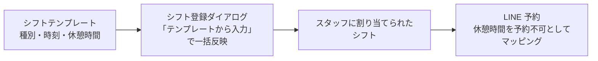

# シフトパターン設定 仕様書 (Shift Templates)

## 概要
- **画面の目的**: スタッフの標準的な勤務時間（例：フルタイム、早番、遅番等）をテンプレートとして定義し、シフト管理の入力を大幅に効率化する。
- **URLパターン**: `/settings/shift-templates`
- **アクセス権限**: シフト管理権限が必要（`ResourceShifts`）

---

## 1. 画面構成

### 1.1 テンプレート一覧
- **項目**: テンプレート名、種別、時間（開始〜終了。休日/有休は「-」表示）、ステータス、操作。
- **並び替え**: ドラッグ操作により、シフト入力時のクイック選択肢の優先順位を管理可能。

### 1.2 詳細編集サイドパネル (`ShiftTemplateSidePanel`)
- **テンプレート名**: スタッフが選択する際の識別名称。未入力の場合は保存ボタンが無効化される。医院内で一意（`uk_shift_templates_clinic_name`）。重複は 409 `shift_template_name_conflict` + `params.name` で、トーストは「シフトテンプレート名『早番』は既に使用されています」のように実名を含む（診療項目マスタと同じ形。正本の対比は [master-treatment.md §2.3](./master-treatment.md)）。
- **ステータス**: 有効/無効の切り替え（`StatusPill`）。無効のテンプレートはシフト入力ダイアログの選択肢に表示されない。
- **シフト種別**: 
    - `全日` / `午前` / `午後` / `休日` / `有休` のカテゴリ分け（`SHIFT_TYPE_LABELS`、`frontend/src/features/shifts/types/index.ts`）。
    - `休日` / `有休` を選択すると時刻・休憩の入力欄は非表示になる（`isShiftTemplateTimeHidden`）。
- **標準時間設定**: 始業・終業時刻（`<input type="time">`。分刻みの制約なし、30分単位への固定はない）。勤務種別で未入力のまま保存するとエラートーストが表示される。
- **メモ**: 補足情報の自由入力。
- **休憩時間定義 (`BreakEditor`)**: 
    - 1 日の中で複数の休憩（例：昼休憩 60 分 ＋ 夕方小休憩 15 分）をテンプレート化。
    - LINE 予約枠の算出に直接影響を与えます。

---

## 2. 主要な臨床・運営機能

### 2.1 LINE 予約空き枠の基礎
ここで設定された休憩時間は、スタッフにシフトが割り当てられた際、LINE 予約アプリ上の「予約不可（埋まっている）」時間として自動的にマッピングされます。勤務・休憩を用いた予約可否は予約正本の合意へ従います。シフトの入力コピーと予約判定の実装適合・実機受入は別であり、テンプレートの存在だけで事故防止を保証しません。

### 2.2 入力コストの削減
カレンダー画面 (`/shifts`) のシフト登録ダイアログ (`ShiftFormDialog`) では、「テンプレートから入力」プルダウンで種別・開始/終了時刻・休憩を一括反映でき、複雑な休憩時間の入力を数秒で完了できます。

---

### 2.3 期間複製・CSV取込との境界

2026-10-15に合意した[期間・スタッフを選ぶシフト複製とExcel作成CSV取込](../24-shift-calendar.md#shift-copy-csv-agreement-20261015)は、シフト管理 `/shifts` の勤務入力・反映操作である。シフトパターン設定のマスタCRUDや、テンプレートを選んでフォームへ値をコピーする既存操作と区別する。マスタ入口やテンプレート選択が可能なことだけでは、勤務変更の権限を与えない。

テンプレート改訂を登録済み勤務へ遡及反映しない。複製／CSVからテンプレートを自動作成・更新しない。複製／取込の入力案を登録済み勤務へ反映する際は、[差分・エラー・予約影響確認](../24-shift-calendar.md#requirement-fr-shifts-bulk-preview-confirm)と既存の勤務・休憩・予約保護を通る。具体的なCSV形式・列・上限はこのマスタ仕様で追加確定しない。既存勤務はシフト正本の明示選択した置換・確認範囲の原子保存に従い、マスタ側から自動上書きしない。

受入：シフト画面の `AC-shifts-template-copy-boundary` と[D14技術trace](../../../design/domains/staff-workforce/technical-spec.md#shift-bulk-acceptance-trace)を参照する。新操作の実装・実機受入は未確認。

## 3. 技術仕様

### 3.1 構成コンポーネント
- **`ShiftTemplateSettings`**: マスタ管理の基盤ページ。
- **`ShiftTemplateSidePanelFields`** の `BreakEditor`: 行追加・削除に対応した動的リスト形式の休憩時間入力部品。

### API連携
| メソッド | エンドポイント | 用途 | 必須権限 | 必須アクション |
|:---|:---|:---|:---|:---|
| GET | `/api/v1/shift-templates` | 登録済みテンプレートの取得 | `shifts` | `view` |
| POST | `/api/v1/shift-templates` | 新規パターンの作成 | `shifts` | `create` |
| PATCH | `/api/v1/shift-templates/reorder` | 全体の表示順序の更新 | `shifts` | `edit` |
| GET | `/api/v1/shift-templates/:id` | テンプレート詳細の取得 | `shifts` | `view` |
| PATCH | `/api/v1/shift-templates/:id` | テンプレート情報の更新 | `shifts` | `edit` |
| DELETE | `/api/v1/shift-templates/:id` | テンプレートの削除 | `shifts` | `delete` |

---

## 10/19後続承認：同種操作・検索ボタン方式

本画面の既存キーワード欄は[適用台帳 M20](../../shared/interaction-scope.md)と[共通FR/8AC](../../shared/ui-contracts.md#interaction-consistency-20261019)へ従う。入力中/適用済みを分け、入力/待機/消去だけでは検索せず検索ボタンで適用。既存の明示リセット、独立filter、詳細復帰、認可・検索対象・取得上限/ページ内制限を保持し、全件検索や一律の保存方式へ変えない。取得中/0件/失敗と遅延応答を分け、検索で選択/保存/コピー/送信を確定しない。旧defer/debounceの記載は入力即適用の目標に用いず、適用後の描画最適化と区別する。[S14手順](../../../ops/testing/scenarios/S14-search-and-multi-word.md#cross-ui-search-20261019)を各対象IDで実施する受入条件とし、実装適合・実機は未確認。
