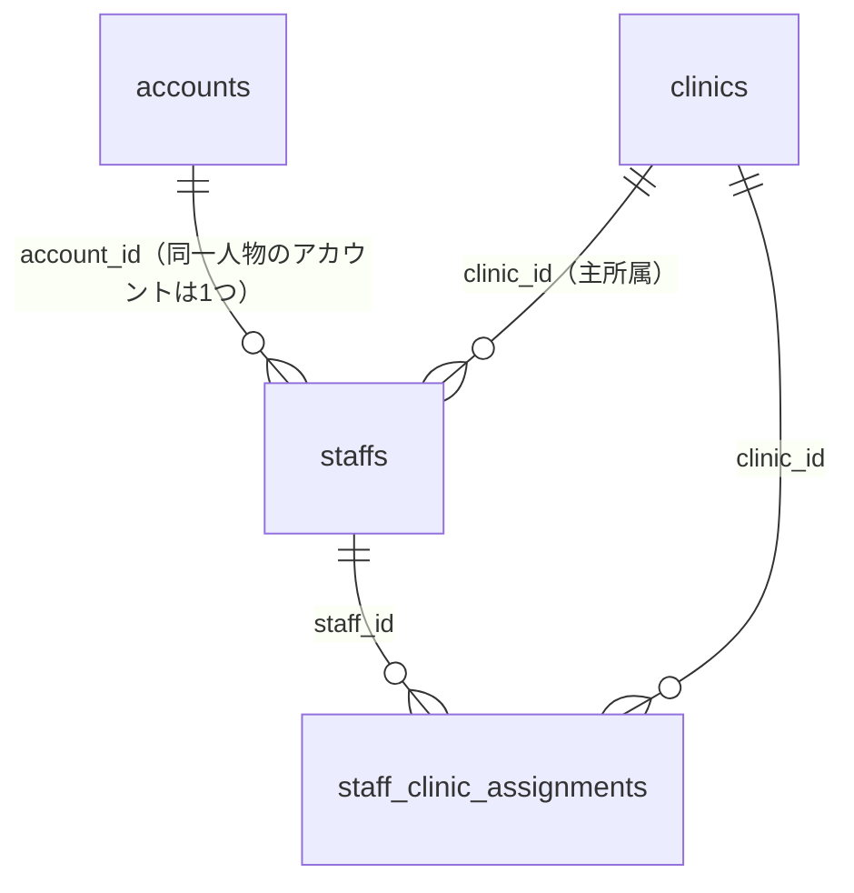

# スタッフ管理 仕様書 (Staff Management)

未来院で一度保護対象外になった予約の再受付は[18:26の現在適格性再確認](../../workflows/reservation-to-record-flow.md#no-show-recheck-1826)に従う。

> 確定仕様の適用範囲：今回の予約ドメイン合意と本書の接続境界。承認日は各FR要件表・根拠節（2026-10-13〜2026-10-14 17:35）、追加合意は各補足節を参照。[確定FR索引](../../domains/reservations/README.md#approved-reservation-scope)に掲載した箇所のみを確定情報として扱う。対象外の継承本文・未承認案・現行実装説明は一括確定しない。実装・実機状態は別管理。

17:23 JSTの[LINE予約6点合意](../../line/reservation-spec.md#line-agreement-1723)へ従う。公開された診療・トリミング・ホテルは予約対象、入院は医院相談。ホテルには医師指名・医師シフト・通常予約の同日制約を適用しない。受付制限・入力保持・受付前取消・必要設定不足の扱いと受入条件はLINE正本を参照する。ホテル受入基準は17:35合意の医院別同時宿泊頭数・全宿泊期間判定で、実装・実機受入は未確認。

17:17 JSTの院内予約8点一括合意は[予約入口の決定一覧](../../domains/reservations/README.md#internal-reservation-batch-1717)を参照する。誤取消／誤終了訂正、未終了予約保護、診療前の日付・カルテ整合、マスタ利用・名称履歴、休診日予約／日跨ぎ勤務、患者照合、ホテル担当時点／入院記録失敗の各正本と受入条件へ従う。LINE受付条件は17:23合意（ホテル受入基準は17:35合意、計算・保存方式は設計）、実装・実機受入は未確認。

| 管理項目 | 記載 |
|:---|:---|
| 文書ID・種別 | page.master-staff／既存画面・共通マスタ仕様 |
| 決定状態 | 今回の予約ドメイン合意は2026-10-14 17:35まで反映し、正本間の記述レビュー完了。対象外は既存決定状態を継承。実装・移行・実機検証とは別。完了範囲は予約入口の最終レビュー参照 |
| 実装状態 | main ec4f7146aの必要箇所を静的照合。新合意へ未追従／未確認の残差を下記に記載。コード変更なし |
| 実機検証状態 | 未実施。文書検査と実機受入を分ける |
| 文書確認日 | 2026-10-14（合意・参照・語彙の確認。実機受入日ではない） |

用語・概念関係は[予約オントロジーの語彙正本](../../ontology/reservations.md#reservation-ontology)へ統一する。予約区分、予約区分グループ（表示用）、予約区分の業務分類を区別し、担当者の総称と画面の指名医師／担当トリマー、職種と個人の対応可能予約区分を同義にしない。画面ラベル・引用・コード識別子は継承し、用語整理から未決業務を確定しない。

16:36合意の[入院開始の明示確定と二重登録防止](master-reservation-type.md#requirement-fr-reservation-types-inpatient-start-confirm)へ従う。予定入院は予約だけで入院中にせず、来院後にスタッフが「入院開始」を確定する。診察後の入院決定も同じ入院管理へつなぎ、同じ入院を二重登録しない。担当医・入院記録は16:44合意の段階条件へ従う。具体的画面配置・重複防止の技術方式・記録作成失敗時の開始未確定・理由表示・再試行は17:17合意。具体的保存方式は設計として分ける。受入条件は区分マスタ正本へ置き、実装・実機受入は未確認。

16:44合意の[入院担当医と開始時の入院記録](master-reservation-type.md#inpatient-doctor-and-record-at-start)へ従う。予定入院予約時は指名医師未定可、入院開始までに入院担当医決定、スタッフによる開始確定時に入院記録を作成する。予定入院・診察後の両入口を維持し、同じ入院を二重登録しない。予約の指名医師から担当医を自動確定せず、記録作成失敗時の開始未確定・理由表示・再試行は17:17合意。具体的UI・保存方式は実装設計とする。実装・実機受入は未確認。

## 概要
- **画面の目的**: システムを利用する全スタッフの基本情報、職種、および LINE 予約用の公開プロフィールの統合管理。
- **URLパターン**: `/settings/staff`
- **アクセス権限**: スタッフ管理者権限が必要（`ResourceMasterStaff`）

---

## 1. 画面構成

### 1.1 スタッフ一覧テーブル
職種や稼働ステータスで絞り込み可能な、院内人員の全体リスト（氏名・職種でのカナ正規化検索付き）。
- **表示項目**: 氏名、職種、権限グループ（先頭2件+残数表示）、ステータス（有効/無効）。

### 1.2 詳細編集サイドパネル (`SidePeekPanel`)
- **基本属性**: 氏名、職種（有効な職種マスタからの選択）、資格番号、有効/無効ステータス。
- **システム連携**: ログイン用メールアドレス（新規作成時のみ入力可・以後は表示のみ）とパスワード、および**権限グループ**の割り当て。新規作成はメール・パスワードとも空欄ならログインアカウントなしで登録できる。メールを入力する場合はパスワードが必須（8文字以上・72バイト以下、文字と数字をそれぞれ含む）。既存のパスワードは変更する場合のみ入力する。
- **マルチ医院**: 所属医院をチェックボックスで割り当て（新規作成時はスタッフ登録後に設定可能）。
- **アカウントと医院所属の不変条件**: 同一人物のログインアカウントは 1 つ。複数医院への所属はこのチェックボックス割当（`staff_clinic_assignments`）で表現し、医院ごとに別アカウントは作成しない。この画面での新規作成は 1 スタッフレコードに複数医院を割り当てる形を取る。`staffs.clinic_id` は主所属（ホーム医院）を表す。複数医院に所属するスタッフは、ログイン後にサイドバー上部で操作医院を切り替える（医院ごとの再ログインは不要）。医院をまたぐ同一人物の追加登録は、新規アカウント作成ではなく既存スタッフへの所属追加で行う。なお旧DB移行データでは 017 適用前の `(doctor_id, clinic_id)` 複合FK の名残で同一人物が医院別に複数の staffs 行を持つ場合があり、その場合も共有するアカウントは 1 つである（`docs/architecture/auth.md` §1.3）。

---

## 2. LINE 予約公開設定

スタッフが飼主向けの LINE 予約画面に表示される際の詳細情報を定義します。

| 項目 | 説明 |
|:---|:---|
| **予約ページに表示** | オンにすると LINE アプリ上の「担当医選択」に出現。 |
| **LINE 表示名** | 院内での呼称とは異なる、飼主向けの親しみやすい名称（空欄なら氏名を使用）。 |
| **スタッフ種別** | 医師 / 看護師 / 設備 の 3 択（`doctor` / `nurse` / `resource`）。 |
| **説明文・画像 URL** | LINE 予約画面に表示する説明文、およびプロフィール画像の URL 指定（アップロード機能ではなく URL テキスト入力）。 |
| **対応可能コース** | [対応可能だけをチェックする合意](#requirement-fr-staff-positive-reservation-capabilities)が正本。グループ別・一括／個別チェックを使い、対応不可方式は廃止する |

---

## 予約担当適格性の途中合意

決定者はユーザー、合意日は2026-10-13。根拠は予約マスタ・担当適格性・シフト連携の対話合意を親タスクから引き継いだ記録。予約ドメインには関連マスタ・シフト・LINEも含み、途中合意で未完了。LINE6点は17:23合意、ホテル受入基準は17:35合意、計算・保存方式は設計として保持。実装・実機受入の完了を意味しない。

| 要件ID | 定義の所在 | 決定根拠 |
|:---|:---|:---|
| FR-staff-positive-reservation-capabilities | [対応可能だけの選択](#requirement-fr-staff-positive-reservation-capabilities) | 合意済み。2026-10-13、ユーザー対話。根拠は下記 |
| FR-staff-shared-reservation-eligibility | [院内／LINE共通の担当可能者基準](#requirement-fr-staff-shared-reservation-eligibility) | 合意済み。2026-10-13 20:43 JST、ユーザー「ok」 |
| FR-staff-capability-booking-guard | [対応区分解除時の予約保護](#requirement-fr-staff-capability-booking-guard) | 合意済み。2026-10-13、ユーザー対話。根拠は下記 |
| FR-staff-deactivation-booking-guard | [無効化・退職時の指名予約保護](#requirement-fr-staff-deactivation-booking-guard) | 合意済み。2026-10-13 21:06 JST、ユーザー「ok」 |
| FR-staff-clinic-departure-booking-guard | [一医院での勤務終了と医院別指名停止](#requirement-fr-staff-clinic-departure-booking-guard) | 方針はユーザー「はい」、文書反映は2026-10-14 17:04 JST「ok」。保存・設定方式は未決 |

### 対応可能だけの選択

チェックした予約区分だけを担当できる方式へ統一し、対応不可をチェックする方式は廃止する。共通予約区分マスタのグループ別に表示し、グループ一括チェックと区分個別チェックを用意する。未所属区分は「未分類」にまとめる。旧方式からは実効対応範囲を維持して変換する方針とし、具体的な変換・検証手順は未決。後から追加した区分は自動許可せず未チェックとし、個別に再選択する。移行のために今回DBやAPIを変更しない。

職種は分類として維持し、担当可能者は[個人対応区分＋シフトの共通基準](#requirement-fr-staff-shared-reservation-eligibility)へ統一する。スタッフ種別の役割、無効区分のチェック表示、予約先医院の勤務先範囲は22:31合意に従う。個人の予約区分対応可否は予約先医院ごとに判定し、主所属医院だけで代用せず、他医院の対応可否も流用しない。この業務方針は既合意で、具体的な医院別設定・保存方式や勤務情報取得は実装設計として残す。予約画面の表示名は[区分別ラベル](../../domains/reservations/pages/reservation-management.md#requirement-fr-reservations-staff-role-label)を参照し、全アプリのstaffを医師へ一括改名しない。

### 院内／LINE共通の担当可能者基準

スタッフ個人の「対応可能な予約区分」とシフトを、院内予約とLINEにおける担当可能者判定の共通基準にする。個人適格性は[肯定形の選択](#requirement-fr-staff-positive-reservation-capabilities)、勤務・休憩の予約への利用は[予約時間全体の候補契約](../../domains/reservations/pages/reservation-management.md#requirement-fr-reservations-duty-staff-selection)に従う。職種はスタッフ分類として残し、予約区分側に別の職種予約可否設定を持たない。[区分側の廃止契約](master-reservation-type.md#requirement-fr-reservation-types-occupation-gate-retirement)がその境界の正本。

共通にするのは担当可能者の基準であり、院内の警告付き登録許容とLINEの受付可否を同一にしない。LINE固有の公開範囲・受付条件は17:23合意のLINE正本へ従う（ホテル受入基準は17:35合意、計算・保存方式は設計）。既存の個人対応設定を勝手に変更せず、旧紐付け職種からの機械変換は未決で情報を失わない移行検討に残す。

決定者はユーザー、2026-10-13 20:43 JSTにこの共通化提案へ「ok」と回答。今回の更新は途中合意で、実装・DB移行・予約ドメイン完了ではない。

### 対応区分解除時の予約保護

対応区分のチェックを外した結果、検査対象の既指名予約を担当できなくなるなら、その予約を他の適格者または指名なしへ変更して解消するまで担当設定を保存できない。勝手な指名解除や取消はしない。対象範囲・保存不可理由・対象予約一覧・予約編集への導線は[未来・現在診療中予約の共通保護契約](../../workflows/reservation-to-record-flow.md#requirement-fr-reservations-future-assignment-protection)へ従う。担当設定側の入力案保持方法は未決で、シフト入力案の保持契約と混同しない。

### 無効化・退職時の指名予約保護

未来の予約または現在診療中の予約で指名されているスタッフは、その予約を別の適格な担当者（診察では別の医師）または指名なしに変更して解消するまで無効化できない。退職に伴う無効化でも同じ保護を適用する。通常の指名先は既存の勤務全時間・休憩・個人対応区分の条件を満たす必要があり、勤務変更や対応区分解除の保護を免除しない。診療中の別医師への引継ぎは[23:43の予約正本](../../domains/reservations/pages/reservation-management.md#requirement-fr-reservations-doctor-handoff)へ従う。11:15合意では交代先の勤務・休憩・対応区分を引継ぎ後の担当時間で判定し、過去全体の勤務は要求しない。[12:22合意の判定時間・延長警告](../../domains/reservations/pages/reservation-management.md#handoff-time-and-extension)へ従う。

保存できない理由と対象予約の日時／患者／区分を表示し、予約編集へ案内する。対象範囲は[未来・現在診療中の共通保護契約](../../workflows/reservation-to-record-flow.md#requirement-fr-reservations-future-assignment-protection)に従う。予約を自動取消したり指名を勝手に解除したりしない。対象予約修正後に無効化を再試行できる。

過去完了履歴の存在だけを理由に無効化を永久に禁止しない。スタッフとその診療・予約履歴は保持し、今回の合意はスタッフ履歴削除の許可ではない。自己無効化・最後の管理者など既存の認可／安全条件を解除する合意でもない。一医院だけでの勤務終了は下記の医院別指名停止契約に従い、全体退職と区別する。退職の専用項目、入力案保持や競合防止の具体的方法は未決。

決定者はユーザー、2026-10-13 21:06 JSTにこの予約解消・理由／対象表示の提案へ「ok」と回答。実装完了・実機受入ではない。

個人対応区分＋シフトの共通基準に使う[休憩端点](../../domains/reservations/pages/reservation-management.md#break-boundary)は21:52 JST合意を参照。端点に接するだけなら休憩重複なし、正幅の重複は指名不可。他の個人適格性と勤務全時間の条件は保持し、既存予約重複の警告許容とは区別する。

22:00 JST合意の[予定終了超過でも現在診療中の予約保護](../../workflows/reservation-to-record-flow.md#consultation-overtime)は個人対応区分解除・スタッフ無効化にも共通。影響チェックに残し、影響予約がなければこの保護だけで一律拒否しない。終了は[10:12合意の当日カードモーダル「診察を終了する」](../../workflows/reservation-to-record-flow.md#consultation-end-card-modal)で明示確定する。[10:43合意の確認付きドラッグ終了](../../workflows/reservation-to-record-flow.md#requirement-fr-reservations-confirmed-drag-consultation-end)も同じ診療終了として扱い、キャンセルなら診療中を維持する。誤終了取消は[11:56の専用操作](../../workflows/reservation-to-record-flow.md#requirement-fr-reservations-undo-consultation-end)として扱う。誤終了取消は12:07合意と会計確定境界へ従う。その他の逆方向・遷移は[記録確認訂正](../../workflows/reservation-to-record-flow.md#requirement-fr-reservations-controlled-reverse-transition)へ渡し、通常操作のUndo条件を拡張しない。具体的記録／会計訂正内部は各ownerへ残す。予約時間の自動延長は承認しない。例と共通受入条件は横断正本へ委ねる。

22:21 JSTの[部分シフト登録時の共通候補基準](../../domains/reservations/pages/reservation-management.md#requirement-fr-reservations-partial-shift-evaluation)に従う。登録済みで有効・個人対応・勤務全時間・休憩等を満たす人だけ候補とする。未登録者を休日や確定ゼロとして扱わず、未登録検出の対象母集団・他院勤務情報の取得方法は調査事項。

22:31 JSTの[医院勤務先による指名・人数範囲](../../domains/reservations/pages/reservation-management.md#requirement-fr-reservations-clinic-duty-scope)を個人対応区分＋シフトの共通基準に追加。所属や主所属だけで出勤先を推定せず、同時間の他院勤務者を除く。個人の有効性・適格性・全勤務時間・休憩条件は維持する。医院間で勤務時間が重なるシフトの保存不可と相手医院名／重複時間の表示は[22:44 JSTのシフト正本](../24-shift-calendar.md#requirement-fr-shifts-cross-clinic-overlap)へ従い、受入条件も同正本を参照する。予約同士の重複警告後の保存許容と混同しない。移動時間は[22:57 JSTの登録者による手動確保](../24-shift-calendar.md#requirement-fr-shifts-manual-travel-gap)へ従う。自動計算や固定1時間の必須値は採用せず、医院間勤務重複禁止は維持する。

23:43 JSTの[診療終了までの別医師への引継ぎ](../../domains/reservations/pages/reservation-management.md#requirement-fr-reservations-doctor-handoff)を参照。変更先は勤務・休憩と対応可能区分等を満たす医師だけで、診療終了後は通常操作では変更不可。予約管理で変更し、カルテに予約変更機能を追加しない。11:15合意により交代先は引継ぎ後の担当時間の勤務・休憩・対応区分で判定し、過去全体の勤務は要求しない。診療終了までは指名なしへの変更も可、終了後の通常の医師変更・指名解除は不可。既存保護解除は維持し、誤終了取消は[11:56契約](../../workflows/reservation-to-record-flow.md#requirement-fr-reservations-undo-consultation-end)に従い、通常の指名変更／解除と区別する。取消の具体的ロール、支払い確定後や他の例外訂正は未決。取消の実行条件は12:07合意に従う。通常予約の全時間条件と引継ぎの条件を混同しない。受入条件は予約正本へ置く。 [12:22合意の判定時間・延長警告](../../domains/reservations/pages/reservation-management.md#handoff-time-and-extension)へ従う。

12:43合意の[シフト削除の保護対象・解消手順](../24-shift-calendar.md#shift-deletion-protection)に従う。未来・現在診療中の影響予約を別の適格者または指名なしへ変更するまで確定不可で、過去完了の履歴は保持する。[休診日設定の警告確認](../24-shift-calendar.md#requirement-fr-shifts-holiday-warning-confirm)はシフトの自動削除や個人対応区分・勤務等の既存適格性を免除しない。

12:56合意の[予約区分の所属0または1・グループ階層なし](master-reservation-type.md#group-membership-cardinality)に従う。色は唯一の所属先から継承し、未所属は共通標準色とする。業務分類・予約区分自体の親子分類、削除／復元時の所属変更等をこの合意で推定しない。個人対応可能区分・有効意図の既存条件を維持し、実装・実機受入は未確認。受入条件は区分マスタ正本へ置く。

13:00合意の[グループ削除後の所属保持と利用再開](master-reservation-type.md#group-deletion-new-use-restart)を参照する。個人対応区分の表示でも所属を自動的に未分類へ移さず、グループ復元だけで利用可能にしない。明示有効化後も個別無効の意図と個人適格性を維持する。保存方式は実装判断とし、受入条件は区分マスタ正本へ置く。

16:07合意の[ホテル担当と入院の両入口](master-reservation-type.md#requirement-fr-reservation-types-hotel-inpatient-entry)に従う。ホテル予約は指名医師を選ばず、世話担当者は宿泊管理側で割当。入院は予約区分からの予定入院と診察後の入院決定の両方を入院管理へつなぐ。入院開始は16:36合意の来院後スタッフ明示確定で、同じ入院を二重登録しない。予定入院の予約時は指名医師未定可、開始までに担当医決定、開始確定時に入院記録作成は16:44合意。ホテル世話担当の決定時点は17:17合意。具体的画面・宿泊管理内部は設計／関連領域へ残す。既存の診療カルテ作成・関連保持の契約は維持し、受入条件は区分マスタ正本へ置く。

13:14合意の[予約区分の業務分類と担当者・記録接続](master-reservation-type.md#requirement-fr-reservation-types-business-routing)を参照する。表示グループとは別に区分へ設定し、診療は指名医師・通常カルテ、トリミングはトリマー・トリミング記録、ホテルは宿泊管理へ接続する。診療の受付時カルテ作成・同時成功・再利用と個人対応区分／勤務等の既存条件を維持する。[14:14合意](master-reservation-type.md#requirement-fr-reservation-types-business-classification-lock)により過去を含む既存予約がある区分の分類変更は不可で、別分類は新しい区分を作成する。既存予約・担当者・作成済み記録の関連を保持する。名称・表示グループは別契約に従う。[15:58合意](master-reservation-type.md#requirement-fr-reservation-types-business-classification-initialization)により未使用区分は分類変更可、未設定区分は新規選択不可で理由表示、既存予約・記録がある未設定区分は内容確認後に補完し、担当者・記録を自動変換／再作成しない。補完担当は業務5点合意で確定。具体的権限識別子・資料照合、17:17までに確定したホテル・入院接続を満たす画面／保存方式と専用管理内部・専用記録内部は未決。受入条件は区分マスタ正本へ置き、実装・実機受入は未確認。

### 一医院での勤務終了と医院別指名停止

A院とB院を兼務する医師がA院だけで勤務を終える場合、A院の今後の指名予約を別の対応可能な医師または未定へ手動で変更してから、A院での指名を停止する。変更先は予約先医院の対応可能区分・勤務・休憩等の既存適格性を満たす医師とする。A院での停止を、B院の勤務・指名予約の停止や変更へ広げず、B院の勤務・指名予約は継続する。予約・指名を自動取消／自動解除／自動移管しない。

[未来・現在診療中の予約保護](../../workflows/reservation-to-record-flow.md#requirement-fr-reservations-future-assignment-protection)を維持する。A院の保護対象予約が未解消ならA院での指名停止を確定せず、既存契約の理由・対象予約一覧・予約編集への案内を使い、手動解消後に再試行する。予定終了超過でも現在診療中は保護対象で、医師交代は[引継ぎ後の担当時間の判定](../../domains/reservations/pages/reservation-management.md#handoff-time-and-extension)に従う。過去完了の履歴だけを理由に停止を永久禁止せず、A院・B院の完了済み予約・診療履歴と担当医参照を保持する。

「一医院での勤務終了」は、その医院で今後の指名を停止し、他医院の勤務を継続できる業務。「全体退職」は全医院で勤務を終える業務で、既存の無効化・指名予約保護契約へ従う。一医院の勤務終了をスタッフ全体の無効化やログインアカウント失効として自動処理する合意ではない。所属解除・勤務終了日の設定・医院別停止状態の保存・権限識別子・画面配置・シフト更新方法は追加確定せず、具体的な設定・保存方式は未決／実装設計として残す。シフトを自動削除する判断も含めない。

医院別の予約区分対応可否は既合意を維持し、主所属医院のみで代用せず他医院の対応可否を流用しない。全員／一部シフト未登録の候補・未確認警告・未定登録可も維持し、その警告対象母集団の調査を今回の停止合意で確定しない。

決定者はユーザー。A院だけでの勤務終了時にA院予約を手動解消して指名停止しB院を継続する方針への返信「はい」（Sentinel_a2577cd6f93c8191a77c06c5a1c4aa89）を根拠とする。文書反映は質問「方針は確認できましたが、文書への反映は『進捗報告は読み取りのみ』という制限により止まりました。今回の合意と、医院別の対応可否に関する既存記載の修正を、仕様文書に反映してよいですか？」（Sentinel_4cf0895fe5848191807a6876abd1a96a）への2026-10-14 17:04 JST「ok」（Sentinel_dc5e1623b1ac8191bcc051921eb01e7c）で個別に許可された。定時報告は引き続き読み取りのみ。実装・実機受入は未確認で、予約ドメイン全体は未完了。

## 追加合意の受入条件

| 条件ID | Given（前提） | When（操作） | Then（期待結果） | 独立確認 | 成功条件 | 確認手順／証跡 |
|:---|:---|:---|:---|:---|:---|:---|
| AC-staff-positive-reservation-capabilities | グループ所属／未所属区分と旧対応範囲がある | 対応可能方式へ変換し一括・個別選択後に区分を追加する | 実効対応範囲を維持し、未所属は未分類。追加区分は未チェックとなり勝手に許可されない | この条件を単独確認 | Thenの業務結果 | [FR](#requirement-fr-staff-positive-reservation-capabilities)。実機未確認 |
| AC-staff-shared-reservation-eligibility | 同じスタッフ個人設定と勤務・休憩がある | 院内／LINEの担当可能者を判定する | 個人対応区分＋シフトを共通基準にする。職種分類は残し、LINE固有の公開・受付条件は別に扱う | 共通基準を単独確認 | 個人適格性と勤務に二重の正本を持たない | [FR](#requirement-fr-staff-shared-reservation-eligibility)。実機未確認・LINE6点・ホテル上限は合意済み、実装検証は未確認 |
| AC-staff-capability-booking-guard | 未来または現在診療中の指名予約で使用される対応区分を担当者が持つ | 対応区分を外して保存し、予約を適格者または指名なしへ変更して再保存する | 解消前は対象一覧と理由を示して保存不可。予約を自動変更せず、解消後に保存できる | この条件を単独確認 | Thenの業務結果 | [FR](#requirement-fr-staff-capability-booking-guard)。実機未確認 |
| AC-staff-deactivation-booking-guard | 未来または現在診療中の予約でスタッフが指名されている | 無効化／退職に伴う無効化を試み、対象予約を他適格者または指名なしへ修正して再試行する | 解消前は保存不可で理由と日時／患者／区分を表示。自動取消・指名解除せず、解消後は他の既存条件を満たせば無効化できる | 指名予約保護を単独確認 | 対象予約を解消するまで無効化しない | [FR](#requirement-fr-staff-deactivation-booking-guard)。実機未確認 |
| AC-staff-deactivation-history-only | 過去完了履歴だけがあり、その他の既存無効化条件を満たす | スタッフを無効化する | 過去履歴だけを理由に永久禁止せず、スタッフと履歴を削除せず保持する | 過去履歴の境界を単独確認 | 履歴保持と無効化が両立する | [FR](#requirement-fr-staff-deactivation-booking-guard)。実機未確認 |
| AC-staff-clinic-specific-capability | 同じ医師がA院とB院に所属し、予約区分への対応可否が医院ごとに異なる | A院とB院でそれぞれ指名候補を判定する | 各予約先医院の対応可否で判定し、主所属医院や他医院の設定で代用しない。勤務・休憩等の既存条件も満たす | 医院別判定を確認 | 他院の対応可否を流用しない | [FR](#requirement-fr-staff-positive-reservation-capabilities)。既合意の追従・実機未確認 |
| AC-staff-clinic-departure-unresolved | A院だけで勤務を終える兼任医師に、A院の今後または現在診療中の保護対象指名予約が残る | A院での指名停止を確定しようとする | 手動解消まで確定不可。理由・対象一覧・予約編集への案内を示し、自動取消／自動解除しない。予定終了超過中の診療も保護する | 未解消時の保護を確認 | 既存診療中保護を迂回しない | [FR](#requirement-fr-staff-clinic-departure-booking-guard)。実機未確認 |
| AC-staff-clinic-departure-preserve-other-clinic | A院の保護対象予約を別の適格医師または未定へ手動変更済みで、B院の勤務・指名予約がある | 他の既存条件を満たしてA院での指名を停止する | A院で指名を停止でき、B院の勤務・指名予約は継続する。スタッフ全体の無効化・アカウント失効・他院予約変更を自動実行しない | 一医院と全体を区別 | A院停止の影響をB院へ広げない | [FR](#requirement-fr-staff-clinic-departure-booking-guard)。実機未確認・保存方式未決 |
| AC-staff-clinic-departure-history | A院に過去完了履歴だけがあり、その他の停止条件を満たす。B院にも履歴がある | A院での指名を停止する | 過去履歴だけを理由に永久禁止せず、両院の完了済み予約・診療履歴・担当医参照を保持する | 履歴保持を確認 | 一医院の勤務終了で履歴を失わない | [FR](#requirement-fr-staff-clinic-departure-booking-guard)。実機未確認 |

## 未決事項・現実装との差分

詳細設計・移行・調査と未承認事項は[設計／未承認事項](../../../work/design/reservations/pending-and-design.md#staff-details)へ移設。以下のコード照合は現行実装の参照で、確定仕様の承認や実機PASSではない。

[現表示](../../../../frontend/src/features/master/components/StaffSidePanelSections.tsx)は対応可能／対応不可切替と一般診療等のcategory分類で、合意したマスタグループ分類・一括チェックへ未追従。データ保存はcapable IDsを使用するが、表示の肯定形統一まで完了したことを示さない。[対応区分保存](../../../../backend/internal/staff/staff_service_permissions.go)のdelegate先を含む予約保護・対象一覧の完全な実機受入は未確認。旧excluded API表と部品名は現実装の参照として残し、廃止方針を反映済みのAPIと誤認しない。

現実装の追加残差: 院内は[個人capability候補](../../../../frontend/src/components/shared/ReservationFormModal/ReservationFormFields.tsx)を読む一方、LINEには[職種guard](../../../../backend/internal/reservation/liff_service_availability.go)が残る。共通基準へ追従済みではない。職種分類のフィルタ・基本情報は廃止しない。

無効化の静的差分: [現スタッフ更新](../../../../backend/internal/staff/staff_service_update.go)は無効化時に[既存ガード](../../../../backend/internal/staff/staff_service_core.go)を呼び、自己無効化・最後の管理者を保護する。今回の未来／現在診療中の指名予約解消チェックと理由・対象一覧は確認した経路で未確認。アカウント失効など既存処理をこの仕様更新で変更しない。過去参照を理由とする削除制限と、今回の無効化条件を混同しない。

スタッフ属性・個人適格性の正本は本書。予約への候補選択と警告は[予約正本](../../domains/reservations/pages/reservation-management.md#master-dependencies)。

## 3. 技術仕様

### 3.1 認可の波及
ここで割り当てられた「権限グループ」は、API 側では毎リクエスト permission_group_rules から実効権限が評価されます。画面側の `/v1/me` は定期ポーリング・フォーカス時再取得を無効にし、キャッシュの staleTime は5分です（`get-me.ts`）。起動・ログイン・トークン更新の結果、または `refreshPermissions` / `ME_QUERY_KEY` の明示的無効化で更新するため、別端末での権限変更がメニューへ即時反映される保証はありません。

### 使用コンポーネント
- **`StaffSidePanel`**: `MasterSidePanel` ベースの統合編集パネル。
- **`StaffBasicInfoSection`** / **`StaffLineReservationSection`**: 基本属性・LINE 予約公開設定の編集セクション。
- **`StaffClinicsSection`** / **`StaffPermissionGroupsSection`** / **`StaffExcludedReservationTypesSection`**: 所属院・権限グループ・対応可能コースの割り当てセクション（最後の部品名には旧 excluded 名が残るが、画面は capable 側の選択 UI）。

### API連携
| メソッド | エンドポイント | 用途 | 必須権限 | 必須アクション |
|:---|:---|:---|:---|:---|
| GET | `/api/v1/masters/staffs` | スタッフ一覧の取得 | `master-staff` | `view` |
| GET | `/api/v1/masters/staffs/:id` | 特定のスタッフ詳細の取得 | `master-staff` | `view` |
| POST | `/api/v1/masters/staffs` | 新規スタッフの作成 | `master-staff` | `create` |
| PATCH | `/api/v1/masters/staffs/:id` | プロフィールや権限の更新 | `master-staff` | `edit` |
| DELETE | `/api/v1/masters/staffs/:id` | スタッフの削除 | `master-staff` | `delete` |
| PATCH | `/api/v1/masters/staffs/reorder` | 表示順序の一括保存（BE実装済みだが本画面からは未呼出） | `master-staff` | `edit` |
| GET | `/api/v1/masters/staffs/:id/permission-groups` | スタッフの権限グループ割り当て取得 | `master-staff` | `view` |
| PUT | `/api/v1/masters/staffs/:id/permission-groups` | スタッフの権限グループ割り当て更新 | `master-staff` | `edit` |
| GET | `/api/v1/masters/staffs/:id/clinics` | スタッフの医院割り当て取得 | `master-staff` | `view` |
| PUT | `/api/v1/masters/staffs/:id/clinics` | スタッフの医院割り当て更新 | `master-staff` | `edit` |
| GET | `/api/v1/masters/staffs/:id/excluded-reservation-types` | スタッフの対応不可予約区分の取得（FE は capable 側 API で永続化するため未呼出） | `master-staff` | `view` |
| PUT | `/api/v1/masters/staffs/:id/excluded-reservation-types` | スタッフの対応不可予約区分の更新（FE は capable 側 API で永続化するため未呼出） | `master-staff` | `edit` |
| GET | `/api/v1/masters/staffs/:id/capable-reservation-types` | スタッフの対応可能予約区分の取得 | `master-staff` | `view` |
| PUT | `/api/v1/masters/staffs/:id/capable-reservation-types` | スタッフの対応可能予約区分の更新 | `master-staff` | `edit` |

---
