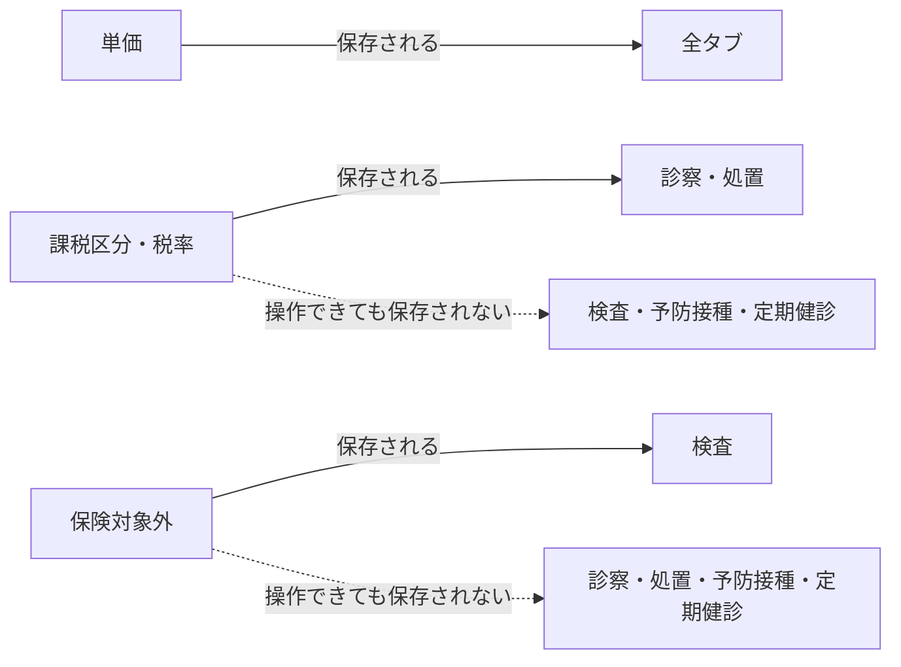

# 診療項目マスタ 仕様書 (Treatment Items)

| 管理項目 | 記載 |
|:---|:---|
| 文書ID・種別 | page.settings.master-treatment／画面仕様 |
| 決定状態 | 既存本文は継承（決定根拠未確認）。第六群の合意と未決は下記正本へ |
| 実装状態 | 既存記載を継承。今回の目標機能／認可適合は未確認 |
| 実機検証状態 | 未実施 |
| 文書確認日 | 2026-10-15 |

### 会計第六群との対応

[第六群の業務正本](../../domains/accounting/lifecycle.md#accounting-agreement-sixth)と[マスタ変更権限](../../domains/accounting/lifecycle.md#requirement-fr-accounting-master-authorized-maintenance)へ従う。全体割引から除外する品目を該当する品目マスタで指定できることが目標。現行の保険対象外を代用せず、保存対応済みとも扱わない。価格等のマスタ変更者は管理者と対象変更権限付きスタッフ。既存の診療master履歴保持の正本も維持する。 全スタッフに変更を開放せず、対象grant・医院scopeを検査する。今回、実権限・設定・API／DBは変更していない。詳細な[現行mapping](../../../design/domains/accounting/technical-spec.md#accounting-master-permission-map)は技術仕様へ。

2026-10-14、入力4項目合意の[診療master権限編集・無効化と当時内容保持](../../domains/medical-records/pages/medical-record-form.md#requirement-fr-medical-records-master-history-snapshots)が業務正本。対象masterの操作grant・医院scopeを保持し、無効項目を新規選択せず、既存記録に保存した名称・対象が持つ単位／価格は当時内容を保持する。旧実装説明だけでsnapshot保持済みと判断しない。

### 会計の保存・参照保護契約

[D10のmaster責務と互換](../../../design/domains/accounting/technical-spec.md#accounting-master-coverage)・[画面取得／失敗／保存](../../../design/domains/accounting/technical-spec.md#accounting-screen-contract)へ従う。現在認可・clinic／対象版を検査し、無権限／競合は保存しない。取得失敗を空masterとせず未保存入力を保護。名称変更／無効化／削除で過去請求／資金・帳票参照を失わせず前後値を追跡。旧CRUD表は現行参照で、新業務未対応経路はadapterと実装受入まで利用開始しない。

[第十群](../../domains/accounting/lifecycle.md#accounting-empty-rounding-master)で全体割引除外は初期値／設定欠落時とも対象外にしない。明示設定を保持し保険／税／明細割引と混同しない。追加済み会計行はmaster変更で自動更新せず明示再適用へ。単価×数量の行額は値引き前に行別1円四捨五入。臨床数量・投薬量や確定済み会計／旧帳票は直接変更しない。

### 予防接種の次回日設定との対応

[予防接種の最新第2項合意](../../domains/vaccinations/lifecycle.md#fr-vaccinations-schedule)では、次回日をワクチン種類ごとの設定または手入力へ統一する。独立／カルテ内の入口固有既定を解消する目標で、具体間隔・設定なしの初期値・新たな優先順位は追加確定しない。設定の管理は既存ワクチンマスタの権限境界へ接続する。以下の共通価格パネルや既存CRUDの説明だけで、設定の編集・保存／読取・両入口への反映が実装済みとしない。マスタ変更で過去の保存済み接種／次回日を自動書換えしない。

### 健診パッケージの次回日設定との対応

[最新第3項合意](../../domains/checkups/lifecycle.md#checkup-next-date-approved)により、健診の次回日はパッケージ設定から候補を出し手入力も可能。設定・保存済み日付・手入力日がなければ空欄とし、一律1年後や別の固定間隔を補完しない。設定変更で過去の保存済み日付や手入力日を自動再計算・消去しない。設定管理はcheckup-typesの既存checkups権限へ接続し、共通パネル表示や既存CRUDだけで設定編集・読取・全入口反映が実装済みとはしない。取得失敗／未知値を未設定と区別し、空欄既定として正常取得・保存成功と扱わない。具体的間隔・臨床閾値は新たに決めない。

### 品目別保険設定の追加合意（2026-10-15）

[品目別保険設定の業務正本](../../domains/accounting/lifecycle.md#requirement-fr-accounting-item-insurance-setting)と[保存・会計引継ぎ設計](../../../design/domains/accounting/technical-spec.md#accounting-item-insurance-design)を適用する。診察・処置・予防・健診も品目ごとの対象／対象外を保存・読取する目標で、薬剤・検査の既存明示値を維持する。個別会計での実適用・資格・補償の保証ではなく、全体割引除外・税・明細値引きとも独立。新規登録の診察・処置・予防・健診品目は保険対象外を初期値とし、必要に応じ権限のあるスタッフが対象へ変更できる。既存明示値は保持し、旧欠落値の一括対象外変換は未承認。全体割引除外のfalse既定とは別契約である。

現在の対象変更grant・医院scope／版を保存時に検査し、設定と前後値・操作者／時刻を追跡する。取得失敗・旧欠落・未保存を明示値と区別し、未保存編集を保護。会計の追加時snapshot・スタッフ確認修正値をmaster変更で自動更新せず、明示再適用／確定後訂正へ。今回の文書変更だけでUI／API／DB・実grant・移行が対応済みとはしない。

## 概要
- **画面の目的**: 診察、処置、手術、検査等の臨床行為の定義、および標準価格・税率の設定。
- **URLパターン**: `/settings/treatment-items` (タブパラメータ: `?tab=consultation` (診察), `?tab=examination` (検査), `?tab=procedure` (処置), `?tab=vaccine` (予防接種), `?tab=checkup` (定期健診))
- **アクセス権限**: 診療マスタ管理権限が必要（`ResourceMasterMedical`）

---

## 1. 画面構成

### 1.1 項目一覧テーブル
- **カテゴリ分類**: 診察、検査、処置、予防接種、定期健診のタブ切り替えにより、膨大な項目を整理して表示。
- **検索**: 項目名（親・子とも）による部分一致。

### 2. 詳細編集サイドパネル (`SidePeekPanel`)
- **基本属性**: 項目名（タイトル編集）、有効/無効ステータス、親カテゴリ（子項目がある場合は変更不可）、備考。
- **価格設定**（`TreatmentItemSidePanel` は全タブ共通のため画面上は以下を一律表示するが、実際に保存されるフィールドはタブ（テーブル）ごとに異なる）:
    - **単価**: `MoneyInput` による金額入力。全タブで保存される。
    - **課税区分**（外税 / 内税 / 非課税）・**税率**（10% / 8%）: 診察・処置のみ保存される（`consultations`/`procedures` テーブルの `tax_type`/`tax_rate`）。検査・予防・定期健診では画面上操作できるが保存されない（バックエンドに対応する列が存在しない）。
    - **保険対象外**（対象 / 対象外）: 継承された現行説明では検査のみ保存される（`exam_types.is_non_insurance`）。診察・処置・予防・定期健診では保存されない。この制約は追加合意の目標とは異なり、対象4種別にも品目単位の保存／再読取を接続する。下図は現行制約の図で、将来の非対応方針ではない。

---

## 2. 主要な機能

### 2.1 レジ精算への自動連動
カルテ（SOAPS）で選択された処置項目は、ここで設定された単価と税率を保持したまま会計セクションへ自動転送されます。

### 2.2 インボイス制度への対応
税率設定に基づき、領収書上での税率別の売上集計・消費税額が自動的に算出されます。

### 2.3 同一タブ内の名称一意（BUG-017）
各タブは別テーブルで、医院内の項目名は `(clinic_id, name)` UNIQUE（`deleted_at IS NULL`）。同一タブ内の同名は拒否し、別タブへの同名は受理する。フロントは事前重複チェックをせず、バックエンドの UNIQUE 違反を 409 で返す。

重複時の HTTP 409 はシフトテンプレートと同じ name-conflict 形とする。応答は安定 `code` と入力エコーの `params.name` を持ち、トーストはタブ種別ラベルだけでなく入力した実名を含む。種別ラベルだけの「診察は既に使用されています」は使わない（タブ名と誤認する）。

| タブ | テーブル | 制約 | `code` | トースト例 |
|:---|:---|:---|:---|:---|
| 診察 | `consultations` | `idx_consultations_clinic_name` | `consultation_name_conflict` | 診察『V04診察』は既に使用されています |
| 検査 | `exam_types` | `idx_exam_types_clinic_name` | `exam_type_name_conflict` | 検査『V04検査』は既に使用されています |
| 処置 | `procedures` | `idx_procedures_clinic_name` | `procedure_name_conflict` | 処置『V04処置』は既に使用されています |
| 予防接種 | `vaccines` | `idx_vaccines_clinic_name` | `vaccine_name_conflict` | 予防接種『V04予防接種』は既に使用されています |
| 定期健診 | `checkup_types` | `idx_checkup_types_clinic_name` | `checkup_type_name_conflict` | 定期健診『V04定期健診』は既に使用されています |

FE の対応は `handle-api-error.ts` の `localizeConflictMessage`。識別子が空の英語メッセージ（`consultation '' already exists`）は種別ラベル単独にせず「既に登録されています」に落とす。受け入れ確認は [V04 §2](../../../ops/testing/scenarios/V04-settings-master-forms.md) C3-2。

---

## 3. 技術仕様

### 3.1 構成コンポーネント
- **`TreatmentPlanMaster`**: メインページ。
- **`UnifiedTabs`**: 大分類ごとの高速なデータ切り替え。
- **`TreatmentItemSidePanel`**: `MasterSidePanel` による項目名・単価・課税区分・税率・保険対象外の編集。
- **`PropertyInput`**: 備考欄のボーダーレス編集。

### API連携
| メソッド | エンドポイント | 用途 | 必須権限 | 必須アクション |
|:---|:---|:---|:---|:---|
| GET | `/api/v1/masters/consultations` | 診察項目一覧の取得 | `master-medical` | `view` |
| GET | `/api/v1/masters/consultations/:id` | 特定の診察項目情報の取得 | `master-medical` | `view` |
| POST | `/api/v1/masters/consultations` | 診察項目の作成 | `master-medical` | `create` |
| PATCH | `/api/v1/masters/consultations/:id` | 診察項目の更新 | `master-medical` | `edit` |
| DELETE | `/api/v1/masters/consultations/:id` | 診察項目の削除 | `master-medical` | `delete` |
| PATCH | `/api/v1/masters/consultations/reorder` | 診察項目の表示順一括保存 | `master-medical` | `edit` |
| GET | `/api/v1/masters/examination-types` | 検査項目一覧の取得 | `master-medical` | `view` |
| GET | `/api/v1/masters/examination-types/:id` | 特定の検査項目情報の取得 | `master-medical` | `view` |
| POST | `/api/v1/masters/examination-types` | 検査項目の作成 | `master-medical` | `create` |
| PATCH | `/api/v1/masters/examination-types/:id` | 検査項目の更新 | `master-medical` | `edit` |
| DELETE | `/api/v1/masters/examination-types/:id` | 検査項目の削除 | `master-medical` | `delete` |
| PATCH | `/api/v1/masters/examination-types/reorder` | 検査項目の表示順一括保存 | `master-medical` | `edit` |
| GET | `/api/v1/masters/procedures` | 処置項目一覧の取得 | `master-medical` | `view` |
| GET | `/api/v1/masters/procedures/:id` | 特定の処置項目情報の取得 | `master-medical` | `view` |
| POST | `/api/v1/masters/procedures` | 処置項目の作成 | `master-medical` | `create` |
| PATCH | `/api/v1/masters/procedures/:id` | 処置項目の更新 | `master-medical` | `edit` |
| DELETE | `/api/v1/masters/procedures/:id` | 処置項目の削除 | `master-medical` | `delete` |
| PATCH | `/api/v1/masters/procedures/reorder` | 処置項目の表示順一括保存 | `master-medical` | `edit` |
| GET | `/api/v1/masters/vaccines` | 予防接種項目一覧の取得 | `master-medical` | `view` |
| GET | `/api/v1/masters/vaccines/:id` | 特定の予防接種項目情報の取得 | `master-medical` | `view` |
| POST | `/api/v1/masters/vaccines` | 予防接種項目の作成 | `master-medical` | `create` |
| PATCH | `/api/v1/masters/vaccines/:id` | 予防接種項目の更新 | `master-medical` | `edit` |
| DELETE | `/api/v1/masters/vaccines/:id` | 予防接種項目の削除 | `master-medical` | `delete` |
| PATCH | `/api/v1/masters/vaccines/reorder` | 予防接種項目の表示順一括保存 | `master-medical` | `edit` |
| GET | `/api/v1/masters/checkup-types` | 定期健診項目一覧の取得 | `checkups` | `view` |
| GET | `/api/v1/masters/checkup-types/:id` | 特定の定期健診項目情報の取得 | `checkups` | `view` |
| POST | `/api/v1/masters/checkup-types` | 定期健診項目の作成 | `checkups` | `create` |
| PATCH | `/api/v1/masters/checkup-types/:id` | 定期健診項目の更新 | `checkups` | `edit` |
| DELETE | `/api/v1/masters/checkup-types/:id` | 定期健診項目の削除 | `checkups` | `delete` |
| PATCH | `/api/v1/masters/checkup-types/reorder` | 定期健診項目の表示順一括保存 | `checkups` | `edit` |

---

