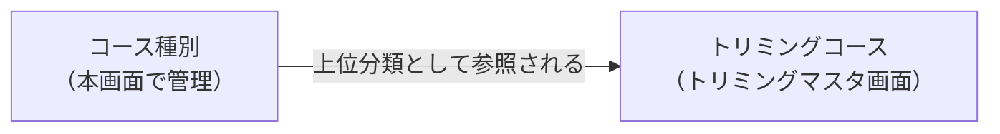

# トリミングコース種別マスタ 仕様書 (Trimming Course Type)

> 領域正本: [業務契約](../../domains/trimming/lifecycle.md)・[技術契約](../../../design/domains/trimming/technical-spec.md)。以下は既存画面／API観察を継承する。削除endpointの存在は無条件削除の許可ではなく、参照・必要履歴・現在認可を検査し、業務原本や分類不明を通常物理削除しない。無効化後も既存記録の参照を保持する。master変更は過去記録・追加済会計明細へ自動反映せず、会計の再適用はD10の明示確認契約へ従う。
## 概要
- **画面の目的**: トリミングコースのカテゴリ（シャンプー、シャンプー+カットなど）を管理し、トリミングコース管理画面の分類基盤を整える。
- **URLパターン**: `/settings/trimming-course-type`
- **アクセス権限**: `ResourceMasterTrimming`（`master-trimming`）の操作別権限。閲覧は`view`、登録は`create`、変更/並替えは`edit`、削除は`delete`を既存の医院scopeとともに検査する。職位名「スタッフ管理者以上」だけで許可を推定しない（下記API対応が正本）。

---

## 会議追加3の目標UI

[会議追加3](../../domains/trimming/lifecycle.md#trimming-meeting-pricing-category)により、コース種別をコースのカテゴリとして整理し、[予約区分マスタ](master-reservation-type.md)に近い一覧・編集UIへ寄せる。カテゴリ一覧から名称・有効状態を編集し、コース側でその所属を確認する。予約区分そのものと統合せず、予約区分の業務分類・担当／枠設定・色の継承をカテゴリへ自動追加しない。既存ID・コース関連・master認可・無効化後の履歴を保持する。

以下のSidePeek等は現行画面の参照であり、新UIの実装完了を示さない。画面配置・具体コンポーネントは業務を変えない範囲で設計し、カテゴリ変更だけで施術料金・追加済み会計・確定済み請求を再計算しない。

## 画面構成

### 1. 一覧
- **表示項目**: 種別名、有効/無効ステータス、操作ボタン。
- **編集方式**: SidePeek（右側パネル）で名称と有効状態を更新。

### 2. 新規登録／更新
- **名称**: 必須。空文字は保存不可。
- **有効状態**: トグルで `isActive` を変更。

---

## 技術仕様

### API連携
| メソッド | エンドポイント | 用途 | 必須権限 | 必須アクション |
|:---|:---|:---|:---|:---|
| GET | `/api/v1/masters/trimming-course-types` | 定義済みのコース種別を取得 | `master-trimming` | `view` |
| GET | `/api/v1/masters/trimming-course-types/:id` | 特定のコース種別詳細を取得 | `master-trimming` | `view` |
| POST | `/api/v1/masters/trimming-course-types` | コース種別を追加 | `master-trimming` | `create` |
| PATCH | `/api/v1/masters/trimming-course-types/:id` | コース種別情報を更新 | `master-trimming` | `edit` |
| DELETE | `/api/v1/masters/trimming-course-types/:id` | コース種別を削除 | `master-trimming` | `delete` |
| PATCH | `/api/v1/masters/trimming-course-types/reorder` | 種別の表示順を一括保存（BE実装済みだが本画面からは未呼出） | `master-trimming` | `edit` |

### 関連画面
- トリミングマスタ（`/settings/trimming`）で表示するコース群の上位分類として参照されます。

## 10/19後続承認：同種操作・検索ボタン方式

本画面の既存キーワード欄は[適用台帳 M08](../../shared/interaction-scope.md)と[共通FR/8AC](../../shared/ui-contracts.md#interaction-consistency-20261019)へ従う。入力中/適用済みを分け、入力/待機/消去だけでは検索せず検索ボタンで適用。既存の明示リセット、独立filter、詳細復帰、認可・検索対象・取得上限/ページ内制限を保持し、全件検索や一律の保存方式へ変えない。取得中/0件/失敗と遅延応答を分け、検索で選択/保存/コピー/送信を確定しない。旧defer/debounceの記載は入力即適用の目標に用いず、適用後の描画最適化と区別する。[S14手順](../../../ops/testing/scenarios/S14-search-and-multi-word.md#cross-ui-search-20261019)を各対象IDで実施する受入条件とし、実装適合・実機は未確認。
