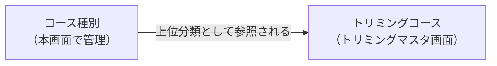

# トリミングコース種別マスタ 仕様書 (Trimming Course Type)

> 領域正本: [業務契約](../../domains/trimming/lifecycle.md)・[技術契約](../../../design/domains/trimming/technical-spec.md)。以下は既存画面／API観察を継承する。削除endpointの存在は無条件削除の許可ではなく、参照・必要履歴・現在認可を検査し、業務原本や分類不明を通常物理削除しない。無効化後も既存記録の参照を保持する。master変更は過去記録・追加済会計明細へ自動反映せず、会計の再適用はD10の明示確認契約へ従う。
## 概要
- **画面の目的**: トリミングコースの大分類（シャンプー、シャンプー+カットなど）を管理し、トリミングコース管理画面の分類基盤を整える。
- **URLパターン**: `/settings/trimming-course-type`
- **アクセス権限**: スタッフ管理者以上（`ResourceMasterTrimming`）

---

## 画面構成

### 1. 一覧
- **表示項目**: 種別名、有効/無効ステータス、操作ボタン。
- **編集方式**: SidePeek（右側パネル）で名称と有効状態を更新。

### 2. 新規登録／更新
- **名称**: 必須。空文字は保存不可。
- **有効状態**: トグルで `isActive` を変更。

---

## 技術仕様

### API連携
| メソッド | エンドポイント | 用途 | 必須権限 | 必須アクション |
|:---|:---|:---|:---|:---|
| GET | `/api/v1/masters/trimming-course-types` | 定義済みのコース種別を取得 | `master-trimming` | `view` |
| GET | `/api/v1/masters/trimming-course-types/:id` | 特定のコース種別詳細を取得 | `master-trimming` | `view` |
| POST | `/api/v1/masters/trimming-course-types` | コース種別を追加 | `master-trimming` | `create` |
| PATCH | `/api/v1/masters/trimming-course-types/:id` | コース種別情報を更新 | `master-trimming` | `edit` |
| DELETE | `/api/v1/masters/trimming-course-types/:id` | コース種別を削除 | `master-trimming` | `delete` |
| PATCH | `/api/v1/masters/trimming-course-types/reorder` | 種別の表示順を一括保存（BE実装済みだが本画面からは未呼出） | `master-trimming` | `edit` |

### 関連画面
- トリミングマスタ（`/settings/trimming`）で表示するコース群の上位分類として参照されます。

