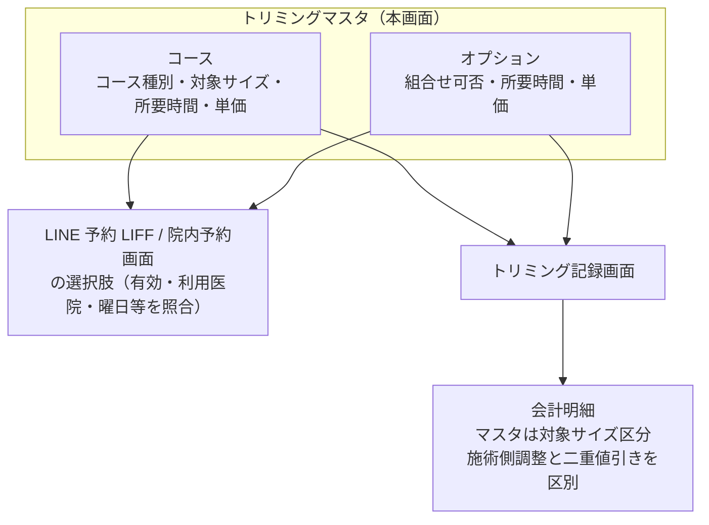

# トリミングマスタ 仕様書 (Trimming Master)

> 領域正本: [業務契約](../../domains/trimming/lifecycle.md)・[技術契約](../../../design/domains/trimming/technical-spec.md)。以下は既存画面／API観察を継承する。削除endpointの存在は無条件削除の許可ではなく、参照・必要履歴・現在認可を検査し、業務原本や分類不明を通常物理削除しない。無効化後も既存記録の参照を保持する。master変更は過去記録・追加済会計明細へ自動反映せず、会計の再適用はD10の明示確認契約へ従う。
## 概要
- **画面の目的**: トリミングにおける「基本コース」と「追加オプション」の定義。
- **URLパターン**: `/settings/trimming`
- **アクセス権限**: トリミング管理権限が必要（`ResourceMasterTrimming`）
- **注意**: 品種（犬種）別の価格マトリックスは存在しない。マスタの価格区分は「対象サイズ」（下記）であり、個別施術の料金手修正／値引きとは別。犬種そのものに紐づく価格テーブルはバックエンドモデルにもない（backend/internal/model/trimming_master.go:9-51）。

---

## 画面構成

### 1. サービス区分切り替え（タブ）
- **コース (Courses)**: ベースメニュー。コース種別＝コースのカテゴリ（[master-trimming-course-type.md](./master-trimming-course-type.md)）に紐付け可能。予約区分マスタに近い一覧・編集UIへの整理は会議追加3へ従う。
- **オプション (Options)**: 追加メニュー（`is_combinable` で併用可否を設定）。

### 2. コース詳細サイドパネル

以下は従来画面の観察であり、最新のコース属性と予約選択条件は[12:32:58 UTCの承認](#trimming-course-attributes-20261017)を正本とする。
- **ステータス**、**コース種別**（指定なし可）、**対象サイズ**（小型/中型/大型/猫の4区分。品種単位ではない）、**所要時間(分)**、**単価(税込)**、**備考**。

### 3. オプション詳細サイドパネル
- **ステータス**、**所要時間(分)**、**組合せ可否**（`is_combinable`）、**単価(税込)**、**備考**。

---

## 主要な機能

### 1. 予約システムとの連動
トリミングコースの予約候補は[最新属性・利用医院・曜日・休止条件](#trimming-course-attributes-20261017)と下記の所要時間／オプション対応条件を照合して表示する。有効化だけで全医院・全日付の予約選択を許可しない。

### 2. 施術記録・会計連携
[最新第5項合意](../../domains/trimming/lifecycle.md#trimming-partial-save-undecided)では、施術記録の途中保存時はコース未定を許す。未定を埋めるための既定コース／架空料金を設けず、後から選ぶ際は既存の有効マスタ条件を適用する。この途中保存の承認だけでコースマスタの属性条件を緩和しない。コース属性の最新承認は[2026-10-17の属性正本](#trimming-course-attributes-20261017)へ従う。施術終了は[追加承認](../../domains/trimming/lifecycle.md#trimming-end-recorded-performance)により実担当と施術内容を記録し、コースなしでも既存オプション等の施術明細があれば可能。終了のための既定コースや自由入力明細を新設しない。

トリミング記録画面で選択されたコース・オプションと、[会議追加3](../../domains/trimming/lifecycle.md#trimming-meeting-pricing-category)の保存済み料金手修正／値引きは、未請求明細API経由で会計へ引き継ぐ。マスタ価格区分は対象サイズに基づき、犬種別価格分岐は設けないが、個別施術の手修正を禁止する意味ではない。個別調整はmaster価格を変えず、会計追加後のsnapshot／手修正・確定済み請求を自動更新しない。値引scope・根拠を区別して二重適用を防ぎ、D10既決計算を使う。現行の施術記録保存時価格snapshot・追加後差分再反映の実装適合は未確認。

---

## 技術仕様

### 使用コンポーネント
- **`TrimmingSettings`**: メインページ（コース/オプションタブ切り替え）。
- **`TrimmingCourseSidePanel` / `TrimmingOptionSidePanel`**: 詳細編集パネル。

### API連携
| メソッド | エンドポイント | 用途 | 必須権限 | 必須アクション |
|:---|:---|:---|:---|:---|
| GET | `/api/v1/masters/trimming-courses` | 基本コース一覧の取得 | `master-trimming` | `view` |
| GET | `/api/v1/masters/trimming-courses/:id` | 特定の基本コース詳細の取得 | `master-trimming` | `view` |
| POST | `/api/v1/masters/trimming-courses` | 基本コースの作成 | `master-trimming` | `create` |
| PATCH | `/api/v1/masters/trimming-courses/:id` | コース情報の更新 | `master-trimming` | `edit` |
| DELETE | `/api/v1/masters/trimming-courses/:id` | コースの削除 | `master-trimming` | `delete` |
| PATCH | `/api/v1/masters/trimming-courses/reorder` | コース表示順の一括保存（BE実装済みだが本画面からは未呼出） | `master-trimming` | `edit` |
| GET | `/api/v1/masters/trimming-options` | オプション項目の一覧取得 | `master-trimming` | `view` |
| GET | `/api/v1/masters/trimming-options/:id` | 特定のオプション項目詳細の取得 | `master-trimming` | `view` |
| POST | `/api/v1/masters/trimming-options` | オプション項目の作成 | `master-trimming` | `create` |
| PATCH | `/api/v1/masters/trimming-options/:id` | オプション項目の更新 | `master-trimming` | `edit` |
| DELETE | `/api/v1/masters/trimming-options/:id` | オプション項目の削除 | `master-trimming` | `delete` |
| PATCH | `/api/v1/masters/trimming-options/reorder` | オプション表示順の一括保存（BE実装済みだが本画面からは未呼出） | `master-trimming` | `edit` |

---

## 予約選択時の所要時間とマスタ改定の境界

[2026-10-17の予約8点承認](../../domains/reservations/pages/reservation-management.md#booking-course-option-duration-20261017)を適用する。予約用に選択できるコースの時間は1分以上とし、時間未設定のコース／オプションは予約で選べない。オプションは明示設定した0分を許し、未設定を0分へ補完しない。予約区分マスタの5分刻み・5〜480分を本マスタへ転用しない。コースは1予約最大1つで選択一律必須ではなく、基礎時間に選択追加オプション時間を加算する。

予約時のコース／オプション時間を当該予約に保持し、マスタ時間改定を既存予約の開始／終了へ自動反映せず、新規予約から適用する。予約編集でコース／オプションを変更すると再計算し、保存前に新終了時刻を表示、延長にも既決の重複・空き枠チェックを適用する。保存形式・旧値照合は設計残件。1件の予約で異なるオプションを複数選択でき、同じオプションは1回までとし、数量指定は設けない。選択した各オプションの時間を1回ずつ合計する。コースごとに追加選択できるオプションを設定し、予約画面には選択コースに対応するものだけを表示する。コースに内包された施術は追加オプションとして重複選択できない。コース未選択で選べるオプションは、コース別の設定とは別に設定できる。既存併用フラグだけで全組合せを許可したり、内包施術の識別方法を確定したりしない。具体的設定UI／保存方式・対応データは設計残件。この施術オプション契約の根拠は2026-10-17本人承認で、旧マニュアルの記載ではない。料金・施術記録・会計snapshotの既存ownerと保護を維持する。個別受入条件は予約正本へ置き、実装・実機適合は未確認。

## トリミングコースの属性と予約利用条件（2026-10-17承認）

対象はトリミングのコースマスタ。診療・ホテルのコースや予約区分へ一律拡張しない。予約区分とは別のコース側で次の属性を管理する。

| 属性 | 承認された扱い |
|:---|:---|
| 名称・所要時間・料金・利用できる医院 | コースの基本属性として管理する。料金は既存の対象サイズ区分等の価格責務に従い、予約区分へ二重管理しない。利用医院は既存医院scope・権限内で扱う |
| 短縮名・説明・画像 | 任意。これらが未登録という理由だけでコースを使用不可にしない |
| 予約可能な曜日 | 設定でき、未指定なら全曜日。全曜日は曜日によるコース選択制限がないという意味で、休診・時間外・シフト・休憩・空き枠・対応区分等の既決条件を解除しない |
| 表示順 | コースの表示順を設定する。具体的な並替え操作や並び順値の保存方法は設計 |
| 休止 | 休止コースは新規予約で選択不可。登録済み予約と履歴を保持し、休止だけで既存予約を取消・時刻変更・別コースへ差し替えたり履歴を削除したりしない |

根拠：質問Sentinel_49bd090843fc8191a8bc3f6dc086fd2cに対する本人Sentinel_b8b58e2ff1e4819182502ef21c52a379の2026-10-17 12:32:58 UTC「おけ」。旧公式マニュアルp.4–6の名称・分単位所要時間・短縮名・所属・曜日・休止・表示順・画像は属性照合の参照とするが、今回の採用根拠は本人の承認である。利用できる医院への対応は今回承認で扱い、旧製品の所属内部形式やノア実設定を推定しない。料金と追加オプションを旧マニュアル記載済みとはしない。PDF原本は親側の確認結果に基づく比較で、Mac側での全文独立照合済みとはしない。

[予約8点の既決](../../domains/reservations/pages/reservation-management.md#booking-course-option-duration-20261017)を維持する。コース所要時間は1分以上、未設定と0分を区別し未設定時間は予約で選択不可。オプションの明示0分は別の既決として許容する。予約時に採用した時間を保存し、マスタ時間改定だけで既存予約の開始／終了を動かさない。今回の属性追加を、既存予約の時間値の再生成や料金・会計snapshotの遡及変更にしない。

個別の初期データ、利用医院設定の具体的保存形式、画像形式・容量、曜日判定の具体実装、既存予約を編集して休止コースを扱う場合の詳細は設計事項として分ける。休止の承認から物理削除や既存データの移行・補完を行わない。

| 条件ID | 前提／操作 | 期待結果 | 検証状態 |
|:---|:---|:---|:---|
| AC-trimming-course-master-attributes | トリミングコースの属性設定を確認し、短縮名・説明・画像を未登録にする | 名称・所要時間・料金・利用医院を管理でき、短縮名・説明・画像の欠如だけで使用不可にしない。予約区分側の料金新設や診療／ホテルへの一律適用はしない | 未実施 |
| AC-trimming-course-weekday-availability | 同じコースで曜日指定あり／未指定を比較し、休診または勤務・空き枠条件を満たさない日も確認する | 指定曜日の条件を適用し、未指定は全曜日として扱う。未指定でも既決の休診／勤務／空き枠等の条件を免除しない | 未実施 |
| AC-trimming-course-clinic-and-display-order | 利用できる医院と表示順を設定したコースを権限内の医院で確認する | 利用医院と表示順に従って候補を扱う。医院設定を認可外の公開権限にせず、具体的な保存粒度や他院設定を推定しない | 未実施 |
| AC-trimming-course-suspended-history | コースを選択した保存済み予約と履歴があり、そのコースを休止する | 新規予約では選択不可、既存予約・履歴は保持する。休止で予約を取消／差替え／時刻変更せず、過去の採用時間を現在マスタで上書きしない | 未実施 |

## 10/19後続承認：同種操作・検索ボタン方式

本画面の既存キーワード欄は[適用台帳 M07](../../shared/interaction-scope.md)と[共通FR/8AC](../../shared/ui-contracts.md#interaction-consistency-20261019)へ従う。入力中/適用済みを分け、入力/待機/消去だけでは検索せず検索ボタンで適用。既存の明示リセット、独立filter、詳細復帰、認可・検索対象・取得上限/ページ内制限を保持し、全件検索や一律の保存方式へ変えない。取得中/0件/失敗と遅延応答を分け、検索で選択/保存/コピー/送信を確定しない。旧defer/debounceの記載は入力即適用の目標に用いず、適用後の描画最適化と区別する。[S14手順](../../../ops/testing/scenarios/S14-search-and-multi-word.md#cross-ui-search-20261019)を各対象IDで実施する受入条件とし、実装適合・実機は未確認。
