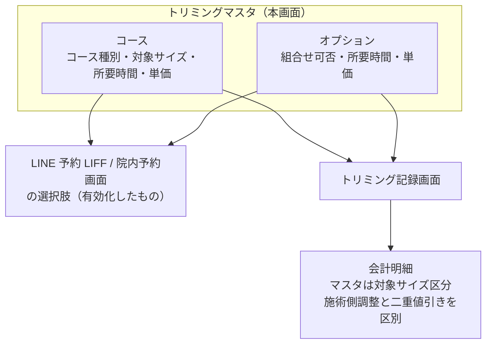

# トリミングマスタ 仕様書 (Trimming Master)

> 領域正本: [業務契約](../../domains/trimming/lifecycle.md)・[技術契約](../../../design/domains/trimming/technical-spec.md)。以下は既存画面／API観察を継承する。削除endpointの存在は無条件削除の許可ではなく、参照・必要履歴・現在認可を検査し、業務原本や分類不明を通常物理削除しない。無効化後も既存記録の参照を保持する。master変更は過去記録・追加済会計明細へ自動反映せず、会計の再適用はD10の明示確認契約へ従う。
## 概要
- **画面の目的**: トリミングにおける「基本コース」と「追加オプション」の定義。
- **URLパターン**: `/settings/trimming`
- **アクセス権限**: トリミング管理権限が必要（`ResourceMasterTrimming`）
- **注意**: 品種（犬種）別の価格マトリックスは存在しない。マスタの価格区分は「対象サイズ」（下記）であり、個別施術の料金手修正／値引きとは別。犬種そのものに紐づく価格テーブルはバックエンドモデルにもない（backend/internal/model/trimming_master.go:9-51）。

---

## 画面構成

### 1. サービス区分切り替え（タブ）
- **コース (Courses)**: ベースメニュー。コース種別＝コースのカテゴリ（[master-trimming-course-type.md](./master-trimming-course-type.md)）に紐付け可能。予約区分マスタに近い一覧・編集UIへの整理は会議追加3へ従う。
- **オプション (Options)**: 追加メニュー（`is_combinable` で併用可否を設定）。

### 2. コース詳細サイドパネル
- **ステータス**、**コース種別**（指定なし可）、**対象サイズ**（小型/中型/大型/猫の4区分。品種単位ではない）、**所要時間(分)**、**単価(税込)**、**備考**。

### 3. オプション詳細サイドパネル
- **ステータス**、**所要時間(分)**、**組合せ可否**（`is_combinable`）、**単価(税込)**、**備考**。

---

## 主要な機能

### 1. 予約システムとの連動
ここで有効化されたコースとオプションは、LINE 予約 LIFF アプリおよび院内予約画面の選択肢として表示されます。

### 2. 施術記録・会計連携
[最新第5項合意](../../domains/trimming/lifecycle.md#trimming-partial-save-undecided)では、施術記録の途中保存時はコース未定を許す。未定を埋めるための既定コース／架空料金を設けず、後から選ぶ際は既存の有効マスタ条件を適用する。これはコースマスタ自体の必須属性や、施術の実施／完了条件を新たに変えるものではない。

トリミング記録画面で選択されたコース・オプションと、[会議追加3](../../domains/trimming/lifecycle.md#trimming-meeting-pricing-category)の保存済み料金手修正／値引きは、未請求明細API経由で会計へ引き継ぐ。マスタ価格区分は対象サイズに基づき、犬種別価格分岐は設けないが、個別施術の手修正を禁止する意味ではない。個別調整はmaster価格を変えず、会計追加後のsnapshot／手修正・確定済み請求を自動更新しない。値引scope・根拠を区別して二重適用を防ぎ、D10既決計算を使う。現行の施術記録保存時価格snapshot・追加後差分再反映の実装適合は未確認。

---

## 技術仕様

### 使用コンポーネント
- **`TrimmingSettings`**: メインページ（コース/オプションタブ切り替え）。
- **`TrimmingCourseSidePanel` / `TrimmingOptionSidePanel`**: 詳細編集パネル。

### API連携
| メソッド | エンドポイント | 用途 | 必須権限 | 必須アクション |
|:---|:---|:---|:---|:---|
| GET | `/api/v1/masters/trimming-courses` | 基本コース一覧の取得 | `master-trimming` | `view` |
| GET | `/api/v1/masters/trimming-courses/:id` | 特定の基本コース詳細の取得 | `master-trimming` | `view` |
| POST | `/api/v1/masters/trimming-courses` | 基本コースの作成 | `master-trimming` | `create` |
| PATCH | `/api/v1/masters/trimming-courses/:id` | コース情報の更新 | `master-trimming` | `edit` |
| DELETE | `/api/v1/masters/trimming-courses/:id` | コースの削除 | `master-trimming` | `delete` |
| PATCH | `/api/v1/masters/trimming-courses/reorder` | コース表示順の一括保存（BE実装済みだが本画面からは未呼出） | `master-trimming` | `edit` |
| GET | `/api/v1/masters/trimming-options` | オプション項目の一覧取得 | `master-trimming` | `view` |
| GET | `/api/v1/masters/trimming-options/:id` | 特定のオプション項目詳細の取得 | `master-trimming` | `view` |
| POST | `/api/v1/masters/trimming-options` | オプション項目の作成 | `master-trimming` | `create` |
| PATCH | `/api/v1/masters/trimming-options/:id` | オプション項目の更新 | `master-trimming` | `edit` |
| DELETE | `/api/v1/masters/trimming-options/:id` | オプション項目の削除 | `master-trimming` | `delete` |
| PATCH | `/api/v1/masters/trimming-options/reorder` | オプション表示順の一括保存（BE実装済みだが本画面からは未呼出） | `master-trimming` | `edit` |

---

