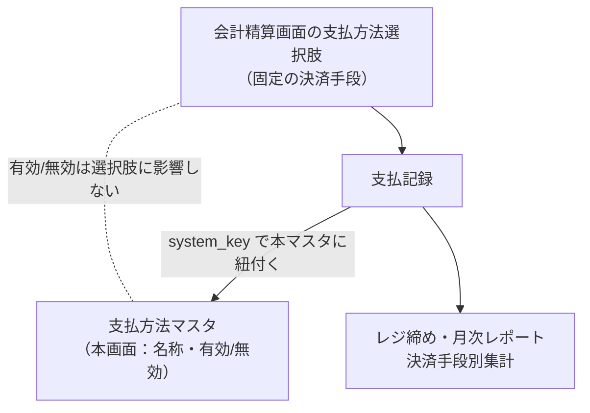

# 支払方法マスタ 仕様書 (Payment Methods)

| 管理項目 | 記載 |
|:---|:---|
| 文書ID・種別 | page.settings.payment-methods／画面仕様 |
| 決定状態 | 既存本文は継承（決定根拠未確認）。第六群と支払方法停止の追加合意・未決は下記正本へ |
| 実装状態 | 既存記載を継承。今回の目標機能／認可適合は未確認 |
| 実機検証状態 | 未実施 |
| 文書確認日 | 2026-10-15 |

### 会計第六群との対応

[第六群の業務正本](../../domains/accounting/lifecycle.md#accounting-agreement-sixth)と[マスタ変更権限](../../domains/accounting/lifecycle.md#requirement-fr-accounting-master-authorized-maintenance)へ従う。マスタ変更者は管理者と対象変更権限付きスタッフ。下記の固定4種／有効状態が選択肢に影響しない説明は現行挙動。将来目標は[停止した方法を新しい入金で選べなくし、過去支払記録・集計に残す追加合意](../../domains/accounting/lifecycle.md#accounting-inactive-payment-method)へ従う。ADR003の現在の支払識別・集計整合は保持する。 全スタッフに変更を開放せず、対象grant・医院scopeを検査する。今回、実権限・設定・API／DBは変更していない。詳細な[現行mapping](../../../design/domains/accounting/technical-spec.md#accounting-master-permission-map)は技術仕様へ。

### 会計の保存・参照保護契約

[D10のmaster責務と互換](../../../design/domains/accounting/technical-spec.md#accounting-master-coverage)・[画面取得／失敗／保存](../../../design/domains/accounting/technical-spec.md#accounting-screen-contract)へ従う。現在認可・clinic／対象版を検査し、無権限／競合は保存しない。取得失敗を空masterとせず未保存入力を保護。名称変更／無効化／削除で過去請求／資金・帳票参照を失わせず前後値を追跡。旧CRUD表は現行参照で、新業務未対応経路はadapterと実装受入まで利用開始しない。

## 概要
- **画面の目的**: 決済手段（現金、クレジットカード、電子マネー等）マスタの名称・有効/無効の管理。レジ締めや月次レポートの決済手段別集計の軸となる。
- **URLパターン**: `/settings/payment-methods`
- **アクセス権限**: 支払方法マスタ管理権限が必要（`ResourcePaymentMethod`）

---

## 画面構成

### 1. 支払方法一覧
登録済みの決済手段の名称と、現在の有効/無効ステータス。

### 2. 詳細編集サイドパネル (`SidePeekPanel`)
- **名称**: レジ締め帳票や月次レポートの決済手段別内訳に表示される名前（例：現金、クレジットカード）。
- **ステータス**: 利用停止した決済手段を「無効」に設定可能。目標では停止後の新受領の選択・保存を制限し、過去支払記録・集計を保持する。変更権限と保存・監査は上記契約へ従う。

---

## 主要な機能

### 1. レジ精算・集計との連動

**追加合意の目標**：[業務正本](../../domains/accounting/lifecycle.md#accounting-inactive-payment-method)・[検査と履歴参照の設計](../../../design/domains/accounting/technical-spec.md#accounting-inactive-payment-design)へ従う。無効な方法は新規会計の実入金・後日回収・預り金／前金の新規受領で選べず、保存時にも現在状態を検査する。新規選択候補と過去参照を分け、停止済み方法の支払履歴・帳票参照・方法別集計を残す。既存資金の再配分・充当・解除／復元を新受領とせず、返金・誤記訂正へ追加禁止を導かない。既存の理由／確認・認可・金額保護は維持する。

**現行実装の参照**：会計精算画面は固定4種（現金・クレジットカード・電子マネー・銀行振込）を表示し、本マスタの有効/無効が選択肢に影響しない。これは追加合意との実装差分であり、目標契約ではない。ADR-003 Option Cの安定識別は保持し、支払記録は `system_key` と医院内master IDの対応で本マスタへ結び、レジ締めや月次の集計軸を保つ。方法追加・ENUM廃止・初期値変更・移行は今回承認／実施していない。

以下の図は現行実装の参照で、追加合意の対応完了を示さない。

### 2. 並び順
一覧は `display_order` 昇順（同値は名称昇順）で表示されます。並び順を変更する UI は本画面には存在しません（reorder API 未呼出）。

---

## 技術仕様

### 使用コンポーネント
- **`PaymentMethodSidePanel`**: `MasterSidePanel` による決済手段名の編集。
- **`StatusToggleButton`**: 有効/無効のトグル切り替え。

### API連携
| メソッド | エンドポイント | 用途 | 必須権限 | 必須アクション |
|:---|:---|:---|:---|:---|
| GET | `/api/v1/payment-methods` | 支払方法マスタ一覧の取得（新受領の選択可否は上記目標契約で区別） | `master-payment-method` | `view` |
| GET | `/api/v1/payment-methods/:id` | 特定の支払方法詳細の取得 | `master-payment-method` | `view` |
| POST | `/api/v1/payment-methods` | 新規支払方法の作成 | `master-payment-method` | `create` |
| PATCH | `/api/v1/payment-methods/:id` | 名称やステータスの更新 | `master-payment-method` | `edit` |
| DELETE | `/api/v1/payment-methods/:id` | 支払方法の削除 | `master-payment-method` | `delete` |
| PATCH | `/api/v1/payment-methods/reorder` | 表示順の一括保存（BE実装済みだが本画面からは未呼出） | `master-payment-method` | `edit` |

---

