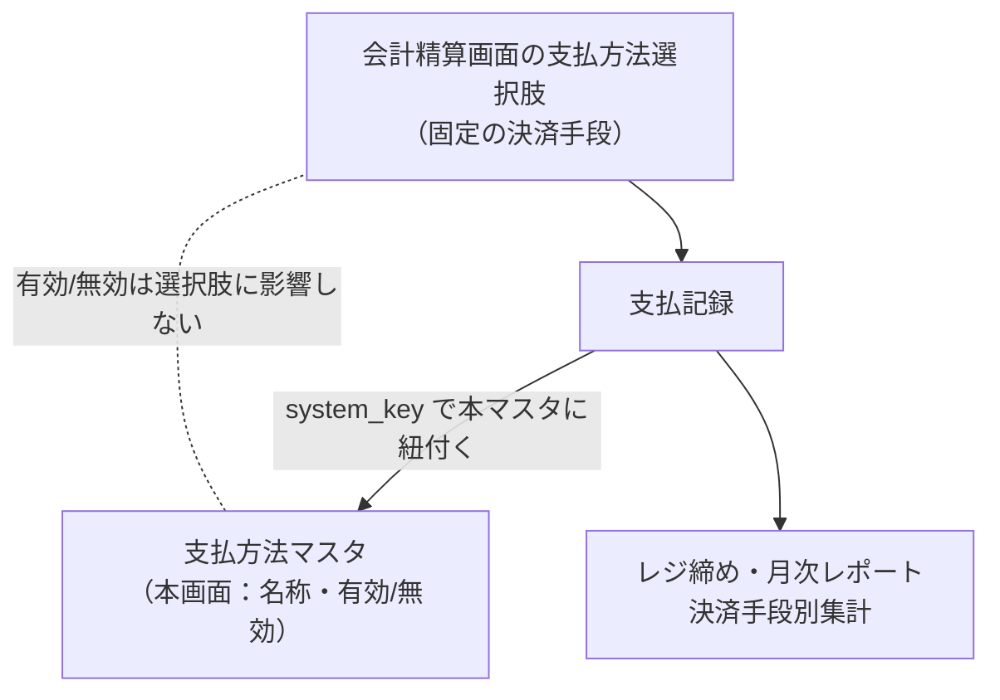

# 支払方法マスタ 仕様書 (Payment Methods)

| 管理項目 | 記載 |
|:---|:---|
| 文書ID・種別 | page.settings.payment-methods／画面仕様 |
| 決定状態 | 既存本文は継承（決定根拠未確認）。第六群の合意と未決は下記正本へ |
| 実装状態 | 既存記載を継承。今回の目標機能／認可適合は未確認 |
| 実機検証状態 | 未実施 |
| 文書確認日 | 2026-10-15 |

### 会計第六群との対応

[第六群の業務正本](../../domains/accounting/lifecycle.md#accounting-agreement-sixth)と[マスタ変更権限](../../domains/accounting/lifecycle.md#requirement-fr-accounting-master-authorized-maintenance)へ従う。マスタ変更者は管理者と対象変更権限付きスタッフ。下記の固定4種／有効状態が選択肢に影響しない説明は現行挙動であり、将来の選択肢固定を承認したものではない。ADR003の現在の支払識別・集計整合は保持する。 全スタッフに変更を開放せず、対象grant・医院scopeを検査する。今回、実権限・設定・API／DBは変更していない。詳細な[現行mapping](../../../design/domains/accounting/technical-spec.md#accounting-master-permission-map)は技術仕様へ。

### 会計の保存・参照保護契約

[D10のmaster責務と互換](../../../design/domains/accounting/technical-spec.md#accounting-master-coverage)・[画面取得／失敗／保存](../../../design/domains/accounting/technical-spec.md#accounting-screen-contract)へ従う。現在認可・clinic／対象版を検査し、無権限／競合は保存しない。取得失敗を空masterとせず未保存入力を保護。名称変更／無効化／削除で過去請求／資金・帳票参照を失わせず前後値を追跡。旧CRUD表は現行参照で、新業務未対応経路はadapterと実装受入まで利用開始しない。

## 概要
- **画面の目的**: 決済手段（現金、クレジットカード、電子マネー等）マスタの名称・有効/無効の管理。レジ締めや月次レポートの決済手段別集計の軸となる。
- **URLパターン**: `/settings/payment-methods`
- **アクセス権限**: 支払方法マスタ管理権限が必要（`ResourcePaymentMethod`）

---

## 画面構成

### 1. 支払方法一覧
登録済みの決済手段の名称と、現在の有効/無効ステータス。

### 2. 詳細編集サイドパネル (`SidePeekPanel`)
- **名称**: レジ締め帳票や月次レポートの決済手段別内訳に表示される名前（例：現金、クレジットカード）。
- **ステータス**: 利用停止した決済手段を「無効」に設定可能。

---

## 主要な機能

### 1. レジ精算・集計との連動
会計精算画面の支払方法選択肢は固定4種（現金・クレジットカード・電子マネー・銀行振込）であり、本マスタの有効/無効は選択肢に影響しません（ADR-003 Option C）。支払記録は `system_key` 経由で本マスタに紐付き、レジ締め時の金種別計上や、月次レポートの決済手段別分析の集計軸となります。

### 2. 並び順
一覧は `display_order` 昇順（同値は名称昇順）で表示されます。並び順を変更する UI は本画面には存在しません（reorder API 未呼出）。

---

## 技術仕様

### 使用コンポーネント
- **`PaymentMethodSidePanel`**: `MasterSidePanel` による決済手段名の編集。
- **`StatusToggleButton`**: 有効/無効のトグル切り替え。

### API連携
| メソッド | エンドポイント | 用途 | 必須権限 | 必須アクション |
|:---|:---|:---|:---|:---|
| GET | `/api/v1/payment-methods` | 利用可能な支払方法一覧の取得 | `master-payment-method` | `view` |
| GET | `/api/v1/payment-methods/:id` | 特定の支払方法詳細の取得 | `master-payment-method` | `view` |
| POST | `/api/v1/payment-methods` | 新規支払方法の作成 | `master-payment-method` | `create` |
| PATCH | `/api/v1/payment-methods/:id` | 名称やステータスの更新 | `master-payment-method` | `edit` |
| DELETE | `/api/v1/payment-methods/:id` | 支払方法の削除 | `master-payment-method` | `delete` |
| PATCH | `/api/v1/payment-methods/reorder` | 表示順の一括保存（BE実装済みだが本画面からは未呼出） | `master-payment-method` | `edit` |

---

