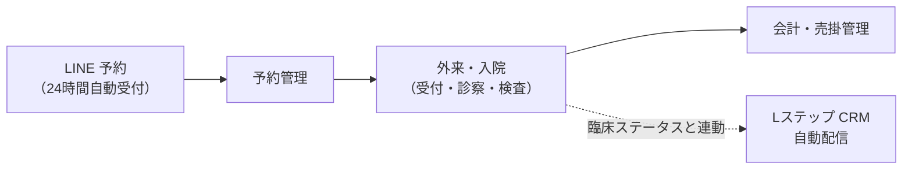

# システム全体概要 (SPECIFICATION)

> **目的**: システム全体の機能要件と主要業務フローの概要を提供する。
> **読者**: 全読者(新規参加者のオンボーディング含む)。
> **タイミング**: システム概要を把握したい時。

> **Animal Ekarte**: 動物病院向け統合カルテ・経営管理システム
> **最新更新**: 2026-10-11（実行 SoT の表記を Plane へ整理） | **照合範囲**: repo 実装と GitHub Issue の仕様・決裁履歴（2026-09-06 時点の静的照合が基準。production 稼働・受入を意味しない）。release gate の作業入口・実行 SoT は Plane workspace `baritechllc` / project `EMR`（hub `EMR-1`。case_id `BRT-4` を継承。`BRT-n`・`LINMIG-n` は Linear 閉鎖前の履歴別名）/ [todo.md](../../todo.md)。

---

## 1. プロジェクト概要

「Animal Ekarte（アニマル・カルテ）」は、予約管理から診察、入院、会計、そして LINE/Lステップを活用した CRM までをシームレスに統合した、臨床現場の安全と病院経営の効率化を支援する次世代型プラットフォームです。

---

## 2. 核心となる 3 つの設計原則

### 2.1 臨床の安全 (Clinical Safety)
- **入力・確認の支援**: 死亡ペットへの新たな予約／実施の制限（EMR-177以降の選択は識別表示付きで許可。最新合意の生前分後日入力・誤記訂正・退院／精算は死亡状態を戻さず理由・履歴付き専用経路で扱い、現行一律拒否との差を各領域へ残す）、検査異常値の自動ハイライト、ワクチン次回予定の管理を扱う。次回日は最新合意に従い種類別設定または手入力へ統一する目標で、現行mainで入口別既定は1yearへ統一されたが、種類別設定／手入力の目標や具体初期値の追加承認とは区別する。適用範囲・例外は各画面仕様を参照する。
- **整合性と監査**: 臨床・会計・権限など業務上重要な変更は `audit_logs` に操作者・時刻付きで記録する（全241テーブルの自動全件監査ではない。経路ごとの明示実装と必要な同一transaction／fail-closedを守る）。[2026-10-15の通常カルテ合意](domains/medical-records/lifecycle.md#medical-record-agreement-autosave-20261015)では医師確定ボタンと旧finalizedだけの通常編集拒否を置換し、診療終了後も通常編集できる。自動保存を含む既存hybridを維持し、タブクリアは開いた時点、履歴複製取消は複製直前へ戻す。以前の保存版・追記・必要監査を保持し、他者変更や会計／在庫等の作用を無警告で巻き戻さない。安全性はサーバ側の認可・患者／医院・現在版／依存照合と履歴で担保し、確認ダイアログだけに依存しない。診療終了時に未実施プランを警告し確認後終了可、記録・請求・入金の確定とは分離する。スタッフ診療履歴は診療終了を掲載条件とし、途中保存は載せない。D07検査・D11見積等の独自確定保護は各ownerに残す。旧ロック実装の存在を最新仕様の実装完了としない。詳細は[カルテ画面](domains/medical-records/pages/medical-record-form.md#medical-record-form-autosave-20261015)・[臨床安全](shared/clinical-safety.md#requirement-fr-common-safety-finalize)へ。

### 2.2 高い操作性 (Notion-like UX)
- **コンテキストの維持**: 画面遷移を最小限に抑えるサイドパネル編集を維持する。同じ用途の操作は実行・クリア・状態保持・戻る・失敗時の挙動を[共通操作契約](shared/ui-contracts.md#interaction-consistency-20261019)へ揃える。業務一覧と飼主・ペット選択のキーワード検索は検索ボタンで明示実行する。旧リアクティブ検索の総論をこの対象へ適用しない。異用途・対象画面は[適用台帳](shared/interaction-scope.md)で区別し、検索述語・認可・取得範囲・自動保存は一律変更しない。
- **マルチデバイス最適化**: 診察室でのタブレット（iPad等）利用を想定し、クリックターゲットの拡大と視認性の高いフォント設計を徹底。

### 2.3 経営の可視化 (Business Intelligence)
- **リアルタイム集計**: 医院ごとの営業時間に合わせた正確な日次・月次売上、客単価、来院頻度の自動分析。
- **データ駆動型 CRM**: 臨床ステータスと連動した自動配信トリガーをコード上 **17 種類** 定義する（退役済み `next_visit_reminder` を含む定義数であり、稼働中・受理済みを意味しない。定義の正本は [LINE / Lステップ仕様](line/README.md)）。Write API と cron の再開は [#259](https://github.com/MinoruSoga/AnimalEkarte/issues/259) の未完了条件であり、コード上のトリガー定義は配信稼働の証明ではない。

---

## 3. 主要な業務ドメイン

### 3.1 外来・入院統合サイクル
- **外来**: カンバン形式の受付から SOAPS 形式のカルテ、検査、画像管理までのシームレスな臨床フロー。
- **入院**: ケージ稼働状況の可視化と、時系列でのデイリーケア計画・実施記録。

### 3.2 会計・売掛管理
- **決済**: 税率別内訳、ペット保険負担、複数支払方法・返金を扱う。金額・配賦契約は [レジ締め仕様](cash-register.md) と [会計詳細](domains/accounting/pages/accounting-settlement.md) を参照し、法令適合や全運用の受入済みを本概要だけで判定しない。
- **経営**: レジ金の実査と過不足管理、月次売上レポートの CSV 出力。

### 3.3 LINE 予約 & Lステップ CRM
- **予約**: スタッフシフトと連動した 24 時間自動受付。
  - 2026-10-05 決定: スタッフの対応可能予約区分（`staff_reservation_capabilities`）は医院が明示設定し、未設定スタッフへの自動 backfill は行わない（未設定は fail-closed = 予約不可）。
- **CRM**: 顧客の状態（CPM）に合わせた配信ロジック（Lステップ連携）。再開条件と停止中の運用は [LINE / Lステップ仕様](line/README.md) を参照する。

---

## 4. 技術スタックと信頼性

- **フロントエンド**: React 19 / Tailwind 4 / shadcn/ui による高速な SPA。
- **バックエンド**: Go 1.26 / Gin / GORM による API（スキーマは **241 テーブル**。`backend/migrations/` の `CREATE TABLE` から `DROP TABLE` を除いた実測が正本（[erd.md](../architecture/erd.md)・[check-docs-symbol-drift](../../scripts/checks/check-docs-symbol-drift.sh) のゲート値）。過去の訂正履歴は git 履歴を参照）。[ADR-006](../architecture/adr/006-backend-domain-package-boundaries.md) により domain/capability-first の modular monolith へ cutover 済み。production 実装は `internal/<domain>` および命名済み cross-cutting package に置き、旧 layer-first 集約（`internal/handler` / `internal/service` / `internal/repository`）は削除済み。ADR-006 の Implemented は code/package 境界の完了であり、release ready ではない。
- **認可・セキュリティ**: **36 種類のリソース**に対する RBAC 制御と、共有テーブル上の論理テナント隔離（`clinic_id` scope + ownership / authorization checks）。
- **品質保証**: クリティカルな domain には unit / integration test と write-owner 等の静的 gate を置く。Playwright E2E は表示・主要導線の任意検証であり、全クリティカルパス網羅や全 handler 結合テスト完備を主張しない（方針: [docs/ops/ci-policy.md](../ops/ci-policy.md)、[docs/ops/testing/](../ops/testing/README.md)）。

---
