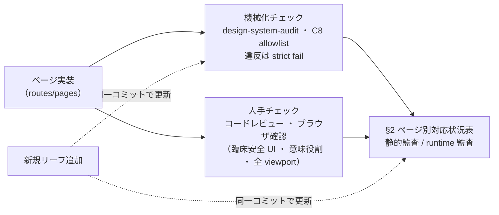

# UI Design Compliance — 全ルートページ準拠監査

> 正本。[DESIGN.md](../../DESIGN.md)（タイポ・形状・余白・エレベーション・寸法）と [docs/spec/design-system.md](design-system.md)（AE 製品色）への準拠を、本体 88 製品ルート（+ wildcard 404）とその実装コンポーネントに対して判定した結果（2026-09-29 訂正: 86 → 87。`/settings/bug-reports` が 2026-09-26 コミット `48ec94c7` で追加。2026-10-02 訂正: 87 → 88。`/settings/chat-history` がコミット `e9574b28a` で追加され、`route-inventory.test.tsx` の期待値は 88）。最終 runtime 監査日 **2026-07-24**。2026-09-06 に静的な route 在庫・C8 allowlist・C20 検査定義を照合し、2026-09-29 に在庫数の静的再照合を行った（いずれもブラウザ再実行ではない）。

> **2026-10-20 手動監査（STG）**: 79 ルートを 1280×900（代表 7 ページは 768×1024）でブラウザ目視 + DOM 計測した。結果は [docs/work/design/stg-ui-audit-20261020.md](../work/design/stg-ui-audit-20261020.md)。重要度 H 13 系統のうち、C1〜C24 で検出できるものは無く、大半はレイアウトの結果（列幅・重なり・省略・ナビ現在地）だった。規定が無かった事項は [design-patterns.md](design-patterns.md) に規約化し、同 §9 の追加検査 C25〜C29（本表 §1 に定義、`design-system-audit.mjs` に実装・既存分は allowlist ラチェット）と e2e 2 件（`ui-design-compliance-readonly.spec.ts`、既定は検知モード）は PR #737 で実装した。本監査は `ui-design-compliance-readonly.spec.ts` の実行ではなく、§2 表の「runtime 監査」列は更新していない。

## 1. 準拠チェック定義

| ID | 観点 | 参照 | 判定方法 |
|---|---|---|---|
| C1 | brand と semantic primary は同じ teal `#038B94` / active `#027078` を使う。意味役割はトークン名で分け、legacy accent `#2383E2`・`C.accent` は禁止 | DESIGN_SYSTEM §2.1, §9, §10 | **機械化**（C1）＋意味役割はレビュー |
| C2 | ページ canvas は暖色 canvas-soft（`PageLayout` / `STYLE.page*` / `C.bgPage`）。純白ページ禁止 | DESIGN_SYSTEM §2.2, §9 | **C8 機械化**（`src/features/*/routes/*.tsx` の PageLayout / Master*Page / allowlist）。§2 表は新規リーフ追加時に更新 |
| C3 | コンポーネントでの hex 直書き禁止。`design-tokens.ts` 経由必須 | DESIGN_SYSTEM §9 Don't, §10 | **機械化**（C3。issue番号コメントは対象外。`design-tokens.ts` と `shared-liff/brand-tokens.ts` は定義正本として除外） |
| C4 | 一覧/詳細系ページは `PageLayout` または同等 shell を持つ | DESIGN_SYSTEM §4, §7.6 | **C8 機械化**（C2 と同一。shell 欠落 = C2/C4 同時フラグ） |
| C5 | 汎用 Primary CTA は `colorVariant="primary"`（既定）、認証・製品識別 CTA だけ `colorVariant="brand"` を明示する | DESIGN_SYSTEM §7.2 | **機械化**（C5 の許可値）＋意味役割はレビュー |
| C6a | 臨床安全 UI（危険/死亡/RBAC 非活性表示）はデザイン変更で退行させない | DESIGN_SYSTEM §2.4, §9 | 静的 grep では網羅不可 — **コードレビュー要**。danger/warning の hex 直書き逸脱は C3 と合わせて確認 |
| C6b | rgba/rgb/hsla/hsl 直値禁止 | design-system-audit.mjs C6 | **機械化**（`pnpm design-audit` / make ci） |
| C7 | PageLayout `maxWidth` 生値禁止（`max-w-full` / `max-w-[Npx]`） | LAYOUT.pageContentMaxWidth | **機械化**（C7） |
| C8 | routes/*.tsx は PageLayout / Master*Page / allowlist | PageLayout | **機械化**（C8・相対パス完全一致 allowlist 43件 = 独自page 9 + helper 34。150行分割の薄い route / *Panels を含む） |
| C9 | `rounded-[Npx]` 任意値禁止 | `--radius-xxs/xs/...` | **機械化**（C9） |
| C10 | Tailwind 既定影（`shadow-2xs〜2xl`）と `shadow-[...]` 任意値禁止。`shadow-level1/level2/btn/panel/focus-brand` 等の elevation トークンのみ使用可 | design-system.md §5.1 | **機械化**（`pnpm design-audit` / make ci） |
| C11 | `text-[Npx\|Nrem]` font-size 任意値禁止 | design-system.md §3.4 | **機械化**（C11） |
| C12 | DESIGN.md にない `text-lg/2xl/3xl/4xl+` 禁止。`text-heading-1/2/3`・`text-xl/base/sm/xs/2xs` へ写像 | design-system.md §3.4 | **機械化**（C12。本体 88 製品ルート対象） |
| C13 | ink 4段を迂回する黒アルファ text / placeholder 禁止 | design-system.md §2.1, §3.4 | **機械化**（C13） |
| C14 | ロール固有 letter-spacing を上書きする `tracking-*` built-in / 任意値 / shorthand 禁止 | design-system.md §3.1, §3.4 | **機械化**（C14。本体 88 製品ルート対象。`*PrintArea*` は印刷透かしとして除外） |
| C15 | 本体 routes/pages の white/black named color 直接指定禁止。色token経由必須 | design-system.md §2, §9 | **機械化**（C15） |
| C16 | spacing scale にない20px utility（`*-5`、負値、`[20px]` / `[1.25rem]`）禁止 | design-system.md §4.1 | **機械化**（C16） |
| C17 | CSS の直接 `box-shadow:` / `filter: drop-shadow()` 禁止。elevation token経由必須 | design-system.md §5.1 | **機械化**（C17） |
| C18 | `TableHead` / `TableCell` とraw `th` / `td` で header eyebrow・body-sm・12px vertical / 16px horizontal paddingを非仕様値へ上書きしない | DESIGN.md `ex-data-table-cell` | **機械化**（C18。test除外、空stateと`data-c18-structural-cell`付きself-closing構造セルは許可。raw は `C18_RAW_CELL_ALLOWLIST` / `*PrintArea*` / FE11除外のみ。件数ratchetなし・違反はstrict fail） |
| C19 | `DataTableRow` / `SortableDataTableRow` / `TableRow` / raw `tr` に行全体の `onClick` を付けない。遷移はcell内のnative link、表示・編集はnative button、並べ替えは44px drag handleを使う | DESIGN.md §7.4, §8.2 | **機械化**（C19。production `.tsx` の4種のrow opening tagをmultiline対応で検査） |
| C20 | Tailwind が走査できない実行時クラス合成（`hover:${C.x}` / `focus:${C.x}` / `text-[${value}]`）禁止 | design-system.md §10 | **機械化**（C20。非test TypeScript、コメント除外） |
| C25 | 省略（`truncate` / `text-ellipsis` / `line-clamp-N`）を持つ要素は `title` / `aria-label` / `aria-labelledby` のいずれかで全文を保持する。focus・タッチで開くツールチップ／展開は静的に判定できないためレビュー項目 | design-patterns.md §3.1 | **機械化**（C25。opening tag 単位。2026-10-20 棚卸しの 58 ファイル / 99 箇所はファイル別件数の `C25_TRUNCATE_BASELINE`。baseline を超える追加は既存ファイルでも fail、減らしたら件数を下げる） |
| C26 | `<nav>` 内と `Layout/Sidebar*.tsx` のナビ文言を `truncate` しない | design-patterns.md §1.2 | **機械化**（C26。`<nav>` は行の途中から始まるものも対象。既存 3 ファイル / 6 箇所は `C26_NAV_TRUNCATE_BASELINE`（ファイル別件数。超過分だけ違反）。文言短縮か省略解除で件数を下げる） |
| C27 | z-index は `Z` / `Z_CLASS` トークンのみ。`z-N`（`2xl:` / `data-[state=open]:` など任意の variant 付き含む）/ `z-[N]` / `zIndex: N` の直書き禁止 | design-patterns.md §5.1 | **機械化**（C27。`design-tokens.ts` 除外。既存 33 ファイル / 56 箇所（1 行に複数あれば出現数で数える）はファイル別件数の `C27_Z_INDEX_BASELINE`。`Z` に段を足して置換したら件数を下げる） |
| C28 | `src/features/**` と `src/components/shared/**` の業務・設定フォームで raw `<select>` / `<input type="date">`（`type={"date"}` 等の JSX 式も）を使わない（共有 `Select` / `DatePicker`）。検索・一覧フィルター・行内編集・時刻入力は許容 | design-patterns.md §4.4 | **機械化**（C28。shared も対象（業務フォームが shared 部品経由で native 入力を描画するため）。許容文脈は `C28_NATIVE_INPUT_CONTEXT_ALLOWLIST`（6 ファイル・理由付き）、既存違反 3 ファイルは `C28_NATIVE_INPUT_BASELINE`（ファイル別件数。超過分だけ違反）） |
| C29 | バリデーション結果（`isValid` 系、`.trim()`、`=== ""`、`.length` 比較、`!form.time` のような値の否定）を保存／送信ボタンの `disabled` / `submitDisabled` に流さない。権限（`can*`）・送信中・ワークフロー状態は対象外 | design-states.md §1.1（2026-10-20 決裁） | **機械化**（C29。対象は保存／送信ボタンの契約（`submitDisabled`・`SubmitButton`・`type="submit"`・「保存」の行）。opening tag 単位で判定し複数行の prop も対象。既存 9 ファイル / 10 箇所は `C29_VALIDATION_DISABLED_BASELINE`（ファイル別件数。超過分だけ違反。`!owner?.deliveryExcluded` のような状態ゲートは名前で区別できないため件数に含めて注記）。`canSubmit` は RBAC 由来の命名のため対象外） |

**FE11 正本分割（2026-07-21、色役割更新 2026-07-27）**: 色は DESIGN_SYSTEM の製品判断、タイポ・形状・余白・エレベーション・寸法は DESIGN.md 字義を正本とする。brand と primary は同じ teal 値を使い、製品識別と汎用操作・選択・focus の意味役割だけをトークン名で分ける。臨床 semantic 色・業務 status 色・nav canvas-soft も DESIGN_SYSTEM の判断を維持する。

**監査範囲の限界**: `design-system-audit.mjs` は `src`・`liff/src`・`line-reserve/src` の非test TypeScriptを全数走査し、C17だけは CSS も走査する。FE11 の静的在庫対象は本体 88 製品ルートのため、C12/C14〜C17は LIFF・line-reserve・shared-liff を明示除外し、画面用規範と異なる `MedicalRecordPrintView` も除外する。C15 は本体 routes/pages、C18は `.tsx` の共通 Table primitive（`TableHead` / `TableCell`）とraw `th` / `td` opening tag、C19は4種のrow opening tagを対象にする。C18 は呼び出し側による非仕様 typography / vertical padding（raw は横padding・セル背景も含む）の再上書きを検出し、検出1件でも strict failする（件数ratchetなし。raw の正当な除外は `C18_RAW_CELL_ALLOWLIST`・`*PrintArea*` basename・FE11除外のみ）。ロール内での意味的誤選択、全viewport、C6a（臨床安全 UI）は静的判定できないためコードレビュー/ブラウザ確認を併用する。

**機械化（FE11 更新）**: C1/C3/C5/C6b/C7〜C20 は `frontend/scripts/design-system-audit.mjs` で strict fail（C18 も件数ratchetなし。違反0件が合格条件）。C2/C4 は C8 により `routes/*.tsx` を機械化済み。§2 表と C8 allowlist は新規リーフ追加時に同一コミットで更新する。C6a（臨床安全 UI）は引き続きコードレビュー要。
```bash
docker compose exec frontend pnpm design-audit
```



## 2. ページ別対応状況表

**静的在庫: 88 製品ルート + wildcard 404 = 89 行**（2026-09-29 訂正: 86 → 87、行数 87 → 88。2026-10-02 訂正: 87 → 88、行数 88 → 89）。この docs refresh では source / route inventory を静的に照合したが、runtime E2E は再実行していない。表の静的列は現行 source との対応だけを示し、runtime 合格を意味しない。

**E2E inventory gap と監査証跡の管理先**: 追記（2026-10-07 監査）: 既知の E2E inventory gap（`frontend/e2e/ui-design-compliance-readonly.spec.ts` の route template 欠落）の詳細、runtime 監査履歴（2026-07-23 の 83 製品ページ aggregate run）、synthetic-API write safety 証跡、targeted coverage 実測はテスト証跡として [docs/ops/testing/README.md](../ops/testing/README.md) の「ui-design-compliance 監査証跡（2026-10-07 spec/ から移設）」節へ移設した。本表の runtime 列「pending（未実行）」の解釈は同節を参照すること。

| エリア | ページ名 | パス | コンポーネント | 静的監査 (2026-08-31) | runtime 監査 | 備考 | 仕様正本 |
|---|---|---|---|---|---|---|---|
| 認証/共通 | ログイン | /login | Login | ✅ | 未記録（現行在庫） |  | [21-login.md](screens/21-login.md) |
| 認証/共通 | パスワードを忘れた方 | /forgot-password | ForgotPasswordPage | ✅ | 未記録（現行在庫） |  | [21-login.md](screens/21-login.md) |
| 認証/共通 | パスワード再設定 | /reset-password | ResetPasswordPage | ✅ | 未記録（現行在庫） |  | [21-login.md](screens/21-login.md) |
| 認証/共通 | 飼主カルテレポート(単独ウィンドウ) | /owners/:id/report | OwnerReport | ✅ | 未記録（現行在庫） |  | [39-owner-report.md](screens/39-owner-report.md) |
| 認証/共通 | 404 Not Found | * | (inline element) | — | 対象外 | lazy Component非使用・簡易fallback | 対象外（app-routes の inline fallback） |
| 会計 | 会計一覧 | /accounting | AccountingList | ✅ | 未記録（現行在庫） |  | [accounting-list.md](domains/accounting/pages/accounting-list.md) |
| 会計 | 会計 - ペット選択 | /accounting/select-pet | AccountingPetSelection | ✅ | 未記録（現行在庫） |  | [00-pet-selection.md](screens/00-pet-selection.md) |
| 会計 | 会計登録(新規) | /accounting/new | AccountingDetailPage→AccountingDetail | ✅ | 未記録（現行在庫） | 薄いwrapper、shell実体はAccountingDetail | [accounting-settlement.md](domains/accounting/pages/accounting-settlement.md) |
| 会計 | 会計詳細 | /accounting/:id | AccountingDetailPage→AccountingDetail | ✅ | 未記録（現行在庫） | 同上 | [accounting-settlement.md](domains/accounting/pages/accounting-settlement.md) |
| 会計 | レジ締め | /accounting/close | CashRegisterClosePage | ✅ | 未記録（現行在庫） | PageLayout化済（2026-07-06） | [29-closing-aggregation.md](screens/29-closing-aggregation.md) |
| 会計 | レジ締め履歴 | /accounting/close/history | CashRegisterHistoryPage | ✅ | 未記録（現行在庫） | PageLayout化済（2026-07-06） | [29-closing-aggregation.md](screens/29-closing-aggregation.md) |
| 会計 | 月次集計レポート | /accounting/reports | AccountingReportsPage | ✅ | 未記録（現行在庫） | PageLayout化済（2026-07-06、既知baseline解消） | [32-accounting-reports.md](screens/32-accounting-reports.md) |
| 在庫/見積/シフト | 在庫一覧 | /inventory | InventoryList | ✅ | 未記録（現行在庫） |  | [18-inventory-list.md](screens/18-inventory-list.md) |
| 在庫/見積/シフト | 在庫登録(新規) | /inventory/new | InventoryForm | ✅ | 未記録（現行在庫） |  | [27-inventory-form.md](screens/27-inventory-form.md) |
| 在庫/見積/シフト | 在庫編集 | /inventory/:id | InventoryForm | ✅ | 未記録（現行在庫） |  | [27-inventory-form.md](screens/27-inventory-form.md) |
| 在庫/見積/シフト | 見積一覧 | /estimates | EstimateList | ✅ | 未記録（現行在庫） |  | [22-estimate-list.md](screens/22-estimate-list.md) |
| 在庫/見積/シフト | 見積作成(新規) | /estimates/new | EstimateForm | ✅ | 未記録（現行在庫） |  | [23-estimate-form.md](screens/23-estimate-form.md) |
| 在庫/見積/シフト | 見積詳細 | /estimates/:id | EstimateDetail | ✅ | 未記録（現行在庫） |  | [26-estimate-detail.md](screens/26-estimate-detail.md) |
| 在庫/見積/シフト | 見積編集 | /estimates/:id/edit | EstimateForm | ✅ | 未記録（現行在庫） |  | [23-estimate-form.md](screens/23-estimate-form.md) |
| 在庫/見積/シフト | シフトカレンダー | /shifts | ShiftCalendarPage | ✅ | 未記録（現行在庫） |  | [24-shift-calendar.md](screens/24-shift-calendar.md) |
| カルテ | カルテ一覧 | /medical-records | MedicalRecords | ✅ | 未記録（現行在庫） |  | [medical-record-list.md](domains/medical-records/pages/medical-record-list.md) |
| カルテ | カルテ作成 - ペット選択 | /medical-records/select-pet | MedicalRecordPetSelection | ✅ | 未記録（現行在庫） |  | [00-pet-selection.md](screens/00-pet-selection.md) |
| カルテ | カルテ作成(新規) | /medical-records/new | MedicalRecordForm | ✅ | 未記録（現行在庫） | synthetic pet GET、予約/カルテ作成POSTをlocal fulfillし、synthetic detailへproduction遷移。backend write 0 | [medical-record-form.md](domains/medical-records/pages/medical-record-form.md) |
| カルテ | カルテ編集 | /medical-records/:id | MedicalRecordForm | ✅ | 未記録（現行在庫） |  | [medical-record-form.md](domains/medical-records/pages/medical-record-form.md) |
| 入院/ホテル | 入院・ホテル一覧 | /hospitalization | HospitalizationList | ✅ | 未記録（現行在庫） |  | [07-hospitalization-list.md](screens/07-hospitalization-list.md) |
| 入院/ホテル | 入院・ホテル登録 - ペット選択 | /hospitalization/select-pet | HospitalizationPetSelection | ✅ | 未記録（現行在庫） |  | [00-pet-selection.md](screens/00-pet-selection.md) |
| 入院/ホテル | 入院・ホテル登録(新規) | /hospitalization/new | HospitalizationForm | ✅ | 未記録（現行在庫） |  | [09-hospitalization-form.md](screens/09-hospitalization-form.md) |
| 入院/ホテル | 入院・ホテル詳細 | /hospitalization/:id | HospitalizationDetail | ✅ | 未記録（現行在庫） | typed `BackendHospitalization` / care-plan fixtureで臨床状態・担当医・単価を4 viewport確認 | [08-hospitalization-detail.md](screens/08-hospitalization-detail.md) |
| 入院/ホテル | 入院・ホテル編集 | /hospitalization/:id/edit | HospitalizationForm | ✅ | 未記録（現行在庫） | typed recordのform/treatment-plan hydration、治療・割引の参照専用状態、費用、mount時business non-GET 0を確認 | [09-hospitalization-form.md](screens/09-hospitalization-form.md) |
| トリミング | トリミング一覧 | /trimming | TrimmingList | ✅ | 未記録（現行在庫） |  | [16-trimming-list.md](screens/16-trimming-list.md) |
| トリミング | トリミング登録 - ペット選択 | /trimming/select-pet | TrimmingPetSelection | ✅ | 未記録（現行在庫） |  | [00-pet-selection.md](screens/00-pet-selection.md) |
| トリミング | トリミング登録(新規) | /trimming/new | TrimmingForm | ✅ | 未記録（現行在庫） |  | [17-trimming-form.md](screens/17-trimming-form.md) |
| トリミング | トリミング編集 | /trimming/:id | TrimmingForm | ✅ | 未記録（現行在庫） | typed `BackendTrimming` とcourse/options/staff master fixtureでedit stateを4 viewport確認 | [17-trimming-form.md](screens/17-trimming-form.md) |
| 検査 | 検査一覧 | /examinations | ExaminationsList | ✅ | 未記録（現行在庫） |  | [12-examinations-list.md](screens/12-examinations-list.md) |
| 検査 | 検査登録 - ペット選択 | /examinations/select-pet | ExaminationPetSelection | ✅ | 未記録（現行在庫） |  | [00-pet-selection.md](screens/00-pet-selection.md) |
| 検査 | 検査登録(新規) | /examinations/new | ExaminationForm | ✅ | pending（未実行） |  | [13-examinations-form.md](screens/13-examinations-form.md) |
| 検査 | 検査編集 | /examinations/:id | ExaminationForm | ✅ | 未記録（現行在庫） |  | [13-examinations-form.md](screens/13-examinations-form.md) |
| ワクチン | ワクチン一覧 | /vaccinations | VaccinationList | ✅ | 未記録（現行在庫） |  | [14-vaccinations-list.md](screens/14-vaccinations-list.md) |
| ワクチン | ワクチン接種 - ペット選択 | /vaccinations/select-pet | VaccinationPetSelection | ✅ | 未記録（現行在庫） |  | [00-pet-selection.md](screens/00-pet-selection.md) |
| ワクチン | ワクチン登録(新規) | /vaccinations/new | VaccinationForm | ✅ | 未記録（現行在庫） | BUG-501: create 権限で独立フォームを表示。petId 未指定時はペット選択へ誘導。カルテ予防接種タブは別の入力実装 | [15-vaccinations-form.md](screens/15-vaccinations-form.md) |
| ワクチン | ワクチン編集 | /vaccinations/:id | VaccinationForm | ✅ | 未記録（現行在庫） | typed `BackendVaccination` とpet/vaccine/doctor fixtureでedit state・担当医帰属を4 viewport確認 | [15-vaccinations-form.md](screens/15-vaccinations-form.md) |
| 定期健診 | 定期健診管理 | /checkups | CheckupsList | ✅ | 未記録（現行在庫） |  | [25-checkups-list.md](screens/25-checkups-list.md) |
| 定期健診 | 定期健診登録 - ペット選択 | /checkups/select-pet | CheckupPetSelection | ✅ | 未記録（現行在庫） |  | [00-pet-selection.md](screens/00-pet-selection.md) |
| 定期健診 | 定期健診登録(新規) | /checkups/new | CheckupForm | ✅ | 未記録（現行在庫） |  | [25-checkups-list.md](screens/25-checkups-list.md) |
| 受付/飼主/予約 | 受付(当日) | / | Reception | ✅ | 未記録（現行在庫） |  | [reception-board.md](domains/reception/pages/reception-board.md) |
| 受付/飼主/予約 | 飼主・ペット管理 | /owners | OwnersListPage→OwnersList | ✅ | 未記録（現行在庫） | 薄いwrapper、shell実体はOwnersList | [03-owners-list.md](screens/03-owners-list.md) |
| 受付/飼主/予約 | 飼主登録(新規) | /owners/new | OwnerFormPage→OwnerForm | ✅ | 未記録（現行在庫） | 薄いwrapper、shell実体はOwnerForm | [04-owners-form.md](screens/04-owners-form.md) |
| 受付/飼主/予約 | 飼主編集 | /owners/:id | OwnerFormPage→OwnerForm | ✅ | 未記録（現行在庫） | 同上 | [04-owners-form.md](screens/04-owners-form.md) |
| 受付/飼主/予約 | 集計ダッシュボード | /aggregation | AggregationDashboardPage | ✅ | 未記録（現行在庫） |  | [36-aggregation-dashboard.md](screens/36-aggregation-dashboard.md) |
| 受付/飼主/予約 | 予約管理 | /reservations | ReservationsPage→ReservationManagement | ✅ | 未記録（現行在庫） |  | [reservation-management.md](domains/reservations/pages/reservation-management.md) |
| 運用/Lステップ | Lステップ健診連携 | /lstep/checkup-sync | CheckupSyncPage | ✅ | 未記録（現行在庫） |  | [31-lstep-integration.md](screens/31-lstep-integration.md) |
| 運用/Lステップ | Lステップ配信モニター | /lstep/delivery-monitor | LstepDeliveryMonitorPage | ✅ | 未記録（現行在庫） |  | [34-lstep-delivery-monitor.md](screens/34-lstep-delivery-monitor.md) |
| 運用/Lステップ | Lステップ分析 | /lstep/analytics | LstepAnalyticsPage | ✅ | 未記録（現行在庫） |  | [31-lstep-integration.md](screens/31-lstep-integration.md) |
| 運用/LINE予約 | LINE予約設定(index) | /line-reservation | LineReservationSettings | ✅ | 未記録（現行在庫） |  | [28-line-reservation.md](screens/28-line-reservation.md) |
| 運用/LINE予約 | LINE予約設定 | /line-reservation/settings | LineReservationSettings | ✅ | 未記録（現行在庫） |  | [28-line-reservation.md](screens/28-line-reservation.md) |
| 運用/LINE予約 | LINE予約ページエディタ | /line-reservation/page-editor | LineReservationPageEditor | ✅ | 未記録（現行在庫） |  | [28-line-reservation.md](screens/28-line-reservation.md) |
| 運用/LINE予約 | LINE予約枠設定 | /line-reservation/slots | LineReservationSlotsSettings | ✅ | 未記録（現行在庫） |  | [28-line-reservation.md](screens/28-line-reservation.md) |
| 運用/医院 | 医院マスタ設定 | /settings/clinic | ClinicMasterSettings→ClinicMasterList | ✅ | 未記録（現行在庫） | 薄いwrapper、shell実体はClinicMasterList | [19-clinic-settings.md](screens/19-clinic-settings.md) |
| 運用/マニュアル | マニュアル(トップ) | /manual | ManualPage | ✅ | 未記録（現行在庫） | custom doc shell（canvas-soft、2026-07-06 C.bgPage化）。二ペインdocビューア+印刷+固定FABのためPageLayout非採用 | [35-internal-manual.md](screens/35-internal-manual.md) |
| 運用/マニュアル | マニュアル記事 | /manual/:category/:slug | ManualPage | ✅ | 未記録（現行在庫） | 同上 | [35-internal-manual.md](screens/35-internal-manual.md) |
| 運用/横断 | 同一飼主・ペット連携 | /identity-links | IdentityLinksPage | ✅ | pending（未実行） | PageLayout化（canView で Navigate ゲート。所属医院内の手動リンクのみ） | [40-identity-links.md](screens/40-identity-links.md) |
| 設定/マスタ | 設定トップ | /settings | MasterSettingsIndex | ✅ | 未記録（現行在庫） |  | [20-master-settings.md](screens/20-master-settings.md) |
| 設定/マスタ | スタッフマスタ | /settings/staff | StaffSettings | ✅ | 未記録（現行在庫） | MasterCRUDPage経由 | [master-staff.md](screens/settings/master-staff.md) |
| 設定/マスタ | 診療項目マスタ | /settings/treatment-items | TreatmentPlanMaster | ✅ | 未記録（現行在庫） | MasterTabPage経由 | [master-treatment.md](screens/settings/master-treatment.md) |
| 設定/マスタ | 治療パッケージマスタ | /settings/treatment-packages | TreatmentPackageSettings | ✅ | 未記録（新規リーフ EMR-523） | MasterPageShell経由 |  |
| 設定/マスタ | 診断マスタ | /settings/diagnosis | DiagnosisSettings | ✅ | 未記録（現行在庫） | MasterTabPage経由 | [master-diagnosis.md](screens/settings/master-diagnosis.md) |
| 設定/マスタ | 動物種類マスタ | /settings/animal-species | AnimalSpeciesSettings | ✅ | 未記録（現行在庫） | MasterCRUDPage経由 | [master-animal-species.md](screens/settings/master-animal-species.md) |
| 設定/マスタ | トリミングマスタ | /settings/trimming | TrimmingSettings | ✅ | 未記録（現行在庫） | MasterTabPage経由 | [master-trimming.md](screens/settings/master-trimming.md) |
| 設定/マスタ | コース種別マスタ | /settings/trimming-course-type | TrimmingCourseTypeSettings | ✅ | 未記録（現行在庫） | MasterCRUDPage経由 | [master-trimming-course-type.md](screens/settings/master-trimming-course-type.md) |
| 設定/マスタ | 薬剤マスタ | /settings/medicine | MedicineSettings | ✅ | 未記録（現行在庫） |  | [master-medicine.md](screens/settings/master-medicine.md) |
| 設定/マスタ | 予約区分マスタ | /settings/reservation-type | ReservationTypeSettings | ✅ | 未記録（現行在庫） |  | [master-reservation-type.md](screens/settings/master-reservation-type.md) |
| 設定/マスタ | 入院マスタ | /settings/hospitalization | HospitalizationSettings | ✅ | 未記録（現行在庫） | MasterCRUDPage経由 | [master-hospitalization-plan.md](screens/settings/master-hospitalization-plan.md) |
| 設定/マスタ | ケージマスタ | /settings/cage | CageSettings | ✅ | 未記録（現行在庫） | MasterCRUDPage経由 | [master-cage.md](screens/settings/master-cage.md) |
| 設定/マスタ | 物販・フードマスタ | /settings/merchandise-items | MerchandiseItemSettings | ✅ | 未記録（現行在庫） | MasterCRUDPage経由 | [master-merchandise.md](screens/settings/master-merchandise.md) |
| 設定/マスタ | 保険マスタ | /settings/insurance | InsuranceSettings | ✅ | 未記録（現行在庫） | MasterCRUDPage経由 | [master-insurance.md](screens/settings/master-insurance.md) |
| 設定/マスタ | 職種マスタ | /settings/occupations | OccupationSettings | ✅ | 未記録（現行在庫） | MasterCRUDPage経由 | [master-occupation.md](screens/settings/master-occupation.md) |
| 設定/マスタ | 権限グループマスタ | /settings/permission-groups | PermissionGroupSettings | ✅ | 未記録（現行在庫） | C6(RBAC表示)は目視要 | [master-permission-group.md](screens/settings/master-permission-group.md) |
| 設定/マスタ | 問診テンプレートマスタ | /settings/inquiry-templates | InterviewTemplateSettings | ✅ | 未記録（現行在庫） | MasterCRUDPage経由 | [master-interview.md](screens/settings/master-interview.md) |
| 設定/マスタ | 主訴カテゴリマスタ | /settings/interview/chief-complaint | ChiefComplaintSettings | ✅ | 未記録（現行在庫） | MasterCRUDPage経由 | [master-chief-complaint.md](screens/settings/master-chief-complaint.md) |
| 設定/マスタ | 問診テンプレート(interview) | /settings/interview/templates | InterviewTemplateSettings | ✅ | 未記録（現行在庫） | 同一Component別path | [master-interview.md](screens/settings/master-interview.md) |
| 設定/マスタ | シフトテンプレート | /settings/shift-templates | ShiftTemplateSettings | ✅ | 未記録（現行在庫） |  | [master-shift-template.md](screens/settings/master-shift-template.md) |
| 設定/マスタ | 締め時間設定 | /settings/closing-time | ClosingSettingsPage | ✅ | 未記録（現行在庫） |  | [closing-time-settings.md](screens/settings/closing-time-settings.md) |
| 設定/マスタ | 支払方法マスタ | /settings/payment-methods | PaymentMethodSettings | ✅ | 未記録（現行在庫） | MasterCRUDPage経由 | [payment-methods.md](screens/settings/payment-methods.md) |
| 設定/マスタ | 割引キャンペーンマスタ | /settings/campaigns | CampaignSettings | ✅ | 未記録（現行在庫） | MasterCRUDPage経由 | [master-campaigns.md](screens/settings/master-campaigns.md) |
| 設定/マスタ | 検査機器マスタ | /settings/lab-device-item-masters | LabDeviceItemMasterSettings | ✅ | 未記録（現行在庫） | 日常送信経路に出さない | [20-master-settings.md §検査機器マスタ](screens/20-master-settings.md#検査機器マスタ) |
| 臨床 | 検査受信 | /lab-device | LabDeviceBoard | ✅ | 未記録（現行在庫） | 1画面掲示板。本日診療中カルテカード＋日別受信一覧。確認ダイアログなし | [007-lab-device-receive-and-commit.md](../architecture/adr/007-lab-device-receive-and-commit.md) |
| 設定/マスタ | Lステップ連携設定 | /settings/integrations/lstep | LstepSettingsPage | ✅ | 未記録（現行在庫） |  | [31-lstep-integration.md](screens/31-lstep-integration.md) |
| 設定/マスタ | Lステップタグ管理 | /settings/lstep/tags | LstepTagManagementPage | ✅ | 未記録（現行在庫） |  | [31-lstep-integration.md](screens/31-lstep-integration.md) |
| サポート | バグ報告一覧 | /settings/bug-reports | BugReportsPage | ✅ | pending（未実行） | 2026-09-26 追加（`48ec94c7`）。2026-10 に権限ゲート撤廃 — 一覧は全医院共有 READ（意図的な製品判断）だが、status/Plane/DELETE など mutation は報告医院のみで他医院は 404。PageLayout 採用を 2026-09-29 に静的確認。E2E inventory 未登載 | [README.md §バグ報告一覧](screens/settings/README.md#バグ報告一覧) |
| サポート | チャット履歴 | /settings/chat-history | ChatHistoryPage | ✅ | pending（未実行） | 2026-10-02 追加（`e9574b28a`）。全医院共有の ROOM ボード（同一 clinic×staff 会話の 30 分超空白区切り。ペア一覧の `chat/exchanges` とは別 endpoint。権限ゲートなし — バグ報告と同じ意図的な製品判断）。E2E inventory 未登載 | [README.md §チャット履歴](screens/settings/README.md#チャット履歴) |

**脚注**:
- EMR-400（2026-10-14 追記）: 画面名は業務一覧「X管理」、マスタ「Xマスタ」。フォームは新規「X登録」、保存可能な既存レコード「X編集」、保存不可の既存レコード「X詳細」とし、一覧の新規ボタンは「新規X登録」。ページタイトルにアイコンは付けない。ダイアログや会計精算など本票対象外の操作文言はこの規則の対象にしない。
- `仕様正本` 列（2026-10-11 追記）: 88 product path それぞれの primary 画面仕様への navigation。静的計測は base `f457821c4` で実施し、route/API/workflow の source は `f82badf36` と同一（差分は CI fixture/test のみ）。redirect 12 件と wildcard 1 件は対象外。本列は primary 仕様リンクの一意性を示すもので、画面 assertion・runtime 受入の認証ではない。
- runtime 履歴・write safety（synthetic-API 3/3 PASS）・targeted coverage 実測・C15〜C19 の 2026-07-24 監査値履歴: 追記（2026-10-07 監査）— テスト証跡として [docs/ops/testing/README.md](../ops/testing/README.md)「ui-design-compliance 監査証跡（2026-10-07 spec/ から移設）」節へ移設。本表の runtime 列の解釈も同節を参照。
- リダイレクト専用route（`<Navigate replace />`）は表から除外: `/settings/job-title`, `/settings/service-type`, `/settings/diagnosis-type`, `/settings/diagnosis-name`, `/settings/trimming-course`, `/settings/trimming-option`, `/settings/examination`, `/settings/vaccine`, `/settings/consultation`, `/settings/procedure`, `/settings/inquiry-template`, `/settings/shift-template` の **12件**。
- C1（legacy accent）・C3（route表面hex直書き）の現行静的結果は design-audit で再確認する。本 docs refresh は runtime / design-audit を再実行しておらず、88 route 全体の新しい合格値を記録しない。
- C5（Primary CTA colorVariant）の現行分布は `primary` 16件、認証の明示的 `brand` 3件。`default` の明示使用と未定義 variant は0件。
- DESIGN_SYSTEM §10 の既知baseline「route表面accent 0件」は再現。2026-07-06時点で `AccountingReportsPage` / `CashRegisterClosePage` / `CashRegisterHistoryPage` を `PageLayout` 化し、非PageLayout例は解消済み。`ManualPage` は二ペインdocビューア構造のため引き続き `PageLayout` 非採用・独自 canvas-soft shell（`C.bgPage`）で C2 準拠。`IdentityLinksPage`（`/identity-links`）は PageLayout shell を採用する（C2/C4/C8）。


## 2026-10-15 全領域仕様への案内

[全37管理行・88ルートの責務と文書照合](domains/SPECIFICATION_PROGRESS.md)を参照する。既存のルートprimary対応と過去の実行検証記録は保持し、今回の文書検査をruntime／実機合格へ転用しない。
