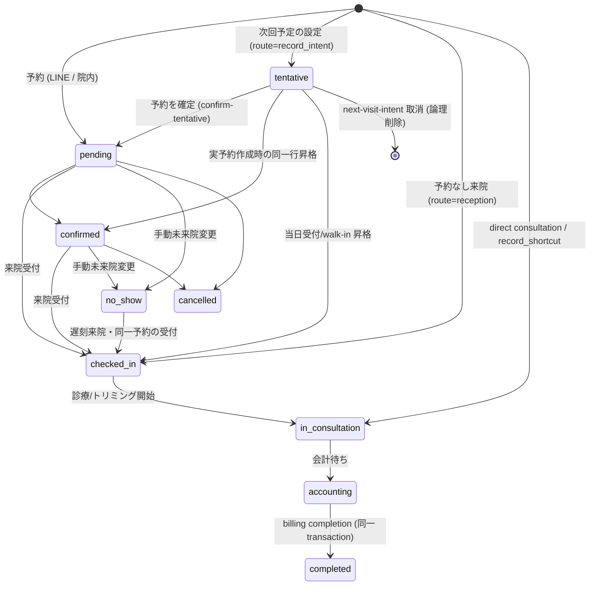

# 予約からカルテ入力までの統合フロー仕様

> 確定仕様の適用範囲：今回の予約ドメイン合意と本書の接続境界。承認日は各FR要件表・根拠節（2026-10-13〜2026-10-14 17:35）、追加合意は各補足節を参照。[確定FR索引](../domains/reservations/README.md#approved-reservation-scope)に掲載した箇所のみを確定情報として扱う。対象外の継承本文・未承認案・現行実装説明は一括確定しない。実装・実機状態は別管理。

[17:17合意の診療前日付訂正](../domains/reservations/pages/reservation-management.md#requirement-fr-reservations-preconsultation-date-record-correction)では、未記入カルテは確認して予約日へ合わせ、記入済みなら通常の日付変更を停止して内容確認の訂正へ渡す。以下の作成後日付固定・直接PATCH拒否は現行実装／通常更新の参照で、この合意の未記入・診療前の確認付き訂正を実装済みとする根拠ではない。確定済みカルテの変更禁止・追記による訂正、保存ルーティング契約は維持する。

17:23 JSTの[LINE予約6点合意](../line/reservation-spec.md#line-agreement-1723)へ従う。公開された診療・トリミング・ホテルは予約対象、入院は医院相談。ホテルには医師指名・医師シフト・通常予約の同日制約を適用しない。受付制限・入力保持・受付前取消・必要設定不足の扱いと受入条件はLINE正本を参照する。ホテル受入基準は17:35合意の医院別同時宿泊頭数・全宿泊期間判定で、実装・実機受入は未確認。

17:17 JSTの院内予約8点一括合意は[予約入口の決定一覧](../domains/reservations/README.md#internal-reservation-batch-1717)を参照する。誤取消／誤終了訂正、未終了予約保護、診療前の日付・カルテ整合、マスタ利用・名称履歴、休診日予約／日跨ぎ勤務、患者照合、ホテル担当時点／入院記録失敗の各正本と受入条件へ従う。LINE受付条件は17:23合意（ホテル受入基準は17:35合意、計算・保存方式は設計）、実装・実機受入は未確認。

17:10合意の[診療前の誤取消からの復元](../domains/reservations/pages/reservation-management.md#requirement-fr-reservations-restore-preconsultation-cancellation)へ従う。同じ予約を復元し、復元時点の指名医師の医院別対応可否・勤務等を再確認する。作成済み通常カルテは同じものを再利用し、予約・カルテを重複作成しない。診療後・支払い確定後の訂正や誤終了取消へ広げず、復元先状態と不適格時の手動修正は17:17合意。保存方式は設計。受入条件は予約正本へ置き、実装・実機受入は未確認。

17:04 JSTに文書反映を個別許可された[一医院での勤務終了と指名停止](../screens/settings/master-staff.md#requirement-fr-staff-clinic-departure-booking-guard)へ従う。A院の今後の指名予約を別の適格医師または未定へ手動変更してからA院での指名を停止し、B院の勤務・指名予約は継続する。現在診療中の既存保護、自動解除しない方針、完了済み履歴保持を維持し、全体退職と区別する。医院別の予約区分対応可否は既合意、具体的設定・保存方式は未決。受入条件は担当者マスタ正本へ置き、実装・実機受入は未確認。

| 管理項目 | 記載 |
|:---|:---|
| 文書ID・種別 | workflow.reservation-to-record／横断フロー |
| 決定状態 | 今回の予約ドメイン合意は2026-10-14 18:26までの各根拠を反映。17:35の完了判断は後続MECEレビューで訂正し、7指摘の是正と確認範囲を予約入口に記録。対象外は既存決定状態を継承。実装・移行・実機検証とは別。完了範囲は予約入口の最終レビュー参照 |
| 実装状態 | 合意と現実装は別。main ec4f7146a の必要箇所を静的照合し、差分は予約正本の残差一覧へ記録。実装変更なし |
| 実機検証状態 | 今回未実施。過去の記録と今回の文書確認を分ける |
| 文書確認日 | 2026-10-14（合意・参照・語彙の確認。実機受入日ではない） |

16:36合意の[入院開始の明示確定と二重登録防止](../screens/settings/master-reservation-type.md#requirement-fr-reservation-types-inpatient-start-confirm)へ従う。予定入院は予約だけで入院中にせず、来院後にスタッフが「入院開始」を確定する。診察後の入院決定も同じ入院管理へつなぎ、同じ入院を二重登録しない。担当医・入院記録は16:44合意の段階条件へ従う。具体的画面配置・重複防止の技術方式・記録作成失敗時の開始未確定・理由表示・再試行は17:17合意。具体的保存方式は設計として分ける。受入条件は区分マスタ正本へ置き、実装・実機受入は未確認。

16:44合意の[入院担当医と開始時の入院記録](../screens/settings/master-reservation-type.md#inpatient-doctor-and-record-at-start)へ従う。予定入院予約時は指名医師未定可、入院開始までに入院担当医決定、スタッフによる開始確定時に入院記録を作成する。予定入院・診察後の両入口を維持し、同じ入院を二重登録しない。予約の指名医師から担当医を自動確定せず、記録作成失敗時の開始未確定・理由表示・再試行は17:17合意。具体的UI・保存方式は実装設計とする。実装・実機受入は未確認。

## 目的・対象範囲

| シナリオ | 業務上の価値 | 優先度・理由 |
|:---|:---|:---|
| 同じ来院の記録を作る | 同一来院に通常カルテを重複させない | 未決／要確認（既存文書に優先度の根拠なし） |

> **目的**: 予約、受付、通常カルテ、トリミング、会計の現行契約を一箇所に定義する。
> **読者**: 予約・受付・カルテ連携の実装者。
> **最新更新**: 2026-10-14 | **ステータス**: 予約対話の途中合意と現実装が混在。合意・差分は明示し、予約ドメイン完了を意味しない

## 担当者・権限・前提

担当者はLINE/LIFF利用者と院内操作権限を持つ利用者。院内職種の割当は未記載／要確認。権限の操作別条件は既存本文と各画面の権限前提を参照する。

### 1. Source of truth と用語

#### 予約の用語・概念関係の正本への参照

用語・別名・定義・関係と多重度・制約・関係図は [ontology/reservations.md](../ontology/reservations.md#reservation-ontology)へ移設した。本書では定義を再掲しない。旧アンカーは互換参照用であり、個別業務・生成イベントのFRと受入条件は本書等の各正本に残る。

##### 現行モデル対応（実装参照）

以下は既存のsource of truthと現行モデルの対応を継承した表。現行categoryの2値を、上記の合意済み業務分類の全範囲や実装済みの証明として扱わない。通常カルテ・専用記録の内部制約は元の対象範囲を維持する。

受付カンバンと予約 lifecycle の source of truth / write owner は `appointments` / `internal/reservation` である。LINE 予約、院内予約、予約なし来院、一覧からの記録入力 shortcut は、受付に載せる業務であれば必ず appointment を持つ。

| 概念 | 現行モデル | 契約 |
|---|---|---|
| 予約・受付 | `appointments` | status、日時、owner/pet/staff、source、route を保持 |
| 通常カルテ | `medical_records.appointment_id` | `general` appointment ごとに active record 最大 1 件 |
| トリミング詳細 | `appointment_trimming_details.appointment_id` | `trimming` appointment ごとに最大 1 件 |
| 予約区分の業務分類（現行対応） | `reservation_types.category` | `general` / `trimming` で遷移先を決める |
| 対応可能予約区分（現行対応） | `staff_reservation_capabilities` | staff 可否判定と write 検証の肯定形 SoT |
| 予約経路 | `appointments.reservation_route` | `line`、`reception`、`record_shortcut` 等の業務入口 |
| 次回予定（EMR-308） | `appointments`（`status='tentative'`） | 日付のみ確定の未予約意図。`intended_date` が正本で `reservation_route='record_intent'`・`source_medical_record_id` に由来カルテを保持。枠・容量・時間枠競合・通常予約の完了通知の対象外。別途 Lステップの3日前・当日リマインダー定義がある |

通常診療とトリミングを同日に行う場合は appointment を 2 件作る。会計は appointment 単位に固定せず、同日・同一 owner/pet の未会計項目をまとめられる。

### 3. 空き枠と staff capability

LIFFの空き枠計算は既存契約を維持する。院内は[2026-10-13の警告確認仕様](../domains/reservations/pages/reservation-management.md#requirement-fr-reservations-internal-warning-override)へ変更し、空き枠・残数の表示概念を採用しない。勤務・担当適格性は[日付見出しの能力警告](../domains/reservations/pages/reservation-management.md#requirement-fr-reservations-capacity-warning)へ使う。共通マスタと予約への依存契約は未確認。

2026-10-13 20:43 JST合意: 院内／LINEの担当可能者は[個人対応区分＋シフトの共通基準](../screens/settings/master-staff.md#requirement-fr-staff-shared-reservation-eligibility)へ統一し、[予約区分側の紐付け職種可否](../screens/settings/master-reservation-type.md#requirement-fr-reservation-types-occupation-gate-retirement)を廃止する。職種はスタッフ分類として残す。警告確認で追加できる院内仕様とLINEの受付条件は同一化せず、LINE6点は17:23合意のLINE正本へ従う（ホテル受入基準は17:35合意、計算・保存方式は設計）。既存データの機械変換は未決で、個人設定を無断変更しない。

staff CRUD の一部 request/response 名は `ExcludedTypeIDs` / `excluded_courses` の exclusion-shaped compatibility surface を残す。この API は入力を `staff_reservation_capabilities` へ変換する。production は `staff_reservation_exclusions` と capability junction の両方へ write しない。候補絞り込みと POST 検証は capability のみを読む。

`GET /v1/reservations/available-staffs` は未実装で、現行設計では不要。導入する場合は別 contract とする。

## 契機・入口・出口

契機・入口はLINE/LIFF予約、院内予約、当日受付、一覧shortcut、記録間shortcut。引継ぎ先は受付、通常カルテ／トリミング、会計完了。詳細は下記「入口別の現行フロー」。各入口の呼出元の網羅は未記載／要確認。

## 状態遷移・引継ぎデータ

| 要件ID | 定義の所在 | 決定根拠 |
|:---|:---|:---|
| FR-reservations-active-general-record-unique | [既存の要件本文](#requirement-fr-reservations-active-general-record-unique) | 既存記載を継承。ID付与で合意済みにしない |
| FR-reservations-start-record-failure-retry | [未作成時の作成と作成／読み込み失敗時の開始未確定・再試行](#requirement-fr-reservations-start-record-failure-retry) | 合意済み。2026-10-14 10:59 JST、直前の明示確認へユーザー「ok」。結果不明時の技術方法は実装判断 |
| FR-reservations-checkin-record-reuse | [受付時作成カルテの再利用・重複なし](#requirement-fr-reservations-checkin-record-reuse) | 合意済み。2026-10-14 10:17 JST、ユーザー「ok」。未作成／失敗時は10:59の作成・読み込み失敗契約へ従う |
| FR-reservations-confirmed-drag-consultation-end | [確認付きドラッグの診療終了](#requirement-fr-reservations-confirmed-drag-consultation-end) | 合意済み。2026-10-14 10:43 JST、直前の明示確認へユーザー「ok」。誤終了取消は11:56の専用操作。その他逆遷移は業務5点合意の記録確認訂正へ |
| FR-reservations-undo-consultation-end | [誤終了の専用取消操作・理由入力と確認・データ保持](#requirement-fr-reservations-undo-consultation-end) | 合意済み。2026-10-14 11:56 JST、当該質問への明示返信「ok」。実行条件は12:07合意。会計確定境界・その他逆遷移は業務5点合意で確定。権限識別子・訂正内部は設計 |
| FR-reservations-manual-consultation-state | [実業務に基づく開始・終了の明示確定](#requirement-fr-reservations-manual-consultation-state) | 合意済み。2026-10-14 00:18 JST、ユーザーの明示同意。開始操作は10:07・終了操作は10:12合意。確認付きドラッグ終了は10:43合意。誤終了取消は11:56合意。その他逆遷移は業務5点合意へ。権限識別子・訂正内部は設計 |
| FR-reservations-future-assignment-protection | [未来・現在診療中予約の保護](#requirement-fr-reservations-future-assignment-protection) | 合意済み。2026-10-13の回答に加え22:00 JSTに予定終了超過でも診療中なら対象と確認。未終了状態の保護は17:17合意、具体的判定方式は設計 |
| FR-reservations-checkin-idempotency | [受付導線と重複防止](#requirement-fr-reservations-checkin-idempotency) | 合意済み。2026-10-13、ユーザー対話。[根拠](../domains/reservations/pages/reservation-management.md#agreement-2026-10-13) |
| FR-reservations-manual-no-show | [手動未来院・遅刻来院](#requirement-fr-reservations-manual-no-show) | 合意済み。2026-10-13、ユーザー対話。[根拠](../domains/reservations/pages/reservation-management.md#agreement-2026-10-13) |
| FR-reservations-checkin-record-atomicity | [受付と通常カルテの同時成功](#requirement-fr-reservations-checkin-record-atomicity) | 合意済み。2026-10-13、ユーザー対話。[根拠](../domains/reservations/pages/reservation-management.md#agreement-2026-10-13) |
| FR-reservations-record-reviewed-correction | [正本](#requirement-fr-reservations-record-reviewed-correction) | 業務5点一括合意 Sentinel_c713c4fdc74c819182979c4b8d2fef07。内部設計・実機未確認 |
| FR-reservations-controlled-reverse-transition | [正本](#requirement-fr-reservations-controlled-reverse-transition) | 業務5点一括合意 Sentinel_c713c4fdc74c819182979c4b8d2fef07。内部設計・実機未確認 |

| 担当者 | 前提 | 契機 | 前状態 | 後状態 | 引継ぎデータ | 異常系／根拠 |
|:---|:---|:---|:---|:---|:---|:---|
| LINE/LIFF・院内利用者 | 医院・患者・枠・操作権限 | 予約作成 | 未作成／tentative | 予約・実予約への昇格 | appointment・owner/pet・日時・担当 | 入口別フロー・下記transaction契約 |
| 院内利用者 | 当日対象・既存予約／飛込み | 受付 | confirmed等／未作成 | checked_in | appointmentId・予約文脈 | 当日受付・記録引継ぎの既存本文 |
| 院内利用者 | 記録・会計操作の条件 | 診療終了・精算 | in_consultation／accounting | accounting／completed | 同一医院・JST日・owner/pet | 下記transaction契約。画面条件は各正本 |

### 2. 入口別の現行フロー

予約区分グループ無効化の[所属区分の新規利用停止](../screens/settings/master-reservation-type.md#requirement-fr-reservation-types-group-disable-new-use)は院内だけに限定しない共通原則。未来日を含む既存予約を保持し、自動取消・日時変更をしない。再有効化は[個別有効意図保持](../screens/settings/master-reservation-type.md#requirement-fr-reservation-types-group-reactivation-intent)に従う。LINEの業務条件は17:23・17:35正本へ従う。実装方式・既存UIとの整合は設計／検証。既存予約の無効区分保持と日時・指名・メモ変更は[追加合意](../screens/settings/master-reservation-type.md#requirement-fr-reservation-types-inactive-existing-edit)へ従う。以下の現行LINE検証を合意仕様へ追従済みと読まない。

22:09 JSTの[通常時間指定予約の同日制約](../domains/reservations/pages/reservation-management.md#requirement-fr-reservations-same-day-schedule)を参照。通常診療・トリミング等の予定は終了が開始より後かつ同日。宿泊ホテル・入院は[別の期間管理](../screens/09-hospitalization-form.md)へ委ね、詳細を確定しない。これは深夜の実診療を強制終了する意味ではなく、現在診療中保護を維持する。

#### 2.1 LINE / LIFF 予約

`POST /api/liff/:clinicId/reservations` は active・公開中・非 internal の予約種別、clinic、LINE customer、明示 staff の所属/capability/active/public、trimming course/option を同じ transaction で再検証する。appointment、trimming detail、option junction は全体成功または rollback とする。

- `source = line`。
- LINE customer が既存 owner に紐付く場合、`owner_id` / `pet_id` を best-effort で補完する。氏名+電話だけで自動リンクしない。
- owner/pet が未確定なら、カルテ作成前に同一 clinic の実体へ確定する。
- 当日 appointment は受付カンバンへ表示する。

LINE 予約の owner/pet 事前解決は best-effort だが、予約書込み transaction では `line_customers.owner_id` の取得時状態（未紐付けを含む）との一致、同一医院の owner/pet 関係、死亡状態を row lock 下で再検証する。紐付け変更や譲渡で古くなった入力は挿入・tentative 昇格の前に拒否する。氏名・電話による自動リンクを行う契約ではない。

#### 2.2 院内予約管理

院内の登録・警告・カレンダー・終了時刻・変更・取消は[予約管理の合意要件](../domains/reservations/pages/reservation-management.md#operations)を正本とする。満員・時間外・同じ担当者の重複は警告確認で登録可能。これをLIFFの規制解除に広げない。

**現実装の差分**: 院内フォームは空き枠APIのslotを使い、サーバーは所属・対応区分・conflict/capacity等を検査して拒否する。院内のactive/publicとLIFFの検証は異なり、明示担当者の選択時刻の勤務再検証は未実装。合意仕様へ追従済みではない。[残差一覧](../domains/reservations/pages/reservation-management.md#implementation-gaps)。

12:51合意の[予約区分・グループの削除／復元](../screens/settings/master-reservation-type.md#requirement-fr-reservation-types-delete-restore-history)に従う。削除は復元可能な非表示で、既存予約の区分名等と履歴を保持する。復元直後は無効で、再利用には明示有効化と既存の利用条件を満たす必要がある。グループ無効化と個別意図、無効区分の既存保持編集、名称履歴・診療段階制限を維持し、予約の自動取消や区分差替えをしない。グループ削除時の所属保持・配下利用停止、復元・明示有効化後の個別有効だけ再開、所属変更単独では再開しない条件は[13:00合意](../screens/settings/master-reservation-type.md#group-deletion-new-use-restart)に従う。データ構造・フラグは実装判断。無効中個別編集は17:17合意済み。個別削除区分の復元操作詳細は設計。受入条件は区分マスタ正本へ置き、実装・実機受入は未確認。

12:56合意の[予約区分の所属0または1・グループ階層なし](../screens/settings/master-reservation-type.md#group-membership-cardinality)に従う。色は唯一の所属先から継承し、未所属は共通標準色とする。業務分類・予約区分自体の親子分類、削除／復元時の所属変更等をこの合意で推定しない。個人対応可能区分・有効意図の既存条件を維持し、実装・実機受入は未確認。受入条件は区分マスタ正本へ置く。

16:07合意の[ホテル担当と入院の両入口](../screens/settings/master-reservation-type.md#requirement-fr-reservation-types-hotel-inpatient-entry)に従う。ホテル予約は指名医師を選ばず、世話担当者は宿泊管理側で割当。入院は予約区分からの予定入院と診察後の入院決定の両方を入院管理へつなぐ。入院開始は16:36合意の来院後スタッフ明示確定で、同じ入院を二重登録しない。予定入院の予約時は指名医師未定可、開始までに担当医決定、開始確定時に入院記録作成は16:44合意。ホテル世話担当の決定時点は17:17合意。具体的画面・宿泊管理内部は設計／関連領域へ残す。既存の診療カルテ作成・関連保持の契約は維持し、受入条件は区分マスタ正本へ置く。

13:14合意の[予約区分の業務分類と担当者・記録接続](../screens/settings/master-reservation-type.md#requirement-fr-reservation-types-business-routing)を参照する。表示グループとは別に区分へ設定し、診療は指名医師・通常カルテ、トリミングはトリマー・トリミング記録、ホテルは宿泊管理へ接続する。診療の受付時カルテ作成・同時成功・再利用と個人対応区分／勤務等の既存条件を維持する。[14:14合意](../screens/settings/master-reservation-type.md#requirement-fr-reservation-types-business-classification-lock)により過去を含む既存予約がある区分の分類変更は不可で、別分類は新しい区分を作成する。既存予約・担当者・作成済み記録の関連を保持する。名称・表示グループは別契約に従う。[15:58合意](../screens/settings/master-reservation-type.md#requirement-fr-reservation-types-business-classification-initialization)により未使用区分は分類変更可、未設定区分は新規選択不可で理由表示、既存予約・記録がある未設定区分は内容確認後に補完し、担当者・記録を自動変換／再作成しない。補完担当は業務5点合意で確定。具体的権限識別子・資料照合、17:17までに確定したホテル・入院接続を満たす画面／保存方式と専用管理内部・専用記録内部は未決。受入条件は区分マスタ正本へ置き、実装・実機受入は未確認。

#### 未来・現在診療中の指名予約を守るマスタ／シフト変更（合意済み・境界は一部未決）

シフト変更・担当区分解除・スタッフ無効化／退職に伴う無効化で対応不能になる既指名予約は、17:17合意により予定時刻を過ぎても取消・未来院・診療終了が確定するまで保護する。従来の未来予約・現在診療中保護も維持する。開始済みでも現在診療中なら含める。過去対応済みの履歴はチェック範囲外とし変更しない。診療済・取消済・未来院の履歴も対象外。2026-10-13 20:08:53のユーザー「未来のみで過去はチェック範囲外」の明確化が根拠。当日これから開始する予約に加え、現在15:30で15:00〜16:00の予約がまだ診療中なら対象に含める。2026-10-13 20:16のユーザー「含める」（Sentinel_b0118c66bccc8191aff135e600a28b43）が追加根拠。予定終了時刻を過ぎても現在診療中なら対象に残す点は22:00 JSTに合意。開始時刻を過ぎた診療前も17:17合意で保護対象とし、時刻・状態の具体的照合方式は設計へ分け、予定時刻だけで診療終了を自動判定しない。

対象予約がある場合は、他の適格者または指名なしへの予約編集で解消するまで変更を保存しない。勝手な指名解除・取消はしない。保存不可理由と対象予約の日時／患者／区分の一覧、[予約管理の編集入口](../domains/reservations/pages/reservation-management.md#requirement-fr-reservations-edit-entry)への導線を提示する。シフトの入力案保持と再保存は[シフト正本](../screens/24-shift-calendar.md#requirement-fr-shifts-protect-assigned-bookings)、担当区分解除は[スタッフ正本](../screens/settings/master-staff.md#requirement-fr-staff-capability-booking-guard)が詳細の正本。診療開始後／会計完了後の通常予約操作は[23:21 JSTの制限](../domains/reservations/pages/reservation-management.md#requirement-fr-reservations-post-consultation-edit-limits)へ従う。別医師への変更は[23:43 JSTの引継ぎ契約](../domains/reservations/pages/reservation-management.md#requirement-fr-reservations-doctor-handoff)により診療終了まで可、終了後の通常操作では不可。変更先は勤務・対応区分等を満たす医師だけ。11:15合意により交代先は引継ぎ後に担当する時間の勤務・休憩・対応区分で判定し、過去の予約時間全体の勤務は要求しない。指名なしへの変更も診療終了まで可、終了後の通常の医師変更・指名解除は不可。別適格者または指名なしで保護を解消する既存合意は維持する。誤終了取消は[11:56の専用操作](#requirement-fr-reservations-undo-consultation-end)と12:07の実行条件へ従う。具体的ロール・支払い確定後の訂正等は未決。 [12:22合意の判定時間・延長警告](../domains/reservations/pages/reservation-management.md#handoff-time-and-extension)へ従う。

12:43合意で、[シフト削除](../screens/24-shift-calendar.md#shift-deletion-protection)も未来・現在診療中の既指名予約を保護し、別の適格者または指名なしへ変更して解消するまで確定不可とする。過去完了の履歴は保護対象へ広げず保持する。[休診日への変更](../screens/24-shift-calendar.md#requirement-fr-shifts-holiday-warning-confirm)は既存予約一覧の警告・確認で確定可能であり、予約を自動取消しない。休診日設定をシフトの自動削除や、勤務・休憩・対応区分・診療施設等の適格性の免除にしない。院内休診日の警告確認・指名未定登録は17:17合意。LINE条件は17:23・17:35・18:26合意のLINE正本へ従う。受入条件はシフト正本へ置き、実装・実機受入は未確認。

#### 実業務に基づく診療開始・終了の明示確定（合意済み）

診療開始・終了は、スタッフが実際の業務状況に基づく明示操作で確定する。予約の予定開始・予定終了時刻に達したことや、その時刻を過ぎたことだけで診療中・診療終了へ自動遷移させない。受付済への変更と診療開始も別の業務状態として扱う。

指名医師変更の[診療終了まで可・終了後の通常変更不可](../domains/reservations/pages/reservation-management.md#requirement-fr-reservations-doctor-handoff)は、この実業務に基づく開始・終了を参照する。シフト変更・個人対応区分解除・スタッフ無効化時の[現在診療中の保護](#requirement-fr-reservations-future-assignment-protection)も維持し、予定終了を過ぎただけで対象外にしない。予定時刻による自動開始・自動終了をこれらの条件の代用にしない。

開始の画面・操作は[10:07 JSTの合意](#consultation-start-card-modal)で決定した。終了は[10:12 JSTの同じカードモーダル「診察を終了する」](#consultation-end-card-modal)で確定する。[確認付きの診療中→会計待ちドラッグ](#requirement-fr-reservations-confirmed-drag-consultation-end)も10:43合意で終了操作として採用。誤終了取消は[専用モーダル操作](#requirement-fr-reservations-undo-consultation-end)を採用。その他の逆方向・遷移、取消条件は12:07合意。会計確定境界・記録確認訂正の主体と手順・その他逆遷移は[業務5点合意](#five-business-decisions)へ従う。具体的権限識別子・訂正内部・保存方式は関連設計。 [12:22合意の判定時間・延長警告](../domains/reservations/pages/reservation-management.md#handoff-time-and-extension)へ従う。

決定者はユーザー。2026-10-14 00:18 JSTに「診療開始・終了は予定時刻で自動判定せず、スタッフが実際の状況に合わせて確定する」へ明示的に同意。実装対応・実機受入は未確認で、予約ドメイン全体の完了ではない。

##### 診療開始を兼ねる「カルテ作成」（合意済み）

診療開始を確定する操作は、当日の受付ページで対象予約のカードを開いたモーダルの「カルテ作成」ボタンとする。この操作が診療開始を兼ねる。別の「診療を開始」ボタンへ分離する提案は採用していない。スタッフが実際の診療開始に合わせて操作し、予定開始時刻による自動遷移は行わない。

決定者はユーザー。2026-10-14 10:07 JSTの回答「そうですね 診療開始は当日の受付ページのカードのモーダルでカルテ作成ボタンを押す感じです」が根拠。終了は[10:12 JSTの合意](#consultation-end-card-modal)で同じモーダルの「診察を終了する」を採用した。実装対応・実機受入は未確認。

##### 同じカードモーダルで診療終了を確定（合意済み）

診療終了は、当日の受付ページの同じ予約カードを開いたモーダルにある「診察を終了する」ボタンで、スタッフが実際の状況に合わせて明示確定する。開始は「カルテ作成」、終了は「診察を終了する」を採用し、予定開始・終了時刻だけでは自動遷移しない。この明示確定した診療終了を、通常の別医師変更が終了後は不可となる境界に用いる。

決定者はユーザー。2026-10-14 10:12 JSTに「診療終了も、同じカードのモーダルにある『診察を終了する』で確定する形でよいですか？」へ「そうですね」と回答。この10:12回答では未決だったドラッグ終了は、[10:43の追加合意](#requirement-fr-reservations-confirmed-drag-consultation-end)で確認付きの診療中→会計待ちを採用した。誤終了取消は[11:56の専用操作](#requirement-fr-reservations-undo-consultation-end)へ従い、その他逆遷移と会計境界は[業務5点合意](#five-business-decisions)、権限識別子・確定後訂正内部は関連設計。保存失敗・訂正の具体的手順、会計完了の定義は今回確定しない。受付時作成済みカルテの利用は[10:17合意の再利用](#requirement-fr-reservations-checkin-record-reuse)に従い、未作成／失敗時は[10:59の作成・読み込み失敗契約](#requirement-fr-reservations-start-record-failure-retry)へ従う。実装対応・実機受入は未確認。 [12:22合意の判定時間・延長警告](../domains/reservations/pages/reservation-management.md#handoff-time-and-extension)へ従う。

##### 確認付きドラッグによる診療終了（合意済み）

当日の受付ページで、対象予約のカードを「診療中」から「会計待ち」へドラッグする操作を残す。この操作では「診療を終了しますか？」の確認を表示し、利用者が確認して確定した場合に診療終了とする。キャンセルした場合は診療中のままにし、診療終了を確定しない。

確認後の診療終了は[カードモーダルの「診察を終了する」](#consultation-end-card-modal)と同じ実業務上の終了として扱い、終了後の通常の別医師変更不可など既存条件と整合させる。予定時刻を過ぎたことによる自動終了ではない。今回採用するのは当日の「診療中→会計待ち」に限り、誤終了を戻す逆方向ドラッグは11:56合意で設けず、[専用の終了取消](#requirement-fr-reservations-undo-consultation-end)を使う。その他逆遷移は[記録確認訂正](#requirement-fr-reservations-controlled-reverse-transition)へ渡す。専用訂正内部は関連設計。

決定者はユーザー。2026-10-14 10:43 JSTの明示確認「今回の『ok』は、カードを『診療中→会計待ち』へドラッグした際、確認を表示して診療終了にする案への了承で合っていますか？」（Sentinel_5861c64d0dd08191895367799c2d6acf）に続くユーザー「ok」（Sentinel_5de41b3993ac8191b4c6f5c66f230b3a）が根拠。返信先IDは以前の質問のままだが、直前の明示確認への回答として受け取り、この仕様で進める旨を通知済み。実装対応・実機受入は未確認。

##### 誤終了を専用操作で取り消す（合意済み）

誤って診療終了にした場合は、受付ページの対象予約カードのモーダルにある「診療終了を取り消す」で理由入力・確認を行い、診療中へ戻す。誤終了を取り消して戻すための逆方向ドラッグ（会計待ち→診療中）は設けない。カルテ・会計データは保持し、会計完了後の訂正は別に扱う。

この操作は誤終了の状態訂正であり、終了後に通常の予約内容変更を許可する合意ではない。終了後の通常の日時・予約区分変更や予約取消、医師変更・指名解除の制限は、それぞれの既存契約を維持する。終了取消だけを理由に予約内容・指名を自動変更したり、カルテ・会計データを削除したりしない。

勤務外でも誤終了取消可・診療継続前の手動担当修正は17:17合意に従う。実行条件は下記12:07合意に従う。会計確定の境界とその他の逆遷移は[業務5点合意](#five-business-decisions)へ従う。具体的権限識別子・確定後訂正内部・保存失敗や同時操作の方式は関連領域の設計。

決定者はユーザー。2026-10-14 11:56 JSTの質問「次は誤って診療終了にした場合です。カードを逆方向へドラッグして戻す操作は設けず、モーダルの『診療終了を取り消す』で理由入力・確認を行い、診療中に戻す形でよいですか？ カルテ・会計データは保持し、会計完了後の訂正は別に扱う案です。」（Sentinel_a03e5b3c0ddc81919541f84f97c3cd50）への明示返信「ok」（Sentinel_4604a5ed0dc0819187f1ce5dc53906e9）が根拠。実装対応・実機受入は未確認。

診療終了取消は、会計で支払いを確定するまでは受付を操作できるスタッフが実行できる。日付による制限は設けず、入力した理由を記録する。受付ページで対象予約のカードを開き、既存の「診療終了を取り消す」の理由入力・確認で診療中へ戻す。カルテ・会計データは保持する。

この日付制限なしは診療終了取消の条件であり、当日受付・診療開始の既存条件を変更しない。支払い確定後の訂正手順は[会計ドメインへの引継ぎ](../domains/accounting/README.md#reservation-correction-handoff)として扱い、この取消操作で通常の終了取消を実行する条件に含めない。

決定者はユーザー。2026-10-14 12:07 JSTの質問「取消できる条件は、次の整理でよいですか？ 会計で支払いを確定するまでは、受付を操作できるスタッフが取消可能／日付による制限は設けず、理由を記録／支払い確定後の訂正手順は、会計ドメインで決める」（Sentinel_495c9727645c81918b1a5e96d3557104）への明示返信「ok」（Sentinel_ddfa747c806c81919c02d19e0c4c4368）が根拠。

分割／未収／0円と返金・会計取消後の通常Undo境界は[会計確定の正本](#accounting-finalization-undo-boundary)で確定。受付操作権限の具体的ロール割当・権限識別子、確定後の訂正内部は引継ぎ事項へ残す。担当医が勤務外でも取消可能とし、診療継続前に適格医師または未定へ変更する17:17合意を適用する。理由の記録先・形式、保存失敗・同時操作の整合方法は実装設計へ分ける。

### 予約未決5点の一括合意：訂正・会計境界・逆遷移

#### 記録確認を伴う予約訂正

記入済みカルテの日付訂正と、受付後の業務分類をまたぐ予約区分変更は、受付担当が訂正理由と変更案を入力し、記録担当が確認して確定する。予約・記録・請求の整合を確認し、同じ予約と既存記録・関連・履歴を保持する。予約だけ先に変更して記録との整合を後回しにしない。確定済みカルテは既存の追記訂正を使い、本文の直接変更・確定解除・削除／再作成を行わない。

この契約は通常編集の禁止を解除する汎用操作ではない。未記入・診療前の日付訂正、受付前の分類変更、支払い前の誤終了取消は各既存契約を維持する。記録確認は[カルテ初回合意の医院が認めた医師・担当医以外代行可／編集ログ](../domains/medical-records/lifecycle.md#requirement-fr-medical-records-authorized-editor-audit)へ従う。具体的な記録訂正項目・未記入判定・実grant対応・請求修正／返金・締め後訂正は関連領域の設計へ委ねる。予約側は理由・変更案・記録確認・整合確認の成否と保存結果を接続する。

#### 誤終了取消の会計確定境界

[誤終了取消FR](#requirement-fr-reservations-undo-consultation-end)の通常Undoは、未収・分割払い・0円会計でも会計確定後に停止し、会計訂正へ渡す。残額ゼロや実入金の有無だけを判定根拠にしない。未保存の支払入力は会計確定扱いにしない。返金・会計取消後も自動的に通常Undoを再開しない。会計確定前の受付操作可能スタッフ・日付制限なし・理由記録・勤務外でも取消可／継続前の手動担当修正は保持する。

会計側が返す通常Undo可否の意味をこの境界に合わせ、確定済みであることを現在の取消statusだけから消さない。具体的な返金・会計訂正完了後の状態訂正は会計／記録領域で定義し、この通常Undoへ自動復帰させない。判定API・保存形式・同時操作・結果不明時の整合方法は技術設計である。

#### その他の逆遷移は記録確認訂正へ

合意済みの診療終了取消・診療前の誤取消復元・未来院からの再受付以外は、通常操作で状態を戻さず、記録確認を伴う訂正として扱う。汎用status変更・逆方向ドラッグで代替しない。診療開始後・会計後・確定カルテ付きの未来院化も、この合意から通常操作の許可へ読み替えない。既存の臨床安全保護・会計確定境界・記録保持を維持する。各専用訂正の内部は関連ドメインで設計する。

決定者はユーザー。親の5案一括確認 Sentinel_4c765f9ae6b88191902a7abfed6ac6c1「この5点でよいでしょうか？」への2026-10-14の返信 Sentinel_c713c4fdc74c819182979c4b8d2fef07「ok」が根拠。承認は業務5点に限定し、技術方式の詳細・他ドメイン内部・実装／実機受入を確定しない。

##### 受付時カルテ作成との関係（再利用・未作成／失敗時の業務挙動は合意済み）

[受付時に通常カルテを作成し受付と同時成功させる既存合意](#requirement-fr-reservations-checkin-record-atomicity)は維持する。今回の「カルテ作成」が開始を兼ねる回答だけで、作成時点を受付から診療開始へ移したり、既存カルテを二重作成したりする仕様へ変更しない。

受付時に作成した通常カルテがある場合、当日の受付ページの同じ予約カードを開いたモーダルの「カルテ作成」は、その既存カルテを開いて診療開始を確定する。新しいカルテを重複作成せず、同一受付・予約に用意したカルテを再利用する。受付時作成の既存合意を診療開始時の新規作成へ置き換えない。

決定者はユーザー。2026-10-14 10:17 JSTに「受付時に用意したカルテを『カルテ作成』ボタンで開いて診療開始にし、新しいカルテを重複作成しない、という動きでよいですか？」へ「ok」と回答。この既存カルテ再利用の未決は解消した。実装対応・実機受入は未確認。

正常経路では、当日の受付カードモーダルの「カルテ作成」で既存カルテを再利用して開き、未作成なら作成して開き、診療開始を確定する。作成または読み込みに失敗した場合は診療開始を確定せず、理由を表示し、再試行できるようにする。失敗時の再試行でも同一受付・予約のカルテを重複作成しない。作成済みカルテの読み込みだけが失敗した場合は、そのカルテを再利用する条件を維持する。

決定者はユーザー。2026-10-14 10:59 JSTの質問「カルテが未作成なら作成し、作成・読み込みに失敗した場合は診療開始を確定せず、理由を表示して再試行できる形でよいですか？」にユーザー「ok」（Sentinel_2d6abc54f2d08191a0fa1230e0ac9024）が続いたことが根拠。返信先IDは以前の質問のままだが、直前の明示確認への回答として了承を受け取り、内容を明示して通知済み。未作成／失敗時の業務挙動はこの合意で決定した。実装対応・実機受入は未確認。

正常の受付は[受付済への変更と通常カルテ作成の両方が成功した場合だけ確定](#requirement-fr-reservations-checkin-record-atomicity)する既存ルールを維持する。今回の開始ボタンの未作成時対応を根拠に、受付だけを成功扱いにしたり、受付時作成を診療開始時だけの作成へ置き換えたりしない。

通信断で結果が不明な場合の成功結果の照合・再取得・再送・冪等性などの具体的な整合方法は、正常経路と失敗時の業務結果・重複防止を満たす実装判断として残す。技術方法の未決を、作成／読み込み失敗時にも診療開始を確定できる許可へ読み替えない。誤終了取消は11:56合意に従うが、他の逆遷移は[専用訂正の正本](#requirement-fr-reservations-controlled-reverse-transition)へ従い、権限識別子・訂正内部は設計。 [12:22合意の判定時間・延長警告](../domains/reservations/pages/reservation-management.md#handoff-time-and-extension)へ従う。

#### 予定終了超過でも現在診療中なら保護対象（合意済み）

予定15:00〜16:00の予約が16:15でも診療中なら、シフト変更・個人対応区分解除・スタッフ無効化の3操作で共通の影響予約チェック対象に残す。予定終了時刻だけで対象外や診療終了を自動判定しない。決定者はユーザー、2026-10-13 22:00 JSTにこの例と3操作の提案へ「ok」と回答。

チェック対象に含めることと、すべての変更を保存拒否することは別。従来の影響予約判定に従い、変更後も既存の対応条件を維持できて影響しない変更は、本予約保護だけを理由に一律拒否しない。対応不能となる影響予約は解消するまで保存不可とし、理由・対象一覧・予約編集導線を維持する。その他の権限・入力・既存安全条件は免除しない。

診療開始・終了を実業務に基づくスタッフの明示操作で確定する原則は[00:18 JSTの合意](#requirement-fr-reservations-manual-consultation-state)に従うが、開始は[当日の受付カードモーダルの「カルテ作成」](#consultation-start-card-modal)を採用。終了は[同じカードモーダルの「診察を終了する」](#consultation-end-card-modal)で確定する。[確認付きドラッグ終了](#requirement-fr-reservations-confirmed-drag-consultation-end)も採用し、誤終了取消は[11:56契約](#requirement-fr-reservations-undo-consultation-end)へ従い、その他逆遷移と会計境界は[業務5点合意](#five-business-decisions)へ従い、権限識別子・会計訂正内部は設計。予約時間の自動延長を承認したものではない。保存済みの予定開始・終了をこの判定のために自動変更せず、終了の保存失敗・訂正手順と予定終了超過時の具体的な影響時間幅の計算方式は未決。

2026-10-13 21:06 JST合意の[スタッフ無効化・退職時保護](../screens/settings/master-staff.md#requirement-fr-staff-deactivation-booking-guard)も本契約の範囲へ揃える。未来・現在診療中の指名予約を解消するまで無効化不可。過去完了履歴だけで永久禁止せず、スタッフと履歴を保持する。履歴削除や予約の自動取消・指名解除はしない。

予約編集とシフト／適格設定保存・スタッフ無効化の同時実行で制約をすり抜けない必要があるが、ロック等の実装方式は未決。データ不整合救済・シフト未登録時のカレンダー列構成は決めず、非勤務者の列を警告付きで残す案を承認済みにしない。

#### 2.3 当日受付

予約あり来院の基本導線は当日の受付ページ「受付予約」カード→モーダル→「受付する」。同じ予約を「受付済」エリアへ進める。予約管理側の受付操作も残し、二重操作・再試行で予約やカルテを増殖させない。予約変更は[予約管理へ集約](../domains/reservations/pages/reservation-management.md#requirement-fr-reservations-edit-entry)する。予約なし来院と一覧shortcutの具体的境界は既存記載を保持し、新しい専用記録仕様は未決。

未来院への変更は手動のみ。時間経過で自動変更しない。未来院となった患者の遅刻来院も、同じ予約を受付済にできる。18:26合意により下記の担当再確認・不適格時の手動修正後受付と既存カルテ再利用へ従う。診療開始後・会計後や確定カルテがある場合は[その他逆遷移の記録確認訂正](#requirement-fr-reservations-controlled-reverse-transition)へ渡し、通常の未来院変更で臨床安全保護を解除しない。

#### 未来院からの再受付と担当再確認（18:26合意）

未来院からの遅刻来院も同じ予約を使う。再受付時に指名医師の対応可否・勤務を再確認し、医院別対応可能区分、有効性・医院別指名停止、勤務・休憩等の既存適格性を照合する。不適格なら別の対応可能な医師または未定へ手動変更してから受付する。未来院以前の指名を無検査で復活させず、自動差替え・自動解除しない。既存カルテがあれば同じカルテを再利用する。

未来院は保護対象外の履歴という既存境界を維持する。その間のシフト・能力・医院別停止変更を、再受付時の確認で照合する。通常カルテ未作成なら受付との同時成功・失敗時再試行、作成済みなら関連保持・重複なしの既存契約へ従う。取消復元、誤終了取消、LINE飼主の取消復元は別操作であり、新規に同一条件へ統合しない。担当修正・受付・再試行の保存方式は実装設計。

| 再受付時の状態 | 受付前の処理 | 記録 |
|:---|:---|:---|
| 指名医師が現在も適格 | 対応可否・勤務等を再確認して同じ予約を受付 | 既存カルテ再利用、未作成なら既存の受付同時成功契約 |
| 指名医師が不適格 | 別の適格医師または未定へ手動変更してから受付 | 同じ予約と作成済みカルテの関連を維持 |

決定者はユーザー。4案と文書不整合3点をまとめた質問（Sentinel_71abdb50fcec8191988196aeb8e25f04）への2026-10-14 18:26 JST「ok」（Sentinel_4e15997c948081918e456378427a7091）が根拠。定時報告とは別の個別承認編集。実装・移行・実機受入は未確認。

診察予約の通常カルテは予約時には作成せず、受付済にするときに作成する。受付済への変更と通常カルテ作成が両方成功した場合だけ確定する。失敗時はエラーを表示して再試行でき、片方だけを成功扱いにせず、予約・通常カルテの重複を防ぐ。予約取消で既作成カルテを自動削除しない契約は[予約正本](../domains/reservations/pages/reservation-management.md#requirement-fr-reservations-cancel-history)を参照。トリミング記録・ホテル宿泊管理への接続は13:14合意の業務分類へ従う。専用記録内部の詳細・入院分類は別途仕様整理。院内の通常操作での変更・取消は[診療段階別の制限](../domains/reservations/pages/reservation-management.md#requirement-fr-reservations-post-consultation-edit-limits)を参照する。診療前の受付済みは従来範囲を維持し、診療開始後／会計完了後は日時・区分変更と取消不可、メモ編集可。LINE条件をこの合意で確定しない。

受付済と診療開始は別の状態。診療開始・終了は[実業務に基づく明示確定](#requirement-fr-reservations-manual-consultation-state)へ従い、受付時にカルテを作ることで自動的に診療中へ進める合意ではない。診療開始は[カードモーダルの「カルテ作成」](#consultation-start-card-modal)で確定する。受付時作成済みのカルテがある場合は[再利用して開き、重複作成しない](#requirement-fr-reservations-checkin-record-reuse)。未作成なら作成し、作成／読み込み失敗時は開始を確定せず理由を表示して再試行できる[10:59契約](#requirement-fr-reservations-start-record-failure-retry)へ従う。

| カンバン列 | `appointments.status` |
|---|---|
| 受付予約 | `pending`, `confirmed` |
| 受付済 | `checked_in` |
| 診療中 | `in_consultation` |
| 会計待ち | `accounting` |
| 会計済 | `completed` |

`cancelled` / `no_show` / `tentative` は通常の進行列には表示しない。

EMR-308: `tentative`（次回予定・未予約）はカルテヘッダーの「次回予定」（`PUT/DELETE /v1/reservations/pets/:petId/next-visit-intent`）で書かれる sentinel 行で、実時刻を持たず（`start_time`/`end_time` は `intended_date` の JST 00:00–00:15 sentinel）カンバン・空き枠・定員計算に参加しない。実予約への遷移は2経路ある。(a) 予約詳細の「予約を確定」（`POST /v1/reservations/:id/confirm-tentative`）で明示時刻・担当を付けて `pending`/`confirmed` へ昇格、(b) 同一ペットへの実予約・当日受付・walk-in 作成経路（内部 Create・CreateBatch・admin/walk-in・LIFF）が `createOrPromoteTentative` で active tentative を同一行昇格し、受付時に sentinel 時刻を実時刻へ置き換える。`DELETE next-visit-intent` は tentative を論理削除する。通常予約の完了通知の対象外であり、別途 Lステップの3日前・当日リマインダー定義がある。

予約管理の終了確認では、表示行の `id` と `updated_at`（小数秒を保持）を `expected_reservation_id` / `expected_updated_at` として送る。サーバーは intent / row lock 下で両方を照合し、更新・削除・再作成済みなら409で終了を拒否する。両方省略した従来のペット単位取消は冪等性を維持する。

`tentative` は同一医院のペットに属する意図であり、飼主移管後も現在のペット飼主として管理画面から操作できる。旧飼主・現在飼主・ペットの医院境界は維持し、通常予約の所有者整合条件は変更しない。昇格後の実予約を別ペットへ付け替える場合は、元ペット由来の `intended_date` と `source_medical_record_id` を同じロック下の更新で除去し、誤ったペットへの意図再設定を提示しない。

ペットの主飼主変更（`PATCH /v1/pets/:id` の `owner_id` 更新）は、同一 transaction でそのペットの未来予約も新飼主へ移管する。対象は JST 当日以降の `pending` / `confirmed` のみで、過去日付・`checked_in` / `in_consultation` / `accounting` / `completed` / `cancelled` / `no_show` / `tentative` は変更しない。移管対象に有効なカルテ（`medical_records.appointment_id`）が既に存在する場合は 409 で拒否し、カルテ自体は書き換えない。更新はペット行 `FOR UPDATE` と対象予約行 `FOR UPDATE NOWAIT` の下で行い、各行の書込は clinic・予約ID・ペット・旧飼主・status・日付境界で再検証する。LINE 予約（`line_customer_id` あり）は旧飼主の LINE 連携を必ず切り、新飼主の confirmed LINE identity が同一 clinic の `line_customers` に一意一致する場合だけ新 customer へ付け替える。一意でなければ `line_customer_id = NULL` かつ `customer_fields` をクリアする。manual 予約（`line_customer_id` なし）は NULL と既存 `customer_fields` を維持する。`source`・staff・schedule/status・provenance は保全し、監査 `pet.owner.transfer`（before/after の owner_id・移管 appointment_ids・from_date のみ、氏名・LINE identity は載せない）を同一 transaction に fail-closed で記録する。

次回予定の権限は操作別である。新規設定の PUT は `reservations:create`、既存 tentative の上書きは `create` と `edit` の両方、取消 DELETE と実予約への確定 POST は `edit` を要する。実予約の表示が優先されていても、既存 tentative があれば上書き権限を省略しない。

拠点横断のカルテ・予約行からの操作は、そのレコードの `clinic_id` を `X-Clinic-ID` に指定し、グローバルの選択医院へ取り違えない。カルテ側の連続した設定・取消は hook インスタンス単位の FIFO で処理し、先行保存の再取得が後続の入力ドラフトを巻き戻さないよう pending と最新要求を管理する。別タブ間や任意のネットワーク障害まで直列化する保証ではない。

上図の次回予定・shortcut・診療／会計の既存経路は継承した参照情報。今回の合意は[受付契約](#checkin-contract)に限定し、専用記録や未決の状態条件を確定しない。

#### 2.4 受付から通常カルテ / トリミング

受付 card は `appointmentId` と予約文脈を次画面へ渡す。

- `category = general`: 同じ appointment を `medical_records.appointment_id` に保存する。別 appointment を作らない。
- `category = trimming`: 同じ appointment に `appointment_trimming_details` を作成・入力する。
- appointment に既存 pet/owner/staff があれば矛盾する差し替えを拒否する。
- appointment-linked `medical_records.date` は start time の JST 日付へ正規化し、作成後は `date` / `appointment_id` を通常更新で変更しない。

#### 2.5 一覧からの記録入力 shortcut

通常カルテは[初回5項目の受付接続・過去専用入力](../domains/medical-records/lifecycle.md#requirement-fr-medical-records-reception-and-retrospective-entry)が最新契約。受付なしは受付登録へ案内する。以下の通常カルテshortcutで診療中予約を作る記述は従来実装参照で、最新合意の許可ではない。trimming内部への新承認には広げない。

通常カルテ一覧 / trimming 一覧からの新規作成は予約入口ではなく `reservation_route = record_shortcut` の記録入力 shortcut である。

- 対象日の未完了 appointment を解決し、なければ当日 appointment を作る。
- 新規 shortcut appointment は `status = in_consultation`。
- `visit_date` / `date` と `appointment_id` を保持し、pet 選択画面を挟んでも失わない。
- 通常カルテ作成後と trimming 作成後は reception query を invalidate し、当日 card を再取得する。

#### 2.6 カルテ ⇔ トリミング相互 shortcut（EMR-168 案A）

下記の既存相互導線は参照情報。通常カルテ側の新規作成は初回合意の受付接続へ従い、同日・同名だけで受付なし通常カルテ作成を許可しない。専用記録を通常カルテへ変換しない。

診察カルテフォームとトリミングフォームは、同日・同一ペットの相方 record への相互遷移導線を持つ。画面は 2 枚のまま（1画面統合はしない）で、遷移は既存の `record_shortcut` 経路を再利用する。

- 診察カルテ側「トリミング記録を開く/作成」: 同日・同一ペットの未完了 trimming appointment を `GET /v1/reservations` で解決する。あれば `appointmentId` 付きの `/trimming/new` へ（detail 既存ならフォームが hydrate、なければ同 appointment に upsert）。なければ `petId` + `visitDate` のみで遷移し、保存時にフォームが `record_shortcut` で appointment+detail を作成する。
- トリミング側「診察カルテを開く/作成」: 同日・同一ペットの通常カルテを `GET /v1/medical-records` で解決する。あれば `/medical-records/:id` へ。なければ `/medical-records/new?petId&visitDate` へ遷移し、auto-create が同日 general appointment を再利用または `record_shortcut` で新規作成する。
- 遷移先リソースの権限（開く=view、作成=create）がない staff には導線を表示しない。死亡ペットでは非表示。
- feature 境界（medical-records ↔ trimming の直接 import 禁止）を維持するため、解決ロジックは共有 hook（`src/hooks/use-partner-record-link.ts`）、表示は共有 component（`PartnerRecordLink`）に置く。

予約区分の名称変更は[マスタ正本の21:14・21:19合意](../screens/settings/master-reservation-type.md#requirement-fr-reservation-types-name-history)に従う。名称変更確定時点と開始日時を比較し、開始前へ新名称、開始済み（時刻ちょうど・診療中を含む）へ変更前名称を保持する。後日閲覧で過去になっただけでは巻き戻さない。これは現在診療中を保護する予約操作の対象範囲とは別。履歴取得・既存補完を決めず、モデル表や現マスタ参照だけで過去保持を実装済みと読まない。

### 4. データモデル（clinic-owned relations）

clinic-owned relation は tenant boundary を明示する。主要 column は次のとおり。

| テーブル | 主要 column |
|---|---|
| `appointments` | `id`, `clinic_id`, `start_time`, `end_time`, `owner_id`, `pet_id`, `reservation_type_id`, `doctor_id`, `status`, `source`, `reservation_route`, `actual_reservation_at`, `line_customer_id`, `customer_fields`, `intended_date`, `source_medical_record_id` |
| `reservation_types` | `id`, `clinic_id`, `name`, `duration_minutes`, `category`, `reservation_visible`, `reservation_day_option`, `is_internal`, `group_id` |
| `reservation_type_occupations` | `clinic_id`, `reservation_type_id`, `occupation_id` |
| `staffs` | `id`, `clinic_id`, `name`, `is_active`, `staff_type`, `reservation_visible` |
| `staff_reservation_capabilities` | `clinic_id`, `staff_id`, `reservation_type_id` |
| `shift_entries` | `id`, `clinic_id`, `staff_id`, `date`, `shift_type`, `start_time`, `end_time` |
| `shift_entry_breaks` | `id`, `shift_entry_id`, `break_start`, `break_end`。clinic ownershipは`shift_entry_id → shift_entries.clinic_id`で継承・検証 |
| `reservation_type_available_slots` | `id`, `clinic_id`, `reservation_type_id`, `available_type`, `day_of_week`, `specific_date`, `start_time`, `is_active` |
| `reservation_type_unavailable_times` | `id`, `clinic_id`, `reservation_type_id`, `unavailable_type`, `day_of_week`, `specific_date`, `start_time`, `end_time` |
| `appointment_trimming_details` | `id`, `clinic_id`, `appointment_id`, `course_id`, `style_request`, `body_weight`, `body_temperature`, `remarks` |
| `appointment_trimming_options` | `id`, `appointment_id`, `option_id`, `sort_order`, `created_at`。clinic ownershipはappointment経由で継承しwrite時に検証 |

`UNIQUE(clinic_id, staff_id, reservation_type_id)` などの uniqueness だけでなく、参照先 master / staff / pet / owner が appointment と同一 clinic であることを write transaction 内で検証する。

### 6. 画面契約

| 画面 | 現行契約 |
|---|---|
| 予約フォーム | [院内の合意要件](../domains/reservations/pages/reservation-management.md#operations)を参照。現実装の空き枠・拒否検査は追従前 |
| 予約管理（次回予定） | `status='tentative'` の appointment は `GET /v1/reservations` の素の等値フィルタで一覧でき、`ExpiredTentativePanel` が `intended_date` 経過分を actionable 表示する。確定は `POST /v1/reservations/:id/confirm-tentative`、設定・取消は `next-visit-intent`。LINE reminder は別トリガーであり、管理面はこの画面契約が担う |
| 受付カンバン | [受付契約](#checkin-contract)。予約変更は予約管理へ。専用記録の開始条件は未決 |
| 通常カルテ一覧 | appointment を解決/作成し、JST 日付と予約文脈を保持する |
| トリミング一覧 | appointment + detail を transaction で作成/再利用し、受付 query を再取得する |
| カルテ/トリミングフォーム相互導線 | 同日・同一ペットの相方 record へ「開く/作成」。既存相方は解決して遷移、新規は record_shortcut 経路。遷移先権限なし・死亡ペットは非表示 |

## 異常系・保存・取消

### 5. Lifecycle / transaction safety contract

実装 mechanics の正本は [ADR-006](../../architecture/adr/006-backend-domain-package-boundaries.md#appointments-write-ownerの実装決定be9-2e-0) と [`appointment_write_owner_lint_test.go`](../../../backend/internal/reservation/appointment_write_owner_lint_test.go)。本書は業務 contract のみを保持する。

- `internal/reservation` 以外の billing、medicalrecord、trimming、lstep は generic appointment update をせず、business intent を表す typed operation を呼ぶ。
- cross-domain write は ambient transaction を必須とし、appointment、record/detail/options、監査、結果再取得の必要部分を commit 前に成功させる。dependency 欠落は fail-closed。
- `general` appointment の通常カルテ作成は appointment を lock し、同じ appointment の active record を最大 1 件にする。`trimming` appointment への通常カルテ作成は拒否する。
- draft record 削除と estimate 作成は同じ parent record lock で直列化する。estimate / finalize が先なら削除を Conflict、削除が先なら後続 estimate を拒否する。
- record finalize と no-show transition は同じ appointment lifecycle lock に参加する。finalize が先なら no-show は no-op、no-show/cancelled が先なら finalize は Conflict。
- 未来院は[手動変更契約](#requirement-fr-reservations-manual-no-show)へ変更する。従来のend time＋4h自動検知は現実装の差分であり合意仕様ではない。finalize等との既存ロック・臨床保護を解除する合意はない。
- trimming write は同一 clinic の active master と staff を固定し、slot/capacity/conflict を lock 後に再検証する。terminal appointment や medical record linked appointment の不正変更を拒否する。
- billing completion は同一 clinic / JST 日 / owner/pet の対象 appointment を transaction 内で `completed` にし、途中失敗を rollback する。

2026-10-13に合意した受付・通常カルテの同時成功と再試行は[受付契約](#checkin-contract)、予約取消と同時編集は[予約正本](../domains/reservations/pages/reservation-management.md#persistence)を参照。それ以外の再送・結果不明時の詳細は未決。

### 勤務時間外の担当医がいる誤終了取消（17:17一括合意）

誤った診療終了の取消は、担当医が勤務時間外でも可能とする。診療を続ける前に対応可能な医師または未定へ手動変更し、過去の担当履歴は残す。勤務外を理由に誤終了取消そのものを拒否せず、取消を勤務外の医師による診療継続の許可にも扱わない。支払い確定前・受付操作可能スタッフ・日付制限なし・理由入力確認・カルテ／会計保持という既合意を維持し、支払い確定後の訂正へ広げない。担当変更の判定は既存の引継ぎ後担当時間契約へ従い、自動交代・自動解除しない。

要件は [FR](#requirement-fr-reservations-undo-consultation-end)。決定者はユーザー。院内予約8点を明示した一括確認「この8点を仕様に反映してよいですか？変更したい番号だけでも大丈夫です。その後、LINE予約をまとめて確認します。」（Sentinel_99085f0f5aa4819187183153215846b9）への2026-10-14 17:17 JST「ok」（Sentinel_5010e24570b88191a4d6bd204ab00163）が根拠。個別承認編集であり、定時報告は読み取りのみ。この17:17時点でLINE案は未承認だった。現在は17:23合意に従う。実装・実機受入は未確認、予約ドメイン全体は未完了。

### 予定時刻を過ぎた未終了予約の保護（17:17一括合意）

予定時刻を過ぎても、取消・未来院・診療終了が確定するまでは、指名医師が対応できなくなるシフト変更・削除、対応区分解除、無効化・医院別指名停止等から予約を保護する。開始時刻を過ぎた診療前／受付済の指名予約も対象に含める。対象予約を別の適格医師または未定へ手動変更して解消するまで、影響する変更を確定しない。予定時刻だけで診療終了・未来院を自動判定せず、無関係な変更の一律拒否もしない。診療終了済・取消済・未来院の履歴は保持対象で、この未終了予約保護の対象から除く。

要件は [FR](#requirement-fr-reservations-future-assignment-protection)。決定者はユーザー。院内予約8点を明示した一括確認「この8点を仕様に反映してよいですか？変更したい番号だけでも大丈夫です。その後、LINE予約をまとめて確認します。」（Sentinel_99085f0f5aa4819187183153215846b9）への2026-10-14 17:17 JST「ok」（Sentinel_5010e24570b88191a4d6bd204ab00163）が根拠。個別承認編集であり、定時報告は読み取りのみ。この17:17時点でLINE案は未承認だった。現在は17:23合意に従う。実装・実機受入は未確認、予約ドメイン全体は未完了。

## 受入条件

この表は既存仕様から抽出した代表条件。すべての入力・操作・異常系への要件IDと受入条件の網羅的対応は未記載／要確認。

| 条件ID | Given（前提） | When（操作） | Then（期待結果） | 独立確認 | 成功条件 | 確認手順／証跡 |
|:---|:---|:---|:---|:---|:---|:---|
| AC-reservations-active-general-record-unique | 同一general appointmentがある | 通常カルテを作成する | そのappointmentのactive recordは最大1件 | このappointmentの作成契約を確認 | 同一来院の有効な通常カルテは1件以下 | [要件](#requirement-fr-reservations-active-general-record-unique)・[各ドメインの受入手順](../README.md)。実機未確認 |
| AC-reservations-future-assignment-protection | 未来指名予約と現在15:30に診療中の15:00〜16:00予約、過去対応済み・取消済・未来院履歴がある | 対応不能にするシフト変更／個人対応区分解除／スタッフ無効化を保存する | 未来予約と開始済みでも現在診療中の予約は影響判定対象。影響予約は解消まで保存不可、履歴は対象外で不変。理由と対象一覧を示す | この条件を単独確認 | Thenの業務結果 | [FR](#requirement-fr-reservations-future-assignment-protection)。実機未確認 |
| AC-reservations-future-assignment-protection-overtime | 予定15:00〜16:00の指名予約が16:15でも診療中 | 対応不能にするシフト変更／個人対応区分解除／スタッフ無効化を試す | 3操作で影響チェック対象に残し解消まで保存不可。予定時刻だけで診療終了・対象外とせず、予約時間を自動延長しない | 予定終了超過を単独確認 | 予定終了超過で保護が消えない | [FR](#requirement-fr-reservations-future-assignment-protection)・[合意例](#consultation-overtime)。実機未確認 |
| AC-reservations-future-assignment-protection-unaffected | 未来／現在診療中の予約があるが、変更による対応不能な影響予約はなく他の保存条件も満たす | シフト／対応区分／スタッフ状態の変更を保存する | 本予約保護だけを理由に一律拒否しない。既存予約・診療状態・予定時間を自動変更しない | 影響なしを単独確認 | 影響対象と一律禁止を混同しない | [FR](#requirement-fr-reservations-future-assignment-protection)。実機未確認 |
| AC-reservations-checkin-idempotency | 当日の同じ予約がある | 受付カードから受付し、予約管理の導線でも二重操作する | 同じ予約が受付済となり、予約・通常カルテが増殖しない | この契約を単独確認 | Thenの業務結果 | [FR](#requirement-fr-reservations-checkin-idempotency)。実機未確認 |
| AC-reservations-manual-no-show | 予約が未来院で遅刻来院した | 担当再確認・必要な手動修正を行い受付する | 同じ予約を受付済にでき、既存カルテは再利用。時間経過だけでは未来院にしない | この契約を単独確認 | Thenの業務結果 | [FR](#requirement-fr-reservations-manual-no-show)。実機未確認 |
| AC-reservations-checkin-record-atomicity | 診察予約で通常カルテ未作成 | 受付し、カルテ作成失敗後に再試行する | 両方成功時のみ確定。失敗を表示し、再試行で重複しない | この契約を単独確認 | Thenの業務結果 | [FR](#requirement-fr-reservations-checkin-record-atomicity)。実機未確認 |
| AC-reservations-manual-consultation-state-no-clock-transition | 診療開始前または診療中の予約があり、スタッフの開始／終了確定操作は行われていない | 予定開始・予定終了時刻に達し、その時刻を過ぎる | 予定時刻だけでは診療開始・終了へ自動遷移しない。現在診療中なら予定終了超過後も既存の影響予約保護に残る | 開始・終了それぞれの時刻経過を単独確認 | 予定時計を実診療状態の代用にしない | [FR](#requirement-fr-reservations-manual-consultation-state)。実機未確認 |
| AC-reservations-manual-consultation-state-explicit | 実際に診療開始または終了する業務状況があり、スタッフが明示操作する | 実際の状況に合わせて診療開始／終了を確定する | 確定した実業務状態を指名医師変更の終了境界と現在診療中の保護に用いる。予定時刻だけで確定しない | 実業務の明示確定を単独確認 | スタッフの明示操作を診療状態の根拠にする | [FR](#requirement-fr-reservations-manual-consultation-state)。実機未確認・開始操作は10:07、終了操作は10:12合意。確認付きドラッグは10:43合意。誤終了取消は11:56合意。取消条件は12:07合意。その他逆遷移は業務5点合意へ。権限識別子・訂正内部は設計。[12:22合意の判定時間・延長警告](../domains/reservations/pages/reservation-management.md#handoff-time-and-extension)へ従う |
| AC-reservations-consultation-start-card-modal | 当日の受付ページに対象予約のカードがあり、スタッフが実際に診療を開始する | カードを開いたモーダルの「カルテ作成」を押す | この操作が診療開始を兼ね、別の「診療を開始」ボタンへ分離しない。予定時刻だけでは開始しない | 開始の入口・操作を単独確認 | 指定されたカードモーダル操作を診療開始の契機にする | [FR](#requirement-fr-reservations-manual-consultation-state)・[10:07合意](#consultation-start-card-modal)。実機未確認・再利用は10:17、未作成時の作成と失敗時の開始未確定・再試行は10:59合意 |
| AC-reservations-consultation-end-card-modal | 当日の受付ページで対象予約が実際に診療を終了する状況にある | 同じ予約カードのモーダルで「診察を終了する」を押す | スタッフの明示操作で診療終了を確定し、通常の別医師変更の終了境界に用いる。予定時刻だけでは終了しない。ドラッグ終了は別の確認付きドラッグ条件で確認する | 終了の入口・操作を単独確認 | 指定のカードモーダルで実診療の終了を確定する | [FR](#requirement-fr-reservations-manual-consultation-state)・[10:12合意](#consultation-end-card-modal)。実機未確認 |
| AC-reservations-checkin-record-reuse | 当日の受付済み・診療前の予約に、受付時に作成した通常カルテRがある | 同じ予約カードのモーダルで「カルテ作成」を押す | 既存カルテRを開いて診療開始を確定する。同一受付の新しいカルテを重複作成しない | 作成済みカルテの再利用を単独確認 | 同じカルテで診療を開始し、受付ごとのカルテが増殖しない | [FR](#requirement-fr-reservations-checkin-record-reuse)。実機未確認・未作成／失敗時は10:59契約へ従う |
| AC-reservations-confirmed-drag-consultation-end | 当日の受付ページに実際に診療を終了する診療中の予約カードがある | 会計待ちへドラッグし「診療を終了しますか？」で確定する | 診療終了を確定して会計待ちへ移す。カードモーダルの終了と同じ業務上の終了として扱う。予定時刻による自動終了ではない | ドラッグ終了の確定を単独確認 | 確認を経て診療終了が確定する | [FR](#requirement-fr-reservations-confirmed-drag-consultation-end)。実機未確認 |
| AC-reservations-confirmed-drag-consultation-end-cancel | 当日の受付ページに診療中の予約カードがある | 会計待ちへドラッグし、表示された「診療を終了しますか？」をキャンセルする | 診療中のまま維持し、診療終了を確定しない。ドラッグ確認のキャンセルと、別途合意した誤終了取消を同一視しない | 確認のキャンセルを単独確認 | キャンセルで終了が確定しない | [FR](#requirement-fr-reservations-confirmed-drag-consultation-end)。実機未確認 |
| AC-reservations-start-record-create-if-missing | 当日の受付カードに対応する通常カルテが未作成で、スタッフが実際に診療を開始する | モーダルの「カルテ作成」で作成・読み込みが成功する | 同じ受付・予約のカルテを作成して開き、診療開始を確定する。同一受付のカルテを重複作成せず、正常の受付時原子的作成ルールも変更しない | 未作成時の正常経路を単独確認 | 未作成なら作成して診療を開始する | [FR](#requirement-fr-reservations-start-record-failure-retry)。実機未確認 |
| AC-reservations-start-record-failure-no-start | 当日の受付カードから実際に診療を開始しようとしている | 「カルテ作成」でカルテ作成失敗と読み込み失敗をそれぞれ発生させる | いずれも診療開始を確定せず、失敗理由を表示して再試行できる。同一受付のカルテを増殖させない | 作成／読み込みの失敗をそれぞれ単独確認 | 失敗時に開始未確定と理由・再試行を維持する | [FR](#requirement-fr-reservations-start-record-failure-retry)。実機未確認・結果不明時の整合方法は実装判断 |
| AC-reservations-start-record-retry-existing | 同じ受付のカルテRが作成済みで、その読み込みに失敗して開始未確定となった | 再試行してカルテRの読み込みが成功する | カルテRを再利用して開き診療開始を確定する。再試行で新しいカルテを重複作成しない | 既存カルテの再試行を単独確認 | 同じカルテで失敗から再開できる | [FR](#requirement-fr-reservations-start-record-failure-retry)。実機未確認 |
| AC-reservations-undo-consultation-end | 受付で対象予約を誤って診療終了にし、支払い確定前で受付操作可能なスタッフが操作する。カルテ・会計データがある | カードモーダルの「診療終了を取り消す」で理由を入力し確認する | 診療中へ戻し、カルテ・会計データを保持する。通常の予約内容変更や会計完了後訂正と区別する | 誤終了の専用取消を単独確認 | 理由・確認を経て診療中へ戻りデータを失わない | [FR](#requirement-fr-reservations-undo-consultation-end)。実機未確認・実行条件は12:07合意。具体的ロール等は未決 |
| AC-reservations-no-reverse-drag-for-end-undo | 当日の受付で対象予約が誤終了後の会計待ちにある | 診療中へ逆方向ドラッグして誤終了を戻そうとする | 誤終了を戻す逆方向ドラッグ操作は設けず、専用モーダルの取消を用いる。その他の逆方向遷移の可否はこの条件で確定しない | 誤終了を戻すドラッグだけを単独確認 | 誤終了取消の入口を専用操作に限定する | [FR](#requirement-fr-reservations-undo-consultation-end)。実機未確認 |
| AC-reservations-end-undo-before-payment-no-date-limit | 支払い確定前の誤終了予約があり、予約日が当日以外でも受付操作可能なスタッフが対象カードを開く | 「診療終了を取り消す」で理由入力・確認を行う | 日付だけを理由に制限せず取消でき、理由を記録して診療中へ戻す。カルテ・会計データを保持する | 支払い前と日付非制限を単独確認 | 受付操作可能なスタッフが日付に依存せず支払い前に取消できる | [FR](#requirement-fr-reservations-undo-consultation-end)・[12:07条件](#consultation-end-undo-before-payment)。実機未確認・具体的ロール等は未決 |
| AC-reservations-end-undo-after-payment-handoff | 会計で支払いを確定した予約がある | 受付の通常の診療終了取消で戻そうとする | 支払い前の取消条件には含めず、確定後の訂正は会計ドメインで扱う。カルテ・会計データを保持し、分割／未収等の詳細や訂正手順をこの条件で推定しない | 支払い確定後の境界を単独確認 | 確定後訂正を受付の通常終了取消に混ぜない | [FR](#requirement-fr-reservations-undo-consultation-end)・[12:07条件](#consultation-end-undo-before-payment)。実機未確認・会計訂正詳細は未決 |
| AC-reservations-end-undo-reception-operator | 支払い確定前の誤終了予約があるが、利用者は受付操作を許可されていない | 診療終了取消を実行しようとする | 受付操作可能なスタッフという実行条件を満たさず取消しない。具体的ロール名・権限識別子はこの条件で追加確定しない | 実行者の業務条件を単独確認 | 受付操作可否を終了取消の実行条件にする | [FR](#requirement-fr-reservations-undo-consultation-end)・[12:07条件](#consultation-end-undo-before-payment)。実機未確認 |
| AC-reservations-batch-end-undo | 勤務時間外の担当医がいる誤終了取消の対象で既存の適用条件を満たす | [勤務時間外の担当医がいる誤終了取消](#internal-batch-end-undo)の操作を実行する | 誤った診療終了の取消は、担当医が勤務時間外でも可能とする。診療を続ける前に対応可能な医師または未定へ手動変更し、過去の担当履歴は残す。勤務外を理由に誤終了取消そのものを拒否せず、取消を勤務外の医師による診療継続の許可にも扱わない。支払い確定前・受付操作可能スタッフ・日付制限なし・理由入力確認・カルテ／会計保持という既合意を維持し、支払い確定後の訂正へ広げない。担当変更の判定は既存の引継ぎ後担当時間契約へ従い、自動交代・自動解除しない。 | 合意した業務結果を単独確認 | 同じ予約・記録・履歴を保持する | [FR](#requirement-fr-reservations-undo-consultation-end)・[17:17条件](#internal-batch-end-undo)。実機未確認 |
| AC-reservations-batch-protection | 予定時刻を過ぎた未終了予約の保護の対象で既存の適用条件を満たす | [予定時刻を過ぎた未終了予約の保護](#internal-batch-protection)の操作を実行する | 予定時刻を過ぎても、取消・未来院・診療終了が確定するまでは、指名医師が対応できなくなるシフト変更・削除、対応区分解除、無効化・医院別指名停止等から予約を保護する。開始時刻を過ぎた診療前／受付済の指名予約も対象に含める。対象予約を別の適格医師または未定へ手動変更して解消するまで、影響する変更を確定しない。予定時刻だけで診療終了・未来院を自動判定せず、無関係な変更の一律拒否もしない。診療終了済・取消済・未来院の履歴は保持対象で、この未終了予約保護の対象から除く。 | 合意した業務結果を単独確認 | 同じ予約・記録・履歴を保持する | [FR](#requirement-fr-reservations-future-assignment-protection)・[17:17条件](#internal-batch-protection)。実機未確認 |

### 18:26合意の反例受入条件

| 条件ID | Given（前提） | When（操作） | Then（期待結果） | 独立確認 | 成功条件 | 確認手順／証跡 |
|:---|:---|:---|:---|:---|:---|:---|
| AC-reservations-no-show-recheck-invalid-staff | 15時の医師A指名予約を未来院にし、その後Aのシフト削除・対応区分解除・医院別指名停止のいずれかを確定した | 遅刻来院を同じ予約で再受付する | 現在の担当適格性を再確認し、不適格なら別の適格医師または未定へ手動変更してから受付する。旧指名を無検査で復活させない | この反例を単独確認 | 同じ予約・記録・業務境界を保持 | [未来院FR](#requirement-fr-reservations-manual-no-show)・[再確認](#no-show-recheck-1826)。実機未確認 |
| AC-reservations-no-show-reuse-existing-record | 未来院の同じ予約に通常カルテが既にある | 担当再確認・必要修正後に再受付し再試行する | 同じ予約・カルテを再利用し、別予約・カルテを重複作成しない | この反例を単独確認 | 同じ予約・記録・業務境界を保持 | [未来院FR](#requirement-fr-reservations-manual-no-show)・[再確認](#no-show-recheck-1826)。実機未確認 |
| AC-reservations-reviewed-date-correction | 記入済みカルテに紐付く予約の日付訂正が必要 | 受付担当が理由・変更案を入力し、記録担当が確認する | 予約・記録・請求の整合を確認して確定し、同じ予約・記録と履歴を保持。通常の日付編集で代替しない | 日付訂正を単独確認 | 担当確認と整合確認 | [FR](#requirement-fr-reservations-record-reviewed-correction)。実機未確認 |
| AC-reservations-reviewed-class-correction | 受付後に診療からホテル等への業務分類変更が必要 | 訂正理由と変更案を受付担当が入力し記録担当へ確認を求める | 記録・請求を確認してから確定。通常編集・自動記録変換や削除を使わない | 分類跨ぎ訂正を単独確認 | 既存関連保持 | [FR](#requirement-fr-reservations-record-reviewed-correction)。実機未確認 |
| AC-reservations-reviewed-finalized-record | 訂正対象のカルテが確定済み | 記録確認訂正を進める | 確定本文を直接変更・確定解除せず既存追記で訂正し、請求整合を確認 | 確定済み記録を単独確認 | 確定保護維持 | [FR](#requirement-fr-reservations-record-reviewed-correction)。実機未確認 |
| AC-reservations-undo-finalized-unpaid | 未収が残るが会計を確定済み | 通常の診療終了取消を試す | 残額の有無によらず通常Undoを停止し会計訂正へ案内 | 未収を単独確認 | 会計確定が境界 | [FR](#requirement-fr-reservations-undo-consultation-end)・[境界](#accounting-finalization-undo-boundary)。実機未確認 |
| AC-reservations-undo-finalized-split | 分割支払で会計を確定済み | 通常の診療終了取消を試す | 通常Undoを停止し会計訂正へ案内 | 分割を単独確認 | 会計確定が境界 | [FR](#requirement-fr-reservations-undo-consultation-end)・[境界](#accounting-finalization-undo-boundary)。実機未確認 |
| AC-reservations-undo-finalized-zero | 金額0円の会計を確定済み | 通常の診療終了取消を試す | 入金がなくても通常Undoを停止 | 0円を単独確認 | 会計確定が境界 | [FR](#requirement-fr-reservations-undo-consultation-end)・[境界](#accounting-finalization-undo-boundary)。実機未確認 |
| AC-reservations-undo-unsaved-payment-input | 会計は未確定、支払内容を画面へ入力しただけで他のUndo条件を満たす | 診療終了取消を行う | 未保存入力だけを会計確定扱いにせず既存Undo条件で判定 | 未保存入力を単独確認 | 入力と確定の分離 | [FR](#requirement-fr-reservations-undo-consultation-end)・[境界](#accounting-finalization-undo-boundary)。実機未確認 |
| AC-reservations-undo-no-auto-reopen-after-refund | 会計確定後に返金または会計取消を行った | 通常Undoの可否を再確認する | 自動的に通常Undoを再開せず会計訂正として扱う | 返金・取消後を確認 | 取消statusで保護を解除しない | [FR](#requirement-fr-reservations-undo-consultation-end)・[境界](#accounting-finalization-undo-boundary)。実機未確認 |
| AC-reservations-other-reverse-reviewed | 合意済み3訂正以外の逆遷移が必要 | 通常status変更・逆方向dragで戻そうとする | 通常操作で戻さず記録確認訂正へ渡す | その他逆遷移を確認 | 通常編集の迂回防止 | [FR](#requirement-fr-reservations-controlled-reverse-transition)。実機未確認 |
| AC-reservations-no-show-after-start-reviewed | 診療開始後・会計後または確定カルテ付きの予約 | 通常操作で未来院へ変更しようとする | 記録確認訂正へ渡し既存臨床・会計保護を解除しない | 診療後未来院化を確認 | 通常逆遷移の禁止 | [FR](#requirement-fr-reservations-controlled-reverse-transition)。実機未確認 |

## 未決事項・関連仕様・根拠

予約対話の決定者・日付・根拠と未完了範囲は[予約正本](../domains/reservations/pages/reservation-management.md#agreement-2026-10-13)を参照。その他は既存の決定状態を継承。診療・トリミングの担当者種類と記録、ホテルの宿泊管理への接続は13:14合意。17:17までに確定したホテル・入院接続を満たす画面／保存方式と専用管理内部・専用記録内部・異常系の詳細は未決。

[文書規約](../authoring-guide.md)。

### 7. Deferred / known gaps

詳細設計・調査・未実施検証と未承認事項は[設計／未承認事項](../../work/design/reservations/pending-and-design.md#workflow-gaps)へ移設。確定済み業務のFR・受入条件は本書に保持し、実装ギャップを未決業務へ読み替えない。

### 8. Historical decisions / resolved issues

**履歴（2026-07-24 までに code-complete。release 状態の主張ではない）**:

- 旧実装では一覧 shortcut が `medical_records` だけを作り、日付/appointment context が欠けて受付へ出ない経路があった。現在は appointment 解決/作成、JST date、query invalidation を含む現行契約へ統一した。
- 過去の実装では院内予約を空き枠API中心へ移した。2026-10-13の院内合意は空き枠・残数表示を採用せず、警告確認で登録できる仕様へ見直した。LIFFの仕様は保持する。
- staff 可否の否定形 `staff_reservation_exclusions` を active design としていた。現在の write 検証 SoT は `staff_reservation_capabilities`。
- weekly / specific-date の trimming slot 表現を検討段階としていた。現在は `reservation_type_available_slots.available_type` を含む現行モデルを採用した。
- Phase 1〜4 の実装 checklist と重複する present-tense problem list は削除した。詳細な移行履歴は git history を参照する。

## カルテ訂正・例外操作の追加接続

[追加合意4項目](../domains/medical-records/lifecycle.md#medical-record-agreement-correction-four)がカルテ訂正の正本。治療項目取消は診療終了Undoと区別し、精算確定歴の通常Undo禁止を維持。患者訂正は原記録・元患者を保持して医師確認付き必要内容転記、元／先を対応付ける。過去専用入力で当日カードや自動課金を生成せず、空誤作成復元だけで受付／開始／課金しない。通常の選択日受付・準備／読込後開始・確定済み追記保護は継承。会計への影響は会計で別途確認し、自動返金／請求消去を認めない。全owner再照合・実装受入は残件。

## 画像印刷・後日結果・会計在庫影響の接続

[追加3項目の正本](../domains/medical-records/pages/medical-record-form.md#medical-record-agreement-integration-three)へ接続。検査画面とカルテは同じ結果／履歴を参照し、確定時版と後日追記を識別する。確定解除や既存子更新の迂回なし。画像D&Dと選択は同じ検証、印刷範囲選択と訂正追記識別は認可された保存済み内容だけで、飼主自動公開なし。カルテ訂正の会計／在庫影響は表示してowner訂正へ案内し、確定請求・返金・在庫を自動変更しない。予約69FRの受付／開始／終了Undo・確定歴と保存§2を維持する。締め後・増減の内部判断と全owner再照合は残件。

## D03最終照合の接続先

[実API・互換・医師確認／再送](../../design/domains/medical-records/technical-spec.md#medical-record-reconciled-contract) → [全writer](../../design/domains/medical-records/technical-spec.md#medical-record-writer-matrix) → [専用intent](../../design/domains/medical-records/technical-spec.md#medical-record-legacy-and-special-contract)。GET初期化・機器取込・master更新・会計確認も依存照合へ含める。受付時同時成功・準備／読込後の明示開始・同ID・原記録／元日付の保持は正本どおり。既存auto-createや通常治療の在庫減算を過去／転記へ流用しない。ownerの実装適合・実旧値・実権限・全体横断確認は別条件で、予約69件の合意を変更しない。

## 会計初回5点の受け手仕様への接続

[会計の請求確定・入金・訂正正本](../domains/accounting/lifecycle.md#accounting-agreement-first-five)に初回合意を反映。同飼主の複数ペット・未請求分選択と確定済み元請求への回収を区別し、未納／部分入金／0円・訂正／返金後も[会計確定歴による通常Undo停止](#accounting-finalization-undo-boundary)を維持する。カルテ保存§2、臨床確認と会計確定の区別、カルテ訂正からの請求・返金・在庫の自動巻戻し禁止は変更しない。

会計側の受入は[9FR／92AC](../domains/accounting/lifecycle.md#accounting-acceptance)、具体的な保存・現行差分は[会計部分設計](../../design/domains/accounting/technical-spec.md)。[第二群](../domains/accounting/lifecycle.md#accounting-agreement-second)で古い請求順／変更可・釣銭、予約前金の受領／充当／実返金、訂正後表示と金額不変の支払誤記訂正、割合→金額・保険確認修正、帳票分離／履歴・過去未納表示、原請求日／実入出金日を合意。前金受領や充当で請求確定／予約完了を自動発生させず、充当を二度目の入金にしない。[第三群](../domains/accounting/lifecycle.md#accounting-agreement-third)で飼主単位預り金／予約任意、同飼主の別予約／別ペットへの確認付き利用、割合合算→金額→割引後保険、同日作成順／理由付き再配分、非現金超過／別方法返金と金額追加承認なし、用途別帳票と元番号維持へ更新した。別飼主移管は未承認。[第四群](../domains/accounting/lifecycle.md#accounting-agreement-fourth)で両粒度の割引・超過警告と承認後の請求額0円下限、会計取消時の預り金残高復元を反映。復元を新受領／実返金とせず、会計確定歴による通常Undo停止を維持。[第五群](../domains/accounting/lifecycle.md#accounting-agreement-fifth)で明細→全体・比例配賦、税抜計算／税込表示、割合額四捨五入・税率別税切捨て、実値引き上限／他行転用なしを反映。[第六群](../domains/accounting/lifecycle.md#accounting-agreement-sixth)で複数保険会社・品目マスタによる全体割引除外・飼主宛名／ペット別明細・元取引と今回変更額・管理者と権限付きスタッフのマスタ変更を反映。保険会社／商品別具体式・除外の初期値／移行・減額時の充当調整等は会計の未決、締め内部はD12へ残す。複数予約／記録への正確なリンクと全owner横断照合・実装は未完了。今回の合意から予約／受付／専用記録の新しい状態遷移や自動確定を許可しない。
