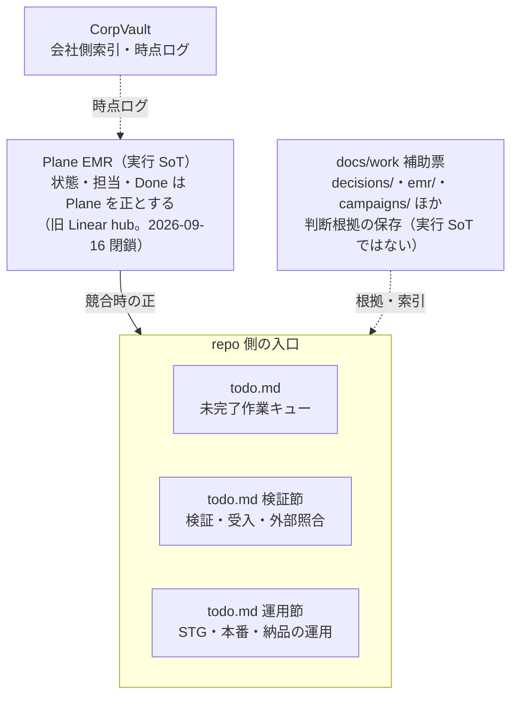

# 作業記録・提案の索引（docs/work）

## 入口

| 文書 | 役割 |
|------|------|
| **Plane** workspace `baritechllc` / Project `EMR`（hub `EMR-1`。旧 Linear `BRT-4` は case_id として継承） | **実行 SoT**（状態・担当・ゲート）。2026-09-29 訂正: Linear は 2026-09-16 に閉鎖済みで履歴参照のみ。旧 `BRT-*` / `LINMIG-*` ID は履歴別名 |
| [todo.md](../../todo.md) | 確認済み製品 FAIL・Slack 出典対応表・維持制約・受入/運用の履歴。未完了タスク状態の正本は Plane（2026-09-23 移行。[receipt](plane/plane-md-migration-20260923-receipt.md)） |
| [todo.md 検証節](../../todo.md#verification-ledger) | 開発検証・測定・受入・外部照合 |
| [todo.md 運用節](../../todo.md#operations-ledger) | STG・本番・納品などの運用・外部実行 |
| CorpVault `50_Projects/ノア動物病院電子カルテ/` | 会社側索引・時点ログ |

**競合・終了ルール:** 状態・担当・Done は Plane `EMR` を正とする（2026-09-29 訂正: 旧記述「Linear を正とする」→ Linear は 2026-09-16 閉鎖済み）。`todo.md` の実行キューには未完了作業だけを保持し、完了行を除く。統合元の完了履歴・維持制約は別節に分離し、現在の受入や release 判定には使わない。STG Lane 4 の終了条件・記録方法は [運用計画](../../todo.md#ops-lane-4) と [受入計画](../../todo.md#ver-todo-v-stg-data) を参照する。[製品 FAIL 節](../../todo.md#product-bugs) は Plane と対応付け、受入未実施や環境 BLOCKED を製品 FAIL に混ぜない。

**本ディレクトリの列挙は日付付きの調査・提案・過去キャンペーンの記録（dated historical / proposal）であり、現在の実行キューではない。** 現在未完了作業は Plane と `todo.md` のキュー節を参照する。

2026-10-13 にカテゴリ別フォルダへ再整理した。`docs-audit/` 配下の日付付き調査パッケージと `.planning/`・`reports/` 内の時点スナップショットは、当時の記録として旧パス表記を残す（参照したい場合は git 履歴か下表の現行パスを辿る）。

### 新規文書の配置ルール

分類軸は 2 系統のハイブリッド（ドメイン別 + 文書種別）。新しい文書は以下の優先順で置き場を決める。迷ったら先に当てはまる方へ入れる。

1. **Plane チケット番号を持つ作業票**（`emr-NNN-*`、チケット単位の設計・検証・証跡）→ `emr/`。内容がセキュリティ・設計系でもチケット番号ルールを優先する（例: `emr/emr-332-security/`）
2. **テーマ横断のドメイン記録** → 対象ドメインのフォルダ（`security/`、`stg/`、`infra/`、`design/`）
3. **採否・見送りの判断** → `decisions/`。**測定・試算・調査分析** → `analysis/`
4. **Issue tracker の移行・対応表・トリアージ記録** → `plane/`
5. **日付付きキャンペーン票の束** → `campaigns/`。**docs 棚卸しパッケージ** → `docs-audit/`
6. 例外: `security/red-blue/` は `red-blue-loop` スキル規約の正規保存先のため `campaigns/` には移さない

ルート直下に新規ファイルを置かない。どれにも当てはまらない場合のみルートに置き、次の整理時にフォルダへ移す。

| 補助 | 役割 |
|------|------|
| **decisions/** | 採択済み方針・見送り判断 |
| [decisions/](./decisions/README.md) | 採択済み方針の短いポインタ |
| [phase2-deferred.md](decisions/phase2-deferred.md) | 今期外の短い索引 |
| [development-task-decisions.md](decisions/development-task-decisions.md) | 旧10開発候補の採否と具体的な着手範囲の根拠。実行キューはtodo.md |
| [skill-reeval-2026-09-06.md](decisions/skill-reeval-2026-09-06.md) | 代表タスクごとの資料選択・停止判断 |
| **analysis/** | 測定・試算ノート |
| [arch-a4-trigger-ledger.md](analysis/arch-a4-trigger-ledger.md) | ARCH-A4 当時の測定・landed slice 台帳（docs/architecture/ から移動。再測定前に古い測定を go/no-go に流用しない） |
| [line-cost-analysis-roi-draft-20261007.md](analysis/line-cost-analysis-roi-draft-20261007.md) | cost-analysis.md から 2026-10-07 移設した作業ノート（配信ボリューム試算シミュレーション・計画中 ROI 指標 draft・料金 worksheet）。試算・draft であり仕様の正本ではない |
| **plane/** | Plane・旧 Linear の移行・対応表 |
| [plane-md-migration-20260923-receipt.md](plane/plane-md-migration-20260923-receipt.md) | 2026-09-23 Markdown→Plane 移行 receipt。旧 ID → `EMR-*` / `MIG-*` の crosswalk 正本 |
| [plane-ready-triage-20260927/](plane/plane-ready-triage-20260927) | 2026-09-27 Plane Needs Human/Blocked 65 件の ready 判定 verdicts（ready=0、verdicts.json あり） |
| [linear-f1-f6-mapping.md](plane/linear-f1-f6-mapping.md) | repo の実装履歴と旧 Linear の対応案（2026-09-11 時点の記録。Linear は閉鎖済みで F1–F6 対応は未特定のまま） |
| **emr/** | Plane `EMR-*` チケットの調査・設計・証跡票 |
| [emr-444-frontend-start-plan-20261020.md](emr/emr-444-frontend-start-plan-20261020.md) | EMR-444 配下フロント寄り票（463/474/475/477/487）の着手プラン・実装進捗・Dots 判断事項。状態正本はPlane |
| [emr-445-plan-handoff-20261020.md](emr/emr-445-plan-handoff-20261020.md) | 全512票点検・非終端229票の入口、必要subset／owner／未実装依存、PR736への文書整合引渡し。状態正本はPlane |
| [emr-89-karte-copy-verification.md](emr/emr-89-karte-copy-verification.md) · [emr-180-note-staff-starttime-rdt-investigation.md](emr/emr-180-note-staff-starttime-rdt-investigation.md) · [emr-200-note2-coverage/](emr/emr-200-note2-coverage) · [emr-211-synthetic-teardown-audit-logs.md](emr/emr-211-synthetic-teardown-audit-logs.md) | 各 Plane チケットの調査・検証記録（証跡票） |
| [emr-105-vaccine-multi-20261002.md](emr/emr-105-vaccine-multi-20261002.md) · [emr-114-reservation-reference-20261002.md](emr/emr-114-reservation-reference-20261002.md) · [emr-116-repro-20261002.md](emr/emr-116-repro-20261002.md) · [emr-131-local-uat-20261002.md](emr/emr-131-local-uat-20261002.md) · [emr-164-verification-20261002.md](emr/emr-164-verification-20261002.md) | emr-*-20261002 証跡・再検証票（EMR-105/114/116/131/164 の 2026-10-02 検証・再現記録。現在の状態は Plane を正とする） |
| [emr-245-list-filter-column-inventory.md](emr/emr-245-list-filter-column-inventory.md) | EMR-245 一覧フィルタと表示列の対応棚卸し（チケット作業メモ。docs/ops/ から移動） |
| [emr-221-import-contract-design/DESIGN.md](emr/emr-221-import-contract-design/DESIGN.md) | EMR-221 八王子取込契約の設計案（レビュー用提案・実装未着手。実行 SoT ではない） |
| [emr-342-medicines-contract-design/DESIGN.md](emr/emr-342-medicines-contract-design/DESIGN.md) | EMR-342 取込契約に薬剤マスタの表を足す設計案（レビュー用提案・実装未着手。実行 SoT ではない） |
| [emr-257-payment-design-20261002.md](emr/emr-257-payment-design-20261002.md) | EMR-257 入院会計の前金・複数入金（預り金充当）の設計提案（実装未着手。実行 SoT ではない） |
| [emr-332-security/index.md](emr/emr-332-security/index.md) | EMR-332 非破壊セキュリティ検証・修復の記録。内容別配置、限定検証と未検証範囲。実行状態の正本はPlane |
| [emr-284-search-fields.md](emr/emr-284-search-fields.md) · [emr-293-deactivation-audit.md](emr/emr-293-deactivation-audit.md) · [emr-319-required-field-audit.md](emr/emr-319-required-field-audit.md) | 各 Plane チケットの調査スナップショット（作成日時点。EMR-293 は 2026-10-08 時点の未解消監査、EMR-319 は 2026-10-09 時点＋PR #614 の各ラウンド記録。現在の状態は Plane を正とする） |
| [emr-reservation-verification-20261008.md](emr/emr-reservation-verification-20261008.md) | EMR-270/274/275/318/321 の実装・検証記録（2026-10-08 時点の日付付き記録。現在の Done・状態の正本は Plane） |
| **security/** | セキュリティ監査・Red/Blue ラウンド |
| [security-triage-2026-10-03.md](security/security-triage-2026-10-03.md) | codex-security 累積 findings のトリアージ記録（2026-10-03）。実行 SoT ではない |
| [security/red-blue/](security/red-blue) | red-blue-loop スキルのラウンド計画・サマリの正規保存先（スキル規約。証跡画像は Plane 添付のみ）。ラウンド1（2026-10-09・TENANT-1・pet/medicalrecord・STG）: 破れ 0・起票 0。ラウンド2（2026-10-09・TENANT-1・reservation/billing/inventory/hospitalization・ローカル Docker）: 破れ 0・起票 0・観察3件 |
| **stg/** | STG 環境の調査・UAT 記録 |
| [stg-uat-clinic-feedback-q1-q4.md](stg/stg-uat-clinic-feedback-q1-q4.md) | STG UAT 医院Q1–Q4の送付用回答と修正タスク。Q1/Q4保険/Q2履歴は STG デプロイ済み（PR #411）。実行 SoT ではない |
| [stg-chat-history-missing-2026-10-05.md](stg/stg-chat-history-missing-2026-10-05.md) | STG チャット履歴未保存事象の調査記録（2026-10-05）。実行 SoT ではない |
| **infra/** | インフラ |
| [infra-cf-rename-task-coverage-review-20261006.md](infra/infra-cf-rename-task-coverage-review-20261006.md) | 2026-10-06 棚卸し実測に対する CF 移管・改名タスクの網羅性レビュー（rereview で更新済み）。実行 SoT ではない |
| [infra-cf-rename-task-coverage-rereview-20261006.md](infra/infra-cf-rename-task-coverage-rereview-20261006.md) | 同上のチケット再構成後の再レビュー。実行 SoT ではない |
| [rename-to-noah-karte.md](infra/rename-to-noah-karte.md) | AnimalEkarte→noah-karte 旧リネーム計画（superseded・実行禁止。docs/ops/infra/ から移設）。現行正本は docs/ops/infra/cloudflare-account-separation.md |
| [reorg-plan.md](infra/reorg-plan.md) | 2026-07 起案のインフラ再編計画の履歴資料（HISTORICAL・実行不可。docs/ops/infra/ から移設） |
| **design/** | デザイン関連の選定・監査資料 |
| [design/frontend-design-review-tools.md](./design/frontend-design-review-tools.md) | フロントエンドのデザイン改善ツール候補を既存規約・React/Vite構成・ブラウザ運用から比較した選定資料（2026-10-13） |
| [design/stg-ui-audit-20261020.md](./design/stg-ui-audit-20261020.md) | STG 79 ルートの目視 + DOM 計測監査（2026-10-20）。重要度 H 13 系統、実装の違反一覧、規定が無かった事項（→ spec/design-patterns.md）。実行 SoT ではなく、修正は Plane で起票する |
| **campaigns/** | 日付付きキャンペーンの準備票・台帳 |
| [linmig-campaign-20260919/](campaigns/linmig-campaign-20260919) | P1–P5/P8・検査機器・実LINE・migrate・件数・フォント・締め時間・bundle のローカル準備票。実行完了ではない |
| [remaining-campaign-20260920/](campaigns/remaining-campaign-20260920) | P6/P7 と Slack 14件（計16票）の判断材料・ケース票。PO裁定と実機/STGは未了 |
| [todo-campaign-20260918/](campaigns/todo-campaign-20260918) | UAT-R2 / Q2・Q4 集計 / 処置移行 / 死亡日 / Linear 照合の準備票 |
| [todo-campaign-20260919-ready17/](campaigns/todo-campaign-20260919-ready17) | Slack READY 13件の設計票 |
| [todo-ledger-20260922/](campaigns/todo-ledger-20260922) | 2026-09-22 台帳の分類表・実行 receipt・訂正ドラフト（DEV-V-OWNER-DB・UAT-Q3-GENDER-MAP・CSV 契約差分・EXCLUSIVE-LOCK） |
| **docs-audit/** | docs 棚卸し・済調査パッケージ（日付付き、内部の旧パス表記は当時の記録のまま） |
| [docs-refresh-20260929/](docs-audit/docs-refresh-20260929) | 日付付き完了調査（docs 全件照合 2026-09-29）の子レポート置き場。2026-10-06 確認: 完了・統合済み（commit `c8dc3a792`）、claim/branch/worktree は削除済み。現在の Status 正本ではない |
| [docs-perfection/README.md](docs-audit/docs-perfection/README.md) | **Astra 調査パッケージ入口**（棚卸し・RQ・子 goal・証拠。2026-09-07 時点の日付付き調査。現在の Status 正本ではない）。製品の実行 SoT は上記 Plane |
| [docs-perfection/REPAIR-QUEUE.md](docs-audit/docs-perfection/REPAIR-QUEUE.md) | 調査時点の優先修復キュー（RQ-001〜） |
| [docs-perfection/ROLE-MAP.md](docs-audit/docs-perfection/ROLE-MAP.md) | docs 保守の Living Docs 役割割当 |

## 削除済み docs（復活防止）

同じ文書を作り直さない。復元は git 履歴。

> 2026-09-29 注記: 下表の「後継」列に残る `Linear` 参照は削除当時の正本。Linear は 2026-09-16 に閉鎖済みで、現在の実行 SoT は Plane `EMR`（hub `EMR-1`）。個別行の改竄はせず、この注記で年代を固定する。

| 削除したもの | 理由 | 後継 |
|---|---|---|
| root `todo-issue.md`・`todo-verification.md`・`todo-operations.md`・`todo-performance.md`（2026-09-26） | ユーザー依頼により todo.md へ統合。別台帳として再作成しない | [todo.md](../../todo.md) の Issue 出典・検証・運用・性能の各節。統合前の原文と行番号参照は Git |
| root `todo-check-auth.md` / `todo-fix-auth.md`（2026-09-15） | 認証の参照用メモと残件の重複管理を解消 | 契約は [認証設計](../architecture/auth.md)、D1・メール・Linear の残件は [統合検証 TODO](../../todo.md#認証認可の外部境界) |
| root `fe-refactor.md`（2026-09-15） | 完了した監査の独立メモ | 維持判断は [裁定記録](decisions/development-task-decisions.md#frontend-監査から引き継ぐ維持判断2026-09-15)、完了履歴は Git |
| root `readiness-report.md`（2026-09-15） | 9月4日時点の環境評価。現在の品質・実行状態の証拠として使わない | 現行規約は [.claude/CLAUDE.md](../../.claude/CLAUDE.md)、検証条件は [agent harness](../ops/agent-harness.md)。当時の評価は Git |
| root `bug.md`・`todo-now.md`・`todo-po.md`・`todo-refactor.md`（2026-09-08） | ユーザー依頼による5台帳の統合。別台帳として再作成しない | [todo.md](../../todo.md) の製品 FAIL・PO・Astra 履歴・FE 履歴。削除前の原文は Git。2026-09-29 訂正: `bug.md` は Plane 移行期に製品欠陥台帳として再作成された後、2026-09-27 の台帳整理で中身を削除され 0 バイトで残存（git `1b4b421bb`）。現在の不具合追跡は Plane `EMR`。旧台帳の再構築は引き続き禁止 |
| `STATUS.md`・`PO-todo.md`・2026-08-20 時点の旧フル `todo.md` / `todo-po.md` | 実行台帳の統合・縮小 | Linear。現在の root 台帳の役割は上記入口を参照 |
| root `phase2.html` / `research-cloudflare.html` / `codex-security-output/` | 作業・調査資料の整理 | 当時の内容は git 履歴。今期外項目は `phase2-deferred.md` |
| root `reports/`（UAT/fable/kanban/walk） | 時点レポート | CorpVault `evidence/2026-08-20-docs-cleanup/` · 新規 UAT は gitignore の `reports/uat-YYYY-MM-DD/`（コミットしない） |
| `docs/work/residual-closeout-ledger.md` | U0–U6 完了ログ | 同 vault `decisions/` · 残ゲートは Linear |
| `docs/work/archives/STATUS-before-2026-08-13-slim.md` | 旧フル台帳 | git 履歴 |
| `docs/ops/infra/_archive/migration-cloudflare.md` | STG 移行の凍結実施記録 | 現行は `docs/ops/infra/architecture.md` · 経緯は git 履歴 |
| `docs/spec/line/01_曽我さん向け_*.md` | クライアント受領原本の二重管理 | 製品正本 `lstep-integration.md` · 原本は vault `client/` |
| `frontend/docs/design-audit-pages.md` | 監査表の複製 | `docs/spec/ui-design-compliance.md` |

**正本:** Plane `EMR`（2026-09-29 訂正: 旧記述「Linear」→ Linear 閉鎖済み）· 製品 docs · 会社側索引は CorpVault

## 置かないもの

- シナリオ md への実行結果書き込み
- 秘密 · 臨床数値の発明
- root への作業台帳フル再構築
- UAT ランナー・スクショ・agent loop の git 追跡

### 予約仕様整理の分離資料

- [予約の旧資料](archive/reservations/README.md)：置換済みの対話・レビュー記録。現行仕様の正本ではない。
- [予約の未承認／設計事項](design/reservations/README.md)：設計・調査・移行・未実施受入と未承認案。
- [確定仕様の入口](../spec/domains/reservations/README.md#approved-reservation-scope)：業務ルール本文をwork/へ複製しない。

## 今後の技術設計との分担

今後の技術設計は[design/](../design/README.md)、確定業務仕様は[spec/](../spec/README.md)、具体的作業・依存関係・進捗はPlane。本workは実施した調査・変更・検証の記録を保持する。既存のdesign・spec-kit等に計画／提案が混在する実態は維持し、今回一括移動しない。予約の新しい技術仕様は[design/domains/reservations](../design/domains/reservations/README.md)を参照し、旧資料を第二正本にしない。
