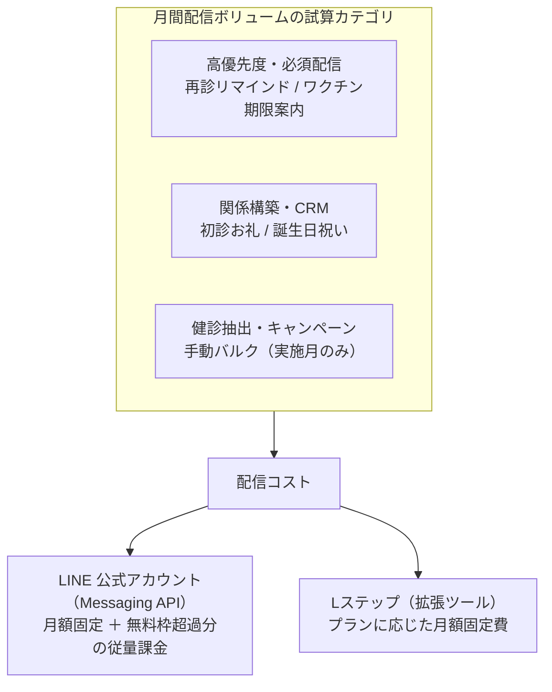

# LINE・Lステップ コスト分析 作業ノート（試算・ROI draft・料金 worksheet）

> **作成**: 2026-10-07（docs 監査）。移設元: [docs/spec/line/cost-analysis.md](../../spec/line/cost-analysis.md)。
> **理由**: 配信ボリューム試算・計画中の ROI 指標 acceptance-criteria draft・料金 worksheet 手順は業務仕様（spec）ではなく作業 material のため、docs/work/ 配下へ分離した。
> **移設元の節**: cost-analysis.md §2（配信ボリュームの予測シミュレーション）、§4 内の「計画中の ROI 指標（未実装）」、§5（料金 worksheet）。本文は移設時点の原文をそのまま保持する。
> **注意**: 本ノートは仕様の正本ではない。課金体系と実装済み効果測定の仕様は cost-analysis.md を参照する。

---

## 移設 1. 配信ボリュームの予測 (シミュレーション)

> 原本の免責（cost-analysis.md 注記 2026-08-01）: 以下の配信ボリューム試算はフル稼働時の想定シミュレーションである。試算値は稼働前提のモデルであり、対象環境の実測ボリュームではない。

一ヶ月あたりの配信件数を以下の 3 つのカテゴリで試算します。

### 2.1 高優先度・必須配信 (再診・予防)
- **再診リマインド**: 月間来院数の約 40% に対して 1 通。
- **ワクチン期限案内**: 全登録患者の約 10% に対して 1 通。
- **試算**: 月間 500〜800 通程度。

### 2.2 関係構築・CRM (自動ステップ)
- **初診お礼**: 月間新規飼主数に対して 1 通。
- **誕生日祝い**: 全登録患者の 1/12 に対して 1 通。
- **試算**: 月間 200〜400 通程度。

### 2.3 健診抽出・キャンペーン (手動バルク)
- **定期健診案内**: `/lstep/checkup-sync` による抽出対象への一括付与。
- **試算**: 実施月のみ 1,000 通以上。

---

## 移設 2. 計画中の ROI 指標（未実装）

- **revenue attribution**: 対象 delivery と 30 日以内の completed accounting を clinic / owner 単位で重複なく結び、売上額と attribution rule を返す。timezone、refund、複数 delivery の帰属 rule を acceptance criteria に含める。
- **dormant return**: dormant trigger 配信時の stage と、その後の qualified visit を記録し、期間・重複排除 rule とともに復帰数を返す。

これらを API、UI、test、計測定義が備わる前に ROI の実装済み指標として扱わない。

---

## 移設 3. 料金 worksheet

外部 provider の plan 名、価格、無料枠、超過単価は repository 外で変更され得るため、本仕様は特定 plan を推奨しない。検討時は LINE / Lステップの公式 pricing URL を運用記録に添付し、**確認日、契約地域、通貨、税区分、登録数、月間配信数、超過単価**を記録して比較する。provider の最新条件を確認せず、この simulation だけで契約を決めない。
